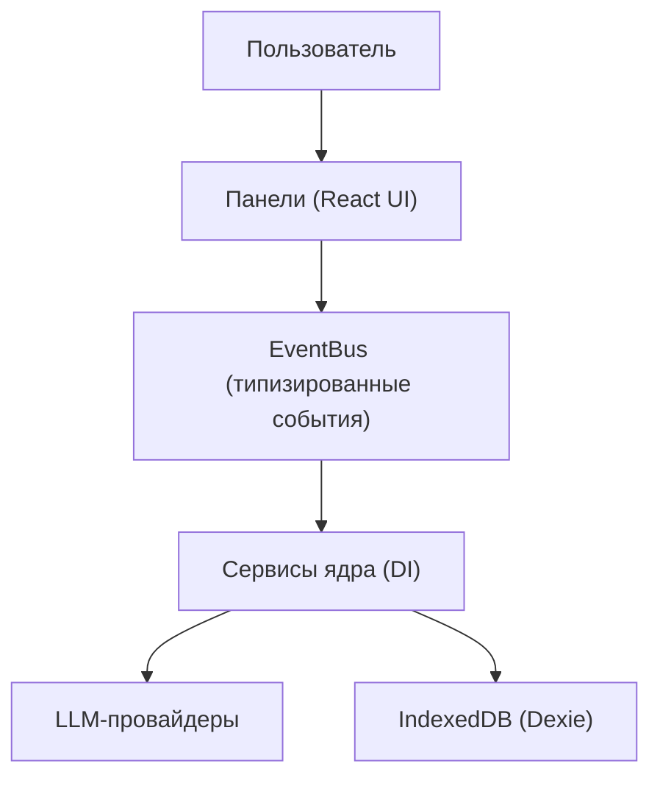

# SuperAgents OS — Wiki

> **Браузерная когнитивная ОС**: локально, приватно, мультиагентно. Дебаты моделей, команды агентов, память и когнитивные конвейеры — в одном приложении, все данные остаются на машине.

**Язык:** **Русский** · [English](./README_EN.md)

[](https://www.typescriptlang.org)
[](https://react.dev)
[](https://vitejs.dev)
[](https://dexie.org)
[](LICENSE)

---

## Что это

SuperAgents OS — событийная платформа для оркестрации распределённого интеллекта. Небо́льшой чат, а операционная система: несколько LLM-провайдеров, роли агентов, память, инструменты и диагностика собраны в одном браузерном окружении. Сервера нет — всё работает локально, данные хранятся в IndexedDB.



**Ключевые принципы:**

- **Local-first** — ключи и данные в IndexedDB, ничего не уходит в облако системы.
- **Event-driven** — всё общение через типизированный EventBus, панели и сервисы развязаны.
- **Мультистратегийная маршрутизация** — UCB1-бандит, broadcast, race, cost-optimized и др.
- **Плагинные провайдеры** — Gemini, OpenRouter, Groq, NVIDIA, OpenAI-совместимые, кастомные.

---

## Карта вики

Полная документация — в [docs/wiki](./docs/wiki/README.md). Это тот же материал, что и в панели «Wiki» приложения, но читается прямо на GitHub. Кроме markdown-зеркала вика собирается в статический **сайт с меню и поиском** — он публикуется на GitHub Pages под `/wiki/` (`npm run gen:wiki-site` собирает сайт локально).

### Основное

| Материал | О чём |
| --- | --- |
| [Что такое SuperAgents OS](./docs/wiki/what-is.md) | Философия, отличия от чат-бота |
| [Возможности ОС](./docs/wiki/capabilities.md) | Обзор функций |
| [Как пользоваться панелями](./docs/wiki/panels-guide.md) | Навигация и типовой сценарий |
| [Архитектура](./docs/wiki/architecture.md) | Слои, паттерны, поток данных |
| [След исполнения](./docs/wiki/execution-trail.md) | Наблюдаемость шагов агентов |

### Домены

| Материал | О чём |
| --- | --- |
| [Дебаты](./docs/wiki/debates.md) | Форматы, стратегии, метрики качества |
| [Агенты](./docs/wiki/agents.md) | Роли, персоны, топологии, консорциумы |
| [Память](./docs/wiki/memory.md) | BM25 + семантика, RAG дебатов |
| [Провайдеры](./docs/wiki/providers.md) | Ключи, роутер, health, бюджеты |
| [Диагностика](./docs/wiki/diagnostics.md) | Логи, трейсы, здоровье, аудиты |

### Панели

Гайд по каждой панели — `panel-*` в [индексе вики](./docs/wiki/README.md#панели): [Чат](./docs/wiki/panel-chat.md), [Провайдеры](./docs/wiki/panel-providers.md), [Задачи](./docs/wiki/panel-tasks.md), [Наблюдаемость](./docs/wiki/panel-observability.md), [SRE](./docs/wiki/panel-sre.md), [Governance](./docs/wiki/panel-governance.md) и ещё ~200.

### История разработки

Хронология аудита и починок по зонам — [zone-1](./docs/wiki/zone-1.md) … [zone-26](./docs/wiki/zone-26.md).

### Разработчикам

| Руководство | О чём |
| --- | --- |
| [Обзор](./docs/wiki/dev-overview.md) | С чего начать в коде |
| [Структура](./docs/wiki/dev-layout.md) | Где что лежит |
| [Boot и DI](./docs/wiki/dev-boot.md) | Контейнер, фазы инициализации |
| [События](./docs/wiki/dev-events.md) | EventBus и реестр событий |
| [Сервисы](./docs/wiki/dev-services.md) | lazyService и баррели |
| [Компоненты](./docs/wiki/dev-components.md) | Анатомия панели |
| [Маршруты](./docs/wiki/dev-routing.md) | Как добавить панель |
| [Сторы](./docs/wiki/dev-stores.md) | Состояние и хуки |
| [i18n](./docs/wiki/dev-i18n.md) | Локализация en/ru |
| [Тесты](./docs/wiki/dev-testing.md) | Vitest, что гонять |
| [CI](./docs/wiki/dev-ci.md) | Гейты пайплайна |
| [Генераторы](./docs/wiki/dev-generators.md) | Авто-каталоги |
| [Конвенции](./docs/wiki/dev-conventions.md) | Правила кода |
| [Глоссарий](./docs/wiki/dev-glossary.md) | Термины |
| [Рецепты](./docs/wiki/dev-cookbook.md) | Частые задачи |

**Авто-каталоги (из кода):** [компоненты](./docs/wiki/dev-component-catalog.md), [события](./docs/wiki/dev-event-catalog.md), [контракты](./docs/wiki/dev-contracts.md), [карта зависимостей ядра](./docs/wiki/dev-service-map.md), [сторы](./docs/wiki/dev-store-catalog.md), [локали](./docs/wiki/dev-i18n-catalog.md), [скрипты](./docs/wiki/dev-scripts.md), [тесты](./docs/wiki/dev-tests-catalog.md).

> Зеркало вики генерируется скриптом `npm run gen:wiki-docs`; CI проверяет, что оно не устарело.

---

## Быстрый старт

**Требуется:** Node.js ≥ 22, npm ≥ 9, современный браузер.

```bash
git clone https://github.com/egilyad/ai-os-new
cd ai-os-new
npm install

# dev-сервер + прокси + typecheck вместе
npm run dev:shared
```

Либо по отдельности: `npm run dev` и (во втором терминале) `npm run proxy`. Открой `http://localhost:5173`.

**Первые шаги:**

1. Добавь ключ провайдера — **Провайдеры → Установленные → Добавить ключ** (начни с OpenRouter).
2. Проверь соединение — health-check проходит автоматически, дождись зелёного статуса.
3. Открой **Чат** и отправь сообщение.
4. Заведи агентов — в **Ролях**, затем зарегистрируй способности.
5. Построй конвейер в **Конструкторе** и разверни его.

---

## Возможности

- **Провайдеры** — ключи в IndexedDB, стриминг, health-check, обнаружение моделей; цепочка декораторов: логирование → кэш → cost → очередь → circuit breaker → retry → rate-limit → адаптер.
- **Чат и исполнение** — стриминг, режимы single / broadcast / race, сравнение провайдеров side-by-side, маршрутизация UCB1, память в промпте.
- **Агенты** — персоны, топологии, задачи, роли и консорциумы.
- **Память** — гибридный поиск BM25 + семантика (Transformers.js), RAG дебатов с сохранением чанков между перезагрузками.
- **Конструктор** — визуальные когнитивные пайплайны (React Flow) с деплоем.
- **Дебаты** — 3 позиции, 33 встроенные стратегии, 75 техник качества, метрики, живой поиск, проверки повторов, human-in-the-loop.
- **След исполнения** — журнал шагов «команда супервайзеров».
- **Телеметрия** — дашборд, трейсы, health, анимация роя, аналитика.
- **Диагностика** — трейсы, timeline, аудиты, time machine, config history.

Подробности по каждой области — в соответствующих разделах вики выше.

> **Безопасность:** API-ключи сейчас хранятся в браузерном хранилище **в открытом виде** — их может прочитать любой код в этом профиле. Считай инструмент однопользовательским и одномашинным (как ключи в `.env`) и **не используй на общих машинах**.

---

## Технологии

| Категория | Технология |
| --- | --- |
| Язык | TypeScript 6.x |
| UI | React 19.x |
| Сборка | Vite 8.x |
| База | Dexie.js (IndexedDB) |
| Состояние | React hooks + типизированный EventBus |
| Workflows | React Flow (@xyflow/react 12.x) |
| Поиск | Orama (BM25) + Transformers.js |
| Воркеры | Web Workers (memory, sandbox) |
| Валидация | Zod 4.x |
| Диаграммы | Mermaid 12.x |
| Тесты | Vitest + React Testing Library |

---

## Структура проекта

```
src/
├── kernel/          # ядро: DI, контракты, сервисы, события, состояние
│   ├── contracts/   #   123 интерфейса
│   ├── services/    #   299 файлов в 18 подпапках
│   ├── events/      #   реестр событий (198 схем)
│   ├── container.ts #   DI-контейнер
│   ├── bootstrap.ts #   фазная инициализация
│   └── instances.ts #   lazyService-синглтоны
├── components/      # панели UI по секциям навигации
├── llm/             # адаптеры провайдеров + декораторы
├── stores/          # состояние UI (Zustand-подобное)
├── i18n/            # локализация (en, ru)
└── routes.tsx       # маршруты по секциям

docs/wiki/           # markdown-зеркало вики (этот портал)
```

Детальнее — [dev-layout](./docs/wiki/dev-layout.md) и [каталог компонентов](./docs/wiki/dev-component-catalog.md).

---

## Скрипты

| Скрипт | Назначение |
| --- | --- |
| `npm run dev` | dev-сервер (HMR) |
| `npm run dev:shared` | Vite + прокси + typecheck |
| `npm run build` | typecheck + продакшн-сборка |
| `npm run preview` | предпросмотр сборки |
| `npm run test` | все тесты (Vitest) |
| `npm run test:stable` | стабильный набор (stores, hooks, kernel, llm, tools) |
| `npm run test:e2e` | e2e (Playwright) |
| `npm run lint` | ESLint |
| `npm run typecheck` | TypeScript без emit |
| `npm run gen:wiki-docs` | пересобрать markdown-зеркало вики |
| `npm run proxy` | CORS-прокси для инструментов |

Полный список — в [английском README](./README_EN.md#scripts).

---

## Документация

| Документ | О чём |
| --- | --- |
| [Вики (RU)](./docs/wiki/README.md) | Вся система: панели, домены, диагностика, история, руководства |
| [System Manifest](./docs/SYSTEM_MANIFEST.md) | Принципы архитектуры |
| [Полный реестр (RU)](./docs/ПОЛНЫЙ_РЕЕСТР.md) | Паспорт системы |
| [Каталог сервисов (RU)](./docs/SERVICES_RU.md) | DI-сервисы |
| [Event Reference](./docs/events.md) | Типизированные события |

---

## Как читать вики

- **На GitHub** — открой [docs/wiki/README.md](./docs/wiki/README.md); каждая статья это отдельный markdown-файл с диаграммами (mermaid рендерится GitHub).
- **На сайте** — статическая вика на GitHub Pages (под `/wiki/`): меню разделов, поиск по всем статьям, mermaid. Собирается из этого же зеркала: `npm run gen:wiki-site`.
- **В приложении** — панель **Wiki**: поиск (BM25), карта ОС, покрытие документации, авто-каталоги и новости.

---

## Contributing

1. Форк и ветка (`git checkout -b feat/your-feature`).
2. Следуй стилю и паттернам кода, добавляй тесты.
3. `npx tsc -b --noEmit` без ошибок, `npm run lint` чисто.
4. Открой Pull Request.

---

## Лицензия

MIT © 2026 Antigravity
