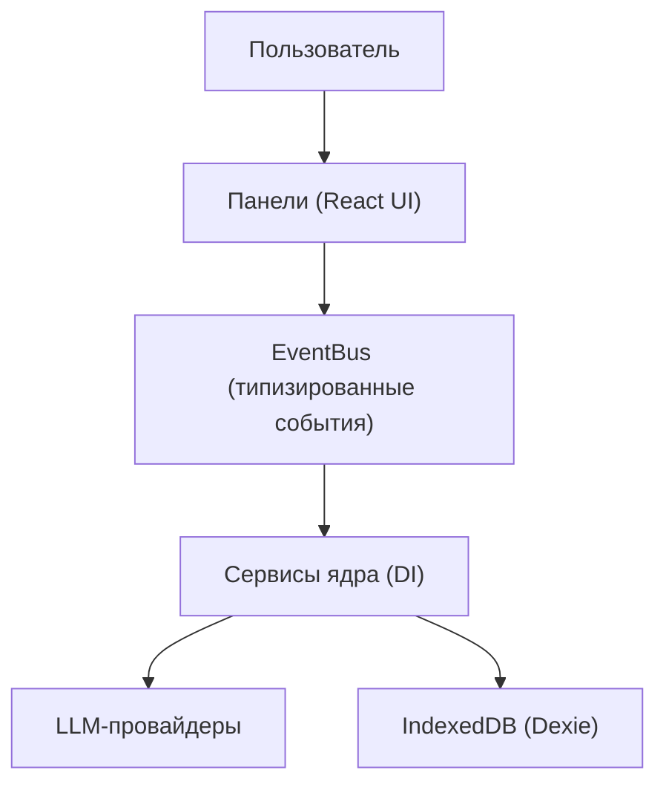

# SuperAgents OS — Wiki

> **Браузерная когнитивная ОС**: локально, приватно, мультиагентно. Дебаты моделей, команды агентов, память и когнитивные конвейеры — в одном приложении, все данные остаются на машине.

**Язык:** **Русский** · [English](./README_EN.md)

[](https://www.typescriptlang.org)
[](https://react.dev)
[](https://vitejs.dev)
[](https://dexie.org)
[](LICENSE)

---

## Что это

SuperAgents OS — событийная платформа для оркестрации распределённого интеллекта. Небо́льшой чат, а операционная система: несколько LLM-провайдеров, роли агентов, память, инструменты и диагностика собраны в одном браузерном окружении. Сервера нет — всё работает локально, данные хранятся в IndexedDB.



**Ключевые принципы:**

- **Local-first** — ключи и данные в IndexedDB, ничего не уходит в облако системы.
- **Event-driven** — всё общение через типизированный EventBus, панели и сервисы развязаны.
- **Мультистратегийная маршрутизация** — UCB1-бандит, broadcast, race, cost-optimized и др.
- **Плагинные провайдеры** — Gemini, OpenRouter, Groq, NVIDIA, OpenAI-совместимые, кастомные.

---

## Карта вики

Полная документация — в [docs/wiki](./docs/wiki/README.md). Это тот же материал, что и в панели «Wiki» приложения, но читается прямо на GitHub. Кроме markdown-зеркала вика собирается в статический **сайт с меню и поиском** — он публикуется на GitHub Pages под `/wiki/` (`npm run gen:wiki-site` собирает сайт локально).

### Основное

| Материал | О чём |
| --- | --- |
| [Что такое SuperAgents OS](./docs/wiki/what-is.md) | Философия, отличия от чат-бота |
| [Возможности ОС](./docs/wiki/capabilities.md) | Обзор функций |
| [Как пользоваться панелями](./docs/wiki/panels-guide.md) | Навигация и типовой сценарий |
| [Архитектура](./docs/wiki/architecture.md) | Слои, паттерны, поток данных |
| [След исполнения](./docs/wiki/execution-trail.md) | Наблюдаемость шагов агентов |

### Домены

| Материал | О чём |
| --- | --- |
| [Дебаты](./docs/wiki/debates.md) | Форматы, стратегии, метрики качества |
| [Агенты](./docs/wiki/agents.md) | Роли, персоны, топологии, консорциумы |
| [Память](./docs/wiki/memory.md) | BM25 + семантика, RAG дебатов |
| [Провайдеры](./docs/wiki/providers.md) | Ключи, роутер, health, бюджеты |
| [Диагностика](./docs/wiki/diagnostics.md) | Логи, трейсы, здоровье, аудиты |

### Компоненты и сервисы

Глубокие статьи о подсистемах (назначение, реализация, связи, проверка) — раздел «Компоненты и сервисы» в [индексе вики](./docs/wiki/README.md#компоненты-и-сервисы): [обзор](./docs/wiki/comp-overview.md), [ядро](./docs/wiki/comp-kernel-boot.md), [DI](./docs/wiki/comp-di-container.md), [шина событий](./docs/wiki/comp-event-bus.md), [транзакции](./docs/wiki/comp-transactions.md), [конфигурация](./docs/wiki/comp-config.md), [персистентность](./docs/wiki/comp-persistence.md), [шифрование](./docs/wiki/comp-security-crypto.md), [ключи](./docs/wiki/comp-key-management.md), [роутинг](./docs/wiki/comp-routing.md), [бюджет](./docs/wiki/comp-budget-pricing.md), [агенты и роли](./docs/wiki/comp-agents-roles-skills.md), [инструменты и MCP](./docs/wiki/comp-tools-mcp.md), [политики](./docs/wiki/comp-policy-security.md), [консистентность](./docs/wiki/comp-consistency.md), [дебаты](./docs/wiki/comp-debate-runtime.md), [когнитивные и топологии](./docs/wiki/comp-cognitive-orchestration.md), [память](./docs/wiki/comp-memory.md), [чат](./docs/wiki/comp-chat.md), [наблюдаемость](./docs/wiki/comp-observability.md), [советник](./docs/wiki/comp-advisor-runtime-intelligence.md), [event sourcing](./docs/wiki/comp-event-sourcing.md), [тайм-тревел](./docs/wiki/comp-time-travel.md), [задачи и расписание](./docs/wiki/comp-task-planning.md), [флот и governance](./docs/wiki/comp-fleet-governance.md), [интеграции](./docs/wiki/comp-integrations-interop.md), [рантайм провайдеров](./docs/wiki/comp-provider-runtime.md), [LLM-мост](./docs/wiki/comp-llm-bridge.md), [слой состояния](./docs/wiki/comp-state-stores.md), [сквозные сценарии](./docs/wiki/comp-scenarios.md), [экипажи и совет](./docs/wiki/comp-crews-councils.md), [фронтир и разнообразие](./docs/wiki/comp-frontier-diversity.md), [лаборатория вариантов](./docs/wiki/comp-rivals-lab.md), [знания и RAG](./docs/wiki/comp-knowledge-rag.md), [оценка и Эло](./docs/wiki/comp-eval-elo.md), [персоны и строитель](./docs/wiki/comp-persona-builder.md), [вызовы и мета-агент](./docs/wiki/comp-invocation-meta.md), [симуляция](./docs/wiki/comp-simulation-world.md), [синтез и форум](./docs/wiki/comp-synthesis-forum.md), [хранилище и таймлайн](./docs/wiki/comp-storage-timeline.md), [инструменты и способности](./docs/wiki/comp-tool-capability.md), [графы и мост событий](./docs/wiki/comp-graph-eventbridge.md), [аргументация](./docs/wiki/comp-debateplus.md), [LLM-конвейер](./docs/wiki/comp-llm-pipeline.md), [адаптеры LLM](./docs/wiki/comp-llm-adapters.md), [секреты и блокировки](./docs/wiki/comp-secrets-locks.md), [мессенджеры и интеграции](./docs/wiki/comp-messaging-integrations.md).

### Панели

Гайд по каждой панели — `panel-*` в [индексе вики](./docs/wiki/README.md#панели): [Чат](./docs/wiki/panel-chat.md), [Провайдеры](./docs/wiki/panel-providers.md), [Задачи](./docs/wiki/panel-tasks.md), [Наблюдаемость](./docs/wiki/panel-observability.md), [SRE](./docs/wiki/panel-sre.md), [Governance](./docs/wiki/panel-governance.md) и ещё ~200.

### История разработки

Хронология аудита и починок по зонам — [zone-1](./docs/wiki/zone-1.md) … [zone-26](./docs/wiki/zone-26.md).

### Разработчикам

| Руководство | О чём |
| --- | --- |
| [Обзор](./docs/wiki/dev-overview.md) | С чего начать в коде |
| [Структура](./docs/wiki/dev-layout.md) | Где что лежит |
| [Boot и DI](./docs/wiki/dev-boot.md) | Контейнер, фазы инициализации |
| [События](./docs/wiki/dev-events.md) | EventBus и реестр событий |
| [Сервисы](./docs/wiki/dev-services.md) | lazyService и баррели |
| [Компоненты](./docs/wiki/dev-components.md) | Анатомия панели |
| [Маршруты](./docs/wiki/dev-routing.md) | Как добавить панель |
| [Сторы](./docs/wiki/dev-stores.md) | Состояние и хуки |
| [i18n](./docs/wiki/dev-i18n.md) | Локализация en/ru |
| [Тесты](./docs/wiki/dev-testing.md) | Vitest, что гонять |
| [CI](./docs/wiki/dev-ci.md) | Гейты пайплайна |
| [Генераторы](./docs/wiki/dev-generators.md) | Авто-каталоги |
| [Конвенции](./docs/wiki/dev-conventions.md) | Правила кода |
| [Глоссарий](./docs/wiki/dev-glossary.md) | Термины |
| [Рецепты](./docs/wiki/dev-cookbook.md) | Частые задачи |

**Авто-каталоги (из кода):** [панели: раздел → маршрут → компонент → статья](./docs/wiki/panels-catalog.md), [компоненты](./docs/wiki/dev-component-catalog.md), [события](./docs/wiki/dev-event-catalog.md), [контракты](./docs/wiki/dev-contracts.md), [карта зависимостей ядра](./docs/wiki/dev-service-map.md), [сторы](./docs/wiki/dev-store-catalog.md), [локали](./docs/wiki/dev-i18n-catalog.md), [скрипты](./docs/wiki/dev-scripts.md), [тесты](./docs/wiki/dev-tests-catalog.md), [здоровье документации](./docs/wiki/docs-health.md), [инвентаризация документации](./docs/wiki/docs-inventory.md), [стандарт документации](./docs/wiki/docs-standard.md), [карта документации](./docs/wiki/docs-index.md), [карта системы](./docs/wiki/dev-system-map.md), [история разработки](./docs/wiki/dev-history.md), [возможности и сценарии](./docs/wiki/scenarios.md), [граф знаний](./docs/wiki/dev-graph.md), [проверки и показатели](./docs/wiki/dev-checks.md).

> Зеркало вики генерируется скриптом `npm run gen:wiki-docs`; CI проверяет, что оно не устарело.

---

## Быстрый старт

**Требуется:** Node.js ≥ 22, npm ≥ 9, современный браузер.

```bash
git clone https://github.com/egilyad/ai-os-new
cd ai-os-new
npm install

# dev-сервер + прокси + typecheck вместе
npm run dev:shared
```

Либо по отдельности: `npm run dev` и (во втором терминале) `npm run proxy`. Открой `http://localhost:5173`.

**Первые шаги:**

1. Добавь ключ провайдера — **Провайдеры → Установленные → Добавить ключ** (начни с OpenRouter).
2. Проверь соединение — health-check проходит автоматически, дождись зелёного статуса.
3. Открой **Чат** и отправь сообщение.
4. Заведи агентов — в **Ролях**, затем зарегистрируй способности.
5. Построй конвейер в **Конструкторе** и разверни его.

---

## Возможности

- **Провайдеры** — ключи в IndexedDB, стриминг, health-check, обнаружение моделей; цепочка декораторов: логирование → кэш → cost → очередь → circuit breaker → retry → rate-limit → адаптер.
- **Чат и исполнение** — стриминг, режимы single / broadcast / race, сравнение провайдеров side-by-side, маршрутизация UCB1, память в промпте.
- **Агенты** — персоны, топологии, задачи, роли и консорциумы.
- **Память** — гибридный поиск BM25 + семантика (Transformers.js), RAG дебатов с сохранением чанков между перезагрузками.
- **Конструктор** — визуальные когнитивные пайплайны (React Flow) с деплоем.
- **Дебаты** — 3 позиции, 33 встроенные стратегии, 75 техник качества, метрики, живой поиск, проверки повторов, human-in-the-loop.
- **След исполнения** — журнал шагов «команда супервайзеров».
- **Телеметрия** — дашборд, трейсы, health, анимация роя, аналитика.
- **Диагностика** — трейсы, timeline, аудиты, time machine, config history.

Подробности по каждой области — в соответствующих разделах вики выше.

> **Безопасность:** API-ключи сейчас хранятся в браузерном хранилище **в открытом виде** — их может прочитать любой код в этом профиле. Считай инструмент однопользовательским и одномашинным (как ключи в `.env`) и **не используй на общих машинах**.

---

## Технологии

| Категория | Технология |
| --- | --- |
| Язык | TypeScript 6.x |
| UI | React 19.x |
| Сборка | Vite 8.x |
| База | Dexie.js (IndexedDB) |
| Состояние | React hooks + типизированный EventBus |
| Workflows | React Flow (@xyflow/react 12.x) |
| Поиск | Orama (BM25) + Transformers.js |
| Воркеры | Web Workers (memory, sandbox) |
| Валидация | Zod 4.x |
| Диаграммы | Mermaid 12.x |
| Тесты | Vitest + React Testing Library |

---

## Структура проекта

```
src/
├── kernel/          # ядро: DI, контракты, сервисы, события, состояние
│   ├── contracts/   #   123 интерфейса
│   ├── services/    #   299 файлов в 18 подпапках
│   ├── events/      #   реестр событий (198 схем)
│   ├── container.ts #   DI-контейнер
│   ├── bootstrap.ts #   фазная инициализация
│   └── instances.ts #   lazyService-синглтоны
├── components/      # панели UI по секциям навигации
├── llm/             # адаптеры провайдеров + декораторы
├── stores/          # состояние UI (Zustand-подобное)
├── i18n/            # локализация (en, ru)
└── routes.tsx       # маршруты по секциям

docs/wiki/           # markdown-зеркало вики (этот портал)
```

Детальнее — [dev-layout](./docs/wiki/dev-layout.md) и [каталог компонентов](./docs/wiki/dev-component-catalog.md).

---

## Скрипты

| Скрипт | Назначение |
| --- | --- |
| `npm run dev` | dev-сервер (HMR) |
| `npm run dev:shared` | Vite + прокси + typecheck |
| `npm run build` | typecheck + продакшн-сборка |
| `npm run preview` | предпросмотр сборки |
| `npm run test` | все тесты (Vitest) |
| `npm run test:stable` | стабильный набор (stores, hooks, kernel, llm, tools) |
| `npm run test:e2e` | e2e (Playwright) |
| `npm run lint` | ESLint |
| `npm run typecheck` | TypeScript без emit |
| `npm run gen:wiki-docs` | пересобрать markdown-зеркало вики |
| `npm run gen:wiki-manifest` | пересобрать машиночитаемый индекс (docs/manifest.json) |
| `npm run gen:wiki-connections` | пересобрать связи «панель → маршрут → компонент → тесты» |
| `npm run gen:wiki-panel-catalog` | пересобрать каталог панелей |
| `npm run gen:wiki-site` | собрать статический сайт вики (для GitHub Pages) |
| `npm run gen:readme-maps` | пересобрать таблицы README из кода |
| `npm run docs:health` | проверка здоровья документации (ссылки, источники, полнота) |
| `npm run proxy` | CORS-прокси для инструментов |

Полный список — в [английском README](./README_EN.md#scripts).

---

## Документация

| Документ | О чём |
| --- | --- |
| [Вики (RU)](./docs/wiki/README.md) | Вся система: панели, домены, диагностика, история, руководства |
| [manifest.json](./docs/manifest.json) | Машиночитаемый индекс: разделы, статьи (источники, тесты, связи), панели (маршрут, компонент, статья) |
| [graph.json](./docs/graph.json) | Граф знаний: узлы (статьи, панели, код, тесты) и рёбра (связи, источники, тесты, панель→статья) |
| [inventory.json](./docs/inventory.json) | Инвентарь всех документов `docs/**` (категория, язык, размер, hash) |
| [entity-model.json](./docs/entity-model.json) | Стандарт документации: карточка сущности, статусы, источники истины, языки |
| [System Manifest](./docs/SYSTEM_MANIFEST.md) | Принципы архитектуры |
| [Полный реестр (RU)](./docs/ПОЛНЫЙ_РЕЕСТР.md) | Паспорт системы |
| [Каталог сервисов (RU)](./docs/SERVICES_RU.md) | DI-сервисы |
| [Event Reference](./docs/events.md) | Типизированные события |

---

## Сгенерированные таблицы (из кода)

> Блоки ниже собираются из исходников скриптом `npm run gen:readme-maps` — не редактировать вручную.

<!-- README-MAPS-RU:STRATEGIES:BEGIN -->
_Сгенерировано из кода 2026-10-17, скрипт `npm run gen:readme-maps` — не редактировать вручную, перезапускать скрипт._

<details>
<summary><b>Все 33 встроенных стратегий дебатов (из кода)</b></summary>

| Стратегия | ID | Что делает |
| -------- | -- | ----------- |
| **Round Robin** | `builtin.round_robin` | Classic sequential round-robin where each agent speaks once per round |
| **Socratic Method** | `builtin.socratic` | Question-driven inquiry that probes assumptions through iterative questioning |
| **Argument Tree** | `builtin.argument_tree` | Tree-structured argumentation with challenges and refinements |
| **Constrained Debate** | `builtin.constrained` | Debate with specific constraints on argument structure and evidence requirements |
| **Moderated Debate** | `builtin.moderated` | Debate with a neutral moderator controlling flow and enforcing rules |
| **Free-for-All** | `builtin.free_for_all` | Multiple agents debate simultaneously without turn ordering |
| **Jury Trial** | `builtin.jury_trial` | Adversarial format with prosecution, defense, witnesses, and jury |
| **Brainstorming** | `builtin.brainstorming` | Free-form idea generation without critique, followed by clustering |
| **Delphi Method** | `builtin.delphi` | Iterative anonymous consensus-building with controlled feedback |
| **Debate-athon** | `builtin.debate_athon` | Extended marathon format with multiple rounds, breaks, and endurance scoring |
| **Meta-Debate** | `builtin.meta_debate` | Debate about the debate itself — rules, framing, methodology |
| **Post-Mortem / Autopsy** | `builtin.autopsy` | Retrospective analysis of a past event, decision, or failure |
| **Simulated Negotiation** | `builtin.simulated_negotiation` | Role-play negotiation between parties with competing interests |
| **Premortem** | `builtin.premortem` | Assume a project has failed and work backwards to identify what went wrong |
| **Red Teaming** | `builtin.red_teaming` | Adversarial testing where one team attacks and another defends |
| **Rhetorical Triangle** | `builtin.rhetorical_triangle` | Analyze arguments through ethos, pathos, and logos lenses |
| **Evidence-Based Policy Debate** | `builtin.evidence_based_policy` | Policy debate requiring cited evidence for each claim |
| **Principle-Based Negotiation** | `builtin.principle_based_negotiation` | Harvard-style principled negotiation focusing on interests not positions |
| **Uncertainty Quantification** | `builtin.uncertainty_quantification` | Systematically identify and quantify uncertainties in arguments |
| **Multi-Criteria Decision Analysis** | `builtin.multi_criteria` | Evaluate options against multiple weighted criteria |
| **Stakeholder Mapping** | `builtin.stakeholder_mapping` | Identify and analyze stakeholders, their interests, and influence |
| **Cross-Examination** | `builtin.cross_examination` | Intense back-and-forth questioning between two parties |
| **Trial by Argument** | `builtin.trial` | Full trial format with opening, evidence, witnesses, closing, and verdict |
| **Parliamentary Debate** | `builtin.parliamentary` | Formal debate with government and opposition teams following parliamentary procedure |
| **Oxford Union Debate** | `builtin.oxford_union` | Traditional Oxford Union format with proposition, opposition, and floor votes |
| **Lincoln-Douglas Debate** | `builtin.lincoln_douglas` | Values-based one-on-one debate with structured case construction |
| **Spontaneous Argumentation** | `builtin.spontaneous_argumentation` | Impromptu arguments with minimal preparation, testing quick thinking |
| **Asynchronous Marathon** | `builtin.asynchronous_marathon` | Extended multi-day debate where agents respond at their own pace |
| **Flash Debate** | `builtin.flash_debate` | Ultra-fast debate with very short response times and limited characters |
| **Collaborative Consensus** | `builtin.collaborative_consensus` | Non-adversarial format focused on finding common ground and shared understanding |
| **Scenario Testing** | `builtin.scenario_testing` | Test assumptions by exploring multiple hypothetical scenarios |
| **Hypothesis Testing** | `builtin.hypothesis_testing` | Scientific method approach: hypothesis, test, evidence evaluation, conclusion |
| **Contest Mode** | `builtin.contest_mode` | Competitive format with judges scoring each round, winner declared at end |

</details>
<!-- README-MAPS-RU:STRATEGIES:END -->

<!-- README-MAPS-RU:TECHNIQUES:BEGIN -->
_Сгенерировано из кода 2026-10-17, скрипт `npm run gen:readme-maps` — не редактировать вручную, перезапускать скрипт._

<details>
<summary><b>Все 75 техник качества дебатов (из кода)</b></summary>

**P0** (18)

- **Cross-Examination** (`cross-examination`) — Directly question opponent claims, demand missing evidence
- **Delta-Focusing** (`delta-focusing`) — Highlight only points of disagreement, skip consensus
- **Shadow Opponent** (`shadow-opponent`) — Anticipate and pre-rebut unspoken counter-arguments
- **Adversarial Source** (`adversarial-source`) — Verify factual claims against source URLs, flag fabrications
- **Vulnerability Targeting** (`vulnerability-targeting`) — Identify and attack weakest claims in opponent argument graph
- **Agreement Anchoring** (`agreement-anchoring`) — Start from shared premises, then reveal logical inconsistencies
- **Belief Mining** (`belief-mining`) — Detect contradictions between stated positions and earlier claims
- **Graph Minimax** (`graph-minimax`) — Plan argument moves several steps ahead using argument graph
- **Meta-Agent** (`meta-agent`) — Tactical directives: when to attack, defend, pivot, or concede
- **Steelman** (`steelman`) — Strengthen opponent position before refuting — steelman fallacies
- **Burden of Proof** (`burden-of-proof`) — Track which claims remain unsupported; demand evidence
- **Entanglement** (`entanglement`) — Force opponent to defend two incompatible positions simultaneously
- **Consistency Check** (`consistency-check`) — Detect self-contradictions across rounds
- **Credibility Scoring** (`credibility-scoring`) — Track source reliability of each participant
- **Causal Loop Mapping** (`causal-graph`) — Force systems thinking: detect feedback loops and second-order effects
- **Objection Anticipation Slot** (`objection-anticipation`) — Dedicate a thinking slot to pre-rebut unspoken counter-arguments
- **Evidence Triangulation Requirement** (`evidence-triangulation`) — Require cross-referencing claims against multiple independent sources
- **Executable Evidence** (`executable-evidence`) — Write executable code (Python/JS) to numerically verify factual claims

**P1** (33)

- **Pre-Publish Critic** (`pre-publish-critic`) — Internal critic evaluates argument before release
- **Fact-Checking** (`fact-checking`) — Verify factual claims in real-time against knowledge base
- **Epistemic Calibration** (`epistemic-calibration`) — Enforce confidence calibration: penalize over/under-confidence
- **Socratic Pivot** (`socratic-pivot`) — Switch from arguing to questioning when opponent is inconsistent
- **Concession Engine** (`concession-engine`) — Monitor concession opportunities based on argument strength shift
- **Bayesian Judges** (`bayesian-judges`) — Reward acknowledging uncertainty and limitations
- **Stance Drift** (`stance-drift`) — Detect when agent silently changes position across rounds
- **Persona Mixer** (`persona-mixer`) — Blend multiple persona archetypes for richer argumentation
- **DPO Sampler** (`dpo-sampler`) — Sample argument styles from high-win-rate past debates
- **Self-Critic** (`critic`) — Pre-validate own argument before submission
- **Pivot Strategy** (`pivot`) — Change argument direction when current approach is failing
- **Strategic Concession** (`concession`) — Concede minor points to gain credibility on major ones
- **Counterfactual Analysis** (`counterfactual`) — Explore "what if" scenarios to test opponent logic
- **Synthesis Engine** (`synthesis`) — Combine best arguments from both sides into coherent whole
- **Triangulation** (`triangulation`) — Cross-reference claims against multiple independent sources
- **Empathy Mirroring** (`empathy`) — Acknowledge opponent perspective before refuting
- **Heat Detection** (`heat`) — Detect emotional escalation, adjust tone accordingly
- **Argument Sentinel** (`sentinel`) — Monitor for abandoned claims and re-introduce them
- **Redundancy Detector** (`redundancy`) — Penalize repeating same evidence or reasoning
- **Insight Bus** (`insight-bus`) — Broadcast cross-argument patterns to all agents
- **Replay Selector** (`replay`) — Re-engage with strongest unresolved points from earlier rounds
- **Enthymeme Attack** (`enthymeme`) — Target hidden premises in opponent arguments
- **Multi-Hop Reasoning** (`multi-hop`) — Require multi-step justification for complex claims
- **Bias Exploitation** (`bias-exploit`) — Identify and exploit opponent cognitive biases
- **Clarification Interrupt** (`interrupt`) — Send targeted clarification requests to ambiguous claims
- **Stakeholder Mapper** (`stakeholder`) — Map which groups are affected by each position
- **Frame Tracker** (`frame`) — Track how each side frames the issue, reframe strategically
- **Expert Witness** (`expert-witness`) — Cite relevant domain experts and their credibility scores
- **Hegelian Dialectical Synthesis** (`hegelian-synthesis`) — Push agents to synthesize thesis + antithesis into coherent resolution
- **Uncertainty Propagation** (`uncertainty-propagation`) — Explicitly propagate confidence levels through multi-step reasoning chains
- **Hidden Incentives Mining** (`hidden-incentives`) — Generate 3 reasoning branches, synthesize strongest into public argument
- **Semantic Concept Blending** (`semantic-blending`) — When deadlocked, invent new frameworks combining opposing concepts
- **Outcome Forecaster** (`outcome-forecaster`) — 

**P2** (24)

- **Rhetorical Device** (`rhetorical-device`) — Inject rhetorical devices (anaphora, tricolon, chiasmus)
- **Hidden Scratchpad** (`scratchpad`) — Internal deliberation before public response
- **Narrative Arc** (`narrative-arc`) — Structure arguments as story arcs (hero journey, mystery, etc.)
- **Abstraction Ladder** (`abstraction-ladder`) — Switch between concrete evidence and abstract principles
- **Role-Reversal** (`role-reversal`) — Occasionally argue from opponent perspective
- **Fog of War** (`fog-of-war`) — Limit information available to each agent
- **Evidence Revelation** (`evidence-revelation`) — Stage evidence release by round
- **Humor Injection** (`humor`) — Inject wit, irony, or analogy where appropriate
- **Status Dynamics** (`status-dynamics`) — Assign social status levels that affect persuasiveness
- **Style Matching** (`style-matching`) — Mirror opponent communication style
- **Dynamic Persona** (`dynamic-persona`) — Topic-matched persona variant selection
- **Strategist** (`strategist`) — Adaptive strategic directives (flank, fortify, probe, etc.)
- **Whisper Channels** (`whisper-channels`) — Private coordination signals between allied agents
- **Audience Sentiment** (`audience`) — Simulate audience reactions to each argument
- **Dynamic Alliance** (`alliance`) — Form and leverage coalitions between agents
- **Prediction Market** (`prediction-market`) — Agents predict debate trajectory, reputation on the line
- **Theory of Mind** (`rtom`) — Model other agents beliefs about the debate state
- **Strategy Fingerprinting** (`strategy-fingerprint`) — Detect and counter opponent debate strategies
- **Rhetoric Safety Layer** (`rhetoric-safety`) — Monitor for ad hominem, inflammatory language, and rhetorical manipulation
- **Blind Evaluation** (`blind-evaluation`) — Judge arguments without knowing which agent made them
- **Bidding for Speaking Time** (`bidding-time`) — Agents bid for speaking time — concise, high-impact arguments win the floor
- **Adaptive Speaking Order** (`adaptive-order`) — Shuffle speaking order dynamically based on argument patterns
- **Judge Deliberation** (`judge-deliberation`) — 
- **Best-of-N Selection** (`best-of-n`) — 

</details>
<!-- README-MAPS-RU:TECHNIQUES:END -->

<!-- README-MAPS-RU:PANELS:BEGIN -->
_Сгенерировано из кода 2026-10-17, скрипт `npm run gen:readme-maps` — не редактировать вручную, перезапускать скрипт._

<details>
<summary><b>Все 259 панелей по разделам (из кода)</b></summary>

**Панель** (`dashboard`, 22)

- Обзор (`dashboard`)
- провайдеры (`keys`)
- знания (`knowledge`)
- проводник Project OS (`project-os`)
- Когнитивные линзы (`lenses`)
- Хранилище кристаллов (`crystals`)
- Движок связей (`junctions`)
- Движок синтеза (`synthesis`)
- Генератор знаний (`knowledge-generator`)
- Форум агентов (`forum`)
- Конструктор (`builder`)
- Директор разговоров (`director`)
- Комнаты агентов (`room`)
- Проекты (`projects`)
- Каналы (`channels`)
- Групповой чат (`group-chat`)
- Планировщик (`scheduler`)
- Планировщик (`planner`)
- Автономия (`autonomy`)
- Диада (`dyad`)
- SOP (`sop`)
- Очередь запусков (`run-queue`)

**Бюджет AI** (`budget`, 7)

- аналитика (`analytics`)
- экономика (`pricing`)
- Бюджет (`budget`)
- Аналитика стоимости (`cost-analytics`)
- Оптимизация стоимости (`cost-optimization`)
- Оповещения о бюджете (`budget-alerts`)
- Траты компании (`costs`)

**Чат** (`chat`, 4)

- Чат (`chat`)
- Сессии чата (`chat-sessions`)
- Хаб сессий (`session-hub`)
- закладки (`bookmarks`)

**Дебаты** (`debates`, 17)

- Арена дебатов (`debate`)
- Живые дебаты (`debate-live`)
- Комнаты дебатов (`debate-workspace`)
- Повтор дебатов (`debate-replay`)
- турнир (`debate-tournament`)
- аудитория (`audience`)
- Аргумент Граф (`argument-graph`)
- Стратегия Конструктор (`strategy-builder`)
- Анализ дебатов (`debate-analysis`)
- Дебаты История (`debate-history`)
- Менеджер дебатов (`debates-manager`)
- темы (`topics`)
- Шаблоны дебатов (`debate-templates`)
- Качество дебатов (`debate-quality`)
- Влияние техник (`quality-impact`)
- Эксперименты (`experimental`)
- Черновик (`scratchpad`)

**Стратегия и анализ** (`debate-strategy`, 4)

- Прогноз исхода (`outcome-forecaster`)
- Минимакс (`minimax-planner`)
- Сходство (`similarity`)
- Детектор дрейфа (`drift-detector`)

**Техники** (`techniques`, 84)

- Стальной аргумент (`steelman`)
- Байесовский судья (`bayesian-judge`)
- Слепая оценка (`blind-eval`)
- Достоверность (`credibility`)
- Калибровка (`calibration`)
- Согласованность (`consistency`)
- Трекер фреймов (`frame-tracker`)
- Дрейф позиции (`stance-drift`)
- Шина инсайтов (`insight-bus`)
- Запутывание (`entanglement`)
- Якорение (`anchoring`)
- Смешение концептов (`concept-blender`)
- Добыча убеждений (`belief-mining`)
- Эксперт-свидетель (`expert-witness`)
- Риторика (`rhetoric`)
- Профайлер искажений (`bias-profiler`)
- Детектор выгод (`incentive-detector`)
- Стейкхолдеры (`stakeholder`)
- Миксер персон (`persona-mixer`)
- Трекер бремени (`bop-tracker`)
- Граф мыслей (`got-deliberation`)
- Теневой оппонент (`shadow-opponent`)
- Враждебный источник (`adversarial-source`)
- Атака уязвимостей (`vuln-targeting`)
- Обоснование (`justification`)
- Логическая форма (`logical-form`)
- Cross Examination (`cross-examination`)
- Delta Focusing (`delta-focusing`)
- Vulnerability Targeting (`vulnerability-targeting`)
- Agreement Anchoring (`agreement-anchoring`)
- Graph Minimax (`graph-minimax`)
- Burden Of Proof (`burden-of-proof`)
- Consistency Check (`consistency-check`)
- Credibility Scoring (`credibility-scoring`)
- Causal Graph (`causal-graph`)
- Pre Publish Critic (`pre-publish-critic`)
- Fact Checking (`fact-checking`)
- Epistemic Calibration (`epistemic-calibration`)
- Socratic Pivot (`socratic-pivot`)
- Concession Engine (`concession-engine`)
- Bayesian Judges (`bayesian-judges`)
- Dpo Sampler (`dpo-sampler`)
- Critic (`critic`)
- Pivot (`pivot`)
- Concession (`concession`)
- Triangulation (`triangulation`)
- Empathy (`empathy`)
- Heat (`heat`)
- Sentinel (`sentinel`)
- Redundancy (`redundancy`)
- Replay (`replay`)
- Enthymeme (`enthymeme`)
- Multi Hop (`multi-hop`)
- Bias Exploit (`bias-exploit`)
- Interrupt (`interrupt`)
- Frame (`frame`)
- Rhetorical Device (`rhetorical-device`)
- Narrative Arc (`narrative-arc`)
- Abstraction Ladder (`abstraction-ladder`)
- Role Reversal (`role-reversal`)
- Fog Of War (`fog-of-war`)
- Evidence Revelation (`evidence-revelation`)
- Humor (`humor`)
- Status Dynamics (`status-dynamics`)
- Style Matching (`style-matching`)
- Dynamic Persona (`dynamic-persona`)
- Strategist (`strategist`)
- Whisper Channels (`whisper-channels`)
- Alliance (`alliance`)
- Prediction Market (`prediction-market`)
- Rtom (`rtom`)
- Strategy Fingerprint (`strategy-fingerprint`)
- Objection Anticipation (`objection-anticipation`)
- Evidence Triangulation (`evidence-triangulation`)
- Hegelian Synthesis (`hegelian-synthesis`)
- Uncertainty Propagation (`uncertainty-propagation`)
- Rhetoric Safety (`rhetoric-safety`)
- Blind Evaluation (`blind-evaluation`)
- Bidding Time (`bidding-time`)
- Adaptive Order (`adaptive-order`)
- Executable Evidence (`executable-evidence`)
- Hidden Incentives (`hidden-incentives`)
- Semantic Blending (`semantic-blending`)
- Judge Deliberation (`judge-deliberation`)

**Агенты** (`agents`, 15)

- агенты (`agents`)
- роли (`roles`)
- роли: консорциумы (`roles-consortia`)
- SRE-агент (`sre`)
- Журнал агента (`agent-journal`)
- Контроль миссии (`mission`)
- живое рабочее пространство (`live`)
- Маркетплейс агентов (`agent-marketplace`)
- Сравнение агентов (`agent-comparison`)
- Протокол агента (`agent-protocol`)
- маркетплейс персон (`persona-marketplace`)
- выбор персоны (`persona-picker`)
- навыки (`skills`)
- таблица лидеров (`leaderboard`)
- Мета-агент (`meta-agent`)

**Диагностика** (`diagnostics`, 20)

- Лог Браузер (`logs`)
- трейсы (`debugger`)
- Маршрутизатор Трассировка (`router-trace`)
- Память (`memory`)
- Здоровье (`health`)
- Система Здоровье (`system-health`)
- Документы Здоровье (`docs-health`)
- Карта давления (`pressure`)
- Карта давления рантайма (`runtime-pressure`)
- что если (`what-if`)
- Граф зависимостей (`dependency-map`)
- диагностика (`diagnostics`)
- инспектор состояния (`state-inspector`)
- профилировщик производительности (`performance-profiler`)
- тень (`shadow`)
- каузальный отладчик (`causal-debugger`)
- контрфактический (`counterfactual`)
- сканер пробелов наблюдаемости (`obs-gaps`)
- Здоровье SLA (`health-sla`)
- Пользовательский Метрики (`custom-metrics`)

**Вики** (`wiki`, 1)

- Вики (`wiki`)

**Флот** (`fleet`, 12)

- Консоль флота (`fleet`)
- Флот — Команды (`fleet-crews`)
- Флот — Советы (`fleet-councils`)
- Флот — Графы (`fleet-graphs`)
- Флот — Персона (`fleet-persona`)
- Флот — Интероп (`fleet-interop`)
- Флот — Рубеж (`fleet-frontier`)
- Компании (`companies`)
- Задачи (`issues`)
- Запуски heartbeat (`runs`)
- Задачи агента (`agent-tasks`)
- Граф происхождения (`provenance`)

**Google AI** (`google`, 4)

- Google Studio (`google-studio`)
- Google Кэш (`google-cache`)
- Gemini Live (`gemini-live`)
- исследование Gemini (`research-gemini`)

**Исследования** (`research`, 7)

- Исследовательский движок (`research-engine`)
- Исследование дебатов (`debate-system-research`)
- исследовательские отчёты (`research-reports`)
- Расширенное исследование (`research-advanced`)
- Генератор гипотез (`hypothesis-gen`)
- Лаборатория rivals (`rival-labs`)
- Проекты Rivals (`rivals-catalog`)

**Интеграции** (`integrations`, 1)

- воркфлоу (`workflows`)

**Рандомс** (`randoms`, 2)

- руководства (`tutorials`)
- Общий доступ к шаблону (`template-sharing`)

**AI провайдеры и ключи** (`ai-providers`, 13)

- Пулы ключей (`pools`)
- группы (`groups`)
- Ключевые заметки (`key-notes`)
- ротации (`rotations`)
- Привязки сессии (`session-bindings`)
- Умная маршрутизация (`smart-routing`)
- Маршрутизация Ии (`routing`)
- Провайдер Панель (`provider-dashboard`)
- Маркетплейс провайдеров (`provider-marketplace`)
- Аналитика использования ключей (`key-usage-analytics`)
- Скорость Groq (`groq-speed`)
- Nvidia Enterprise (`nvidia-enterprise`)
- OpenRouter ◈ (`openrouter`)

**Системные сервисы** (`system`, 11)

- инструменты (`tools`)
- коннекторы (`connectors`)
- MCP-серверы (`mcp`)
- Сервис Реестр (`service-registry`)
- шаблоны топологии (`topology-templates`)
- Кэш (`cache`)
- Вебхуки (`webhooks`)
- Плагин Сдк (`plugin-sdk`)
- стражи (`guardians`)
- Адаптеры агентов (`adapters`)
- Переносимость (`portability`)

**Безопасность и правила** (`security`, 11)

- Настройки (`settings`)
- политики (`policies`)
- Редактор политик (`policy-editor`)
- Аудит Лог (`audit`)
- Конфиг История (`history`)
- Экспорт Импорт (`export-import`)
- машина времени (`time-machine`)
- Управление / RBAC (`governance`)
- Ограничения (`guardrails`)
- проверка безопасности (`security`)
- Одобрения (`approvals`)

**Системная память** (`memory`, 3)

- Дворец памяти (`memory-palace`)
- Федеративная память (`federated-memory`)
- Память Экспорт Импорт (`memory-export-import`)

**Лаборатория** (`lab`, 8)

- наборы данных для оценки (`eval-datasets`)
- Эксперименты маршрутизации моделей (`routing-experiments`)
- песочница (`playground`)
- A/B-тестирование (`ab-testing`)
- Ревью архитектуры (`arch-review`)
- Аудит стратегии промпта (`prompt-audit`)
- Лаборатория симуляций (`simulation`)
- Стресс-тест управления (`gov-stress-test`)

**Остальное** (`other`, 13)

- редакторы (`editors`)
- промпты (`prompts`)
- История версий промпта (`prompt-versions`)
- пакетная обработка (`batch`)
- командная работа (`team-collaboration`)
- сообщество (`community-hub`)
- Дистилляция моделей (`model-distillation`)
- Деплой (`deploy`)
- Голосовой ввод (`voice-input`)
- аквариум (`aquarium`)
- Граф вклада (`contribution-graph`)
- задачи (`tasks`)
- файлы (`files`)

> Имена/описания стратегий и техник берутся из кода (без перевода);
> панели подписаны русскими локалями `nav.*`.
</details>
<!-- README-MAPS-RU:PANELS:END -->

---

## Как читать вики

- **На GitHub** — открой [docs/wiki/README.md](./docs/wiki/README.md); каждая статья это отдельный markdown-файл с диаграммами (mermaid рендерится GitHub).
- **На сайте** — статическая вика на GitHub Pages (под `/wiki/`): меню разделов, поиск по всем статьям, mermaid. Собирается из этого же зеркала: `npm run gen:wiki-site`.
- **Для агентов** — [docs/manifest.json](./docs/manifest.json): стабильные ID, типы, статусы, источники, тесты и связи. Копия доступна на сайте: `/wiki/manifest.json`.
- **В приложении** — панель **Wiki**: поиск (BM25), карта ОС, покрытие документации, авто-каталоги и новости.

---

## Contributing

1. Форк и ветка (`git checkout -b feat/your-feature`).
2. Следуй стилю и паттернам кода, добавляй тесты.
3. `npx tsc -b --noEmit` без ошибок, `npm run lint` чисто.
4. Открой Pull Request.

---

## Лицензия

MIT © 2026 Antigravity
