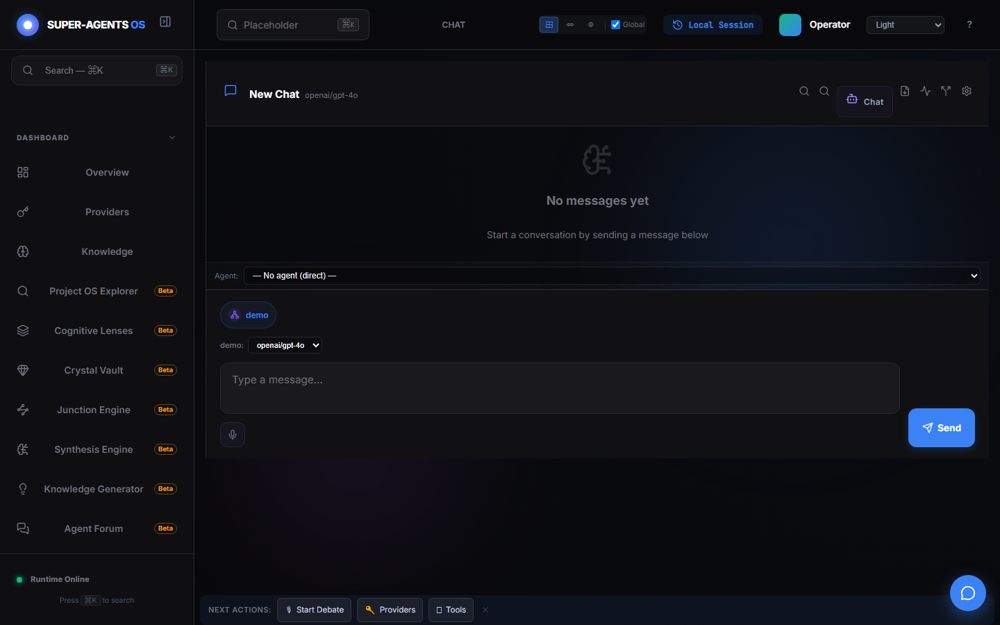

# Демонстрация: Чат с ИИ

- Маршрут: `/chat`
- Версия приложения: 4.5.0
- Скриншот снят Playwright (`npm run gen:demos`) на чистом профиле с одним ключом.

## Что показано

- Основной диалог с выбранной моделью (`openai/gpt-4o`), заголовок `New Chat`.
- Выбор агента (`— No agent (direct) —`) и активный ключ `demo`.
- Кнопка `Send` активируется только когда ключ выбран и определена модель —
  это защита от отправки «в никуда».
- Экран пустой истории: честное «No messages yet», без заглушек.

## Как повторить

1. Добавьте ключ провайдера (см. [провайдеры](./providers.md)).
2. Откройте `/chat`, выберите агента при необходимости.
3. Введите сообщение и нажмите `Send` (ответ приходит потоком токенов).

## Связанные материалы

- Панель: <https://egilyad.github.io/ai-os-new/wiki/panel-chat.html>
- Обзор возможностей: <https://egilyad.github.io/ai-os-new/wiki/capabilities.html>
