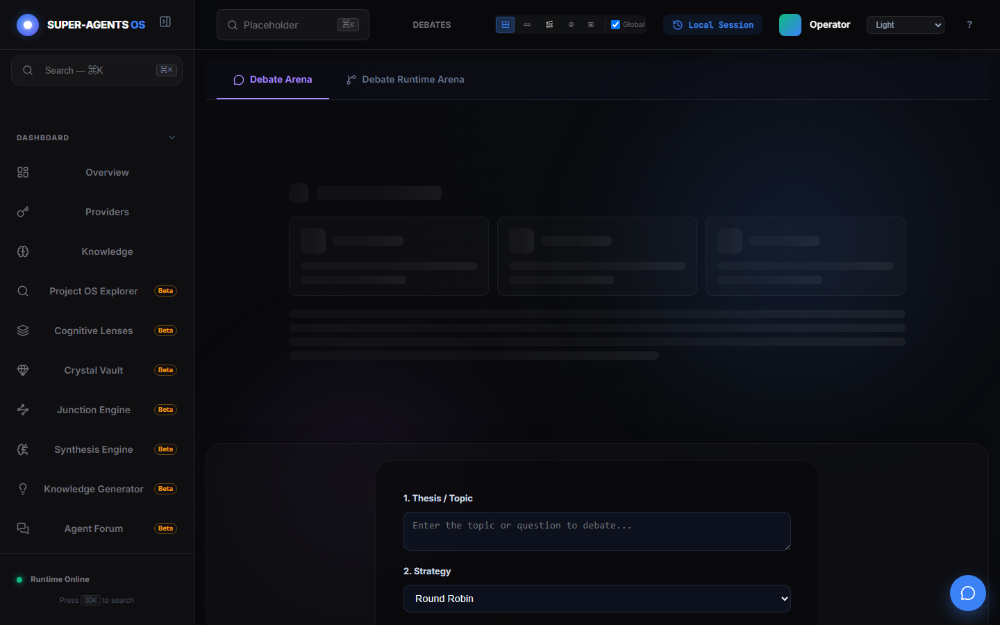

# Демонстрация: Дебаты агентов

- Маршрут: `/debate`
- Версия приложения: 4.5.0
- Скриншот снят Playwright на чистом профиле.

## Что показано

- Вкладки `Debate Arena` и `Debate Runtime Arena` — постановка дебата и его живой прогон.
- Форма запуска: `1. Thesis / Topic` (тема спора) и `2. Strategy` (в снимке — `Round Robin`).
- Область арены на момент снимка показывает загрузку (скелет-плейсхолдеры): сессий
  ещё нет, потому что профиль пустой. Это честное состояние, а не макет.

## Как повторить

1. Добавьте ключ провайдера (см. [провайдеры](./providers.md)).
2. Откройте `/debate`, задайте тему и стратегию, запустите.
3. Следите за раундами в `Debate Arena`; историю смотрите на `/debate-history`.

## Связанные материалы

- Обзор дебатов: <https://egilyad.github.io/ai-os-new/wiki/debates.html>
- Зона контента: <https://egilyad.github.io/ai-os-new/wiki/zone-14.html>
