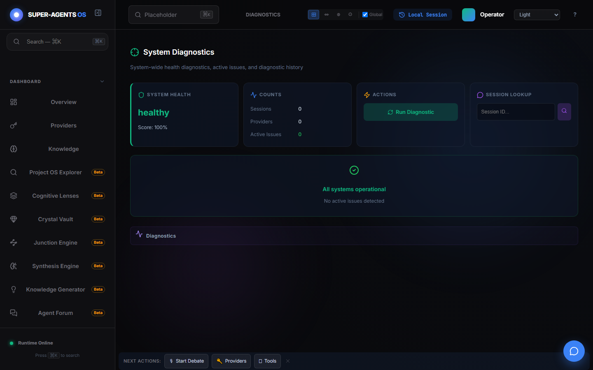

# Демонстрация: Диагностика

- Маршрут: `/diagnostics`
- Версия приложения: 4.5.0
- Скриншот снят Playwright на чистом профиле.

## Что показано

- Блок `System Diagnostics` с картой `SYSTEM HEALTH`: `healthy`, `Score: 100%`.
- Счётчики `COUNTS`: сессии, провайдеры, активные проблемы (в снимке — 0).
- Действие `Run Diagnostic` и `SESSION LOOKUP` по ID сессии.
- Панель подтверждает `All systems operational` без выдуманных инцидентов.

## Как повторить

1. Откройте `/diagnostics`, нажмите `Run Diagnostic`.
2. При проблемах проверьте `Counts` и `Session Lookup` по конкретной сессии.
3. Дополните картину логами и трейсами в наблюдаемости.

## Связанные материалы

- Диагностика: <https://egilyad.github.io/ai-os-new/wiki/diagnostics.html>
- Наблюдаемость: <https://egilyad.github.io/ai-os-new/wiki/panel-observability.html>
