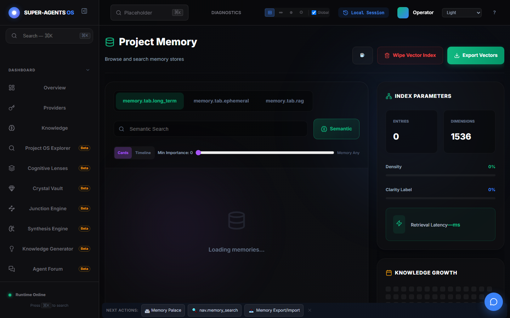

# Демонстрация: Память

- Маршрут: `/memory`
- Версия приложения: 4.5.0
- Скриншот снят Playwright на чистом профиле (память пустая).

## Что показано

- Три хранилища: `memory.tab.long_term`, `memory.tab.ephemeral`, `memory.tab.rag`.
- Семантический поиск и переключение `Cards` / `Timeline`, порог важности.
- Параметры индекса: `ENTRIES 0`, `DIMENSIONS 1536`, плотность и ясность 0 % —
  честные нули, пока память не наполнена.
- Блок `KNOWLEDGE GROWTH` и кнопки `Wipe Vector Index` / `Export Vectors`.

## Как повторить

1. Откройте `/memory`, добавьте запись или включите авто-сохранение в настройках.
2. Выполните семантический поиск — векторный индекс наполнится, показатели оживут.
3. Экспортируйте векторы для резервной копии.

## Связанные материалы

- Память и знания: <https://egilyad.github.io/ai-os-new/wiki/memory.html>
- База знаний (RAG): <https://egilyad.github.io/ai-os-new/wiki/panel-knowledge.html>
