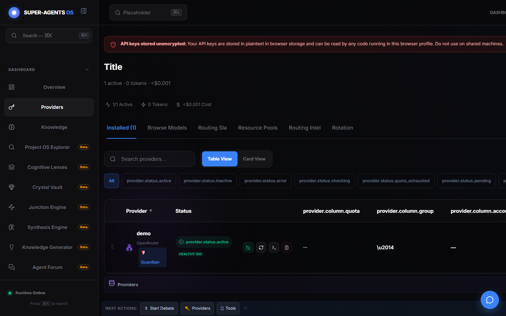

# Демонстрация: Провайдеры и ключи

- Маршрут: `/keys`
- Версия приложения: 4.5.0
- Скриншот снят Playwright на профиле с одним тестовым ключом.

## Что показано

- Вкладка `Installed (1)`: ключ `demo` для провайдера `OpenRouter` со статусом
  `provider.status.active` и health `HEALTHY 100`.
- Красный баннер «API keys stored unencrypted…» — предупреждение о локальном
  хранении ключей (local-first дизайн, см. ниже).
- Табличный и карточный вид, фильтры по статусу, поиск по провайдерам.
- Вкладки `Browse Models`, `Routing Sla`, `Resource Pools`, `Routing Intel`, `Rotation`.

## Важно о безопасности

Ключи лежат в IndexedDB **открытым текстом** — это осознанный local-first выбор
для одной машины. Не используйте на общих компьютерах.

## Как повторить

1. Откройте `/keys` → `Installed` → добавьте ключ провайдера.
2. Дождитесь зелёного health-статуса.
3. Проверьте работу в [чате](./chat.md).

## Связанные материалы

- Провайдеры: <https://egilyad.github.io/ai-os-new/wiki/providers.html>
- Панель ключей: <https://egilyad.github.io/ai-os-new/wiki/panel-providers.html>
