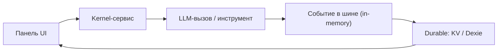

<!-- АВТОСГЕНЕРАЦИЯ: файл создан scripts/gen-wiki-docs.mjs из корпуса Wiki (src/components/WikiPanel). Не редактировать вручную. -->

# Архитектура и связи

> Раздел: **Архитектура** · Статус: documented · Теги: слои, шина, DI

Источники: `README_EN.md`

## Слои

UI (React-панели, только сервисы+контракты) → Kernel (SystemKernel, шина, DI-контейнер, ~50 фаз регистрации) → Infrastructure (LLM-адаптеры, воркеры, Dexie).

## Главная цепочка действия

Панель → сервис → (LLM-вызов / инструмент) → событие в шине → durable-запись (KV/Dexie) → панель читает состояние. Шина событий — lossy и in-memory: менеджер и UI обязаны гидрироваться из Dexie, а не из событий.

## Связи подсистем

Дебаты читают память и RAG, пишут timeline и снапшоты; задачи пишут раны и журнал; апрувы гейтят computer-use; кристаллы и кросс-индекс пишутся по вердикту (чтения в промпт пока нет).

---

## Связанные материалы

- [Знания и память](./memory.md)
- [След исполнения: журнал, раны, зомби](./execution-trail.md)
- [Разработчикам: структура и ворота](./for-developers.md)
- [Диагностика и известные проблемы](./diagnostics.md)

[← Все материалы](./README.md)
