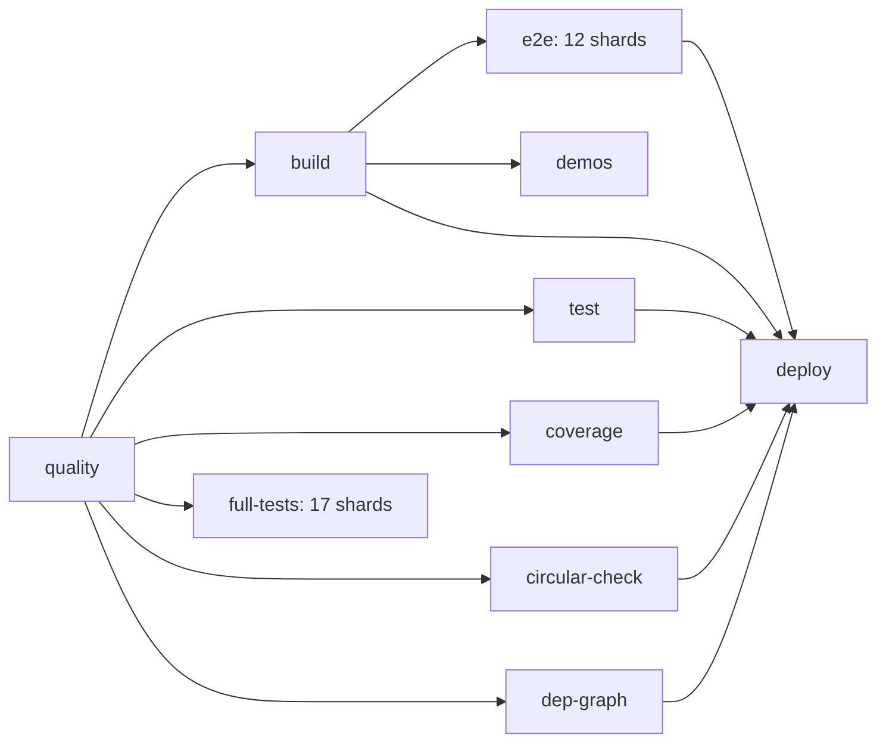

<!-- АВТОСГЕНЕРАЦИЯ: файл создан scripts/gen-wiki-docs.mjs из корпуса Wiki (src/components/WikiPanel). Не редактировать вручную. -->

# CI/CD Architecture

> Раздел: **Разработчикам** · Статус: verified · Теги: ci, github actions, workflow

Источники: `.github/workflows/ci.yml`

## Workflow: один файл `.github/workflows/ci.yml`

### Джобы и зависимости

| Джоба | needs | Что делает |
| --- | --- | --- |
| **quality** | — | TypeScript type-check, ESLint (порог warnings 4300), синхронизация вики, документация |
| **build** | quality | `npm run build` + проверка размера бандла, upload артефакта `dist` |
| **test** | quality | Стабильный набор юнит-тестов (`npm run test:stable`) |
| **coverage** | quality | Покрытие v8 с порогами (statements/branches/functions/lines) |
| **full-tests** | quality | Полная матрица: 17 срезов unit-тестов (threads-пул, heap 8192) |
| **e2e** | quality, build | 12 шардов Playwright; каждая джоба сама собирает dist (base "/") и ставит chromium с ретраями |
| **demos** | build | Демо-скриншоты (screenshots/visual-regression), upload PNG |
| **security-audit** | — | `npm audit` + проверка секретов |
| **circular-check** | quality | Проверка циклических зависимостей |
| **dep-graph** | quality | Проверка графа зависимостей |
| **deploy** | quality, build, test, coverage, security-audit, circular-check, dep-graph, e2e | Deploy GitHub Pages (только main/master) |

### Ключевые решения

- **17 срезов unit** — чтобы каждая джоба укладывалась в память раннера (heap 8192,
  пул `threads`, максимум 2 треда на группу).
- **E2E собирает dist сама** — исключает зависимость от артефакта; `VITE_BASE_PATH=/`
  обязательно, иначе ассеты по `/ai-os-new/` 404 и SPA пуст.
- **Install Playwright с ретраями** — против транзиентных DNS/apt-сбоев раннеров.
- **Gates**: `deploy` ждёт все проверки; E2E не блокируют деплой? — блокируют: deploy needs e2e.

---

## Связанные материалы

- [Полный перечень проверок CI](./ci-checks-full.md)
- [Архитектура тестирования](./testing-architecture.md)

[← Все материалы](./README.md)
