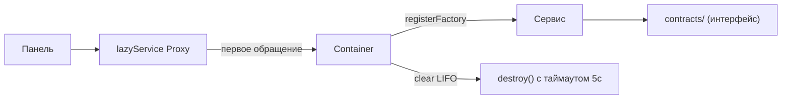

<!-- АВТОСГЕНЕРАЦИЯ: файл создан scripts/gen-wiki-docs.mjs из корпуса Wiki (src/components/WikiPanel). Не редактировать вручную. -->

# Компонент: DI-контейнер и lazyService

> Раздел: **Компоненты и сервисы** · Статус: verified · Теги: компоненты, DI, container, сервисы

Источники: `src/kernel/container.ts`, `src/kernel/container.test.ts`, `src/kernel/service-helper.ts`

## Назначение

Контейнер — единственный способ получить сервис: он владеет жизненным циклом, разрешает зависимости и защищает от циклов. `lazyService` — фасад для панелей: даёт «сервис», который подключается к контейнеру только при первом обращении.

## Возможности

- `register` — готовый singleton; `registerFactory` — ленивый singleton; `registerTransient` — новый инстанс на каждый `get`.
- `override` — подмена реализации для тестов (только для factory/transient id).
- `getOptional`, `has`, `getDependencies`, `getServices`.
- Детект циклических зависимостей; кэш провалов фабрик; LIFO-destroy с таймаутом.

## Реализация

- `Container` (`src/kernel/container.ts`), `defaultContainer` — синглтон.
- Защита от циклов: при `get(id)` во время резолва другого сервиса → `Circular dependency detected`.
- Кэш провалов: `FACTORY_FAILURE_TTL = 5000` мс — падающая фабрика не дёргается на каждом обращении.
- `clear()`: destroy в обратном порядке регистрации, `DESTROY_TIMEOUT_MS = 5000` на каждый; ошибки логируются, не бросаются.
- **Нюанс:** `registerTransient` не попадает в `registrationOrder`, поэтому transient-инстансы не уничтожаются `clear()`.
- `lazyService<T>(name, fallbacks?)` (`src/kernel/service-helper.ts`): Proxy, резолвит `defaultContainer.getOptional(name)` при первом обращении к свойству, кеширует инстанс, биндит методы. Негативный кэш `NOT_FOUND_TTL = 1000` мс. Свойства `then`/`toJSON`/символы → `undefined` (await/JSON-safe). Обращение к нерезолвленному сервису бросает `ServiceNotRegisteredError: <name> — <prop> accessed before registration`.

## Архитектура

## Связи

- Используется в [Компонент: запуск ядра (bootstrap, container, runtime)](./comp-kernel-boot.md) для регистрации всех сервисов.
- Контракты — [Контракты ядра](./dev-contracts.md); граф — [Карта зависимостей ядра (DI)](./dev-service-map.md).
- `invalidateLazyServiceNotFound(name)` / `clearResolvedServices()` — сброс при ручной регистрации и на shutdown.

## Проверка работоспособности

- Тест `src/kernel/container.test.ts` (392 строки): register/factory/transient/override, циклы (self и A→B→A), TTL провалов 5с, LIFO-destroy с таймаутом и идемпотентностью, `getDependencies`.
- Ручная: открыть любую панель, потребляющую сервис; ошибка `ServiceNotRegisteredError` означает, что сервис не зарегистрирован в фазе boot.

## Состояние

- Подтверждено кодом и тестами контейнера.
- **Не подтверждено тестами:** `service-helper.ts` (lazyService, негативный кэш, биндинг) — отдельного теста нет.

---

## Связанные материалы

- [Компонент: запуск ядра (bootstrap, container, runtime)](./comp-kernel-boot.md)
- [Разработчикам: boot, DI и контейнер](./dev-boot.md)
- [Разработчикам: сервисы и lazyService](./dev-services.md)
- [Карта зависимостей ядра (DI)](./dev-service-map.md)
- [Разработчикам: конвенции кода](./dev-conventions.md)

[← Все материалы](./README.md)
