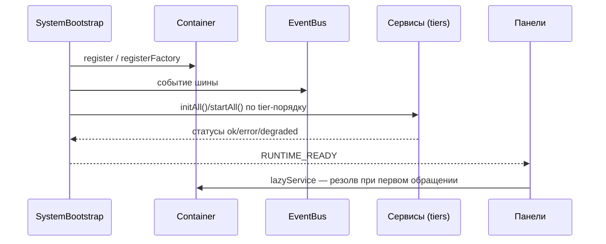

<!-- АВТОСГЕНЕРАЦИЯ: файл создан scripts/gen-wiki-docs.mjs из корпуса Wiki (src/components/WikiPanel). Не редактировать вручную. -->

# Компонент: запуск ядра (bootstrap, container, runtime)

> Раздел: **Компоненты и сервисы** · Статус: verified · Теги: компоненты, ядро, bootstrap, runtime

Источники: `src/kernel/bootstrap.ts`, `src/kernel/bootstrap-phases.ts`, `src/kernel/kernel.ts`, `src/kernel/runtime.ts`, `src/kernel/instances/index.ts`

## Назначение

Поднять систему в правильном порядке: сначала инфраструктура (контейнер, шина, БД, безопасность), затем сервисы по приоритетам, затем топология и runtime. Панели не создают сервисы сами — они получают их из баррелей `src/kernel/instances`.

## Возможности

- Детерминированный boot по **фазам** и **tier-приоритетам**, чтобы критичные сервисы (конфиг, ключи, цены) поднялись раньше остальных.
- Идемпотентный `init()` (in-flight промис защищает от двойного запуска).
- Деградация вместо падения: если падает не-критичный сервис — фаза `degraded`, система продолжает жить.
- Memory-watchdog: при давлении на память сбрасываются кеши и отменяются запросы.
- Отметка прерванных дебатов как `failed` при рестарте («sweep»).

## Реализация

- `SystemBootstrap` (`src/kernel/bootstrap.ts`) — фазы: `pending → kernel → services → topology → ready` (или `degraded`/`failed`). Методы: `resolve`, `init`, `getReport`, `getPhase`, `isReady`, `shutdown`.
- `bootstrap-phases.ts` — константы: `CRITICAL_SERVICES` (`kernel, configService, keyService, pricingService`), `RUNNING_DEBATE_PHASES`, `INIT_TIERS` (Tier 0 — config/logger, Tier 1 — routerConfig/key/pricing, Tier 2 — budget/keyState/rotation/keyVault, Tier 3 — providerRuntime/healthScore/probe, Tier 4 — groupManager/cache/policy, Tier 5 — доменные, Tier 6 — `*`).
- `SystemKernel` (`src/kernel/kernel.ts`) — разделяемое состояние (`getState`/`loadState`), `transaction`, метрики решений и нарушений. Константа версии `'2.1.0-safety'`; `decisions`/`violations` ограничены 50.
- `RuntimeManager` (`src/kernel/runtime.ts`) — фазы `loading/initializing/ready/degraded/shutdown/error`, health-check каждые 30с, `getService`, `restart`.
- Баррели `src/kernel/instances`: `services-core` / `services-extras` (lazyService), `events`, `core-references`/`extra-references`, `infra`.

## Архитектура

## Связи

- Зависит от [Компонент: DI-контейнер и lazyService](./comp-di-container.md) (регистрация/резолв), [Компонент: шина событий (EventBus)](./comp-event-bus.md) (`RUNTIME_READY`), БД ([Компонент: персистентность (Dexie и storage-адаптеры)](./comp-persistence.md)).
- Топология монтируется на фазе `topology` (`orchestrator.mount`).
- Панели видят результат через `RuntimeManager.getService`.

## Проверка работоспособности

- `npm run dev` — в консоли фазный лог boot; `RUNTIME_READY` в ленте событий.
- Ручная проверка: панель **System**/`diagnostics` показывает статусы сервисов.
- **Тестов нет** — для `bootstrap.ts`, `kernel.ts`, `runtime.ts` и `bootstrap-phases.ts` автотесты не найдены (покрытие косвенное, через e2e smoke).

## Состояние

- Реализовано и подтверждено чтением кода: фазы, tiers, критические сервисы, watchdog, sweep.
- Не подтверждено автотестами: порядок инициализации и восстановление после сбоя критического сервиса.

---

## Связанные материалы

- [Компонент: DI-контейнер и lazyService](./comp-di-container.md)
- [Компонент: шина событий (EventBus)](./comp-event-bus.md)
- [Разработчикам: boot, DI и контейнер](./dev-boot.md)
- [Разработчикам: сервисы и lazyService](./dev-services.md)
- [Разработчикам: карта каталогов](./dev-layout.md)

[← Все материалы](./README.md)
