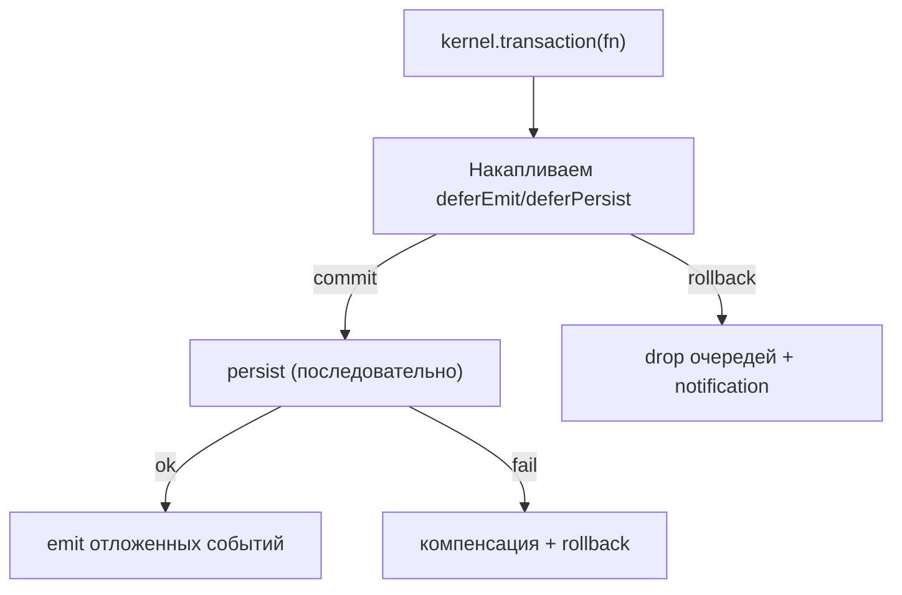

<!-- АВТОСГЕНЕРАЦИЯ: файл создан scripts/gen-wiki-docs.mjs из корпуса Wiki (src/components/WikiPanel). Не редактировать вручную. -->

# Компонент: транзакции состояния

> Раздел: **Компоненты и сервисы** · Статус: verified · Теги: компоненты, транзакции, атомарность

Источники: `src/kernel/services/transaction.ts`, `src/kernel/contracts/transaction.ts`, `src/kernel/utils/with-transaction.ts`

## Назначение

Сделать мутацию состояния атомарной: либо всё применяется (persist + emit), либо ничего. Защищает от «наполовину применённой» конфигурации или частично записанного состояния.

## Возможности

- Внутри транзакции действия не применяются сразу, а **накапливаются**: `deferEmit` (событие) и `deferPersist` (запись).
- `onCommit` / `onRollback` — колбеки на итог.
- Компенсация: если один из persist падает, уже выполненные откатываются в обратном порядке, затем вызывается `rollback`.

## Реализация

- `TransactionContext implements ITransaction` (`src/kernel/services/transaction.ts`); `capture<T>(state)` возвращает `structuredClone` (без заморозки, вопреки комментарию).
- `commit(eventBus?)` идемпотентен (возвращает существующий `_commitPromise`); порядок: persist (последовательно) → `deferEmit` → `onCommit`.
- `rollback(eventBus?)` дропает очереди, предупреждает и (при наличии шины) эмитит `system:notification` со счётчиками отброшенного.
- Точка входа: `kernel.transaction(fn)` (`src/kernel/kernel.ts`) — создаёт `TransactionContext('kernel')`, коммитит с адаптером шины, при ошибке rollback + rethrow.
- Автономный эквивалент — `withTransaction(source, fn, eventBus?)` (`src/kernel/utils/with-transaction.ts`), используется, например, `ConfigService._updateSection`.

## Архитектура

## Связи

- `deferEmit` связан с [Компонент: шина событий (EventBus)](./comp-event-bus.md).
- `deferPersist` — с [Компонент: персистентность (Dexie и storage-адаптеры)](./comp-persistence.md) (Dexie/KV).
- Используется там, где важна согласованность (конфигурация, снапшоты).

## Проверка работоспособности

- Ручная проверка: обернуть две записи в `kernel.transaction`, спровоцировать ошибку на второй — первая не должна сохраниться, а `system:notification` — сообщить об откате.
- **Тестов нет** — для `TransactionContext`, `withTransaction` и `kernel.transaction` автотесты не найдены.

## Состояние

- Реализовано и подтверждено чтением кода.
- Не подтверждено автотестами — приоритетный кандидат на покрытие.

---

## Связанные материалы

- [Компонент: запуск ядра (bootstrap, container, runtime)](./comp-kernel-boot.md)
- [Компонент: шина событий (EventBus)](./comp-event-bus.md)
- [Компонент: персистентность (Dexie и storage-адаптеры)](./comp-persistence.md)
- [Компонент: конфигурация и настройки](./comp-config.md)

[← Все материалы](./README.md)
