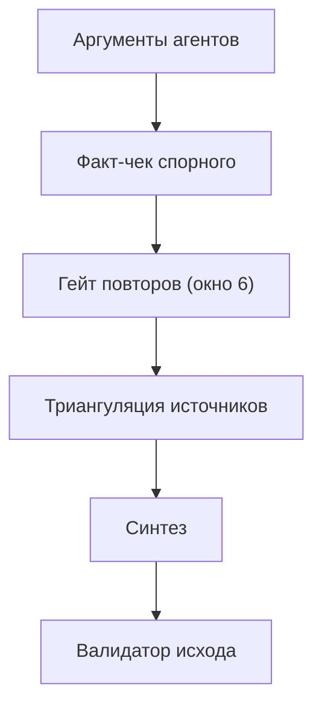

<!-- АВТОСГЕНЕРАЦИЯ: файл создан scripts/gen-wiki-docs.mjs из корпуса Wiki (src/components/WikiPanel). Не редактировать вручную. -->

# Дебаты: режимы и механика

> Раздел: **Дебаты** · Статус: verified · Теги: дебаты, стратегии, проверки

Источники: `src/kernel/services/debate-runtime/debate-strategy-definitions.ts`, `src/kernel/services/debate-runtime/`

## Режимы

33 встроенные стратегии: round-robin, сократический, дерево аргументов, суд, модератор, дебаты-марафон и др. Позиции pro/con/neutral, свои шаблоны тоже можно.

## Что происходит внутри раунда

Агенты пишут аргументы → факт-чек спорного → гейт повторов (окно 6, кросс-агентная проверка, предупреждение в промпт) → триангуляция источников → синтез. Валидатор исхода проверяет заземлённость синтеза и честность закрытых противоречий.

## Живой поиск и ссылки

Каждый раунд — один заземлённый веб-поиск на всех (источники цитируются кликабельными ссылками). Правило для агентов: ссылку — только на URL из контекста, выдуманные адреса запрещены.

## История

Завершённые дебаты — в истории (последние 5), упавшие/отменённые — в терминальной истории с аргументами. Снапшоты reload-честные.

История разработки этой области — [Зона 2: дебаты](./zone-2.md).

---

## Связанные материалы

- [Знания и память](./memory.md)
- [Провайдеры и маршрутизация](./providers.md)

---

## Связи с кодом (авто)

Цепочка «панель → маршрут → компонент → тесты» собрана из реестра маршрутов.

- Панель `debate` → маршрут `/debate`
  - Компонент: `src/components/DebateArena`
  - Тесты: `src/components/DebateArena.test.tsx`

См. также: [Каталог панелей](./panels-catalog.md) · [Каталог компонентов OS](./dev-component-catalog.md).

[← Все материалы](./README.md)
