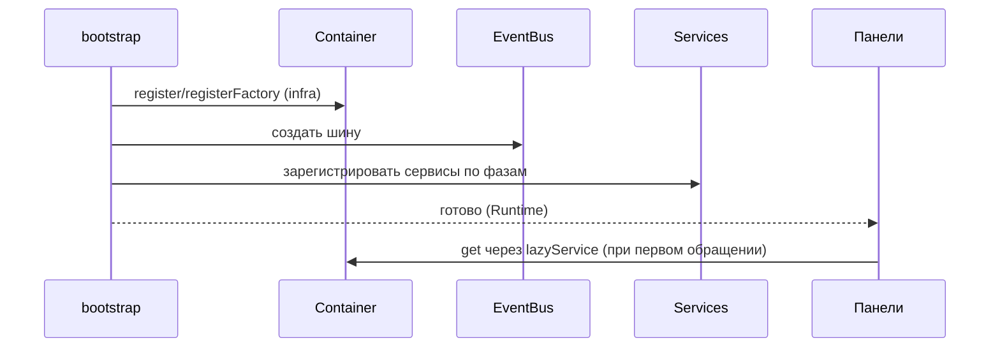

<!-- АВТОСГЕНЕРАЦИЯ: файл создан scripts/gen-wiki-docs.mjs из корпуса Wiki (src/components/WikiPanel). Не редактировать вручную. -->

# Разработчикам: boot, DI и контейнер

> Раздел: **Разработчикам** · Статус: verified · Теги: dev, bootstrap, DI

Источники: `src/kernel/bootstrap.ts`, `src/kernel/bootstrap-phases.ts`, `src/kernel/container.ts`

## Как поднимается ядро

Boot разбит на фазы (`bootstrap.ts` + `bootstrap-phases.ts`): сначала инфраструктура (Container, EventBus, БД, Security), затем сервисы, затем runtime. Панели не создают сервисы сами — они берут их из барреля `src/kernel/instances` (лениво).

## Контейнер (src/kernel/container.ts)

- `register` — готовый singleton; `registerFactory` — ленивый singleton; `registerTransient` — новый инстанс на каждый `get`.
- `override` — подмена реализации для тестов (без module-mock).
- Защита от циклов: повторный `get` во время резолва бросает «Circular dependency detected».
- Кэш провалов фабрик: 5с TTL — не долбит падающий сервис на каждом обращении.
- `clear()` уничтожает сервисы в LIFO-порядке (если есть `destroy`), с таймаутом 5с на каждый.
- `getDependencies()` отдаёт граф связей — используется диагностикой и `lazyService`.

## Правило

Сервис получает зависимости через конструктор (`constructor(deps)`). Если сервису нужен другой сервис в рантайме — через контейнер, а не импортом конкретного класса.

---

## Связанные материалы

- [Разработчикам: сервисы и lazyService](./dev-services.md)
- [Разработчикам: шина событий](./dev-events.md)
- [Разработчикам: обзор и слои](./dev-overview.md)

[← Все материалы](./README.md)
