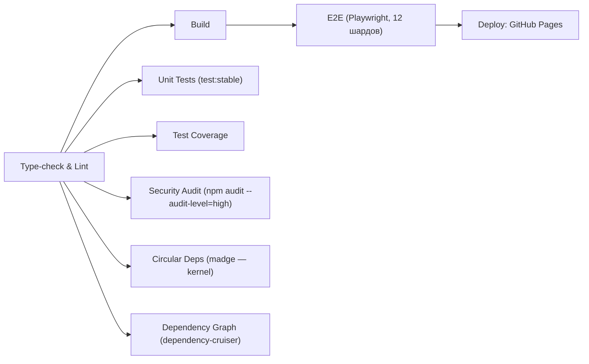

<!-- АВТОСГЕНЕРАЦИЯ: файл создан scripts/gen-wiki-docs.mjs из корпуса Wiki (src/components/WikiPanel). Не редактировать вручную. -->

# Разработчикам: ворота качества и CI

> Раздел: **Разработчикам** · Статус: verified · Теги: dev, CI, гейт, сборка

Источники: `.github/workflows/ci.yml`, `package.json`

## Конвейер (.github/workflows/ci.yml)

## Что именно проверяется

- **Type-check**: `npx tsc -b --noEmit` (именно `-b`: solution-конфиг с references на app+node; голый `tsc --noEmit` компилит ноль файлов — ложное «зелёно»).
- **ESLint**: `npm run lint -- --max-warnings 5200` — 0 ошибок обязательно, варнинги (React Compiler, raw colors, restricted imports) считаются и трендятся вниз.
- **Security**: `npm audit --audit-level=high` — любой high/critical валит билд.
- **Circular**: `madge --circular src/kernel/` — цикл в ядре валит.
- **Dependency rules**: `depcruise` — направление слоёв UI→Application→Kernel→Infrastructure.
- **E2E**: прогон против собранного артефакта `dist`, замороженного build-джобой.
- **Deploy**: sourcemaps `hidden`, `.map` вырезаются перед заливкой (в прод не утекают).

## Сборка

`npm run build` = `tsc -b` + `vite build`. Есть аварийный `build:skip-typecheck` — только локально, в CI/шипе не использовать.

---

## Связанные материалы

- [Разработчикам: тесты](./dev-testing.md)
- [Разработчикам: генераторы и сгенерированные файлы](./dev-generators.md)
- [Скрипты и CLI](./dev-scripts.md)
- [Каталог тестов](./dev-tests-catalog.md)
- [Разработчикам: структура и ворота](./for-developers.md)

[← Все материалы](./README.md)
