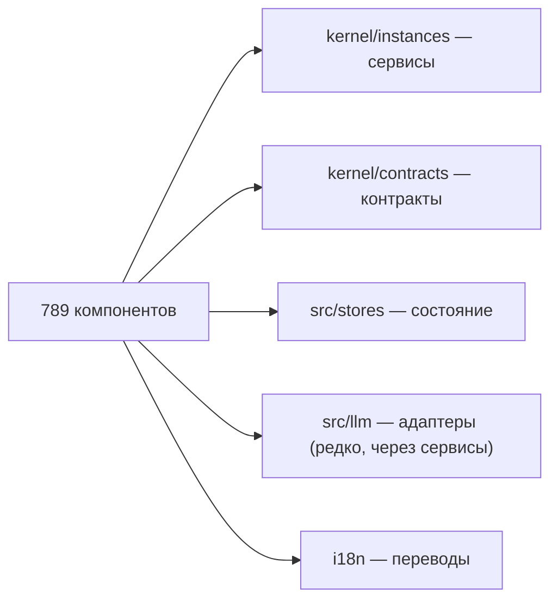

<!-- АВТОСГЕНЕРАЦИЯ: файл создан scripts/gen-wiki-docs.mjs из корпуса Wiki (src/components/WikiPanel). Не редактировать вручную. -->

# Каталог компонентов OS

> Раздел: **Разработчикам** · Статус: verified · Теги: dev, каталог, компоненты, связи

Источники: `scripts/gen-wiki-catalog.mjs`, `src/generated/wiki-component-catalog.ts`

## Каталог компонентов

Сгенерировано автоматически (scripts/gen-wiki-catalog.mjs) из живого дерева src/components/: 789 компонентов, 130 групп. Связи — это импорты из слоёв ядра: сервисы (kernel/instances), контракты (kernel/contracts), сторы (src/stores), адаптеры (src/llm), локализация (i18n).

### Сводка по группам

| Группа | Компонентов | С i18n | Сервисов (уник.) |
|---|---|---|---|
| (корень) | 97 | 53 | 77 |
| AddKeyModal | 8 | 3 | 4 |
| AdversarialSourcePanel | 1 | 1 | 0 |
| AgentJournalPanel | 3 | 2 | 0 |
| AgentsPanel | 24 | 5 | 21 |
| AgentTasksPanel | 1 | 1 | 2 |
| AlertLayer | 1 | 1 | 3 |
| AnalyticsPanel | 8 | 5 | 10 |
| AnchoringPanel | 1 | 1 | 0 |
| AquariumPanel | 9 | 1 | 3 |
| ArgumentGraphPanel | 1 | 0 | 2 |
| AutonomyPanel | 1 | 1 | 1 |
| BayesianJudgePanel | 1 | 1 | 0 |
| BeliefMiningPanel | 1 | 1 | 0 |
| BiasProfilerPanel | 1 | 1 | 0 |
| BlindEvalPanel | 1 | 1 | 0 |
| BookmarksPanel | 3 | 3 | 3 |
| BoPTrackerPanel | 1 | 1 | 0 |
| BudgetPanel | 6 | 5 | 0 |
| BuilderPanel | 6 | 2 | 7 |
| CalibrationPanel | 1 | 1 | 0 |
| CausalDebugger | 5 | 0 | 9 |
| ChannelPanel | 1 | 1 | 1 |
| ChatAdminPanel | 7 | 0 | 3 |
| ChatDock | 1 | 0 | 0 |
| ChatExportPanel | 4 | 4 | 0 |
| ChatPanel | 20 | 6 | 5 |
| Common | 12 | 5 | 3 |
| ConceptBlenderPanel | 1 | 1 | 0 |
| ConnectorsPanel | 8 | 7 | 4 |
| ConsistencyPanel | 1 | 1 | 0 |
| CouncilPanel | 1 | 0 | 0 |
| CounterfactualPanel | 5 | 0 | 6 |
| CredibilityPanel | 1 | 1 | 0 |
| CrystalVaultPanel | 4 | 4 | 1 |
| DashboardPanel | 14 | 12 | 14 |
| DebateLive | 11 | 2 | 4 |
| DebatePanel | 49 | 4 | 28 |
| DebateResearch | 48 | 8 | 13 |
| DebateRuntimePanel | 12 | 5 | 20 |
| DecisionLogPanel | 3 | 1 | 0 |
| DirectorPanel | 11 | 9 | 2 |
| DocsHealthPanel | 4 | 3 | 2 |
| DocumentationPanel | 6 | 1 | 0 |
| DriftDetectorPanel | 1 | 1 | 1 |
| DyadPanel | 1 | 1 | 1 |
| Editors | 5 | 0 | 0 |
| EntanglementPanel | 1 | 1 | 0 |
| EventsTimeline | 1 | 0 | 2 |
| ExpertWitnessPanel | 1 | 1 | 0 |
| FleetPanel | 1 | 1 | 41 |
| FleetPanels | 6 | 0 | 0 |
| ForumPanel | 7 | 7 | 3 |
| FrameTrackerPanel | 1 | 1 | 0 |
| GeminiResearch | 6 | 0 | 2 |
| GoogleStudio | 7 | 0 | 1 |
| GoTDeliberationPanel | 1 | 1 | 0 |
| GovernancePanel | 1 | 1 | 1 |
| GroupChatPanel | 1 | 1 | 2 |
| GroupsPanel | 2 | 2 | 3 |
| GuardrailsPanel | 1 | 1 | 1 |
| HealthPanel | 8 | 7 | 11 |
| IncentiveDetectorPanel | 1 | 1 | 0 |
| InsightBusPanel | 1 | 1 | 0 |
| JunctionPanel | 4 | 2 | 1 |
| JustificationPanel | 1 | 1 | 0 |
| KeyNotesPanel | 4 | 3 | 1 |
| KeyTable | 21 | 2 | 7 |
| KnowledgeGenPanel | 3 | 3 | 1 |
| KnowledgePanel | 6 | 1 | 4 |
| Layout | 5 | 2 | 0 |
| LensesPanel | 4 | 4 | 1 |
| LiveCognition | 5 | 1 | 7 |
| LogicalFormPanel | 1 | 1 | 0 |
| LogsPanel | 1 | 1 | 3 |
| MCPPanel | 3 | 3 | 7 |
| MemoryPanel | 12 | 11 | 6 |
| MetaAgentPanel | 1 | 1 | 0 |
| MinimaxPlannerPanel | 1 | 1 | 0 |
| NvidiaEnterprise | 3 | 0 | 5 |
| OnboardingWizard | 4 | 4 | 1 |
| OutcomeForecasterPanel | 1 | 1 | 0 |
| PatternsPanel | 6 | 4 | 2 |
| PerformanceProfilerPanel | 2 | 0 | 0 |
| PersonaMixerPanel | 1 | 1 | 0 |
| PlannerPanel | 1 | 1 | 1 |
| PolicyEditorPanel | 4 | 2 | 1 |
| PolicyPanel | 1 | 1 | 6 |
| PoolStatusPanel | 1 | 1 | 1 |
| PressureMapPanel | 6 | 3 | 5 |
| ProjectsPanel | 3 | 3 | 11 |
| ProvenancePanel | 1 | 1 | 2 |
| ProviderIcon | 1 | 0 | 0 |
| ProviderManager | 23 | 9 | 13 |
| QualityImpactDashboard | 4 | 4 | 4 |
| ResearchPanel | 16 | 1 | 2 |
| RhetoricPanel | 1 | 1 | 0 |
| RivalLabs | 2 | 2 | 0 |
| RivalsHub | 1 | 1 | 6 |
| RolesPanel | 32 | 4 | 9 |
| RoomPanel | 1 | 1 | 3 |
| RouterTraceView | 3 | 2 | 1 |
| RoutingIntelligence | 11 | 3 | 4 |
| RunQueuePanel | 1 | 1 | 1 |
| ScratchpadPanel | 1 | 1 | 0 |
| ServiceRegistryPanel | 5 | 1 | 2 |
| SettingsPanel | 10 | 7 | 13 |
| ShadowOpponentPanel | 1 | 1 | 1 |
| ShadowPanel | 3 | 0 | 3 |
| shared | 3 | 0 | 0 |
| Sidebar | 2 | 1 | 0 |
| SimilarityPanel | 1 | 1 | 0 |
| SimulationPanel | 1 | 0 | 0 |
| SkillsPanel | 1 | 1 | 4 |
| SopPanel | 1 | 1 | 2 |
| SREAgentPanel | 9 | 6 | 4 |
| StakeholderPanel | 1 | 1 | 0 |
| StanceDriftPanel | 1 | 1 | 0 |
| StateInspectorPanel | 3 | 1 | 3 |
| SteelmanPanel | 1 | 1 | 0 |
| SynthesisPanel | 4 | 4 | 2 |
| TasksPanel | 2 | 1 | 5 |
| TechniquePanels | 59 | 58 | 3 |
| ToolsPanel | 6 | 1 | 6 |
| TracesPanel | 7 | 3 | 4 |
| UsageHeatmap | 1 | 0 | 1 |
| VulnTargetingPanel | 1 | 1 | 0 |
| WhatIfPanel | 1 | 1 | 2 |
| WikiPanel | 2 | 1 | 0 |
| WorkspacePanel | 1 | 1 | 1 |

### Горячие сервисы (по охвату групп)

Сервисы ядра, которые компоненты запрашивают чаще всего — центральные точки связности.

| Сервис | Групп | Компонентов |
|---|---|---|
| eventBus | 43 | 71 |
| EVENTS | 36 | 55 |
| rootLogger | 28 | 49 |
| keyService | 11 | 25 |
| agentService | 8 | 14 |
| kernel | 7 | 9 |
| orchestrator | 7 | 7 |
| debateEngine | 6 | 8 |
| settingsService | 5 | 7 |
| adapterRegistry | 5 | 6 |
| qualityImpactCollector | 4 | 62 |
| keyStateStore | 4 | 7 |
| CONFIG | 4 | 6 |
| toolService | 4 | 4 |
| autonomyService | 4 | 4 |
| getAllSettings | 3 | 61 |
| RouterDecision | 3 | 8 |
| debateService | 3 | 7 |
| sessionManager | 3 | 5 |
| researchEngine | 3 | 5 |
| FREE_TIER_LIMITS | 3 | 5 |
| adminService | 3 | 4 |
| budgetService | 3 | 4 |
| autoDebateService | 3 | 4 |
| probeService | 3 | 4 |
| groupManager | 3 | 3 |
| storageAdapter | 3 | 3 |
| providerAchievementService | 3 | 3 |
| lensEngine | 3 | 3 |
| cognitiveService | 3 | 3 |

### (корень) (97)

| Компонент | route id | Файл | Сервисы ядра | Сторы | i18n |
|---|---|---|---|---|---|
| ABTestPanel | — | src/components/ABTestPanel.tsx | — | — | да |
| AdaptersPanel | — | src/components/AdaptersPanel.tsx | — | — | да |
| AgentComparisonPanel | — | src/components/AgentComparisonPanel.tsx | — | — | — |
| AgentJournalPanel | — | src/components/AgentJournalPanel.tsx | — | — | да |
| AgentMarketplacePanel | — | src/components/AgentMarketplacePanel.tsx | — | — | — |
| AgentProtocolPanel | — | src/components/AgentProtocolPanel.tsx | — | — | — |
| AppLayout | — | src/components/AppLayout.tsx | — | — | да |
| ApprovalsPanel | — | src/components/ApprovalsPanel.tsx | — | — | да |
| AudiencePanel | — | src/components/AudiencePanel.tsx | — | — | — |
| AuditLogView | — | src/components/AuditLogView.tsx | — | — | — |
| BatchProcessingPanel | — | src/components/BatchProcessingPanel.tsx | — | — | да |
| BudgetAlertsPanel | — | src/components/BudgetAlertsPanel.tsx | — | — | да |
| BudgetPanel | — | src/components/BudgetPanel.tsx | — | — | да |
| CachePanel | — | src/components/CachePanel.tsx | — | — | да |
| ChatExportPanel | — | src/components/ChatExportPanel.tsx | — | — | да |
| ChatSessionsManagerPanel | — | src/components/ChatSessionsManagerPanel.tsx | — | — | да |
| CollaborationPanel | — | src/components/CollaborationPanel.tsx | — | — | — |
| CommandPalette | — | src/components/CommandPalette.tsx | — | — | да |
| CommunityHubPanel | — | src/components/CommunityHubPanel.tsx | — | — | — |
| CompaniesPanel | — | src/components/CompaniesPanel.tsx | — | — | да |
| components | — | src/components/components.tsx | — | — | — |
| ConfigHistoryView | — | src/components/ConfigHistoryView.tsx | — | — | — |
| ConfirmDialog | — | src/components/ConfirmDialog.tsx | — | — | — |
| ContributionGraphPanel | — | src/components/ContributionGraphPanel.tsx | — | — | да |
| CostAnalyticsPanel | — | src/components/CostAnalyticsPanel.tsx | — | — | да |
| CostOptimizationPanel | — | src/components/CostOptimizationPanel.tsx | — | — | да |
| CostsPanel | — | src/components/CostsPanel.tsx | — | — | да |
| CustomMetricsPanel | — | src/components/CustomMetricsPanel.tsx | — | — | да |
| DebateAnalysisPanel | — | src/components/DebateAnalysisPanel.tsx | — | — | да |
| DebateArena | — | src/components/DebateArena.tsx | — | — | да |
| DebateQualityPanel | — | src/components/DebateQualityPanel.tsx | — | — | да |
| DebateReplayControls | — | src/components/DebateReplayControls.tsx | — | — | — |
| DebateReplayEventDetail | — | src/components/DebateReplayEventDetail.tsx | — | — | — |
| DebateReplayLiveControls | — | src/components/DebateReplayLiveControls.tsx | — | — | — |
| DebateReplayPanel | — | src/components/DebateReplayPanel.tsx | — | — | — |
| DebateReplaySidebar | — | src/components/DebateReplaySidebar.tsx | — | — | — |
| DebateReplayTimeline | — | src/components/DebateReplayTimeline.tsx | — | — | — |
| DebatesManagerPanel | — | src/components/DebatesManagerPanel.tsx | — | — | да |
| DebateTemplatesPanel | — | src/components/DebateTemplatesPanel.tsx | — | — | да |
| DecisionLogPanel | — | src/components/DecisionLogPanel.tsx | — | — | да |
| DependencyMapPanel | — | src/components/DependencyMapPanel.tsx | — | — | да |
| DeployPanel | — | src/components/DeployPanel.tsx | — | — | — |
| DiagnosticPanel | — | src/components/DiagnosticPanel.tsx | — | — | да |
| DistillationPanel | — | src/components/DistillationPanel.tsx | — | — | — |
| DocsHealthPanel | — | src/components/DocsHealthPanel.tsx | — | — | да |
| EvalDatasetPanel | — | src/components/EvalDatasetPanel.tsx | — | — | да |
| ExperimentalPanel | — | src/components/ExperimentalPanel.tsx | — | — | да |
| ExportImportPanel | — | src/components/ExportImportPanel.tsx | — | — | — |
| FederatedMemoryPanel | — | src/components/FederatedMemoryPanel.tsx | — | — | — |
| GeminiLivePanel | — | src/components/GeminiLivePanel.tsx | — | — | — |
| GlobalErrorBoundary | — | src/components/GlobalErrorBoundary.tsx | — | — | — |
| GoogleCachePanel | — | src/components/GoogleCachePanel.tsx | — | — | — |
| GuardiansPanel | — | src/components/GuardiansPanel.tsx | — | — | да |
| HealthSlaPanel | — | src/components/HealthSlaPanel.tsx | — | — | — |
| IssuesPanel | — | src/components/IssuesPanel.tsx | — | — | да |
| KeyNotesPanel | — | src/components/KeyNotesPanel.tsx | — | — | да |
| KeyUsageAnalyticsPanel | — | src/components/KeyUsageAnalyticsPanel.tsx | — | — | да |
| LearnHubPanel | — | src/components/LearnHubPanel.tsx | — | — | — |
| MemoryTransferPanel | — | src/components/MemoryTransferPanel.tsx | — | — | — |
| MessageSearchPanel | — | src/components/MessageSearchPanel.tsx | — | — | да |
| ModalShell | — | src/components/ModalShell.tsx | — | — | — |
| ModelComparePanel | — | src/components/ModelComparePanel.tsx | — | — | — |
| ModuleInfo | — | src/components/ModuleInfo.tsx | — | — | да |
| OpenRouterPanel | — | src/components/OpenRouterPanel.tsx | — | — | — |
| PanelLoader | — | src/components/PanelLoader.tsx | — | — | — |
| PanelStates | — | src/components/PanelStates.tsx | — | — | да |
| PerformanceProfilerPanel | — | src/components/PerformanceProfilerPanel.tsx | — | — | да |
| PersonaMarketplacePanel | — | src/components/PersonaMarketplacePanel.tsx | — | — | — |
| PersonaPickerPanel | — | src/components/PersonaPickerPanel.tsx | — | — | — |
| PluginSdkPanel | — | src/components/PluginSdkPanel.tsx | — | — | — |
| PortabilityPanel | — | src/components/PortabilityPanel.tsx | — | — | да |
| PressureMap | — | src/components/PressureMap.tsx | — | — | да |
| PromptLibraryPanel | — | src/components/PromptLibraryPanel.tsx | — | — | да |
| PromptSecurityPanel | — | src/components/PromptSecurityPanel.tsx | — | — | да |
| PromptVersionPanel | — | src/components/PromptVersionPanel.tsx | — | — | — |
| ProviderDashboard | — | src/components/ProviderDashboard.tsx | — | — | да |
| ProviderMarketplace | — | src/components/ProviderMarketplace.tsx | — | — | — |
| ResearchReportPanel | — | src/components/ResearchReportPanel.tsx | — | — | — |
| RivalsCatalogPanel | — | src/components/RivalsCatalogPanel.tsx | — | — | — |
| RotationsPanel | — | src/components/RotationsPanel.tsx | — | — | да |
| RunsPanel | — | src/components/RunsPanel.tsx | — | — | да |
| SchedulerPanel | — | src/components/SchedulerPanel.tsx | — | — | да |
| SessionBindingsPanel | — | src/components/SessionBindingsPanel.tsx | — | — | да |
| SessionHubPanel | — | src/components/SessionHubPanel.tsx | — | — | да |
| Sidebar | — | src/components/Sidebar.tsx | — | — | да |
| SmartRoutingPanel | — | src/components/SmartRoutingPanel.tsx | — | — | — |
| SocialLeaderboardPanel | — | src/components/SocialLeaderboardPanel.tsx | — | — | — |
| SystemHealthPanel | — | src/components/SystemHealthPanel.tsx | — | — | да |
| TemplateSharingPanel | — | src/components/TemplateSharingPanel.tsx | — | — | — |
| TimeMachinePanel | — | src/components/TimeMachinePanel.tsx | — | — | — |
| TopicSuggesterPanel | — | src/components/TopicSuggesterPanel.tsx | — | — | да |
| TopologyGalleryPanel | — | src/components/TopologyGalleryPanel.tsx | — | — | — |
| TournamentPanel | — | src/components/TournamentPanel.tsx | — | — | да |
| TutorialPanel | — | src/components/TutorialPanel.tsx | — | — | — |
| VoiceInputPanel | — | src/components/VoiceInputPanel.tsx | — | — | — |
| WebhooksPanel | — | src/components/WebhooksPanel.tsx | — | — | да |
| WorkflowPanel | — | src/components/WorkflowPanel.tsx | — | — | да |

### AddKeyModal (8)

| Компонент | route id | Файл | Сервисы ядра | Сторы | i18n |
|---|---|---|---|---|---|
| AddKeyModal | — | src/components/AddKeyModal/AddKeyModal.tsx | — | — | да |
| BulkImportStep | — | src/components/AddKeyModal/BulkImportStep.tsx | — | — | да |
| DefaultModelStep | — | src/components/AddKeyModal/DefaultModelStep.tsx | — | — | — |
| KeyDetailsForm | — | src/components/AddKeyModal/KeyDetailsForm.tsx | — | — | да |
| ModalHeader | — | src/components/AddKeyModal/ModalHeader.tsx | — | — | — |
| ProviderSelectionStep | — | src/components/AddKeyModal/ProviderSelectionStep.tsx | — | — | — |
| StepDots | — | src/components/AddKeyModal/StepDots.tsx | — | — | — |
| StepSidebar | — | src/components/AddKeyModal/StepSidebar.tsx | — | — | — |

### AdversarialSourcePanel (1)

| Компонент | route id | Файл | Сервисы ядра | Сторы | i18n |
|---|---|---|---|---|---|
| AdversarialSourcePanel | — | src/components/AdversarialSourcePanel/AdversarialSourcePanel.tsx | — | — | да |

### AgentJournalPanel (3)

| Компонент | route id | Файл | Сервисы ядра | Сторы | i18n |
|---|---|---|---|---|---|
| JournalAddForm | — | src/components/AgentJournalPanel/JournalAddForm.tsx | — | — | да |
| JournalEntryCard | — | src/components/AgentJournalPanel/JournalEntryCard.tsx | — | — | да |
| StatMini | — | src/components/AgentJournalPanel/StatMini.tsx | — | — | — |

### AgentsPanel (24)

| Компонент | route id | Файл | Сервисы ядра | Сторы | i18n |
|---|---|---|---|---|---|
| agent-templates | — | src/components/AgentsPanel/agent-templates.tsx | — | — | — |
| AgentAvatar | — | src/components/AgentsPanel/AgentAvatar.tsx | — | — | — |
| AgentCapabilitiesTab | — | src/components/AgentsPanel/AgentCapabilitiesTab.tsx | — | — | — |
| AgentCard | — | src/components/AgentsPanel/AgentCard.tsx | — | — | — |
| AgentComparison | — | src/components/AgentsPanel/AgentComparison.tsx | — | — | — |
| AgentConfigTab | — | src/components/AgentsPanel/AgentConfigTab.tsx | — | — | да |
| AgentDetailPanel | — | src/components/AgentsPanel/AgentDetailPanel.tsx | — | — | — |
| AgentGroupsSection | — | src/components/AgentsPanel/AgentGroupsSection.tsx | — | — | да |
| AgentHandoffsTab | — | src/components/AgentsPanel/AgentHandoffsTab.tsx | — | — | — |
| AgentHistoryTab | — | src/components/AgentsPanel/AgentHistoryTab.tsx | — | — | — |
| AgentIdentityEditor | — | src/components/AgentsPanel/AgentIdentityEditor.tsx | — | — | — |
| AgentInfraTab | — | src/components/AgentsPanel/AgentInfraTab.tsx | — | — | — |
| AgentObservabilityTab | — | src/components/AgentsPanel/AgentObservabilityTab.tsx | — | — | — |
| AgentPolicySection | — | src/components/AgentsPanel/AgentPolicySection.tsx | — | — | — |
| AgentProfileTab | — | src/components/AgentsPanel/AgentProfileTab.tsx | — | — | — |
| AgentsPanelContainer | — | src/components/AgentsPanel/AgentsPanelContainer.tsx | — | — | — |
| AgentsPanelView | — | src/components/AgentsPanel/AgentsPanelView.tsx | — | — | да |
| AgentsTable | — | src/components/AgentsPanel/AgentsTable.tsx | — | — | — |
| AgentStatsDashboard | — | src/components/AgentsPanel/AgentStatsDashboard.tsx | — | — | да |
| AgentWizard | — | src/components/AgentsPanel/AgentWizard.tsx | — | — | да |
| EloLeaderboard | — | src/components/AgentsPanel/EloLeaderboard.tsx | — | — | — |
| LiveActivityStream | — | src/components/AgentsPanel/LiveActivityStream.tsx | — | — | — |
| QuickCreateAgentModal | — | src/components/AgentsPanel/QuickCreateAgentModal.tsx | — | — | — |
| sidebar-tabs | — | src/components/AgentsPanel/sidebar-tabs.tsx | — | — | — |

### AgentTasksPanel (1)

| Компонент | route id | Файл | Сервисы ядра | Сторы | i18n |
|---|---|---|---|---|---|
| AgentTasksPanel | — | src/components/AgentTasksPanel/AgentTasksPanel.tsx | — | — | да |

### AlertLayer (1)

| Компонент | route id | Файл | Сервисы ядра | Сторы | i18n |
|---|---|---|---|---|---|
| AlertLayer | — | src/components/AlertLayer/AlertLayer.tsx | — | — | да |

### AnalyticsPanel (8)

| Компонент | route id | Файл | Сервисы ядра | Сторы | i18n |
|---|---|---|---|---|---|
| AnalyticsPanel | — | src/components/AnalyticsPanel/AnalyticsPanel.tsx | — | — | да |
| ChartsSection | — | src/components/AnalyticsPanel/ChartsSection.tsx | — | — | — |
| DecisionsTab | — | src/components/AnalyticsPanel/DecisionsTab.tsx | — | — | да |
| PricingPanel | — | src/components/AnalyticsPanel/PricingPanel.tsx | — | — | да |
| ProviderHealthSection | — | src/components/AnalyticsPanel/ProviderHealthSection.tsx | — | — | — |
| ProvidersTab | — | src/components/AnalyticsPanel/ProvidersTab.tsx | — | — | да |
| Sparkline | — | src/components/AnalyticsPanel/Sparkline.tsx | — | — | да |
| SummaryStatsGrid | — | src/components/AnalyticsPanel/SummaryStatsGrid.tsx | — | — | — |

### AnchoringPanel (1)

| Компонент | route id | Файл | Сервисы ядра | Сторы | i18n |
|---|---|---|---|---|---|
| AnchoringPanel | — | src/components/AnchoringPanel/AnchoringPanel.tsx | — | — | да |

### AquariumPanel (9)

| Компонент | route id | Файл | Сервисы ядра | Сторы | i18n |
|---|---|---|---|---|---|
| AquariumPanel | — | src/components/AquariumPanel/AquariumPanel.tsx | — | — | да |
| Bubble | — | src/components/AquariumPanel/components/Bubble.tsx | — | — | — |
| CleanerBot | — | src/components/AquariumPanel/components/CleanerBot.tsx | — | — | — |
| Fish | — | src/components/AquariumPanel/components/Fish.tsx | — | — | — |
| FoodParticle | — | src/components/AquariumPanel/components/FoodParticle.tsx | — | — | — |
| Jellyfish | — | src/components/AquariumPanel/components/Jellyfish.tsx | — | — | — |
| PerfOverlay | — | src/components/AquariumPanel/PerfOverlay.tsx | — | — | — |
| ProviderAquariumShape | — | src/components/AquariumPanel/components/ProviderAquariumShape.tsx | — | — | — |
| Seaweed | — | src/components/AquariumPanel/components/Seaweed.tsx | — | — | — |

### ArgumentGraphPanel (1)

| Компонент | route id | Файл | Сервисы ядра | Сторы | i18n |
|---|---|---|---|---|---|
| ArgumentGraphPanel | — | src/components/ArgumentGraphPanel/ArgumentGraphPanel.tsx | — | — | — |

### AutonomyPanel (1)

| Компонент | route id | Файл | Сервисы ядра | Сторы | i18n |
|---|---|---|---|---|---|
| AutonomyPanel | — | src/components/AutonomyPanel/AutonomyPanel.tsx | — | — | да |

### BayesianJudgePanel (1)

| Компонент | route id | Файл | Сервисы ядра | Сторы | i18n |
|---|---|---|---|---|---|
| BayesianJudgePanel | — | src/components/BayesianJudgePanel/BayesianJudgePanel.tsx | — | — | да |

### BeliefMiningPanel (1)

| Компонент | route id | Файл | Сервисы ядра | Сторы | i18n |
|---|---|---|---|---|---|
| BeliefMiningPanel | — | src/components/BeliefMiningPanel/BeliefMiningPanel.tsx | — | — | да |

### BiasProfilerPanel (1)

| Компонент | route id | Файл | Сервисы ядра | Сторы | i18n |
|---|---|---|---|---|---|
| BiasProfilerPanel | — | src/components/BiasProfilerPanel/BiasProfilerPanel.tsx | — | — | да |

### BlindEvalPanel (1)

| Компонент | route id | Файл | Сервисы ядра | Сторы | i18n |
|---|---|---|---|---|---|
| BlindEvalPanel | — | src/components/BlindEvalPanel/BlindEvalPanel.tsx | — | — | да |

### BookmarksPanel (3)

| Компонент | route id | Файл | Сервисы ядра | Сторы | i18n |
|---|---|---|---|---|---|
| BookmarkCard | — | src/components/BookmarksPanel/BookmarkCard.tsx | — | — | да |
| BookmarksPanel | — | src/components/BookmarksPanel/BookmarksPanel.tsx | — | — | да |
| TagBar | — | src/components/BookmarksPanel/TagBar.tsx | — | — | да |

### BoPTrackerPanel (1)

| Компонент | route id | Файл | Сервисы ядра | Сторы | i18n |
|---|---|---|---|---|---|
| BoPTrackerPanel | — | src/components/BoPTrackerPanel/BoPTrackerPanel.tsx | — | — | да |

### BudgetPanel (6)

| Компонент | route id | Файл | Сервисы ядра | Сторы | i18n |
|---|---|---|---|---|---|
| AgentBudgetSection | — | src/components/BudgetPanel/AgentBudgetSection.tsx | — | — | да |
| AlertsSection | — | src/components/BudgetPanel/AlertsSection.tsx | — | — | да |
| GlobalBudgetSection | — | src/components/BudgetPanel/GlobalBudgetSection.tsx | — | — | да |
| PlatformBudgetSection | — | src/components/BudgetPanel/PlatformBudgetSection.tsx | — | — | да |
| ProviderBudgetSection | — | src/components/BudgetPanel/ProviderBudgetSection.tsx | — | — | да |
| StatCard | — | src/components/BudgetPanel/StatCard.tsx | — | — | — |

### BuilderPanel (6)

| Компонент | route id | Файл | Сервисы ядра | Сторы | i18n |
|---|---|---|---|---|---|
| builder-nodes | — | src/components/BuilderPanel/builder-nodes.tsx | — | — | да |
| BuilderAISidebar | — | src/components/BuilderPanel/BuilderAISidebar.tsx | — | — | — |
| CognitiveBuilder | — | src/components/BuilderPanel/CognitiveBuilder.tsx | — | — | да |
| ComponentPalette | — | src/components/BuilderPanel/ComponentPalette.tsx | — | — | — |
| InspectorPanel | — | src/components/BuilderPanel/InspectorPanel.tsx | — | — | — |
| WorkflowListPanel | — | src/components/BuilderPanel/WorkflowListPanel.tsx | — | — | — |

### CalibrationPanel (1)

| Компонент | route id | Файл | Сервисы ядра | Сторы | i18n |
|---|---|---|---|---|---|
| CalibrationPanel | — | src/components/CalibrationPanel/CalibrationPanel.tsx | — | — | да |

### CausalDebugger (5)

| Компонент | route id | Файл | Сервисы ядра | Сторы | i18n |
|---|---|---|---|---|---|
| CausalDebugger | — | src/components/CausalDebugger/CausalDebugger.tsx | — | — | — |
| ConsistencyCheckSection | — | src/components/CausalDebugger/ConsistencyCheckSection.tsx | — | — | — |
| SnapshotPair | — | src/components/CausalDebugger/SnapshotPair.tsx | — | — | — |
| TemporalReplaySection | — | src/components/CausalDebugger/TemporalReplaySection.tsx | — | — | — |
| TraceListPanel | — | src/components/CausalDebugger/TraceListPanel.tsx | — | — | — |

### ChannelPanel (1)

| Компонент | route id | Файл | Сервисы ядра | Сторы | i18n |
|---|---|---|---|---|---|
| ChannelPanel | — | src/components/ChannelPanel/ChannelPanel.tsx | — | — | да |

### ChatAdminPanel (7)

| Компонент | route id | Файл | Сервисы ядра | Сторы | i18n |
|---|---|---|---|---|---|
| AdminHeader | — | src/components/ChatAdminPanel/AdminHeader.tsx | — | — | — |
| AdminStatsCards | — | src/components/ChatAdminPanel/AdminStatsCards.tsx | — | — | — |
| AdminToolbar | — | src/components/ChatAdminPanel/AdminToolbar.tsx | — | — | — |
| ChatAdminPanel | — | src/components/ChatAdminPanel/ChatAdminPanel.tsx | — | — | — |
| PreviewModal | — | src/components/ChatAdminPanel/PreviewModal.tsx | — | — | — |
| SessionRow | — | src/components/ChatAdminPanel/SessionRow.tsx | — | — | — |
| SessionTable | — | src/components/ChatAdminPanel/SessionTable.tsx | — | — | — |

### ChatDock (1)

| Компонент | route id | Файл | Сервисы ядра | Сторы | i18n |
|---|---|---|---|---|---|
| ChatDock | — | src/components/ChatDock/ChatDock.tsx | — | — | — |

### ChatExportPanel (4)

| Компонент | route id | Файл | Сервисы ядра | Сторы | i18n |
|---|---|---|---|---|---|
| ExportActions | — | src/components/ChatExportPanel/ExportActions.tsx | — | — | да |
| FormatPanel | — | src/components/ChatExportPanel/FormatPanel.tsx | — | — | да |
| PreviewPane | — | src/components/ChatExportPanel/PreviewPane.tsx | — | — | да |
| SourcePanel | — | src/components/ChatExportPanel/SourcePanel.tsx | — | — | да |

### ChatPanel (20)

| Компонент | route id | Файл | Сервисы ядра | Сторы | i18n |
|---|---|---|---|---|---|
| ChatExportOverlay | — | src/components/ChatPanel/ChatExportOverlay.tsx | — | — | — |
| ChatHeader | — | src/components/ChatPanel/ChatHeader.tsx | — | — | — |
| ChatHistoryEntry | — | src/components/ChatPanel/ChatHistoryEntry.tsx | — | — | да |
| ChatInputArea | — | src/components/ChatPanel/ChatInputArea.tsx | — | — | да |
| ChatMessagesSection | — | src/components/ChatPanel/ChatMessagesSection.tsx | — | — | да |
| ChatPanel | — | src/components/ChatPanel/ChatPanel.tsx | — | — | да |
| ChatSearchBar | — | src/components/ChatPanel/ChatSearchBar.tsx | — | — | — |
| ChatSidebar | — | src/components/ChatPanel/ChatSidebar.tsx | — | — | да |
| ChatStatusToast | — | src/components/ChatPanel/ChatStatusToast.tsx | — | — | — |
| ChatSystemPromptSection | — | src/components/ChatPanel/ChatSystemPromptSection.tsx | — | — | — |
| CodeRunner | — | src/components/ChatPanel/CodeRunner.tsx | — | — | — |
| CopyButton | — | src/components/ChatPanel/CopyButton.tsx | — | — | — |
| highlight-utils | — | src/components/ChatPanel/highlight-utils.tsx | — | — | — |
| inline-markdown | — | src/components/ChatPanel/inline-markdown.tsx | — | — | — |
| markdown-parser | — | src/components/ChatPanel/markdown-parser.tsx | — | — | — |
| MarkdownRenderer | — | src/components/ChatPanel/MarkdownRenderer.tsx | — | — | — |
| MermaidDiagram | — | src/components/ChatPanel/MermaidDiagram.tsx | — | — | — |
| PersonaSelector | — | src/components/ChatPanel/PersonaSelector.tsx | — | — | — |
| ResponseCard | — | src/components/ChatPanel/ResponseCard.tsx | — | — | да |
| VoiceButton | — | src/components/ChatPanel/VoiceButton.tsx | — | — | — |

### Common (12)

| Компонент | route id | Файл | Сервисы ядра | Сторы | i18n |
|---|---|---|---|---|---|
| AgentDisplay | — | src/components/Common/AgentDisplay.tsx | — | — | — |
| Breadcrumbs | — | src/components/Common/Breadcrumbs.tsx | — | — | да |
| Button | — | src/components/Common/Button.tsx | — | — | — |
| ContextMenu | — | src/components/Common/ContextMenu.tsx | — | — | — |
| DemoBadge | — | src/components/Common/DemoBadge.tsx | — | — | — |
| DemoGate | — | src/components/Common/DemoGate.tsx | — | — | — |
| EmptyState | — | src/components/Common/EmptyState.tsx | — | — | — |
| ErrorBoundary | — | src/components/Common/ErrorBoundary.tsx | — | — | да |
| ExperimentalBadge | — | src/components/Common/ExperimentalBadge.tsx | — | — | да |
| KeyboardShortcutsModal | — | src/components/Common/KeyboardShortcutsModal.tsx | — | — | да |
| Skeleton | — | src/components/Common/Skeleton.tsx | — | — | да |
| status-vocabulary | — | src/components/Common/status-vocabulary.tsx | — | — | — |

### ConceptBlenderPanel (1)

| Компонент | route id | Файл | Сервисы ядра | Сторы | i18n |
|---|---|---|---|---|---|
| ConceptBlenderPanel | — | src/components/ConceptBlenderPanel/ConceptBlenderPanel.tsx | — | — | да |

### ConnectorsPanel (8)

| Компонент | route id | Файл | Сервисы ядра | Сторы | i18n |
|---|---|---|---|---|---|
| connector-constants | — | src/components/ConnectorsPanel/connector-constants.tsx | — | — | — |
| ConnectorAddForm | — | src/components/ConnectorsPanel/ConnectorAddForm.tsx | — | — | да |
| ConnectorCard | — | src/components/ConnectorsPanel/ConnectorCard.tsx | — | — | да |
| ConnectorControls | — | src/components/ConnectorsPanel/ConnectorControls.tsx | — | — | да |
| ConnectorHeader | — | src/components/ConnectorsPanel/ConnectorHeader.tsx | — | — | да |
| ConnectorsPanel | — | src/components/ConnectorsPanel/ConnectorsPanel.tsx | — | — | да |
| ConnectorWebhooksView | — | src/components/ConnectorsPanel/ConnectorWebhooksView.tsx | — | — | да |
| DisconnectModal | — | src/components/ConnectorsPanel/DisconnectModal.tsx | — | — | да |

### ConsistencyPanel (1)

| Компонент | route id | Файл | Сервисы ядра | Сторы | i18n |
|---|---|---|---|---|---|
| ConsistencyPanel | — | src/components/ConsistencyPanel/ConsistencyPanel.tsx | — | — | да |

### CouncilPanel (1)

| Компонент | route id | Файл | Сервисы ядра | Сторы | i18n |
|---|---|---|---|---|---|
| CouncilPanel | — | src/components/CouncilPanel/CouncilPanel.tsx | — | — | — |

### CounterfactualPanel (5)

| Компонент | route id | Файл | Сервисы ядра | Сторы | i18n |
|---|---|---|---|---|---|
| CausalAttribution | — | src/components/CounterfactualPanel/CausalAttribution.tsx | — | — | — |
| CounterfactualPanel | — | src/components/CounterfactualPanel/CounterfactualPanel.tsx | — | — | — |
| NarrativeSection | — | src/components/CounterfactualPanel/NarrativeSection.tsx | — | — | — |
| ScoreComparison | — | src/components/CounterfactualPanel/ScoreComparison.tsx | — | — | — |
| TraceSidebar | — | src/components/CounterfactualPanel/TraceSidebar.tsx | — | — | — |

### CredibilityPanel (1)

| Компонент | route id | Файл | Сервисы ядра | Сторы | i18n |
|---|---|---|---|---|---|
| CredibilityPanel | — | src/components/CredibilityPanel/CredibilityPanel.tsx | — | — | да |

### CrystalVaultPanel (4)

| Компонент | route id | Файл | Сервисы ядра | Сторы | i18n |
|---|---|---|---|---|---|
| CrystalCard | — | src/components/CrystalVaultPanel/CrystalCard.tsx | — | — | да |
| CrystalLifecycleBadge | — | src/components/CrystalVaultPanel/CrystalLifecycleBadge.tsx | — | — | да |
| CrystalProposeModal | — | src/components/CrystalVaultPanel/CrystalProposeModal.tsx | — | — | да |
| CrystalVaultPanel | — | src/components/CrystalVaultPanel/CrystalVaultPanel.tsx | — | — | да |

### DashboardPanel (14)

| Компонент | route id | Файл | Сервисы ядра | Сторы | i18n |
|---|---|---|---|---|---|
| AgentLiveBoard | — | src/components/DashboardPanel/AgentLiveBoard.tsx | — | — | — |
| CriticalAlertBanner | — | src/components/DashboardPanel/CriticalAlertBanner.tsx | — | — | да |
| DashboardComponents | — | src/components/DashboardPanel/DashboardComponents.tsx | — | — | да |
| DashboardHeader | — | src/components/DashboardPanel/DashboardHeader.tsx | — | — | да |
| DashboardPanel | — | src/components/DashboardPanel/DashboardPanel.tsx | — | — | да |
| GetStartedPanel | — | src/components/DashboardPanel/GetStartedPanel.tsx | — | — | да |
| InferenceMeshSection | — | src/components/DashboardPanel/InferenceMeshSection.tsx | — | — | да |
| IntelligenceGraph | — | src/components/DashboardPanel/IntelligenceGraph.tsx | — | — | — |
| LiveTerminalSection | — | src/components/DashboardPanel/LiveTerminalSection.tsx | — | — | да |
| ProviderPressureMap | — | src/components/DashboardPanel/ProviderPressureMap.tsx | — | — | да |
| QuickActionBar | — | src/components/DashboardPanel/QuickActionBar.tsx | — | — | да |
| RoutingActivitySection | — | src/components/DashboardPanel/RoutingActivitySection.tsx | — | — | да |
| StatsGrid | — | src/components/DashboardPanel/StatsGrid.tsx | — | — | да |
| SystemHealthPanel | — | src/components/DashboardPanel/SystemHealthPanel.tsx | — | — | да |

### DebateLive (11)

| Компонент | route id | Файл | Сервисы ядра | Сторы | i18n |
|---|---|---|---|---|---|
| CircularLayout | — | src/components/DebateLive/CircularLayout.tsx | — | — | — |
| CountdownRing | — | src/components/DebateLive/CountdownRing.tsx | — | — | — |
| DebateArenaView | — | src/components/DebateLive/DebateArenaView.tsx | — | — | да |
| DebateLivePanel | — | src/components/DebateLive/DebateLivePanel.tsx | — | — | да |
| EyeLine | — | src/components/DebateLive/EyeLine.tsx | — | — | — |
| JudgeCenter | — | src/components/DebateLive/JudgeCenter.tsx | — | — | — |
| JudgeScales | — | src/components/DebateLive/JudgeScales.tsx | — | — | — |
| MemoryBubble | — | src/components/DebateLive/MemoryBubble.tsx | — | — | — |
| SocratesMascot | — | src/components/DebateLive/SocratesMascot.tsx | — | — | — |
| SpeakerNode | — | src/components/DebateLive/SpeakerNode.tsx | — | — | — |
| ThoughtBubble | — | src/components/DebateLive/ThoughtBubble.tsx | — | — | — |

### DebatePanel (49)

| Компонент | route id | Файл | Сервисы ядра | Сторы | i18n |
|---|---|---|---|---|---|
| ActivitySection | — | src/components/DebatePanel/ActivitySection.tsx | — | — | — |
| AgentEditor | — | src/components/DebatePanel/AgentEditor.tsx | — | — | — |
| AgentsStep | — | src/components/DebatePanel/AgentsStep.tsx | — | — | — |
| AutoDebateSection | — | src/components/DebatePanel/AutoDebateSection.tsx | — | — | — |
| CausalAnalysisSection | — | src/components/DebatePanel/CausalAnalysisSection.tsx | — | — | — |
| CollabDebatePanel | — | src/components/DebatePanel/CollabDebatePanel.tsx | — | — | — |
| DebateAnalytics | — | src/components/DebatePanel/DebateAnalytics.tsx | — | — | — |
| DebateChat | — | src/components/DebatePanel/DebateChat.tsx | — | — | — |
| DebateHistoryPage | — | src/components/DebatePanel/DebateHistoryPage.tsx | — | — | да |
| DebateHistoryPanel | — | src/components/DebatePanel/DebateHistoryPanel.tsx | — | — | — |
| DebateMemoryPanel | — | src/components/DebatePanel/DebateMemoryPanel.tsx | — | — | — |
| DebateMemoryStats | — | src/components/DebatePanel/DebateMemoryStats.tsx | — | — | — |
| DebatePanel | — | src/components/DebatePanel/DebatePanel.tsx | — | — | да |
| DebateSessionCard | — | src/components/DebatePanel/DebateSessionCard.tsx | — | — | — |
| DebateSessionHeader | — | src/components/DebatePanel/DebateSessionHeader.tsx | — | — | — |
| DebateSetupFormSections | — | src/components/DebatePanel/DebateSetupFormSections.tsx | — | — | — |
| DebateSetupWizard | — | src/components/DebatePanel/DebateSetupWizard.tsx | — | — | — |
| DebateSidebar | — | src/components/DebatePanel/DebateSidebar.tsx | — | — | — |
| DebateStrategyBuilder | — | src/components/DebatePanel/DebateStrategyBuilder.tsx | — | — | — |
| DebateTabContent | — | src/components/DebatePanel/DebateTabContent.tsx | — | — | — |
| DebateVerdictPanel | — | src/components/DebatePanel/DebateVerdictPanel.tsx | — | — | да |
| DebateWorkspacePanel | — | src/components/DebatePanel/DebateWorkspacePanel.tsx | — | — | да |
| EmptyHistoryState | — | src/components/DebatePanel/EmptyHistoryState.tsx | — | — | — |
| FactCheckBadge | — | src/components/DebatePanel/FactCheckBadge.tsx | — | — | — |
| GraphMetricsSection | — | src/components/DebatePanel/GraphMetricsSection.tsx | — | — | — |
| HistoricalFiguresPicker | — | src/components/DebatePanel/HistoricalFiguresPicker.tsx | — | — | — |
| history-constants | — | src/components/DebatePanel/history-constants.tsx | — | — | — |
| HistoryArgumentRow | — | src/components/DebatePanel/HistoryArgumentRow.tsx | — | — | — |
| HistoryHeader | — | src/components/DebatePanel/HistoryHeader.tsx | — | — | — |
| HistoryItem | — | src/components/DebatePanel/HistoryItem.tsx | — | — | — |
| InjectBarSection | — | src/components/DebatePanel/InjectBarSection.tsx | — | — | — |
| MatchCard | — | src/components/DebatePanel/MatchCard.tsx | — | — | — |
| MatchDetail | — | src/components/DebatePanel/MatchDetail.tsx | — | — | — |
| PrimitiveCard | — | src/components/DebatePanel/PrimitiveCard.tsx | — | — | — |
| PrimitiveInspector | — | src/components/DebatePanel/PrimitiveInspector.tsx | — | — | — |
| ProbeResults | — | src/components/DebatePanel/ProbeResults.tsx | — | — | — |
| ProbeResultsList | — | src/components/DebatePanel/ProbeResultsList.tsx | — | — | — |
| QualityMetricsSection | — | src/components/DebatePanel/QualityMetricsSection.tsx | — | — | — |
| RelatedDebates | — | src/components/DebatePanel/RelatedDebates.tsx | — | — | — |
| ReviewStep | — | src/components/DebatePanel/ReviewStep.tsx | — | — | — |
| RoundTimeline | — | src/components/DebatePanel/RoundTimeline.tsx | — | — | — |
| StrategySelector | — | src/components/DebatePanel/StrategySelector.tsx | — | — | — |
| TabBarSection | — | src/components/DebatePanel/TabBarSection.tsx | — | — | — |
| TopicStep | — | src/components/DebatePanel/TopicStep.tsx | — | — | — |
| TournamentBracketView | — | src/components/DebatePanel/TournamentBracketView.tsx | — | — | — |
| VerdictActionButtons | — | src/components/DebatePanel/VerdictActionButtons.tsx | — | — | — |
| VotePanelSection | — | src/components/DebatePanel/VotePanelSection.tsx | — | — | — |
| WizardNav | — | src/components/DebatePanel/WizardNav.tsx | — | — | — |
| WizardStepIndicator | — | src/components/DebatePanel/WizardStepIndicator.tsx | — | — | — |

### DebateResearch (48)

| Компонент | route id | Файл | Сервисы ядра | Сторы | i18n |
|---|---|---|---|---|---|
| AgentAuditCard | — | src/components/DebateResearch/AgentAuditCard.tsx | — | — | — |
| ArchitectureReview | — | src/components/DebateResearch/ArchitectureReview.tsx | — | — | да |
| AuditStatCards | — | src/components/DebateResearch/AuditStatCards.tsx | — | — | — |
| ControlsBar | — | src/components/DebateResearch/ControlsBar.tsx | — | — | — |
| CoverageBars | — | src/components/DebateResearch/CoverageBars.tsx | — | — | — |
| CoverageStatCards | — | src/components/DebateResearch/CoverageStatCards.tsx | — | — | — |
| DebateSystemResearch | — | src/components/DebateResearch/DebateSystemResearch.tsx | — | — | да |
| DebtReportSection | — | src/components/DebateResearch/DebtReportSection.tsx | — | — | — |
| EmptyAttachState | — | src/components/DebateResearch/EmptyAttachState.tsx | — | — | — |
| EmptyStateSection | — | src/components/DebateResearch/EmptyStateSection.tsx | — | — | — |
| ExperimentComparison | — | src/components/DebateResearch/ExperimentComparison.tsx | — | — | — |
| ExperimentHistoryPanel | — | src/components/DebateResearch/ExperimentHistoryPanel.tsx | — | — | — |
| FilePreviewPanel | — | src/components/DebateResearch/FilePreviewPanel.tsx | — | — | — |
| FileTreeSection | — | src/components/DebateResearch/FileTreeSection.tsx | — | — | — |
| FilterBar | — | src/components/DebateResearch/FilterBar.tsx | — | — | да |
| FindingCategory | — | src/components/DebateResearch/FindingCategory.tsx | — | — | — |
| FindingItem | — | src/components/DebateResearch/FindingItem.tsx | — | — | — |
| gov-stress-constants | — | src/components/DebateResearch/gov-stress-constants.tsx | — | — | — |
| GovStatCards | — | src/components/DebateResearch/GovStatCards.tsx | — | — | — |
| GovStressTest | — | src/components/DebateResearch/GovStressTest.tsx | — | — | — |
| GovSummaryBar | — | src/components/DebateResearch/GovSummaryBar.tsx | — | — | — |
| GroupDistribution | — | src/components/DebateResearch/GroupDistribution.tsx | — | — | — |
| hypothesis-constants | — | src/components/DebateResearch/hypothesis-constants.tsx | — | — | — |
| HypothesisCard | — | src/components/DebateResearch/HypothesisCard.tsx | — | — | да |
| HypothesisGenerator | — | src/components/DebateResearch/HypothesisGenerator.tsx | — | — | да |
| HypothesisMarketplace | — | src/components/DebateResearch/HypothesisMarketplace.tsx | — | — | — |
| NewHypothesisModal | — | src/components/DebateResearch/NewHypothesisModal.tsx | — | — | да |
| ObsGaps | — | src/components/DebateResearch/ObsGaps.tsx | — | — | — |
| ObsServiceRow | — | src/components/DebateResearch/ObsServiceRow.tsx | — | — | — |
| project-os-utils | — | src/components/DebateResearch/project-os-utils.tsx | — | — | — |
| ProjectOsExplorer | — | src/components/DebateResearch/ProjectOsExplorer.tsx | — | — | да |
| ProjectToolbar | — | src/components/DebateResearch/ProjectToolbar.tsx | — | — | — |
| prompt-audit-constants | — | src/components/DebateResearch/prompt-audit-constants.tsx | — | — | — |
| PromptAudit | — | src/components/DebateResearch/PromptAudit.tsx | — | — | — |
| RecentFilesSection | — | src/components/DebateResearch/RecentFilesSection.tsx | — | — | — |
| RecommendationsPanel | — | src/components/DebateResearch/RecommendationsPanel.tsx | — | — | — |
| ResearchExportPanel | — | src/components/DebateResearch/ResearchExportPanel.tsx | — | — | да |
| ResearchRunHistory | — | src/components/DebateResearch/ResearchRunHistory.tsx | — | — | — |
| ResultsTableSection | — | src/components/DebateResearch/ResultsTableSection.tsx | — | — | — |
| RoutingExperiments | — | src/components/DebateResearch/RoutingExperiments.tsx | — | — | — |
| ScenarioResultCard | — | src/components/DebateResearch/ScenarioResultCard.tsx | — | — | — |
| StatsDashboard | — | src/components/DebateResearch/StatsDashboard.tsx | — | — | — |
| StatsPanel | — | src/components/DebateResearch/StatsPanel.tsx | — | — | — |
| StrategyComparisonCard | — | src/components/DebateResearch/StrategyComparisonCard.tsx | — | — | — |
| StrategyDistribution | — | src/components/DebateResearch/StrategyDistribution.tsx | — | — | — |
| SuggestionsPanel | — | src/components/DebateResearch/SuggestionsPanel.tsx | — | — | — |
| TempDistribution | — | src/components/DebateResearch/TempDistribution.tsx | — | — | — |
| WorkspaceBar | — | src/components/DebateResearch/WorkspaceBar.tsx | — | — | — |

### DebateRuntimePanel (12)

| Компонент | route id | Файл | Сервисы ядра | Сторы | i18n |
|---|---|---|---|---|---|
| AgentControlPanel | — | src/components/DebateRuntimePanel/AgentControlPanel.tsx | — | — | — |
| CognitiveMetricsCard | — | src/components/DebateRuntimePanel/CognitiveMetricsCard.tsx | — | — | да |
| CognitivePressureCard | — | src/components/DebateRuntimePanel/CognitivePressureCard.tsx | — | — | да |
| CreateSessionForm | — | src/components/DebateRuntimePanel/CreateSessionForm.tsx | — | — | — |
| DebateRuntimePanel | — | src/components/DebateRuntimePanel/DebateRuntimePanel.tsx | — | — | да |
| DiagnosticIssuesPanel | — | src/components/DebateRuntimePanel/DiagnosticIssuesPanel.tsx | — | — | да |
| PhaseTimeline | — | src/components/DebateRuntimePanel/PhaseTimeline.tsx | — | — | — |
| SessionDetailHeader | — | src/components/DebateRuntimePanel/SessionDetailHeader.tsx | — | — | — |
| SessionListPanel | — | src/components/DebateRuntimePanel/SessionListPanel.tsx | — | — | — |
| SessionOverviewTab | — | src/components/DebateRuntimePanel/SessionOverviewTab.tsx | — | — | да |
| SessionViewTabs | — | src/components/DebateRuntimePanel/SessionViewTabs.tsx | — | — | — |
| TopologyDiagram | — | src/components/DebateRuntimePanel/TopologyDiagram.tsx | — | — | — |

### DecisionLogPanel (3)

| Компонент | route id | Файл | Сервисы ядра | Сторы | i18n |
|---|---|---|---|---|---|
| DecisionCard | — | src/components/DecisionLogPanel/DecisionCard.tsx | — | — | да |
| ScoreRow | — | src/components/DecisionLogPanel/ScoreRow.tsx | — | — | — |
| StatBox | — | src/components/DecisionLogPanel/StatBox.tsx | — | — | — |

### DirectorPanel (11)

| Компонент | route id | Файл | Сервисы ядра | Сторы | i18n |
|---|---|---|---|---|---|
| AgentIdentityChip | — | src/components/DirectorPanel/AgentIdentityChip.tsx | — | — | — |
| ConfigureTab | — | src/components/DirectorPanel/ConfigureTab.tsx | — | — | — |
| DirectorPanel | — | src/components/DirectorPanel/DirectorPanel.tsx | — | — | да |
| LibraryTab | — | src/components/DirectorPanel/LibraryTab.tsx | — | — | да |
| ParticipantsField | — | src/components/DirectorPanel/ParticipantsField.tsx | — | — | да |
| RunTab | — | src/components/DirectorPanel/RunTab.tsx | — | — | да |
| ScenarioCard | — | src/components/DirectorPanel/ScenarioCard.tsx | — | — | да |
| ScenarioEditor | — | src/components/DirectorPanel/ScenarioEditor.tsx | — | — | да |
| ScenarioLibraryFilters | — | src/components/DirectorPanel/ScenarioLibraryFilters.tsx | — | — | да |
| ScenarioStatusBadge | — | src/components/DirectorPanel/ScenarioStatusBadge.tsx | — | — | да |
| TurnsField | — | src/components/DirectorPanel/TurnsField.tsx | — | — | да |

### DocsHealthPanel (4)

| Компонент | route id | Файл | Сервисы ядра | Сторы | i18n |
|---|---|---|---|---|---|
| BrokenItemsSection | — | src/components/DocsHealthPanel/BrokenItemsSection.tsx | — | — | да |
| ByCategorySection | — | src/components/DocsHealthPanel/ByCategorySection.tsx | — | — | да |
| HealingPlanSection | — | src/components/DocsHealthPanel/HealingPlanSection.tsx | — | — | да |
| HealthStatCard | — | src/components/DocsHealthPanel/HealthStatCard.tsx | — | — | — |

### DocumentationPanel (6)

| Компонент | route id | Файл | Сервисы ядра | Сторы | i18n |
|---|---|---|---|---|---|
| doc-constants | — | src/components/DocumentationPanel/doc-constants.tsx | — | — | — |
| doc-content-data | — | src/components/DocumentationPanel/doc-content-data.tsx | — | — | — |
| doc-helpers | — | src/components/DocumentationPanel/doc-helpers.tsx | — | — | — |
| doc-section-components | — | src/components/DocumentationPanel/doc-section-components.tsx | — | — | — |
| doc-sections | — | src/components/DocumentationPanel/doc-sections.tsx | — | — | — |
| DocumentationPanel | — | src/components/DocumentationPanel/DocumentationPanel.tsx | — | — | да |

### DriftDetectorPanel (1)

| Компонент | route id | Файл | Сервисы ядра | Сторы | i18n |
|---|---|---|---|---|---|
| DriftDetectorPanel | — | src/components/DriftDetectorPanel/DriftDetectorPanel.tsx | — | — | да |

### DyadPanel (1)

| Компонент | route id | Файл | Сервисы ядра | Сторы | i18n |
|---|---|---|---|---|---|
| DyadPanel | — | src/components/DyadPanel/DyadPanel.tsx | — | — | да |

### Editors (5)

| Компонент | route id | Файл | Сервисы ядра | Сторы | i18n |
|---|---|---|---|---|---|
| CodeEditor | — | src/components/Editors/CodeEditor.tsx | — | — | — |
| DslCanvas | — | src/components/Editors/DslCanvas.tsx | — | — | — |
| EditorsPanel | — | src/components/Editors/EditorsPanel.tsx | — | — | — |
| JsonSchemaEditor | — | src/components/Editors/JsonSchemaEditor.tsx | — | — | — |
| RichTextEditor | — | src/components/Editors/RichTextEditor.tsx | — | — | — |

### EntanglementPanel (1)

| Компонент | route id | Файл | Сервисы ядра | Сторы | i18n |
|---|---|---|---|---|---|
| EntanglementPanel | — | src/components/EntanglementPanel/EntanglementPanel.tsx | — | — | да |

### EventsTimeline (1)

| Компонент | route id | Файл | Сервисы ядра | Сторы | i18n |
|---|---|---|---|---|---|
| EventsTimeline | — | src/components/EventsTimeline/EventsTimeline.tsx | — | — | — |

### ExpertWitnessPanel (1)

| Компонент | route id | Файл | Сервисы ядра | Сторы | i18n |
|---|---|---|---|---|---|
| ExpertWitnessPanel | — | src/components/ExpertWitnessPanel/ExpertWitnessPanel.tsx | — | — | да |

### FleetPanel (1)

| Компонент | route id | Файл | Сервисы ядра | Сторы | i18n |
|---|---|---|---|---|---|
| FleetPanel | — | src/components/FleetPanel/FleetPanel.tsx | — | — | да |

### FleetPanels (6)

| Компонент | route id | Файл | Сервисы ядра | Сторы | i18n |
|---|---|---|---|---|---|
| CouncilsPanel | — | src/components/FleetPanels/CouncilsPanel.tsx | — | — | — |
| CrewsPanel | — | src/components/FleetPanels/CrewsPanel.tsx | — | — | — |
| FrontierPanel | — | src/components/FleetPanels/FrontierPanel.tsx | — | — | — |
| GraphsPanel | — | src/components/FleetPanels/GraphsPanel.tsx | — | — | — |
| InteropPanel | — | src/components/FleetPanels/InteropPanel.tsx | — | — | — |
| PersonaOpsPanel | — | src/components/FleetPanels/PersonaOpsPanel.tsx | — | — | — |

### ForumPanel (7)

| Компонент | route id | Файл | Сервисы ядра | Сторы | i18n |
|---|---|---|---|---|---|
| AuthorBadge | — | src/components/ForumPanel/AuthorBadge.tsx | — | — | да |
| ForumHeatmap | — | src/components/ForumPanel/ForumHeatmap.tsx | — | — | да |
| ForumPanel | — | src/components/ForumPanel/ForumPanel.tsx | — | — | да |
| ModerationQueue | — | src/components/ForumPanel/ModerationQueue.tsx | — | — | да |
| PostComposer | — | src/components/ForumPanel/PostComposer.tsx | — | — | да |
| TopicList | — | src/components/ForumPanel/TopicList.tsx | — | — | да |
| TopicView | — | src/components/ForumPanel/TopicView.tsx | — | — | да |

### FrameTrackerPanel (1)

| Компонент | route id | Файл | Сервисы ядра | Сторы | i18n |
|---|---|---|---|---|---|
| FrameTrackerPanel | — | src/components/FrameTrackerPanel/FrameTrackerPanel.tsx | — | — | да |

### GeminiResearch (6)

| Компонент | route id | Файл | Сервисы ядра | Сторы | i18n |
|---|---|---|---|---|---|
| GeminiAnomaliesTab | — | src/components/GeminiResearch/GeminiAnomaliesTab.tsx | — | — | — |
| GeminiFactCheckTab | — | src/components/GeminiResearch/GeminiFactCheckTab.tsx | — | — | — |
| GeminiPeerReviewTab | — | src/components/GeminiResearch/GeminiPeerReviewTab.tsx | — | — | — |
| GeminiResearchPanel | — | src/components/GeminiResearch/GeminiResearchPanel.tsx | — | — | — |
| GeminiSearchTab | — | src/components/GeminiResearch/GeminiSearchTab.tsx | — | — | — |
| GeminiSummaryTab | — | src/components/GeminiResearch/GeminiSummaryTab.tsx | — | — | — |

### GoogleStudio (7)

| Компонент | route id | Файл | Сервисы ядра | Сторы | i18n |
|---|---|---|---|---|---|
| GoogleChatTab | — | src/components/GoogleStudio/GoogleChatTab.tsx | — | — | — |
| GoogleGroundingTab | — | src/components/GoogleStudio/GoogleGroundingTab.tsx | — | — | — |
| GoogleImagenTab | — | src/components/GoogleStudio/GoogleImagenTab.tsx | — | — | — |
| GoogleMultimodalTab | — | src/components/GoogleStudio/GoogleMultimodalTab.tsx | — | — | — |
| GoogleStudioPanel | — | src/components/GoogleStudio/GoogleStudioPanel.tsx | — | — | — |
| GoogleThinkingTab | — | src/components/GoogleStudio/GoogleThinkingTab.tsx | — | — | — |
| GoogleVertexTab | — | src/components/GoogleStudio/GoogleVertexTab.tsx | — | — | — |

### GoTDeliberationPanel (1)

| Компонент | route id | Файл | Сервисы ядра | Сторы | i18n |
|---|---|---|---|---|---|
| GoTDeliberationPanel | — | src/components/GoTDeliberationPanel/GoTDeliberationPanel.tsx | — | — | да |

### GovernancePanel (1)

| Компонент | route id | Файл | Сервисы ядра | Сторы | i18n |
|---|---|---|---|---|---|
| GovernancePanel | — | src/components/GovernancePanel/GovernancePanel.tsx | — | — | да |

### GroupChatPanel (1)

| Компонент | route id | Файл | Сервисы ядра | Сторы | i18n |
|---|---|---|---|---|---|
| GroupChatPanel | — | src/components/GroupChatPanel/GroupChatPanel.tsx | — | — | да |

### GroupsPanel (2)

| Компонент | route id | Файл | Сервисы ядра | Сторы | i18n |
|---|---|---|---|---|---|
| GroupDetail | — | src/components/GroupsPanel/GroupDetail.tsx | — | — | да |
| GroupsPanel | — | src/components/GroupsPanel/GroupsPanel.tsx | — | — | да |

### GuardrailsPanel (1)

| Компонент | route id | Файл | Сервисы ядра | Сторы | i18n |
|---|---|---|---|---|---|
| GuardrailsPanel | — | src/components/GuardrailsPanel/GuardrailsPanel.tsx | — | — | да |

### HealthPanel (8)

| Компонент | route id | Файл | Сервисы ядра | Сторы | i18n |
|---|---|---|---|---|---|
| DistributedNodesSection | — | src/components/HealthPanel/DistributedNodesSection.tsx | — | — | да |
| HealthPanel | — | src/components/HealthPanel/HealthPanel.tsx | — | — | да |
| HealthScoreSection | — | src/components/HealthPanel/HealthScoreSection.tsx | — | — | да |
| HealthTimelineSection | — | src/components/HealthPanel/HealthTimelineSection.tsx | — | — | да |
| KernelServicesSection | — | src/components/HealthPanel/KernelServicesSection.tsx | — | — | да |
| ProbeResultsSection | — | src/components/HealthPanel/ProbeResultsSection.tsx | — | — | да |
| RateLimitIntrospection | — | src/components/HealthPanel/RateLimitIntrospection.tsx | — | — | да |
| VitalCard | — | src/components/HealthPanel/VitalCard.tsx | — | — | — |

### IncentiveDetectorPanel (1)

| Компонент | route id | Файл | Сервисы ядра | Сторы | i18n |
|---|---|---|---|---|---|
| IncentiveDetectorPanel | — | src/components/IncentiveDetectorPanel/IncentiveDetectorPanel.tsx | — | — | да |

### InsightBusPanel (1)

| Компонент | route id | Файл | Сервисы ядра | Сторы | i18n |
|---|---|---|---|---|---|
| InsightBusPanel | — | src/components/InsightBusPanel/InsightBusPanel.tsx | — | — | да |

### JunctionPanel (4)

| Компонент | route id | Файл | Сервисы ядра | Сторы | i18n |
|---|---|---|---|---|---|
| JunctionCard | — | src/components/JunctionPanel/JunctionCard.tsx | — | — | — |
| JunctionGraph | — | src/components/JunctionPanel/JunctionGraph.tsx | — | — | — |
| JunctionList | — | src/components/JunctionPanel/JunctionList.tsx | — | — | да |
| JunctionPanel | — | src/components/JunctionPanel/JunctionPanel.tsx | — | — | да |

### JustificationPanel (1)

| Компонент | route id | Файл | Сервисы ядра | Сторы | i18n |
|---|---|---|---|---|---|
| JustificationPanel | — | src/components/JustificationPanel/JustificationPanel.tsx | — | — | да |

### KeyNotesPanel (4)

| Компонент | route id | Файл | Сервисы ядра | Сторы | i18n |
|---|---|---|---|---|---|
| FilePreviewModal | — | src/components/KeyNotesPanel/FilePreviewModal.tsx | — | — | да |
| KeySelectorSidebar | — | src/components/KeyNotesPanel/KeySelectorSidebar.tsx | — | — | да |
| NoteCard | — | src/components/KeyNotesPanel/NoteCard.tsx | — | — | — |
| NoteInputForm | — | src/components/KeyNotesPanel/NoteInputForm.tsx | — | — | да |

### KeyTable (21)

| Компонент | route id | Файл | Сервисы ядра | Сторы | i18n |
|---|---|---|---|---|---|
| AlertItem | — | src/components/KeyTable/AlertItem.tsx | — | — | — |
| AnalyticsTab | — | src/components/KeyTable/AnalyticsTab.tsx | — | — | — |
| DecisionCard | — | src/components/KeyTable/DecisionCard.tsx | — | — | — |
| DecisionExpandedView | — | src/components/KeyTable/DecisionExpandedView.tsx | — | — | — |
| DiagnosticsTab | — | src/components/KeyTable/DiagnosticsTab.tsx | — | — | — |
| ErrorBreakdownSection | — | src/components/KeyTable/ErrorBreakdownSection.tsx | — | — | — |
| HistoryTab | — | src/components/KeyTable/HistoryTab.tsx | — | — | — |
| KeyMetadataGrid | — | src/components/KeyTable/KeyMetadataGrid.tsx | — | — | да |
| KeyProfileExtended | — | src/components/KeyTable/KeyProfileExtended.tsx | — | — | — |
| LatencyBreakdownSection | — | src/components/KeyTable/LatencyBreakdownSection.tsx | — | — | — |
| ModelTestSection | — | src/components/KeyTable/ModelTestSection.tsx | — | — | — |
| NotesTab | — | src/components/KeyTable/NotesTab.tsx | — | — | — |
| OverviewActionHeader | — | src/components/KeyTable/OverviewActionHeader.tsx | — | — | — |
| OverviewSignalCards | — | src/components/KeyTable/OverviewSignalCards.tsx | — | — | — |
| OverviewTab | — | src/components/KeyTable/OverviewTab.tsx | — | — | да |
| QualityTab | — | src/components/KeyTable/QualityTab.tsx | — | — | — |
| SandboxTab | — | src/components/KeyTable/SandboxTab.tsx | — | — | — |
| SparklineChart | — | src/components/KeyTable/SparklineChart.tsx | — | — | — |
| ToolsTab | — | src/components/KeyTable/ToolsTab.tsx | — | — | — |
| TracesTab | — | src/components/KeyTable/TracesTab.tsx | — | — | — |
| UsageChart | — | src/components/KeyTable/UsageChart.tsx | — | — | — |

### KnowledgeGenPanel (3)

| Компонент | route id | Файл | Сервисы ядра | Сторы | i18n |
|---|---|---|---|---|---|
| GeneratorDashboard | — | src/components/KnowledgeGenPanel/GeneratorDashboard.tsx | — | — | да |
| KnowledgeGenPanel | — | src/components/KnowledgeGenPanel/KnowledgeGenPanel.tsx | — | — | да |
| TriggerConfig | — | src/components/KnowledgeGenPanel/TriggerConfig.tsx | — | — | да |

### KnowledgePanel (6)

| Компонент | route id | Файл | Сервисы ядра | Сторы | i18n |
|---|---|---|---|---|---|
| ErrorBanner | — | src/components/KnowledgePanel/ErrorBanner.tsx | — | — | — |
| GraphHeader | — | src/components/KnowledgePanel/GraphHeader.tsx | — | — | — |
| KnowledgeGraph | — | src/components/KnowledgePanel/KnowledgeGraph.tsx | — | — | — |
| KnowledgePanel | — | src/components/KnowledgePanel/KnowledgePanel.tsx | — | — | да |
| NodeDetailSidebar | — | src/components/KnowledgePanel/NodeDetailSidebar.tsx | — | — | — |
| SearchAndFilter | — | src/components/KnowledgePanel/SearchAndFilter.tsx | — | — | — |

### Layout (5)

| Компонент | route id | Файл | Сервисы ядра | Сторы | i18n |
|---|---|---|---|---|---|
| BottomNav | — | src/components/Layout/BottomNav.tsx | — | — | — |
| LayoutContext | — | src/components/Layout/LayoutContext.tsx | — | — | — |
| LayoutSelector | — | src/components/Layout/LayoutSelector.tsx | — | — | да |
| NextActionPredictions | — | src/components/Layout/NextActionPredictions.tsx | — | — | да |
| ResponsiveShell | — | src/components/Layout/ResponsiveShell.tsx | — | — | — |

### LensesPanel (4)

| Компонент | route id | Файл | Сервисы ядра | Сторы | i18n |
|---|---|---|---|---|---|
| LensEditorModal | — | src/components/LensesPanel/LensEditorModal.tsx | — | — | да |
| LensesPanel | — | src/components/LensesPanel/LensesPanel.tsx | — | — | да |
| LensSelector | — | src/components/LensesPanel/LensSelector.tsx | — | — | да |
| LensStackVisualizer | — | src/components/LensesPanel/LensStackVisualizer.tsx | — | — | да |

### LiveCognition (5)

| Компонент | route id | Файл | Сервисы ядра | Сторы | i18n |
|---|---|---|---|---|---|
| ControlActions | — | src/components/LiveCognition/ControlActions.tsx | — | — | — |
| EventLog | — | src/components/LiveCognition/EventLog.tsx | — | — | — |
| LiveStatCard | — | src/components/LiveCognition/LiveStatCard.tsx | — | — | — |
| LiveWorkspace | — | src/components/LiveCognition/LiveWorkspace.tsx | — | — | да |
| MissionControl | — | src/components/LiveCognition/MissionControl.tsx | — | — | — |

### LogicalFormPanel (1)

| Компонент | route id | Файл | Сервисы ядра | Сторы | i18n |
|---|---|---|---|---|---|
| LogicalFormPanel | — | src/components/LogicalFormPanel/LogicalFormPanel.tsx | — | — | да |

### LogsPanel (1)

| Компонент | route id | Файл | Сервисы ядра | Сторы | i18n |
|---|---|---|---|---|---|
| LogsPanel | — | src/components/LogsPanel/LogsPanel.tsx | — | — | да |

### MCPPanel (3)

| Компонент | route id | Файл | Сервисы ядра | Сторы | i18n |
|---|---|---|---|---|---|
| MCPEditorModal | — | src/components/MCPPanel/MCPEditorModal.tsx | — | — | да |
| MCPPanel | — | src/components/MCPPanel/MCPPanel.tsx | — | — | да |
| MCPServerCard | — | src/components/MCPPanel/MCPServerCard.tsx | — | — | да |

### MemoryPanel (12)

| Компонент | route id | Файл | Сервисы ядра | Сторы | i18n |
|---|---|---|---|---|---|
| CollectionTabs | — | src/components/MemoryPanel/CollectionTabs.tsx | — | — | да |
| ForgettingCurvePanel | — | src/components/MemoryPanel/ForgettingCurvePanel.tsx | — | — | — |
| IndexStatsPanel | — | src/components/MemoryPanel/IndexStatsPanel.tsx | — | — | да |
| KnowledgeGrowthPanel | — | src/components/MemoryPanel/KnowledgeGrowthPanel.tsx | — | — | да |
| MemoryCard | — | src/components/MemoryPanel/MemoryCard.tsx | — | — | да |
| MemoryEmptyState | — | src/components/MemoryPanel/MemoryEmptyState.tsx | — | — | да |
| MemoryErrorAlert | — | src/components/MemoryPanel/MemoryErrorAlert.tsx | — | — | да |
| MemoryHeader | — | src/components/MemoryPanel/MemoryHeader.tsx | — | — | да |
| MemoryPalacePanel | — | src/components/MemoryPanel/MemoryPalacePanel.tsx | — | — | да |
| MemoryPanel | — | src/components/MemoryPanel/MemoryPanel.tsx | — | — | да |
| MemoryTimeline | — | src/components/MemoryPanel/MemoryTimeline.tsx | — | — | да |
| SearchBar | — | src/components/MemoryPanel/SearchBar.tsx | — | — | да |

### MetaAgentPanel (1)

| Компонент | route id | Файл | Сервисы ядра | Сторы | i18n |
|---|---|---|---|---|---|
| MetaAgentPanel | — | src/components/MetaAgentPanel/MetaAgentPanel.tsx | — | — | да |

### MinimaxPlannerPanel (1)

| Компонент | route id | Файл | Сервисы ядра | Сторы | i18n |
|---|---|---|---|---|---|
| MinimaxPlannerPanel | — | src/components/MinimaxPlannerPanel/MinimaxPlannerPanel.tsx | — | — | да |

### NvidiaEnterprise (3)

| Компонент | route id | Файл | Сервисы ядра | Сторы | i18n |
|---|---|---|---|---|---|
| NvidiaEnterpriseComponents | — | src/components/NvidiaEnterprise/NvidiaEnterpriseComponents.tsx | — | — | — |
| NvidiaEnterprisePanel | — | src/components/NvidiaEnterprise/NvidiaEnterprisePanel.tsx | — | — | — |
| NvidiaKeyTable | — | src/components/NvidiaEnterprise/NvidiaKeyTable.tsx | — | — | — |

### OnboardingWizard (4)

| Компонент | route id | Файл | Сервисы ядра | Сторы | i18n |
|---|---|---|---|---|---|
| AddConnectionStep | — | src/components/OnboardingWizard/AddConnectionStep.tsx | — | — | да |
| DoneStep | — | src/components/OnboardingWizard/DoneStep.tsx | — | — | да |
| OnboardingWizard | — | src/components/OnboardingWizard/OnboardingWizard.tsx | — | — | да |
| WelcomeStep | — | src/components/OnboardingWizard/WelcomeStep.tsx | — | — | да |

### OutcomeForecasterPanel (1)

| Компонент | route id | Файл | Сервисы ядра | Сторы | i18n |
|---|---|---|---|---|---|
| OutcomeForecasterPanel | — | src/components/OutcomeForecasterPanel/OutcomeForecasterPanel.tsx | — | — | да |

### PatternsPanel (6)

| Компонент | route id | Файл | Сервисы ядра | Сторы | i18n |
|---|---|---|---|---|---|
| InsightFeed | — | src/components/PatternsPanel/InsightFeed.tsx | — | — | да |
| PatternCard | — | src/components/PatternsPanel/PatternCard.tsx | — | — | — |
| PatternDetailModal | — | src/components/PatternsPanel/PatternDetailModal.tsx | — | — | да |
| PatternHeader | — | src/components/PatternsPanel/PatternHeader.tsx | — | — | да |
| PatternsPanel | — | src/components/PatternsPanel/PatternsPanel.tsx | — | — | да |
| ProviderNav | — | src/components/PatternsPanel/ProviderNav.tsx | — | — | — |

### PerformanceProfilerPanel (2)

| Компонент | route id | Файл | Сервисы ядра | Сторы | i18n |
|---|---|---|---|---|---|
| components | — | src/components/PerformanceProfilerPanel/components.tsx | — | — | — |
| ServiceDetailPanel | — | src/components/PerformanceProfilerPanel/ServiceDetailPanel.tsx | — | — | — |

### PersonaMixerPanel (1)

| Компонент | route id | Файл | Сервисы ядра | Сторы | i18n |
|---|---|---|---|---|---|
| PersonaMixerPanel | — | src/components/PersonaMixerPanel/PersonaMixerPanel.tsx | — | — | да |

### PlannerPanel (1)

| Компонент | route id | Файл | Сервисы ядра | Сторы | i18n |
|---|---|---|---|---|---|
| PlannerPanel | — | src/components/PlannerPanel/PlannerPanel.tsx | — | — | да |

### PolicyEditorPanel (4)

| Компонент | route id | Файл | Сервисы ядра | Сторы | i18n |
|---|---|---|---|---|---|
| ActionEditor | — | src/components/PolicyEditorPanel/ActionEditor.tsx | — | — | да |
| ConditionEditor | — | src/components/PolicyEditorPanel/ConditionEditor.tsx | — | — | да |
| PolicyEditorPanel | — | src/components/PolicyEditorPanel/PolicyEditorPanel.tsx | — | — | — |
| RuleList | — | src/components/PolicyEditorPanel/RuleList.tsx | — | — | — |

### PolicyPanel (1)

| Компонент | route id | Файл | Сервисы ядра | Сторы | i18n |
|---|---|---|---|---|---|
| PolicyPanel | — | src/components/PolicyPanel/PolicyPanel.tsx | — | — | да |

### PoolStatusPanel (1)

| Компонент | route id | Файл | Сервисы ядра | Сторы | i18n |
|---|---|---|---|---|---|
| PoolStatusPanel | — | src/components/PoolStatusPanel/PoolStatusPanel.tsx | — | — | да |

### PressureMapPanel (6)

| Компонент | route id | Файл | Сервисы ядра | Сторы | i18n |
|---|---|---|---|---|---|
| BreakdownList | — | src/components/PressureMapPanel/BreakdownList.tsx | — | — | — |
| MiniBar | — | src/components/PressureMapPanel/MiniBar.tsx | — | — | — |
| PressureAlerts | — | src/components/PressureMapPanel/PressureAlerts.tsx | — | — | да |
| PressureGauge | — | src/components/PressureMapPanel/PressureGauge.tsx | — | — | — |
| PressureMapPanel | — | src/components/PressureMapPanel/PressureMapPanel.tsx | — | — | да |
| TrendChart | — | src/components/PressureMapPanel/TrendChart.tsx | — | — | да |

### ProjectsPanel (3)

| Компонент | route id | Файл | Сервисы ядра | Сторы | i18n |
|---|---|---|---|---|---|
| ActivitiesPanel | — | src/components/ProjectsPanel/ActivitiesPanel.tsx | — | — | да |
| ProjectsPanel | — | src/components/ProjectsPanel/ProjectsPanel.tsx | — | — | да |
| WebsitePreview | — | src/components/ProjectsPanel/WebsitePreview.tsx | — | — | да |

### ProvenancePanel (1)

| Компонент | route id | Файл | Сервисы ядра | Сторы | i18n |
|---|---|---|---|---|---|
| ProvenancePanel | — | src/components/ProvenancePanel/ProvenancePanel.tsx | — | — | да |

### ProviderIcon (1)

| Компонент | route id | Файл | Сервисы ядра | Сторы | i18n |
|---|---|---|---|---|---|
| ProviderIcon | — | src/components/ProviderIcon/ProviderIcon.tsx | — | — | — |

### ProviderManager (23)

| Компонент | route id | Файл | Сервисы ядра | Сторы | i18n |
|---|---|---|---|---|---|
| AchievementList | — | src/components/ProviderManager/AchievementList.tsx | — | — | — |
| BrowseModelsView | — | src/components/ProviderManager/BrowseModelsView.tsx | — | — | да |
| GroqKeyTable | — | src/components/ProviderManager/GroqKeyTable.tsx | — | — | — |
| GroqSpeedDashboard | — | src/components/ProviderManager/GroqSpeedDashboard.tsx | — | — | — |
| InstalledProvidersView | — | src/components/ProviderManager/InstalledProvidersView.tsx | — | — | да |
| OpenRouterKeyTable | — | src/components/ProviderManager/OpenRouterKeyTable.tsx | — | — | — |
| PersonalityBadge | — | src/components/ProviderManager/PersonalityBadge.tsx | — | — | — |
| PersonalityCard | — | src/components/ProviderManager/PersonalityCard.tsx | — | — | — |
| ProbeResultSection | — | src/components/ProviderManager/ProbeResultSection.tsx | — | — | — |
| provider-utils | — | src/components/ProviderManager/provider-utils.tsx | — | — | — |
| ProviderCard | — | src/components/ProviderManager/ProviderCard.tsx | — | — | да |
| ProviderCardActions | — | src/components/ProviderManager/ProviderCardActions.tsx | — | — | да |
| ProviderDetailModal | — | src/components/ProviderManager/ProviderDetailModal.tsx | — | — | да |
| ProviderHealthBar | — | src/components/ProviderManager/ProviderHealthBar.tsx | — | — | — |
| ProviderManagerContainer | — | src/components/ProviderManager/ProviderManagerContainer.tsx | — | — | да |
| ProviderManagerView | — | src/components/ProviderManager/ProviderManagerView.tsx | — | — | да |
| ProviderTableRow | — | src/components/ProviderManager/ProviderTableRow.tsx | — | — | да |
| ProviderUsageBars | — | src/components/ProviderManager/ProviderUsageBars.tsx | — | — | — |
| QuickTestSection | — | src/components/ProviderManager/QuickTestSection.tsx | — | — | да |
| ResourcePoolsView | — | src/components/ProviderManager/ResourcePoolsView.tsx | — | — | — |
| RotationView | — | src/components/ProviderManager/RotationView.tsx | — | — | — |
| RoutingIntelligenceView | — | src/components/ProviderManager/RoutingIntelligenceView.tsx | — | — | — |
| RoutingSLAView | — | src/components/ProviderManager/RoutingSLAView.tsx | — | — | — |

### QualityImpactDashboard (4)

| Компонент | route id | Файл | Сервисы ядра | Сторы | i18n |
|---|---|---|---|---|---|
| ExperimentsTab | — | src/components/QualityImpactDashboard/ExperimentsTab.tsx | — | — | да |
| ExportTab | — | src/components/QualityImpactDashboard/ExportTab.tsx | — | — | да |
| ImpactTab | — | src/components/QualityImpactDashboard/ImpactTab.tsx | — | — | да |
| QualityImpactDashboardPanel | — | src/components/QualityImpactDashboard/QualityImpactDashboardPanel.tsx | — | — | да |

### ResearchPanel (16)

| Компонент | route id | Файл | Сервисы ядра | Сторы | i18n |
|---|---|---|---|---|---|
| AnomaliesTab | — | src/components/ResearchPanel/AnomaliesTab.tsx | — | — | — |
| CitationGraphTab | — | src/components/ResearchPanel/CitationGraphTab.tsx | — | — | — |
| CitationsTab | — | src/components/ResearchPanel/CitationsTab.tsx | — | — | — |
| DiscoveryTab | — | src/components/ResearchPanel/DiscoveryTab.tsx | — | — | — |
| FactCheckTab | — | src/components/ResearchPanel/FactCheckTab.tsx | — | — | — |
| KnowledgeGraphTab | — | src/components/ResearchPanel/KnowledgeGraphTab.tsx | — | — | — |
| LoopCard | — | src/components/ResearchPanel/LoopCard.tsx | — | — | — |
| PeerReviewTab | — | src/components/ResearchPanel/PeerReviewTab.tsx | — | — | — |
| research-constants | — | src/components/ResearchPanel/research-constants.tsx | — | — | — |
| ResearchEngineAdvancedPanel | — | src/components/ResearchPanel/ResearchEngineAdvancedPanel.tsx | — | — | — |
| ResearchEnginePanel | — | src/components/ResearchPanel/ResearchEnginePanel.tsx | — | — | да |
| ResearchReportTab | — | src/components/ResearchPanel/ResearchReportTab.tsx | — | — | — |
| ResearchSharedComponents | — | src/components/ResearchPanel/ResearchSharedComponents.tsx | — | — | — |
| SessionCard | — | src/components/ResearchPanel/SessionCard.tsx | — | — | — |
| SummaryTab | — | src/components/ResearchPanel/SummaryTab.tsx | — | — | — |
| SystematicReviewTab | — | src/components/ResearchPanel/SystematicReviewTab.tsx | — | — | — |

### RhetoricPanel (1)

| Компонент | route id | Файл | Сервисы ядра | Сторы | i18n |
|---|---|---|---|---|---|
| RhetoricPanel | — | src/components/RhetoricPanel/RhetoricPanel.tsx | — | — | да |

### RivalLabs (2)

| Компонент | route id | Файл | Сервисы ядра | Сторы | i18n |
|---|---|---|---|---|---|
| RivalLabsPanel | — | src/components/RivalLabs/RivalLabsPanel.tsx | — | — | да |
| RivalServiceCard | — | src/components/RivalLabs/RivalServiceCard.tsx | — | — | да |

### RivalsHub (1)

| Компонент | route id | Файл | Сервисы ядра | Сторы | i18n |
|---|---|---|---|---|---|
| RivalsHub | — | src/components/RivalsHub/RivalsHub.tsx | — | — | да |

### RolesPanel (32)

| Компонент | route id | Файл | Сервисы ядра | Сторы | i18n |
|---|---|---|---|---|---|
| AnalyticsAdvanced | — | src/components/RolesPanel/AnalyticsAdvanced.tsx | — | — | — |
| AnalyticsOverview | — | src/components/RolesPanel/AnalyticsOverview.tsx | — | — | — |
| AnalyticsTimeSeries | — | src/components/RolesPanel/AnalyticsTimeSeries.tsx | — | — | — |
| ColorPicker | — | src/components/RolesPanel/ColorPicker.tsx | — | — | — |
| ConfigStep | — | src/components/RolesPanel/team-wizard/ConfigStep.tsx | — | — | — |
| ConsiliaTab | — | src/components/RolesPanel/ConsiliaTab.tsx | — | — | — |
| DomainPicker | — | src/components/RolesPanel/team-wizard/DomainPicker.tsx | — | — | — |
| EmojiPicker | — | src/components/RolesPanel/EmojiPicker.tsx | — | — | — |
| LeaderAssignment | — | src/components/RolesPanel/team-wizard/LeaderAssignment.tsx | — | — | — |
| PermissionMatrix | — | src/components/RolesPanel/PermissionMatrix.tsx | — | — | — |
| ProceduralAvatar | — | src/components/RolesPanel/ProceduralAvatar.tsx | — | — | — |
| PromptStudio | — | src/components/RolesPanel/PromptStudio.tsx | — | — | да |
| ReviewStep | — | src/components/RolesPanel/team-wizard/ReviewStep.tsx | — | — | — |
| RoleAnalytics | — | src/components/RolesPanel/RoleAnalytics.tsx | — | — | — |
| RoleCard | — | src/components/RolesPanel/RoleCard.tsx | — | — | — |
| RoleEditorModal | — | src/components/RolesPanel/RoleEditorModal.tsx | — | — | — |
| RoleLibrary | — | src/components/RolesPanel/RoleLibrary.tsx | — | — | — |
| RoleSandbox | — | src/components/RolesPanel/RoleSandbox.tsx | — | — | да |
| RolesConsortiaPanel | — | src/components/RolesPanel/RolesConsortiaPanel.tsx | — | — | да |
| RoleSelector | — | src/components/RolesPanel/team-wizard/RoleSelector.tsx | — | — | — |
| RolesPanel | — | src/components/RolesPanel/RolesPanel.tsx | — | — | да |
| RolesTab | — | src/components/RolesPanel/RolesTab.tsx | — | — | — |
| RoleVersions | — | src/components/RolesPanel/RoleVersions.tsx | — | — | — |
| ShapePicker | — | src/components/RolesPanel/ShapePicker.tsx | — | — | — |
| StrategyPicker | — | src/components/RolesPanel/team-wizard/StrategyPicker.tsx | — | — | — |
| TeamChat | — | src/components/RolesPanel/TeamChat.tsx | — | — | — |
| TeamDetailsPanel | — | src/components/RolesPanel/TeamDetailsPanel.tsx | — | — | — |
| TeamPipeline | — | src/components/RolesPanel/TeamPipeline.tsx | — | — | — |
| TeamsTab | — | src/components/RolesPanel/TeamsTab.tsx | — | — | — |
| TeamWizard | — | src/components/RolesPanel/TeamWizard.tsx | — | — | — |
| TemplatePicker | — | src/components/RolesPanel/team-wizard/TemplatePicker.tsx | — | — | — |
| TemplatesTab | — | src/components/RolesPanel/TemplatesTab.tsx | — | — | — |

### RoomPanel (1)

| Компонент | route id | Файл | Сервисы ядра | Сторы | i18n |
|---|---|---|---|---|---|
| RoomPanel | — | src/components/RoomPanel/RoomPanel.tsx | — | — | да |

### RouterTraceView (3)

| Компонент | route id | Файл | Сервисы ядра | Сторы | i18n |
|---|---|---|---|---|---|
| DecisionDetail | — | src/components/RouterTraceView/DecisionDetail.tsx | — | — | да |
| router-trace-components | — | src/components/RouterTraceView/router-trace-components.tsx | — | — | — |
| RouterTraceView | — | src/components/RouterTraceView/RouterTraceView.tsx | — | — | да |

### RoutingIntelligence (11)

| Компонент | route id | Файл | Сервисы ядра | Сторы | i18n |
|---|---|---|---|---|---|
| ABTestPanel | — | src/components/RoutingIntelligence/ABTestPanel.tsx | — | — | — |
| AdvancedTab | — | src/components/RoutingIntelligence/AdvancedTab.tsx | — | — | — |
| DecisionTreeTab | — | src/components/RoutingIntelligence/DecisionTreeTab.tsx | — | — | да |
| DowngradeMapSection | — | src/components/RoutingIntelligence/DowngradeMapSection.tsx | — | — | — |
| FallbackChainSection | — | src/components/RoutingIntelligence/FallbackChainSection.tsx | — | — | — |
| HistoryTab | — | src/components/RoutingIntelligence/HistoryTab.tsx | — | — | да |
| MetricBar | — | src/components/RoutingIntelligence/MetricBar.tsx | — | — | — |
| RoutingIntelligence | — | src/components/RoutingIntelligence/RoutingIntelligence.tsx | — | — | да |
| SlaModeSection | — | src/components/RoutingIntelligence/SlaModeSection.tsx | — | — | — |
| WeightProfilesSection | — | src/components/RoutingIntelligence/WeightProfilesSection.tsx | — | — | — |
| WeightTunerInner | — | src/components/RoutingIntelligence/WeightTunerInner.tsx | — | — | — |

### RunQueuePanel (1)

| Компонент | route id | Файл | Сервисы ядра | Сторы | i18n |
|---|---|---|---|---|---|
| RunQueuePanel | — | src/components/RunQueuePanel/RunQueuePanel.tsx | — | — | да |

### ScratchpadPanel (1)

| Компонент | route id | Файл | Сервисы ядра | Сторы | i18n |
|---|---|---|---|---|---|
| ScratchpadPanel | — | src/components/ScratchpadPanel/ScratchpadPanel.tsx | — | — | да |

### ServiceRegistryPanel (5)

| Компонент | route id | Файл | Сервисы ядра | Сторы | i18n |
|---|---|---|---|---|---|
| DetailPanel | — | src/components/ServiceRegistryPanel/DetailPanel.tsx | — | — | — |
| ServiceRegistryPanel | — | src/components/ServiceRegistryPanel/ServiceRegistryPanel.tsx | — | — | да |
| ServiceTable | — | src/components/ServiceRegistryPanel/ServiceTable.tsx | — | — | — |
| StatusBar | — | src/components/ServiceRegistryPanel/StatusBar.tsx | — | — | — |
| UnmappedPanel | — | src/components/ServiceRegistryPanel/UnmappedPanel.tsx | — | — | — |

### SettingsPanel (10)

| Компонент | route id | Файл | Сервисы ядра | Сторы | i18n |
|---|---|---|---|---|---|
| AdvancedTab | — | src/components/SettingsPanel/AdvancedTab.tsx | — | — | да |
| AlertsTab | — | src/components/SettingsPanel/AlertsTab.tsx | — | — | да |
| AppearanceTab | — | src/components/SettingsPanel/AppearanceTab.tsx | — | — | — |
| GeneralTab | — | src/components/SettingsPanel/GeneralTab.tsx | — | — | да |
| NotificationsTab | — | src/components/SettingsPanel/NotificationsTab.tsx | — | — | да |
| PromptsTab | — | src/components/SettingsPanel/PromptsTab.tsx | — | — | — |
| ReadingTab | — | src/components/SettingsPanel/ReadingTab.tsx | — | — | да |
| settings-shared | — | src/components/SettingsPanel/settings-shared.tsx | — | — | — |
| SettingsPanel | — | src/components/SettingsPanel/SettingsPanel.tsx | — | — | да |
| WritingTab | — | src/components/SettingsPanel/WritingTab.tsx | — | — | да |

### ShadowOpponentPanel (1)

| Компонент | route id | Файл | Сервисы ядра | Сторы | i18n |
|---|---|---|---|---|---|
| ShadowOpponentPanel | — | src/components/ShadowOpponentPanel/ShadowOpponentPanel.tsx | — | — | да |

### ShadowPanel (3)

| Компонент | route id | Файл | Сервисы ядра | Сторы | i18n |
|---|---|---|---|---|---|
| RouterDiffView | — | src/components/ShadowPanel/RouterDiffView.tsx | — | — | — |
| ShadowPanel | — | src/components/ShadowPanel/ShadowPanel.tsx | — | — | — |
| ShadowStatCard | — | src/components/ShadowPanel/ShadowStatCard.tsx | — | — | — |

### shared (3)

| Компонент | route id | Файл | Сервисы ядра | Сторы | i18n |
|---|---|---|---|---|---|
| BarChart | — | src/components/shared/charts/BarChart.tsx | — | — | — |
| DonutChart | — | src/components/shared/charts/DonutChart.tsx | — | — | — |
| RadarChart | — | src/components/shared/charts/RadarChart.tsx | — | — | — |

### Sidebar (2)

| Компонент | route id | Файл | Сервисы ядра | Сторы | i18n |
|---|---|---|---|---|---|
| NavBadge | — | src/components/Sidebar/NavBadge.tsx | — | — | — |
| QuickAccess | — | src/components/Sidebar/QuickAccess.tsx | — | — | да |

### SimilarityPanel (1)

| Компонент | route id | Файл | Сервисы ядра | Сторы | i18n |
|---|---|---|---|---|---|
| SimilarityPanel | — | src/components/SimilarityPanel/SimilarityPanel.tsx | — | — | да |

### SimulationPanel (1)

| Компонент | route id | Файл | Сервисы ядра | Сторы | i18n |
|---|---|---|---|---|---|
| SimulationPanel | — | src/components/SimulationPanel/SimulationPanel.tsx | — | — | — |

### SkillsPanel (1)

| Компонент | route id | Файл | Сервисы ядра | Сторы | i18n |
|---|---|---|---|---|---|
| SkillsPanel | — | src/components/SkillsPanel/SkillsPanel.tsx | — | — | да |

### SopPanel (1)

| Компонент | route id | Файл | Сервисы ядра | Сторы | i18n |
|---|---|---|---|---|---|
| SopPanel | — | src/components/SopPanel/SopPanel.tsx | — | — | да |

### SREAgentPanel (9)

| Компонент | route id | Файл | Сервисы ядра | Сторы | i18n |
|---|---|---|---|---|---|
| AlertItem | — | src/components/SREAgentPanel/AlertItem.tsx | — | — | — |
| CachingAdvice | — | src/components/SREAgentPanel/CachingAdvice.tsx | — | — | да |
| MetricCards | — | src/components/SREAgentPanel/MetricCards.tsx | — | — | да |
| sre-constants | — | src/components/SREAgentPanel/sre-constants.tsx | — | — | — |
| SREAgentPanel | — | src/components/SREAgentPanel/SREAgentPanel.tsx | — | — | да |
| SREHeader | — | src/components/SREAgentPanel/SREHeader.tsx | — | — | да |
| SRETabBar | — | src/components/SREAgentPanel/SRETabBar.tsx | — | — | да |
| SuggestionCard | — | src/components/SREAgentPanel/SuggestionCard.tsx | — | — | да |
| WhatIfCard | — | src/components/SREAgentPanel/WhatIfCard.tsx | — | — | — |

### StakeholderPanel (1)

| Компонент | route id | Файл | Сервисы ядра | Сторы | i18n |
|---|---|---|---|---|---|
| StakeholderPanel | — | src/components/StakeholderPanel/StakeholderPanel.tsx | — | — | да |

### StanceDriftPanel (1)

| Компонент | route id | Файл | Сервисы ядра | Сторы | i18n |
|---|---|---|---|---|---|
| StanceDriftPanel | — | src/components/StanceDriftPanel/StanceDriftPanel.tsx | — | — | да |

### StateInspectorPanel (3)

| Компонент | route id | Файл | Сервисы ядра | Сторы | i18n |
|---|---|---|---|---|---|
| StatBox | — | src/components/StateInspectorPanel/StatBox.tsx | — | — | — |
| StateInspectorPanel | — | src/components/StateInspectorPanel/StateInspectorPanel.tsx | — | — | да |
| TreeNode | — | src/components/StateInspectorPanel/TreeNode.tsx | — | — | — |

### SteelmanPanel (1)

| Компонент | route id | Файл | Сервисы ядра | Сторы | i18n |
|---|---|---|---|---|---|
| SteelmanPanel | — | src/components/SteelmanPanel/SteelmanPanel.tsx | — | — | да |

### SynthesisPanel (4)

| Компонент | route id | Файл | Сервисы ядра | Сторы | i18n |
|---|---|---|---|---|---|
| PerspectiveGrid | — | src/components/SynthesisPanel/PerspectiveGrid.tsx | — | — | да |
| SynthesisComposer | — | src/components/SynthesisPanel/SynthesisComposer.tsx | — | — | да |
| SynthesisPanel | — | src/components/SynthesisPanel/SynthesisPanel.tsx | — | — | да |
| SynthesisZonesView | — | src/components/SynthesisPanel/SynthesisZonesView.tsx | — | — | да |

### TasksPanel (2)

| Компонент | route id | Файл | Сервисы ядра | Сторы | i18n |
|---|---|---|---|---|---|
| TaskDetailModal | — | src/components/TasksPanel/TaskDetailModal.tsx | — | — | — |
| TasksPanel | — | src/components/TasksPanel/TasksPanel.tsx | — | — | да |

### TechniquePanels (59)

| Компонент | route id | Файл | Сервисы ядра | Сторы | i18n |
|---|---|---|---|---|---|
| AbstractionLadderPanel | — | src/components/TechniquePanels/AbstractionLadderPanel.tsx | — | — | да |
| AdaptiveOrderPanel | — | src/components/TechniquePanels/AdaptiveOrderPanel.tsx | — | — | да |
| AgreementAnchoringPanel | — | src/components/TechniquePanels/AgreementAnchoringPanel.tsx | — | — | да |
| AlliancePanel | — | src/components/TechniquePanels/AlliancePanel.tsx | — | — | да |
| BayesianJudgesPanel | — | src/components/TechniquePanels/BayesianJudgesPanel.tsx | — | — | да |
| BiasExploitPanel | — | src/components/TechniquePanels/BiasExploitPanel.tsx | — | — | да |
| BiddingTimePanel | — | src/components/TechniquePanels/BiddingTimePanel.tsx | — | — | да |
| BlindEvaluationPanel | — | src/components/TechniquePanels/BlindEvaluationPanel.tsx | — | — | да |
| BurdenOfProofPanel | — | src/components/TechniquePanels/BurdenOfProofPanel.tsx | — | — | да |
| CausalGraphPanel | — | src/components/TechniquePanels/CausalGraphPanel.tsx | — | — | да |
| ConcessionEnginePanel | — | src/components/TechniquePanels/ConcessionEnginePanel.tsx | — | — | да |
| ConcessionPanel | — | src/components/TechniquePanels/ConcessionPanel.tsx | — | — | да |
| ConsistencyCheckPanel | — | src/components/TechniquePanels/ConsistencyCheckPanel.tsx | — | — | да |
| CredibilityScoringPanel | — | src/components/TechniquePanels/CredibilityScoringPanel.tsx | — | — | да |
| CriticPanel | — | src/components/TechniquePanels/CriticPanel.tsx | — | — | да |
| CrossExaminationPanel | — | src/components/TechniquePanels/CrossExaminationPanel.tsx | — | — | да |
| DeltaFocusingPanel | — | src/components/TechniquePanels/DeltaFocusingPanel.tsx | — | — | да |
| DpoSamplerPanel | — | src/components/TechniquePanels/DpoSamplerPanel.tsx | — | — | да |
| DynamicPersonaPanel | — | src/components/TechniquePanels/DynamicPersonaPanel.tsx | — | — | да |
| EmpathyPanel | — | src/components/TechniquePanels/EmpathyPanel.tsx | — | — | да |
| EnthymemePanel | — | src/components/TechniquePanels/EnthymemePanel.tsx | — | — | да |
| EpistemicCalibrationPanel | — | src/components/TechniquePanels/EpistemicCalibrationPanel.tsx | — | — | да |
| EvidenceRevelationPanel | — | src/components/TechniquePanels/EvidenceRevelationPanel.tsx | — | — | да |
| EvidenceTriangulationPanel | — | src/components/TechniquePanels/EvidenceTriangulationPanel.tsx | — | — | да |
| ExecutableEvidencePanel | — | src/components/TechniquePanels/ExecutableEvidencePanel.tsx | — | — | да |
| FactCheckingPanel | — | src/components/TechniquePanels/FactCheckingPanel.tsx | — | — | да |
| FogOfWarPanel | — | src/components/TechniquePanels/FogOfWarPanel.tsx | — | — | да |
| FramePanel | — | src/components/TechniquePanels/FramePanel.tsx | — | — | да |
| GraphMinimaxPanel | — | src/components/TechniquePanels/GraphMinimaxPanel.tsx | — | — | да |
| HeatPanel | — | src/components/TechniquePanels/HeatPanel.tsx | — | — | да |
| HegelianSynthesisPanel | — | src/components/TechniquePanels/HegelianSynthesisPanel.tsx | — | — | да |
| HiddenIncentivesPanel | — | src/components/TechniquePanels/HiddenIncentivesPanel.tsx | — | — | да |
| HumorPanel | — | src/components/TechniquePanels/HumorPanel.tsx | — | — | да |
| InterruptPanel | — | src/components/TechniquePanels/InterruptPanel.tsx | — | — | да |
| JudgeDeliberationPanel | — | src/components/TechniquePanels/JudgeDeliberationPanel.tsx | — | — | да |
| MultiHopPanel | — | src/components/TechniquePanels/MultiHopPanel.tsx | — | — | да |
| NarrativeArcPanel | — | src/components/TechniquePanels/NarrativeArcPanel.tsx | — | — | да |
| ObjectionAnticipationPanel | — | src/components/TechniquePanels/ObjectionAnticipationPanel.tsx | — | — | да |
| PivotPanel | — | src/components/TechniquePanels/PivotPanel.tsx | — | — | да |
| PredictionMarketPanel | — | src/components/TechniquePanels/PredictionMarketPanel.tsx | — | — | да |
| PrePublishCriticPanel | — | src/components/TechniquePanels/PrePublishCriticPanel.tsx | — | — | да |
| RedundancyPanel | — | src/components/TechniquePanels/RedundancyPanel.tsx | — | — | да |
| ReplayPanel | — | src/components/TechniquePanels/ReplayPanel.tsx | — | — | да |
| RhetoricalDevicePanel | — | src/components/TechniquePanels/RhetoricalDevicePanel.tsx | — | — | да |
| RhetoricSafetyPanel | — | src/components/TechniquePanels/RhetoricSafetyPanel.tsx | — | — | да |
| RoleReversalPanel | — | src/components/TechniquePanels/RoleReversalPanel.tsx | — | — | да |
| RtomPanel | — | src/components/TechniquePanels/RtomPanel.tsx | — | — | да |
| SemanticBlendingPanel | — | src/components/TechniquePanels/SemanticBlendingPanel.tsx | — | — | да |
| SentinelPanel | — | src/components/TechniquePanels/SentinelPanel.tsx | — | — | да |
| SocraticPivotPanel | — | src/components/TechniquePanels/SocraticPivotPanel.tsx | — | — | да |
| StatusDynamicsPanel | — | src/components/TechniquePanels/StatusDynamicsPanel.tsx | — | — | да |
| StrategistPanel | — | src/components/TechniquePanels/StrategistPanel.tsx | — | — | да |
| StrategyFingerprintPanel | — | src/components/TechniquePanels/StrategyFingerprintPanel.tsx | — | — | да |
| StyleMatchingPanel | — | src/components/TechniquePanels/StyleMatchingPanel.tsx | — | — | да |
| technique-panels-bundle | — | src/components/TechniquePanels/technique-panels-bundle.tsx | — | — | — |
| TriangulationPanel | — | src/components/TechniquePanels/TriangulationPanel.tsx | — | — | да |
| UncertaintyPropagationPanel | — | src/components/TechniquePanels/UncertaintyPropagationPanel.tsx | — | — | да |
| VulnerabilityTargetingPanel | — | src/components/TechniquePanels/VulnerabilityTargetingPanel.tsx | — | — | да |
| WhisperChannelsPanel | — | src/components/TechniquePanels/WhisperChannelsPanel.tsx | — | — | да |

### ToolsPanel (6)

| Компонент | route id | Файл | Сервисы ядра | Сторы | i18n |
|---|---|---|---|---|---|
| ToolCard | — | src/components/ToolsPanel/ToolCard.tsx | — | — | — |
| ToolInspectorPanel | — | src/components/ToolsPanel/ToolInspectorPanel.tsx | — | — | — |
| ToolSandboxTab | — | src/components/ToolsPanel/ToolSandboxTab.tsx | — | — | — |
| ToolSchemaTab | — | src/components/ToolsPanel/ToolSchemaTab.tsx | — | — | — |
| ToolSecurityTab | — | src/components/ToolsPanel/ToolSecurityTab.tsx | — | — | — |
| ToolsPanel | — | src/components/ToolsPanel/ToolsPanel.tsx | — | — | да |

### TracesPanel (7)

| Компонент | route id | Файл | Сервисы ядра | Сторы | i18n |
|---|---|---|---|---|---|
| CognitiveMicroscope | — | src/components/TracesPanel/CognitiveMicroscope.tsx | — | — | — |
| DecisionGraph | — | src/components/TracesPanel/DecisionGraph.tsx | — | — | — |
| MicroscopeTimeline | — | src/components/TracesPanel/MicroscopeTimeline.tsx | — | — | — |
| StepAnalysisPanel | — | src/components/TracesPanel/StepAnalysisPanel.tsx | — | — | да |
| TopologyTraceView | — | src/components/TracesPanel/TopologyTraceView.tsx | — | — | — |
| TraceDebugger | — | src/components/TracesPanel/TraceDebugger.tsx | — | — | да |
| TracesPanel | — | src/components/TracesPanel/TracesPanel.tsx | — | — | да |

### UsageHeatmap (1)

| Компонент | route id | Файл | Сервисы ядра | Сторы | i18n |
|---|---|---|---|---|---|
| UsageHeatmap | — | src/components/UsageHeatmap/UsageHeatmap.tsx | — | — | — |

### VulnTargetingPanel (1)

| Компонент | route id | Файл | Сервисы ядра | Сторы | i18n |
|---|---|---|---|---|---|
| VulnTargetingPanel | — | src/components/VulnTargetingPanel/VulnTargetingPanel.tsx | — | — | да |

### WhatIfPanel (1)

| Компонент | route id | Файл | Сервисы ядра | Сторы | i18n |
|---|---|---|---|---|---|
| WhatIfPanel | — | src/components/WhatIfPanel/WhatIfPanel.tsx | — | — | да |

### WikiPanel (2)

| Компонент | route id | Файл | Сервисы ядра | Сторы | i18n |
|---|---|---|---|---|---|
| WikiArticleView | — | src/components/WikiPanel/WikiArticleView.tsx | — | — | — |
| WikiPanel | — | src/components/WikiPanel/WikiPanel.tsx | — | — | да |

### WorkspacePanel (1)

| Компонент | route id | Файл | Сервисы ядра | Сторы | i18n |
|---|---|---|---|---|---|
| WorkspacePanel | — | src/components/WorkspacePanel/WorkspacePanel.tsx | — | — | да |

---

## Связанные материалы

- [Разработчикам: компоненты и панели](./dev-components.md)
- [Разработчикам: сервисы и lazyService](./dev-services.md)
- [Разработчикам: маршруты и добавление панели](./dev-routing.md)
- [Разработчикам: карта каталогов](./dev-layout.md)

[← Все материалы](./README.md)
