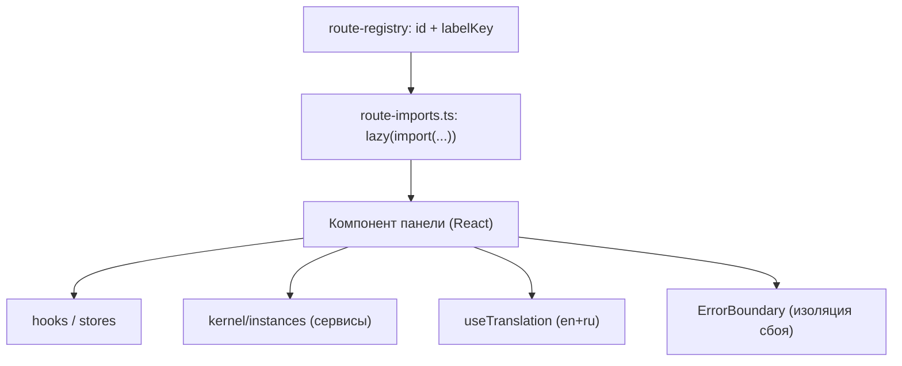

<!-- АВТОСГЕНЕРАЦИЯ: файл создан scripts/gen-wiki-docs.mjs из корпуса Wiki (src/components/WikiPanel). Не редактировать вручную. -->

# Разработчикам: компоненты и панели

> Раздел: **Разработчикам** · Статус: verified · Теги: dev, компоненты, панели

Источники: `src/components/`, `src/components/ChatPanel/MarkdownRenderer.tsx`

## Анатомия панели

- Каждая панель — ленивый компонент; сбой внутри гасит только её (ErrorBoundary), ОС продолжает работать.
- Только сервисы и контракты, без прямых импортов адаптеров/Dexie.
- Строки — через `useTranslation`, не хардкод.
- Цвета — через токены (`var(--token)`), а не сырые литералы (правило fa-02).

## Общее

- `src/components/Common/` — переиспользуемые утилиты/хуки (`usePolling`, gatewayApi и др.).
- Чат-рендер markdown/mermaid/code — `src/components/ChatPanel/` (`MarkdownRenderer`), переиспользуется в вики.

## Durable vs live

Компонент показывает либо live-состояние (события/стор), либо durable (прочитано из БД). Не смешивай: если данные обязаны пережить перезагрузку — читай из хранилища, а событие используй как сигнал «обнови».

---

## Связанные материалы

- [Разработчикам: маршруты и добавление панели](./dev-routing.md)
- [Разработчикам: локализация (i18n)](./dev-i18n.md)
- [Разработчикам: конвенции кода](./dev-conventions.md)
- [Панель: Чат](./panel-chat.md)

[← Все материалы](./README.md)
