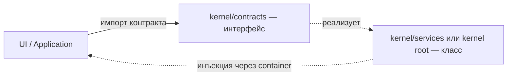

<!-- АВТОСГЕНЕРАЦИЯ: файл создан scripts/gen-wiki-docs.mjs из корпуса Wiki (src/components/WikiPanel). Не редактировать вручную. -->

# Контракты ядра

> Раздел: **Разработчикам** · Статус: verified · Теги: dev, контракты, интерфейсы, каталог

Источники: `scripts/gen-wiki-contracts.mjs`, `src/kernel/contracts/`

## Контракты ядра

Интерфейсы и типы-контракты слоя ядра (src/kernel/contracts): 291 файл, 1270 экспортов (1098 interface, 172 type). Контракт — единственная поверхность ядра, которую разрешено импортировать коду UI; реализации живут в services и передаются через DI.

### (root) (1233)

| Контракт | Вид | Файл | Реализации в ядре |
|---|---|---|---|
| ABTestComparison | interface | src/kernel/contracts/ab-test-types.ts | — |
| ABTestHistory | interface | src/kernel/contracts/ab-test-types.ts | — |
| ABTestRequest | interface | src/kernel/contracts/ab-test-types.ts | — |
| ABTestResponse | interface | src/kernel/contracts/ab-test-types.ts | — |
| ABTestResult | interface | src/kernel/contracts/ab-test-types.ts | — |
| AdvisorConfig | interface | src/kernel/contracts/advisor.ts | — |
| AdvisorMetrics | interface | src/kernel/contracts/advisor.ts | — |
| AdvisorPressureLevel | type | src/kernel/contracts/advisor.ts | — |
| DiagnosticCategory | type | src/kernel/contracts/advisor.ts | — |
| DiagnosticFinding | interface | src/kernel/contracts/advisor.ts | — |
| DiagnosticSeverity | type | src/kernel/contracts/advisor.ts | — |
| GlobalPressure | interface | src/kernel/contracts/advisor.ts | — |
| IDiagnosticsEngine | interface | src/kernel/contracts/advisor.ts | src/kernel/services/advisor/diagnostics-engine.ts |
| IInsightEngine | interface | src/kernel/contracts/advisor.ts | src/kernel/services/advisor/insight-engine.ts |
| IOptimizationEngine | interface | src/kernel/contracts/advisor.ts | src/kernel/services/advisor/optimization-engine.ts |
| IPressureEngine | interface | src/kernel/contracts/advisor.ts | src/kernel/services/advisor/pressure-engine.ts |
| IWhatIfEngine | interface | src/kernel/contracts/advisor.ts | src/kernel/services/advisor/whatif-engine.ts |
| LLMAnalysisResult | interface | src/kernel/contracts/advisor.ts | — |
| OptimizationSuggestion | interface | src/kernel/contracts/advisor.ts | — |
| PressureMapSnapshot | interface | src/kernel/contracts/advisor.ts | — |
| ProposedChange | interface | src/kernel/contracts/advisor.ts | — |
| ProviderDiagnostic | interface | src/kernel/contracts/advisor.ts | — |
| ProviderPressure | interface | src/kernel/contracts/advisor.ts | — |
| RuntimeScenario | interface | src/kernel/contracts/advisor.ts | — |
| SREAlert | interface | src/kernel/contracts/advisor.ts | — |
| SuggestionImpact | type | src/kernel/contracts/advisor.ts | — |
| SuggestionType | type | src/kernel/contracts/advisor.ts | — |
| WhatIfScenario | interface | src/kernel/contracts/advisor.ts | — |
| AgentHealth | type | src/kernel/contracts/agent-health.ts | — |
| AgentHealthSnapshot | interface | src/kernel/contracts/agent-health.ts | — |
| AgentCapability | interface | src/kernel/contracts/agent-protocol.ts | — |
| AgentProtocolMessage | interface | src/kernel/contracts/agent-protocol.ts | — |
| AgentRegistration | interface | src/kernel/contracts/agent-protocol.ts | — |
| IAgentProtocolService | interface | src/kernel/contracts/agent-protocol.ts | src/kernel/services/agent-protocol-service.ts |
| ProtocolCapability | type | src/kernel/contracts/agent-protocol.ts | — |
| ProtocolMessageType | type | src/kernel/contracts/agent-protocol.ts | — |
| IAgentProjectRuntime | interface | src/kernel/contracts/agent-runtime.ts | src/kernel/services/agent-project-runtime.ts |
| IApprovalService | interface | src/kernel/contracts/approval.ts | src/kernel/services/approval-service.ts |
| ArchDebtItem | interface | src/kernel/contracts/architecture-review.ts | — |
| ArchFinding | interface | src/kernel/contracts/architecture-review.ts | — |
| ArchReadFile | type | src/kernel/contracts/architecture-review.ts | — |
| DepGraphNode | interface | src/kernel/contracts/architecture-review.ts | — |
| IArchitectureReviewService | interface | src/kernel/contracts/architecture-review.ts | src/kernel/services/architecture-review-service.ts |
| IArtifactService | interface | src/kernel/contracts/artifact.ts | src/kernel/services/artifact-service.ts |
| AudienceArchetype | interface | src/kernel/contracts/audience.ts | — |
| AudienceMember | interface | src/kernel/contracts/audience.ts | — |
| AudiencePoll | interface | src/kernel/contracts/audience.ts | — |
| AudienceReaction | type | src/kernel/contracts/audience.ts | — |
| AudienceReactionEvent | interface | src/kernel/contracts/audience.ts | — |
| AudienceSideChatMessage | interface | src/kernel/contracts/audience.ts | — |
| AudienceState | interface | src/kernel/contracts/audience.ts | — |
| IAudienceService | interface | src/kernel/contracts/audience.ts | src/kernel/services/audience-service.ts |
| AutoDebateOptions | interface | src/kernel/contracts/auto-debate.ts | — |
| AutoDebateResult | interface | src/kernel/contracts/auto-debate.ts | — |
| BatchTestResult | interface | src/kernel/contracts/auto-debate.ts | — |
| IAutoDebateService | interface | src/kernel/contracts/auto-debate.ts | src/kernel/services/debate-runtime/auto-debate/auto-debate-service.ts |
| ProviderWinRate | interface | src/kernel/contracts/auto-debate.ts | — |
| TournamentMatch | interface | src/kernel/contracts/auto-debate.ts | — |
| TournamentResult | interface | src/kernel/contracts/auto-debate.ts | — |
| IAutonomyRunner | interface | src/kernel/contracts/autonomy-runner.ts | src/kernel/services/autonomy-runner.ts |
| IAutonomyOrchestrator | interface | src/kernel/contracts/autonomy.ts | src/kernel/services/autonomy-orchestrator.ts |
| BrowserAction | type | src/kernel/contracts/browser-harness.ts | — |
| BrowserArtifact | interface | src/kernel/contracts/browser-harness.ts | — |
| BrowserHarnessPolicy | interface | src/kernel/contracts/browser-harness.ts | — |
| IBrowserHarnessService | interface | src/kernel/contracts/browser-harness.ts | src/kernel/services/browser/browser-harness-service.ts |
| BudgetAlertAction | type | src/kernel/contracts/budget-alert.ts | — |
| BudgetAlertCondition | type | src/kernel/contracts/budget-alert.ts | — |
| BudgetAlertEvent | interface | src/kernel/contracts/budget-alert.ts | — |
| BudgetAlertRule | interface | src/kernel/contracts/budget-alert.ts | — |
| IBudgetAlertService | interface | src/kernel/contracts/budget-alert.ts | src/kernel/services/budget-alert-service.ts |
| AgentBudget | interface | src/kernel/contracts/budget.ts | — |
| BudgetAlert | interface | src/kernel/contracts/budget.ts | — |
| IBudgetService | interface | src/kernel/contracts/budget.ts | src/kernel/services/budget-service.ts |
| SpendSummary | interface | src/kernel/contracts/budget.ts | — |
| IBuilderAgentService | interface | src/kernel/contracts/builder.ts | src/kernel/services/builder/builder-agent-service.ts |
| CacheEntry | interface | src/kernel/contracts/cache.ts | — |
| ICacheService | interface | src/kernel/contracts/cache.ts | src/kernel/services/cache-service.ts |
| ICapabilityManager | interface | src/kernel/contracts/capability-manager.ts | src/kernel/services/capability-manager.ts |
| IAgentFactory | interface | src/kernel/contracts/capability.ts | src/kernel/services/capability/agent-factory.ts |
| ICapabilityResolver | interface | src/kernel/contracts/capability.ts | src/kernel/services/capability/capability-resolver.ts |
| CausalScope | interface | src/kernel/contracts/causal-debugger.ts | — |
| CausalScopeConfig | interface | src/kernel/contracts/causal-debugger.ts | — |
| CausalTrace | interface | src/kernel/contracts/causal-debugger.ts | — |
| CausalTraceEntry | interface | src/kernel/contracts/causal-debugger.ts | — |
| DecisionSnapshot | interface | src/kernel/contracts/causal-debugger.ts | — |
| EventRef | interface | src/kernel/contracts/causal-debugger.ts | — |
| ICausalScopeManager | interface | src/kernel/contracts/causal-debugger.ts | src/kernel/services/causal-scope-manager.ts |
| ICausalTraceStore | interface | src/kernel/contracts/causal-debugger.ts | src/kernel/services/causal-timeline-service.ts |
| ProjectionSnapshot | interface | src/kernel/contracts/causal-debugger.ts | — |
| IChannelService | interface | src/kernel/contracts/channel.ts | src/kernel/services/channel-service.ts |
| ChatServiceDeps | interface | src/kernel/contracts/chat.ts | — |
| CodeArtifact | interface | src/kernel/contracts/code-sandbox.ts | — |
| ICodeSandboxService | interface | src/kernel/contracts/code-sandbox.ts | src/kernel/services/sandbox/code-sandbox-service.ts |
| SandboxPolicy | interface | src/kernel/contracts/code-sandbox.ts | — |
| CognitiveIssue | interface | src/kernel/contracts/cognitive-intelligence.ts | — |
| CognitiveMetricsSnapshot | interface | src/kernel/contracts/cognitive-intelligence.ts | — |
| CognitivePressure | interface | src/kernel/contracts/cognitive-intelligence.ts | — |
| CognitiveSessionSummary | interface | src/kernel/contracts/cognitive-intelligence.ts | — |
| CognitiveZone | interface | src/kernel/contracts/cognitive-intelligence.ts | — |
| ICognitiveDiagnosticsEngine | interface | src/kernel/contracts/cognitive-intelligence.ts | src/kernel/services/cognitive-intelligence/cognitive-diagnostics.ts |
| ICognitiveIntelligenceService | interface | src/kernel/contracts/cognitive-intelligence.ts | src/kernel/services/cognitive-intelligence/cognitive-intelligence-service.ts |
| ICognitivePressureEngine | interface | src/kernel/contracts/cognitive-intelligence.ts | src/kernel/services/cognitive-intelligence/cognitive-pressure.ts |
| ICognitiveWhatIfEngine | interface | src/kernel/contracts/cognitive-intelligence.ts | src/kernel/services/cognitive-intelligence/cognitive-whatif.ts |
| SessionDiagnostic | interface | src/kernel/contracts/cognitive-intelligence.ts | — |
| TopologyWhatIf | interface | src/kernel/contracts/cognitive-intelligence.ts | — |
| CompromiseSignal | interface | src/kernel/contracts/compromise.ts | — |
| GitHubSecretAlert | interface | src/kernel/contracts/compromise.ts | — |
| SentryAlert | interface | src/kernel/contracts/compromise.ts | — |
| WebhookSource | type | src/kernel/contracts/compromise.ts | — |
| ConfigRegistry | interface | src/kernel/contracts/config-registry.ts | — |
| FeatureFlagsConfigSection | interface | src/kernel/contracts/config-registry.ts | — |
| KeysConfigSection | interface | src/kernel/contracts/config-registry.ts | — |
| LlmConfigSection | interface | src/kernel/contracts/config-registry.ts | — |
| MetricsConfigSection | interface | src/kernel/contracts/config-registry.ts | — |
| MonitoringConfigSection | interface | src/kernel/contracts/config-registry.ts | — |
| PressureConfigSection | interface | src/kernel/contracts/config-registry.ts | — |
| PricingConfigSection | interface | src/kernel/contracts/config-registry.ts | — |
| RouterConfigSection | interface | src/kernel/contracts/config-registry.ts | — |
| RouterWeightTriple | interface | src/kernel/contracts/config-registry.ts | — |
| ServicesConfigSection | interface | src/kernel/contracts/config-registry.ts | — |
| StorageConfigSection | interface | src/kernel/contracts/config-registry.ts | — |
| TracesConfigSection | interface | src/kernel/contracts/config-registry.ts | — |
| WebhooksConfigSection | interface | src/kernel/contracts/config-registry.ts | — |
| CodeManifest | interface | src/kernel/contracts/consistency-checker.ts | — |
| CodeManifestEntry | interface | src/kernel/contracts/consistency-checker.ts | — |
| ConsistencyCheckItem | interface | src/kernel/contracts/consistency-checker.ts | — |
| ConsistencyCheckType | type | src/kernel/contracts/consistency-checker.ts | — |
| ConsistencyReport | interface | src/kernel/contracts/consistency-checker.ts | — |
| IConsistencyChecker | interface | src/kernel/contracts/consistency-checker.ts | src/kernel/services/consistency-checker.ts |
| HealingFixSuggestion | interface | src/kernel/contracts/consistency-healing.ts | — |
| HealingPlan | interface | src/kernel/contracts/consistency-healing.ts | — |
| HealingResult | interface | src/kernel/contracts/consistency-healing.ts | — |
| HealingTask | interface | src/kernel/contracts/consistency-healing.ts | — |
| HealingTaskStatus | type | src/kernel/contracts/consistency-healing.ts | — |
| IConsistencyHealingPipeline | interface | src/kernel/contracts/consistency-healing.ts | src/kernel/services/consistency-checker.ts |
| ContributionDay | interface | src/kernel/contracts/contribution.ts | — |
| ContributionGraph | interface | src/kernel/contracts/contribution.ts | — |
| ContributionWeek | interface | src/kernel/contracts/contribution.ts | — |
| IContributionService | interface | src/kernel/contracts/contribution.ts | src/kernel/services/contribution-service.ts |
| CostOptimizationService | interface | src/kernel/contracts/cost-optimization-types.ts | — |
| CostRecommendation | interface | src/kernel/contracts/cost-optimization-types.ts | — |
| CostSummary | interface | src/kernel/contracts/cost-optimization-types.ts | — |
| ModelCost | interface | src/kernel/contracts/cost-optimization-types.ts | — |
| ProviderCost | interface | src/kernel/contracts/cost-optimization-types.ts | — |
| CouncilProposal | interface | src/kernel/contracts/council.ts | — |
| CreateCouncilInput | interface | src/kernel/contracts/council.ts | — |
| ICouncilLlmPort | interface | src/kernel/contracts/council.ts | src/kernel/services/llm-bridge/llm-task-executor.ts |
| ICouncilService | interface | src/kernel/contracts/council.ts | src/kernel/services/council/council-service-facade.ts, src/kernel/services/council/council-service.ts |
| DecisionExplanation | interface | src/kernel/contracts/counterfactual-explanation.ts | — |
| DecisiveComponent | interface | src/kernel/contracts/counterfactual-explanation.ts | — |
| ICounterfactualExplanationService | interface | src/kernel/contracts/counterfactual-explanation.ts | src/kernel/services/counterfactual-explanation-service.ts |
| ProviderExplanation | interface | src/kernel/contracts/counterfactual-explanation.ts | — |
| ScoreComponentDelta | interface | src/kernel/contracts/counterfactual-explanation.ts | — |
| ICounterfactualNarrativeService | interface | src/kernel/contracts/counterfactual-narrative.ts | src/kernel/services/counterfactual-narrative-service.ts |
| NarrativeExplanation | interface | src/kernel/contracts/counterfactual-narrative.ts | — |
| CounterfactualInput | interface | src/kernel/contracts/counterfactual.ts | — |
| CounterfactualOverride | interface | src/kernel/contracts/counterfactual.ts | — |
| CounterfactualResult | interface | src/kernel/contracts/counterfactual.ts | — |
| CounterfactualScoreDiff | interface | src/kernel/contracts/counterfactual.ts | — |
| ICounterfactualEngine | interface | src/kernel/contracts/counterfactual.ts | src/kernel/services/counterfactual-engine.ts |
| CreateCrewInput | interface | src/kernel/contracts/crew.ts | — |
| CreateRoleInput | interface | src/kernel/contracts/crew.ts | — |
| CreateTaskInput | interface | src/kernel/contracts/crew.ts | — |
| CrewRunResult | interface | src/kernel/contracts/crew.ts | — |
| ForgeProposal | interface | src/kernel/contracts/crew.ts | — |
| IAgentForgeService | interface | src/kernel/contracts/crew.ts | src/kernel/services/crew/agent-forge-service.ts |
| ICrewService | interface | src/kernel/contracts/crew.ts | src/kernel/services/crew/crew-service.ts |
| ICrewTaskExecutor | interface | src/kernel/contracts/crew.ts | src/kernel/services/crew/crew-service.ts, src/kernel/services/llm-bridge/llm-task-executor.ts |
| IDistributedLock | interface | src/kernel/contracts/cross-tab-lock.ts | src/kernel/services/cross-tab-lock-service.ts |
| ILockAcquireResult | interface | src/kernel/contracts/cross-tab-lock.ts | — |
| ILockEvent | interface | src/kernel/contracts/cross-tab-lock.ts | — |
| LockAcquisition | interface | src/kernel/contracts/cross-tab-lock.ts | — |
| LockListener | type | src/kernel/contracts/cross-tab-lock.ts | — |
| LockOptions | interface | src/kernel/contracts/cross-tab-lock.ts | — |
| LockResource | type | src/kernel/contracts/cross-tab-lock.ts | — |
| CircuitBreakerState | interface | src/kernel/contracts/cross-tab-state.ts | — |
| ICrossTabStateSync | interface | src/kernel/contracts/cross-tab-state.ts | src/kernel/services/cross-tab-state.ts |
| RateLimitState | interface | src/kernel/contracts/cross-tab-state.ts | — |
| CustomMetric | interface | src/kernel/contracts/custom-metrics.ts | — |
| ICustomMetricsService | interface | src/kernel/contracts/custom-metrics.ts | src/kernel/services/custom-metrics-service.ts |
| MetricAggregation | type | src/kernel/contracts/custom-metrics.ts | — |
| MetricDashboard | interface | src/kernel/contracts/custom-metrics.ts | — |
| MetricValue | interface | src/kernel/contracts/custom-metrics.ts | — |
| DeadLetterEntry | interface | src/kernel/contracts/dead-letter-queue.ts | — |
| IDeadLetterQueue | interface | src/kernel/contracts/dead-letter-queue.ts | src/kernel/services/dead-letter-queue-service.ts |
| IAbstractionLadderService | interface | src/kernel/contracts/debate-abstraction-ladder.ts | src/kernel/services/debate-runtime/abstraction-ladder-service.ts |
| LadderStep | interface | src/kernel/contracts/debate-abstraction-ladder.ts | — |
| IAdaptiveOrderService | interface | src/kernel/contracts/debate-adaptive-order.ts | src/kernel/services/debate-runtime/adaptive-order-service.ts |
| Order | interface | src/kernel/contracts/debate-adaptive-order.ts | — |
| IAdversarialSourceService | interface | src/kernel/contracts/debate-adversarial-source.ts | src/kernel/services/debate-runtime/debate-adversarial-source-service.ts |
| SourceVerificationResult | interface | src/kernel/contracts/debate-adversarial-source.ts | — |
| IAgreementAnchoringService | interface | src/kernel/contracts/debate-agreement-anchoring.ts | src/kernel/services/debate-runtime/agreement-anchoring-service.ts |
| SharedPremise | interface | src/kernel/contracts/debate-agreement-anchoring.ts | — |
| Alliance | interface | src/kernel/contracts/debate-alliance.ts | — |
| IAllianceService | interface | src/kernel/contracts/debate-alliance.ts | src/kernel/services/debate-runtime/alliance-service.ts |
| ArgumentEdge | interface | src/kernel/contracts/debate-argument-graph.ts | — |
| ArgumentEdgeType | type | src/kernel/contracts/debate-argument-graph.ts | — |
| ArgumentGraphStats | interface | src/kernel/contracts/debate-argument-graph.ts | — |
| ArgumentNode | interface | src/kernel/contracts/debate-argument-graph.ts | — |
| ConstraintCandidate | interface | src/kernel/contracts/debate-argument-graph.ts | — |
| EdgeDetectionMethod | type | src/kernel/contracts/debate-argument-graph.ts | — |
| GraphBuildInput | interface | src/kernel/contracts/debate-argument-graph.ts | — |
| IArgumentGraphService | interface | src/kernel/contracts/debate-argument-graph.ts | src/kernel/services/debate-runtime/debate-argument-graph-service.ts |
| UnattackedClaim | interface | src/kernel/contracts/debate-argument-graph.ts | — |
| BayesianBelief | interface | src/kernel/contracts/debate-bayesian.ts | — |
| IBayesianJudge | interface | src/kernel/contracts/debate-bayesian.ts | src/kernel/services/debate-runtime/bayesian-judge.ts |
| BeliefConflict | interface | src/kernel/contracts/debate-belief-mining.ts | — |
| BeliefType | type | src/kernel/contracts/debate-belief-mining.ts | — |
| ConflictType | type | src/kernel/contracts/debate-belief-mining.ts | — |
| IBeliefMiningService | interface | src/kernel/contracts/debate-belief-mining.ts | src/kernel/services/debate-runtime/debate-belief-mining-service.ts |
| MinedBelief | interface | src/kernel/contracts/debate-belief-mining.ts | — |
| BestOfNResult | interface | src/kernel/contracts/debate-best-of-n.ts | — |
| IBestOfNSelector | interface | src/kernel/contracts/debate-best-of-n.ts | src/kernel/services/debate-runtime/best-of-n.ts |
| LlmCallFn | type | src/kernel/contracts/debate-best-of-n.ts | — |
| VariantScore | interface | src/kernel/contracts/debate-best-of-n.ts | — |
| BiasProfile | interface | src/kernel/contracts/debate-bias.ts | — |
| BiasScore | interface | src/kernel/contracts/debate-bias.ts | — |
| BiasType | type | src/kernel/contracts/debate-bias.ts | — |
| IBiasProfiler | interface | src/kernel/contracts/debate-bias.ts | src/kernel/services/debate-runtime/bias-profiler.ts |
| Bid | interface | src/kernel/contracts/debate-bidding-time.ts | — |
| IBiddingTimeService | interface | src/kernel/contracts/debate-bidding-time.ts | src/kernel/services/debate-runtime/bidding-time-service.ts |
| BlendedConcept | interface | src/kernel/contracts/debate-blending.ts | — |
| BlendResult | interface | src/kernel/contracts/debate-blending.ts | — |
| DeadlockSignal | interface | src/kernel/contracts/debate-blending.ts | — |
| IConceptBlender | interface | src/kernel/contracts/debate-blending.ts | src/kernel/services/debate-runtime/concept-blender.ts |
| IBlindEvaluationService | interface | src/kernel/contracts/debate-blind-eval.ts | src/kernel/services/debate-runtime/blind-evaluation-service.ts |
| BoPStatus | type | src/kernel/contracts/debate-bop.ts | — |
| BurdenEntry | interface | src/kernel/contracts/debate-bop.ts | — |
| IBoPTrackerService | interface | src/kernel/contracts/debate-bop.ts | src/kernel/services/debate-runtime/debate-bop-service.ts |
| UnmetBurden | interface | src/kernel/contracts/debate-bop.ts | — |
| IBurdenOfProofService | interface | src/kernel/contracts/debate-burden-of-proof.ts | src/kernel/services/debate-runtime/burden-of-proof-service.ts |
| UnsupportedClaim | interface | src/kernel/contracts/debate-burden-of-proof.ts | — |
| CalibrationViolation | interface | src/kernel/contracts/debate-calibration.ts | — |
| ClaimScore | interface | src/kernel/contracts/debate-calibration.ts | — |
| ICalibrationService | interface | src/kernel/contracts/debate-calibration.ts | src/kernel/services/debate-runtime/calibration-service.ts |
| CausalAnalysis | interface | src/kernel/contracts/debate-causal-graph.ts | — |
| CausalLink | interface | src/kernel/contracts/debate-causal-graph.ts | — |
| ICausalGraphBuilder | interface | src/kernel/contracts/debate-causal-graph.ts | src/kernel/services/debate-runtime/causal-graph-builder.ts |
| ConcessionOpportunity | interface | src/kernel/contracts/debate-concession.ts | — |
| IConcessionService | interface | src/kernel/contracts/debate-concession.ts | src/kernel/services/debate-runtime/concession-service.ts |
| ConsistencyWarning | interface | src/kernel/contracts/debate-consistency.ts | — |
| Contradiction | interface | src/kernel/contracts/debate-consistency.ts | — |
| IConsistencyService | interface | src/kernel/contracts/debate-consistency.ts | src/kernel/services/debate-runtime/debate-consistency-service.ts |
| CounterfactualScenario | interface | src/kernel/contracts/debate-counterfactual.ts | — |
| ICounterfactualService | interface | src/kernel/contracts/debate-counterfactual.ts | src/kernel/services/debate-runtime/counterfactual-service.ts |
| ICredibilityScorer | interface | src/kernel/contracts/debate-credibility.ts | src/kernel/services/debate-runtime/debate-credibility-service.ts |
| SourceCredibility | interface | src/kernel/contracts/debate-credibility.ts | — |
| CriticFeedback | interface | src/kernel/contracts/debate-critic.ts | — |
| ICriticService | interface | src/kernel/contracts/debate-critic.ts | src/kernel/services/debate-runtime/critic-service.ts |
| CrossExaminationTarget | interface | src/kernel/contracts/debate-cross-examination.ts | — |
| ICrossExaminationService | interface | src/kernel/contracts/debate-cross-examination.ts | src/kernel/services/debate-runtime/cross-examination-service.ts |
| DeltaPoint | interface | src/kernel/contracts/debate-delta-focusing.ts | — |
| IDeltaFocusingService | interface | src/kernel/contracts/debate-delta-focusing.ts | src/kernel/services/debate-runtime/delta-focusing-service.ts |
| IDpoStrategySampler | interface | src/kernel/contracts/debate-dpo-sampler.ts | src/kernel/services/debate-runtime/dpo-strategy-sampler.ts |
| PreferenceScore | interface | src/kernel/contracts/debate-dpo-sampler.ts | — |
| DriftRecord | interface | src/kernel/contracts/debate-drift.ts | — |
| IPersonaDriftDetector | interface | src/kernel/contracts/debate-drift.ts | src/kernel/services/debate-runtime/persona-drift-detector.ts |
| PersonaProfile | interface | src/kernel/contracts/debate-drift.ts | — |
| IDynamicPersonaService | interface | src/kernel/contracts/debate-dynamic-persona.ts | src/kernel/services/debate-runtime/dynamic-persona-service.ts |
| PersonaVariant | interface | src/kernel/contracts/debate-dynamic-persona.ts | — |
| ArenaLayout | type | src/kernel/contracts/debate-emotion.ts | — |
| ArenaLayoutConfig | interface | src/kernel/contracts/debate-emotion.ts | — |
| DebateEmotion | type | src/kernel/contracts/debate-emotion.ts | — |
| EmpathyMirror | interface | src/kernel/contracts/debate-empathy.ts | — |
| IEmpathyService | interface | src/kernel/contracts/debate-empathy.ts | src/kernel/services/debate-runtime/empathy-service.ts |
| AnchorClaim | interface | src/kernel/contracts/debate-entanglement.ts | — |
| EntanglementConstraint | interface | src/kernel/contracts/debate-entanglement.ts | — |
| EntanglementResponseType | type | src/kernel/contracts/debate-entanglement.ts | — |
| IAnchoringService | interface | src/kernel/contracts/debate-entanglement.ts | src/kernel/services/debate-runtime/debate-entanglement-engine.ts |
| IEntanglementEngine | interface | src/kernel/contracts/debate-entanglement.ts | src/kernel/services/debate-runtime/debate-entanglement-engine.ts |
| ResponseValidationResult | interface | src/kernel/contracts/debate-entanglement.ts | — |
| EnthymemeGap | interface | src/kernel/contracts/debate-enthymeme.ts | — |
| IEnthymemeService | interface | src/kernel/contracts/debate-enthymeme.ts | src/kernel/services/debate-runtime/enthymeme-service.ts |
| CalibrationScore | interface | src/kernel/contracts/debate-epistemic-calibration.ts | — |
| IEpistemicCalibrationService | interface | src/kernel/contracts/debate-epistemic-calibration.ts | src/kernel/services/debate-runtime/epistemic-calibration-service.ts |
| IEvidenceRevelationService | interface | src/kernel/contracts/debate-evidence-revelation.ts | src/kernel/services/debate-runtime/evidence-revelation-service.ts |
| RevealStage | interface | src/kernel/contracts/debate-evidence-revelation.ts | — |
| IEvidenceTriangulationService | interface | src/kernel/contracts/debate-evidence-triangulation.ts | src/kernel/services/debate-runtime/evidence-triangulation-service.ts |
| TriangulationResult | interface | src/kernel/contracts/debate-evidence-triangulation.ts | — |
| ExecutableClaim | interface | src/kernel/contracts/debate-executable-evidence.ts | — |
| IExecutableEvidenceService | interface | src/kernel/contracts/debate-executable-evidence.ts | src/kernel/services/debate-runtime/executable-evidence-service.ts |
| ExpertTestimony | interface | src/kernel/contracts/debate-expert-witness.ts | — |
| ExpertWitness | interface | src/kernel/contracts/debate-expert-witness.ts | — |
| IExpertWitnessService | interface | src/kernel/contracts/debate-expert-witness.ts | src/kernel/services/debate-runtime/expert-witness-service.ts |
| FactCheckResult | interface | src/kernel/contracts/debate-fact-checking.ts | — |
| IFactCheckingService | interface | src/kernel/contracts/debate-fact-checking.ts | src/kernel/services/debate-runtime/fact-checking-service.ts |
| FogConfig | interface | src/kernel/contracts/debate-fog-of-war.ts | — |
| IFogOfWarService | interface | src/kernel/contracts/debate-fog-of-war.ts | src/kernel/services/debate-runtime/fog-of-war-service.ts |
| ArgumentVariant | interface | src/kernel/contracts/debate-forecaster.ts | — |
| ForecastResult | interface | src/kernel/contracts/debate-forecaster.ts | — |
| IOutcomeForecaster | interface | src/kernel/contracts/debate-forecaster.ts | src/kernel/services/debate-runtime/outcome-forecaster.ts |
| FrameEntry | interface | src/kernel/contracts/debate-frame-tracker.ts | — |
| FrameType | type | src/kernel/contracts/debate-frame-tracker.ts | — |
| IFrameTracker | interface | src/kernel/contracts/debate-frame-tracker.ts | src/kernel/services/debate-runtime/frame-tracker.ts |
| GoTBranch | interface | src/kernel/contracts/debate-got.ts | — |
| GoTBranchType | type | src/kernel/contracts/debate-got.ts | — |
| GoTResult | interface | src/kernel/contracts/debate-got.ts | — |
| IGoTDeliberation | interface | src/kernel/contracts/debate-got.ts | src/kernel/services/debate-runtime/got-deliberation.ts |
| HeatLevel | interface | src/kernel/contracts/debate-heat.ts | — |
| IHeatDetectionService | interface | src/kernel/contracts/debate-heat.ts | src/kernel/services/debate-runtime/heat-detection-service.ts |
| DialecticSynthesis | interface | src/kernel/contracts/debate-hegelian.ts | — |
| IHegelianService | interface | src/kernel/contracts/debate-hegelian.ts | src/kernel/services/debate-runtime/hegelian-service.ts |
| IDebateHumanService | interface | src/kernel/contracts/debate-human.ts | src/kernel/services/debate-runtime/debate-human-service.ts |
| HumilityScore | interface | src/kernel/contracts/debate-humility-scoring.ts | — |
| IHumilityScoringService | interface | src/kernel/contracts/debate-humility-scoring.ts | src/kernel/services/debate-runtime/humility-scoring-service.ts |
| HumorInsert | interface | src/kernel/contracts/debate-humor.ts | — |
| IHumorService | interface | src/kernel/contracts/debate-humor.ts | src/kernel/services/debate-runtime/humor-service.ts |
| IIncentiveDetector | interface | src/kernel/contracts/debate-incentives.ts | src/kernel/services/debate-runtime/incentive-detector.ts |
| IncentiveAnalysis | interface | src/kernel/contracts/debate-incentives.ts | — |
| IncentiveProfile | interface | src/kernel/contracts/debate-incentives.ts | — |
| IInsightBus | interface | src/kernel/contracts/debate-insight-bus.ts | src/kernel/services/debate-runtime/insight-bus.ts |
| Insight | interface | src/kernel/contracts/debate-insight-bus.ts | — |
| InsightType | type | src/kernel/contracts/debate-insight-bus.ts | — |
| IProjectDebateIntegration | interface | src/kernel/contracts/debate-integration.ts | src/kernel/services/project-debate-integration.ts |
| IInterruptQueue | interface | src/kernel/contracts/debate-interrupt.ts | src/kernel/services/debate-runtime/interrupt-queue.ts |
| InterruptRequest | interface | src/kernel/contracts/debate-interrupt.ts | — |
| InterruptStatus | type | src/kernel/contracts/debate-interrupt.ts | — |
| DeliberationResult | interface | src/kernel/contracts/debate-judge-deliberation.ts | — |
| IJudgeDeliberationService | interface | src/kernel/contracts/debate-judge-deliberation.ts | src/kernel/services/debate-runtime/judge-deliberation-service.ts |
| IJustificationEnforcer | interface | src/kernel/contracts/debate-justification.ts | src/kernel/services/debate-runtime/justification-enforcer.ts |
| JustificationChain | interface | src/kernel/contracts/debate-justification.ts | — |
| JustificationHop | type | src/kernel/contracts/debate-justification.ts | — |
| AbstractionLevel | type | src/kernel/contracts/debate-level-tracker.ts | — |
| ILevelTracker | interface | src/kernel/contracts/debate-level-tracker.ts | src/kernel/services/debate-runtime/level-tracker.ts |
| LevelAnalysis | interface | src/kernel/contracts/debate-level-tracker.ts | — |
| EnthymemeTarget | interface | src/kernel/contracts/debate-logic.ts | — |
| ILogicalFormExtractor | interface | src/kernel/contracts/debate-logic.ts | src/kernel/services/debate-runtime/logical-form-extractor.ts |
| LogicalForm | interface | src/kernel/contracts/debate-logic.ts | — |
| LogicalFormType | type | src/kernel/contracts/debate-logic.ts | — |
| LogicalPremise | interface | src/kernel/contracts/debate-logic.ts | — |
| IMetaAgentController | interface | src/kernel/contracts/debate-meta-agent.ts | src/kernel/services/debate-runtime/debate-meta-agent-controller.ts |
| TacticalDirective | interface | src/kernel/contracts/debate-meta-agent.ts | — |
| TacticalRole | type | src/kernel/contracts/debate-meta-agent.ts | — |
| IMinimaxPlanner | interface | src/kernel/contracts/debate-minimax.ts | src/kernel/services/debate-runtime/debate-minimax-planner.ts |
| MinimaxActionType | type | src/kernel/contracts/debate-minimax.ts | — |
| MinimaxMove | interface | src/kernel/contracts/debate-minimax.ts | — |
| DebateMode | interface | src/kernel/contracts/debate-mode-system.ts | — |
| DebateModeId | type | src/kernel/contracts/debate-mode-system.ts | — |
| DebateModePreset | interface | src/kernel/contracts/debate-mode-system.ts | — |
| ModePolicy | interface | src/kernel/contracts/debate-mode-system.ts | — |
| PolicyType | type | src/kernel/contracts/debate-mode-system.ts | — |
| IMultiHopService | interface | src/kernel/contracts/debate-multi-hop.ts | src/kernel/services/debate-runtime/multi-hop-service.ts |
| MultiHopCheck | interface | src/kernel/contracts/debate-multi-hop.ts | — |
| INarrativeBuilder | interface | src/kernel/contracts/debate-narrative.ts | src/kernel/services/debate-runtime/narrative-builder.ts |
| NarrativeArc | interface | src/kernel/contracts/debate-narrative.ts | — |
| NarrativeArcType | type | src/kernel/contracts/debate-narrative.ts | — |
| IObjectionAnticipationService | interface | src/kernel/contracts/debate-objection-anticipation.ts | src/kernel/services/debate-runtime/objection-anticipation-service.ts |
| ObjectionSlot | interface | src/kernel/contracts/debate-objection-anticipation.ts | — |
| IPersonaMixer | interface | src/kernel/contracts/debate-persona-mixer.ts | src/kernel/services/debate-runtime/persona-mixer.ts |
| MixContext | interface | src/kernel/contracts/debate-persona-mixer.ts | — |
| PersonaMix | interface | src/kernel/contracts/debate-persona-mixer.ts | — |
| IPersonaSelector | interface | src/kernel/contracts/debate-persona-selector.ts | src/kernel/services/debate-runtime/persona-selector.ts |
| PersonaVariant | interface | src/kernel/contracts/debate-persona-selector.ts | — |
| IPivotService | interface | src/kernel/contracts/debate-pivot.ts | src/kernel/services/debate-runtime/pivot-service.ts |
| PivotSignal | interface | src/kernel/contracts/debate-pivot.ts | — |
| CriticIssue | interface | src/kernel/contracts/debate-pre-publish-critic.ts | — |
| IPrePublishCriticService | interface | src/kernel/contracts/debate-pre-publish-critic.ts | src/kernel/services/debate-runtime/pre-publish-critic-service.ts |
| IPredictionMarketService | interface | src/kernel/contracts/debate-prediction-market.ts | src/kernel/services/debate-runtime/prediction-market-service.ts |
| MarketPrediction | interface | src/kernel/contracts/debate-prediction-market.ts | — |
| QualityTechnique | interface | src/kernel/contracts/debate-quality-settings.ts | — |
| IRedundancyService | interface | src/kernel/contracts/debate-redundancy.ts | src/kernel/services/debate-runtime/redundancy-service.ts |
| RedundancyReport | interface | src/kernel/contracts/debate-redundancy.ts | — |
| IReplaySelector | interface | src/kernel/contracts/debate-replay.ts | — |
| PivotalMoment | interface | src/kernel/contracts/debate-replay.ts | — |
| IRhetoricSafetyService | interface | src/kernel/contracts/debate-rhetoric-safety.ts | src/kernel/services/debate-runtime/rhetoric-safety-service.ts |
| SafetyFlag | interface | src/kernel/contracts/debate-rhetoric-safety.ts | — |
| IRhetoricalDeviceSelector | interface | src/kernel/contracts/debate-rhetorical-device.ts | src/kernel/services/debate-runtime/rhetorical-device-selector.ts |
| RhetoricalDevice | interface | src/kernel/contracts/debate-rhetorical-device.ts | — |
| IRoleReversalService | interface | src/kernel/contracts/debate-role-reversal.ts | src/kernel/services/debate-runtime/role-reversal-service.ts |
| ReversalPrompt | interface | src/kernel/contracts/debate-role-reversal.ts | — |
| AgentBelief | interface | src/kernel/contracts/debate-rtom.ts | — |
| IRToMGraphService | interface | src/kernel/contracts/debate-rtom.ts | src/kernel/services/debate-runtime/debate-rtom-service.ts |
| RToMGraph | interface | src/kernel/contracts/debate-rtom.ts | — |
| RToMStance | type | src/kernel/contracts/debate-rtom.ts | — |
| TheoryOfMindEdge | interface | src/kernel/contracts/debate-rtom.ts | — |
| AgentExecutionRequest | interface | src/kernel/contracts/debate-runtime.ts | — |
| AgentExecutionResult | interface | src/kernel/contracts/debate-runtime.ts | — |
| AgentExecutor | type | src/kernel/contracts/debate-runtime.ts | — |
| AgentScore | interface | src/kernel/contracts/debate-runtime.ts | — |
| AgentStateEntry | interface | src/kernel/contracts/debate-runtime.ts | — |
| BudgetSnapshot | interface | src/kernel/contracts/debate-runtime.ts | — |
| Claim | interface | src/kernel/contracts/debate-runtime.ts | — |
| Conflict | interface | src/kernel/contracts/debate-runtime.ts | — |
| ConsensusResult | interface | src/kernel/contracts/debate-runtime.ts | — |
| DebateBudgetLimits | interface | src/kernel/contracts/debate-runtime.ts | — |
| DebateSessionSnapshot | interface | src/kernel/contracts/debate-runtime.ts | — |
| DebateTopology | interface | src/kernel/contracts/debate-runtime.ts | — |
| IConsensusEngine | interface | src/kernel/contracts/debate-runtime.ts | src/kernel/services/debate-runtime/debate-consensus.ts |
| IDebateBudget | interface | src/kernel/contracts/debate-runtime.ts | src/kernel/services/debate-runtime/debate-budget.ts, src/kernel/services/debate-runtime/debate-pipeline-fake-engine.ts |
| IDebateEngine | interface | src/kernel/contracts/debate-runtime.ts | src/kernel/services/debate-runtime/debate-engine.ts |
| IDebateEvaluator | interface | src/kernel/contracts/debate-runtime.ts | src/kernel/services/council/council-aware-evaluator.ts, src/kernel/services/council/weighted-judge-evaluator.ts, src/kernel/services/debate-runtime/debate-evaluator.ts |
| IDebateMemory | interface | src/kernel/contracts/debate-runtime.ts | src/kernel/services/debate-runtime/debate-memory.ts |
| IDebateOrchestrator | interface | src/kernel/contracts/debate-runtime.ts | src/kernel/services/debate-runtime/conversation-backed-debate-orchestrator.ts, src/kernel/services/debate-runtime/debate-orchestrator.ts |
| IDebateSession | interface | src/kernel/contracts/debate-runtime.ts | src/kernel/services/debate-runtime/debate-session.ts |
| IDebateTimeline | interface | src/kernel/contracts/debate-runtime.ts | src/kernel/services/debate-runtime/debate-timeline.ts |
| ITopologyService | interface | src/kernel/contracts/debate-runtime.ts | src/kernel/services/debate-runtime/debate-topology.ts |
| MemoryRecord | interface | src/kernel/contracts/debate-runtime.ts | — |
| MemorySnapshot | interface | src/kernel/contracts/debate-runtime.ts | — |
| OrchestratorEvent | type | src/kernel/contracts/debate-runtime.ts | — |
| ParticipantConfig | interface | src/kernel/contracts/debate-runtime.ts | — |
| PressureAction | interface | src/kernel/contracts/debate-runtime.ts | — |
| PressureLevel | type | src/kernel/contracts/debate-runtime.ts | — |
| ReasoningChain | interface | src/kernel/contracts/debate-runtime.ts | — |
| ReasoningStep | interface | src/kernel/contracts/debate-runtime.ts | — |
| ReasoningTrace | interface | src/kernel/contracts/debate-runtime.ts | — |
| TopologyEdge | interface | src/kernel/contracts/debate-runtime.ts | — |
| TopologyNode | interface | src/kernel/contracts/debate-runtime.ts | — |
| IScratchpadService | interface | src/kernel/contracts/debate-scratchpad.ts | src/kernel/services/debate-runtime/scratchpad-service.ts |
| ScratchpadAnalysis | interface | src/kernel/contracts/debate-scratchpad.ts | — |
| BlendResult | interface | src/kernel/contracts/debate-semantic-blending.ts | — |
| ISemanticBlendingService | interface | src/kernel/contracts/debate-semantic-blending.ts | src/kernel/services/debate-runtime/semantic-blending-service.ts |
| AbandonedClaim | interface | src/kernel/contracts/debate-sentinel.ts | — |
| ISentinelService | interface | src/kernel/contracts/debate-sentinel.ts | src/kernel/services/debate-runtime/sentinel-service.ts |
| DebateServiceDeps | interface | src/kernel/contracts/debate-service-deps.ts | — |
| IShadowOpponentService | interface | src/kernel/contracts/debate-shadow-opponent.ts | src/kernel/services/debate-runtime/debate-shadow-opponent-service.ts |
| ShadowCritique | interface | src/kernel/contracts/debate-shadow-opponent.ts | — |
| ISimilarityMonitor | interface | src/kernel/contracts/debate-similarity.ts | src/kernel/services/debate-runtime/similarity-monitor.ts |
| RedundancyRecord | interface | src/kernel/contracts/debate-similarity.ts | — |
| ISocraticPivotService | interface | src/kernel/contracts/debate-socratic-pivot.ts | src/kernel/services/debate-runtime/socratic-pivot-service.ts |
| PivotQuestion | interface | src/kernel/contracts/debate-socratic-pivot.ts | — |
| IStakeholderMapper | interface | src/kernel/contracts/debate-stakeholder.ts | src/kernel/services/debate-runtime/stakeholder-mapper.ts |
| Stakeholder | interface | src/kernel/contracts/debate-stakeholder.ts | — |
| DriftEvent | interface | src/kernel/contracts/debate-stance-drift.ts | — |
| DriftType | type | src/kernel/contracts/debate-stance-drift.ts | — |
| IStanceDriftTracker | interface | src/kernel/contracts/debate-stance-drift.ts | src/kernel/services/debate-runtime/stance-drift-tracker.ts |
| StanceVector | interface | src/kernel/contracts/debate-stance-drift.ts | — |
| IStateMachine | interface | src/kernel/contracts/debate-state-machine.ts | src/kernel/services/debate-runtime/debate-state-machine.ts |
| TransitionEvent | type | src/kernel/contracts/debate-state-machine.ts | — |
| TransitionGuard | type | src/kernel/contracts/debate-state-machine.ts | — |
| TransitionHook | type | src/kernel/contracts/debate-state-machine.ts | — |
| TransitionOutcome | interface | src/kernel/contracts/debate-state-machine.ts | — |
| IStatusDynamicsService | interface | src/kernel/contracts/debate-status-dynamics.ts | src/kernel/services/debate-runtime/status-dynamics-service.ts |
| StatusLevel | interface | src/kernel/contracts/debate-status-dynamics.ts | — |
| ISteelmanService | interface | src/kernel/contracts/debate-steelman.ts | src/kernel/services/debate-runtime/debate-steelman-service.ts |
| SteelmanTarget | interface | src/kernel/contracts/debate-steelman.ts | — |
| IDebateLiveStore | interface | src/kernel/contracts/debate-store.ts | — |
| IDebateSessionStore | interface | src/kernel/contracts/debate-store.ts | — |
| SessionStoreSubscriber | type | src/kernel/contracts/debate-store.ts | — |
| IStrategist | interface | src/kernel/contracts/debate-strategist.ts | src/kernel/services/debate-runtime/debate-strategist.ts |
| StrategicDirective | type | src/kernel/contracts/debate-strategist.ts | — |
| StrategistPlan | interface | src/kernel/contracts/debate-strategist.ts | — |
| CriticLoopPrimitive | interface | src/kernel/contracts/debate-strategy-dsl.ts | — |
| DebateGraphPrimitive | interface | src/kernel/contracts/debate-strategy-dsl.ts | — |
| GraphAgentConfig | interface | src/kernel/contracts/debate-strategy-dsl.ts | — |
| GraphEdge | interface | src/kernel/contracts/debate-strategy-dsl.ts | — |
| GraphEdgeType | type | src/kernel/contracts/debate-strategy-dsl.ts | — |
| Incompatibility | interface | src/kernel/contracts/debate-strategy-dsl.ts | — |
| IncompatibilitySeverity | type | src/kernel/contracts/debate-strategy-dsl.ts | — |
| IStrategyRegistry | interface | src/kernel/contracts/debate-strategy-dsl.ts | src/kernel/services/debate-runtime/debate-strategy-registry.ts |
| PeerReviewPrimitive | interface | src/kernel/contracts/debate-strategy-dsl.ts | — |
| ReviewCriteria | type | src/kernel/contracts/debate-strategy-dsl.ts | — |
| SequencePrimitive | interface | src/kernel/contracts/debate-strategy-dsl.ts | — |
| SequenceStep | interface | src/kernel/contracts/debate-strategy-dsl.ts | — |
| StrategyCompatibility | interface | src/kernel/contracts/debate-strategy-dsl.ts | — |
| StrategyDefinition | interface | src/kernel/contracts/debate-strategy-dsl.ts | — |
| StrategyParameter | interface | src/kernel/contracts/debate-strategy-dsl.ts | — |
| StrategyPrimitive | type | src/kernel/contracts/debate-strategy-dsl.ts | — |
| StrategyPrimitiveBase | interface | src/kernel/contracts/debate-strategy-dsl.ts | — |
| StrategyPrimitiveType | type | src/kernel/contracts/debate-strategy-dsl.ts | — |
| StrategyRegistryEntry | interface | src/kernel/contracts/debate-strategy-dsl.ts | — |
| ValidationError | interface | src/kernel/contracts/debate-strategy-dsl.ts | — |
| ValidationResult | interface | src/kernel/contracts/debate-strategy-dsl.ts | — |
| VotingMechanism | type | src/kernel/contracts/debate-strategy-dsl.ts | — |
| VotingPrimitive | interface | src/kernel/contracts/debate-strategy-dsl.ts | — |
| InferredStrategy | interface | src/kernel/contracts/debate-strategy-fingerprint.ts | — |
| IStrategyFingerprintService | interface | src/kernel/contracts/debate-strategy-fingerprint.ts | src/kernel/services/debate-runtime/debate-strategy-fingerprint.ts |
| IStyleMatchingService | interface | src/kernel/contracts/debate-style-matching.ts | src/kernel/services/debate-runtime/style-matching-service.ts |
| StyleProfile | interface | src/kernel/contracts/debate-style-matching.ts | — |
| ISynthesisService | interface | src/kernel/contracts/debate-synthesis.ts | src/kernel/services/debate-runtime/synthesis-service.ts |
| SynthesisResult | interface | src/kernel/contracts/debate-synthesis.ts | — |
| ITriangulationService | interface | src/kernel/contracts/debate-triangulation.ts | src/kernel/services/debate-runtime/triangulation-service.ts |
| TriangulationCheck | interface | src/kernel/contracts/debate-triangulation.ts | — |
| ActivityMetrics | interface | src/kernel/contracts/debate-types.ts | — |
| AgentActivityMetric | interface | src/kernel/contracts/debate-types.ts | — |
| AgentPhase | type | src/kernel/contracts/debate-types.ts | — |
| ArgumentImpact | interface | src/kernel/contracts/debate-types.ts | — |
| ArgumentStrategy | type | src/kernel/contracts/debate-types.ts | — |
| ConstraintCorrelation | interface | src/kernel/contracts/debate-types.ts | — |
| DebateArgument | interface | src/kernel/contracts/debate-types.ts | — |
| DebateConfig | interface | src/kernel/contracts/debate-types.ts | — |
| DebateConstraint | type | src/kernel/contracts/debate-types.ts | — |
| DebateGraphMetrics | interface | src/kernel/contracts/debate-types.ts | — |
| DebateInterpretation | interface | src/kernel/contracts/debate-types.ts | — |
| DebateParticipant | interface | src/kernel/contracts/debate-types.ts | — |
| DebatePhase | type | src/kernel/contracts/debate-types.ts | — |
| DebateRole | type | src/kernel/contracts/debate-types.ts | — |
| DebateSession | interface | src/kernel/contracts/debate-types.ts | — |
| DebateSessionStrategy | type | src/kernel/contracts/debate-types.ts | — |
| DebateStrategy | type | src/kernel/contracts/debate-types.ts | — |
| DebateVerdict | interface | src/kernel/contracts/debate-types.ts | — |
| DepthMetric | interface | src/kernel/contracts/debate-types.ts | — |
| DisagreementPoint | interface | src/kernel/contracts/debate-types.ts | — |
| HumanVote | interface | src/kernel/contracts/debate-types.ts | — |
| IDebateQueryEngine | interface | src/kernel/contracts/debate-types.ts | src/kernel/services/debate-runtime/debate-query-engine.ts |
| OriginalityMetric | interface | src/kernel/contracts/debate-types.ts | — |
| ParentResolution | type | src/kernel/contracts/debate-types.ts | — |
| QualityMetrics | interface | src/kernel/contracts/debate-types.ts | — |
| TimelineEntry | interface | src/kernel/contracts/debate-types.ts | — |
| TopologyType | type | src/kernel/contracts/debate-types.ts | — |
| TrajectoryChanger | interface | src/kernel/contracts/debate-types.ts | — |
| UsefulnessMetric | interface | src/kernel/contracts/debate-types.ts | — |
| VerdictFeedback | interface | src/kernel/contracts/debate-types.ts | — |
| VerdictFeedbackVote | type | src/kernel/contracts/debate-types.ts | — |
| VerdictKeyArgument | interface | src/kernel/contracts/debate-types.ts | — |
| IUncertaintyPropagationService | interface | src/kernel/contracts/debate-uncertainty-propagation.ts | src/kernel/services/debate-runtime/uncertainty-propagation-service.ts |
| UncertaintyNode | interface | src/kernel/contracts/debate-uncertainty-propagation.ts | — |
| IVulnerabilityTargetingService | interface | src/kernel/contracts/debate-vulnerability.ts | src/kernel/services/debate-runtime/debate-vulnerability-service.ts |
| VulnerabilityTarget | interface | src/kernel/contracts/debate-vulnerability.ts | — |
| VulnerabilityType | type | src/kernel/contracts/debate-vulnerability.ts | — |
| IWhisperChannelsService | interface | src/kernel/contracts/debate-whisper-channels.ts | src/kernel/services/debate-runtime/whisper-channels-service.ts |
| Whisper | interface | src/kernel/contracts/debate-whisper-channels.ts | — |
| DebateFormatId | type | src/kernel/contracts/debateplus.ts | — |
| FormatResult | interface | src/kernel/contracts/debateplus.ts | — |
| IArgTechService | interface | src/kernel/contracts/debateplus.ts | src/kernel/services/debateplus/argtech-service.ts |
| IFormatService | interface | src/kernel/contracts/debateplus.ts | src/kernel/services/debateplus/format-service.ts |
| DeployBundle | interface | src/kernel/contracts/deploy-bundle.ts | — |
| IDeployBundleService | interface | src/kernel/contracts/deploy-bundle.ts | src/kernel/services/deploy/deploy-bundle-service.ts |
| DeployConfig | interface | src/kernel/contracts/deploy.ts | — |
| DeployEnvironment | type | src/kernel/contracts/deploy.ts | — |
| DeployLog | interface | src/kernel/contracts/deploy.ts | — |
| Deployment | interface | src/kernel/contracts/deploy.ts | — |
| DeployStatus | type | src/kernel/contracts/deploy.ts | — |
| DeployTarget | type | src/kernel/contracts/deploy.ts | — |
| IDeployService | interface | src/kernel/contracts/deploy.ts | src/kernel/services/deploy-service.ts |
| DiagnosticRunRecord | interface | src/kernel/contracts/diagnostic-service.ts | — |
| DiagnosticScope | type | src/kernel/contracts/diagnostic-service.ts | — |
| IDiagnosticService | interface | src/kernel/contracts/diagnostic-service.ts | src/kernel/services/runtime-intelligence/diagnostic-service.ts |
| ProviderDiagnostic | interface | src/kernel/contracts/diagnostic-service.ts | — |
| SystemDiagnostic | interface | src/kernel/contracts/diagnostic-service.ts | — |
| ConfigError | interface | src/kernel/contracts/errors.ts | — |
| KernelError | interface | src/kernel/contracts/errors.ts | — |
| KernelErrorUnion | type | src/kernel/contracts/errors.ts | — |
| MemoryError | interface | src/kernel/contracts/errors.ts | — |
| ProviderError | interface | src/kernel/contracts/errors.ts | — |
| QuotaError | interface | src/kernel/contracts/errors.ts | — |
| RoutingError | interface | src/kernel/contracts/errors.ts | — |
| ToolError | interface | src/kernel/contracts/errors.ts | — |
| EvalDataset | interface | src/kernel/contracts/eval-dataset.ts | — |
| EvalPrompt | interface | src/kernel/contracts/eval-dataset.ts | — |
| EvalRun | interface | src/kernel/contracts/eval-dataset.ts | — |
| EvalRunResult | interface | src/kernel/contracts/eval-dataset.ts | — |
| IEvalDatasetService | interface | src/kernel/contracts/eval-dataset.ts | src/kernel/services/eval-dataset-service.ts |
| ILlmJudgeService | interface | src/kernel/contracts/eval-scorer.ts | src/kernel/services/eval/llm-judge-service.ts |
| IScorerRegistryService | interface | src/kernel/contracts/eval-scorer.ts | src/kernel/services/eval/scorer-registry-service.ts |
| ScorerFn | type | src/kernel/contracts/eval-scorer.ts | — |
| ScorerResult | interface | src/kernel/contracts/eval-scorer.ts | — |
| KernelEvent | interface | src/kernel/contracts/event-log.ts | — |
| IExecutionGovernor | interface | src/kernel/contracts/execution-governor.ts | src/kernel/services/execution-governor.ts |
| ManagedOperation | interface | src/kernel/contracts/execution-governor.ts | src/kernel/services/execution-governor.ts |
| OperationFilter | interface | src/kernel/contracts/execution-governor.ts | — |
| OperationSpec | interface | src/kernel/contracts/execution-governor.ts | — |
| OperationState | type | src/kernel/contracts/execution-governor.ts | — |
| OperationType | type | src/kernel/contracts/execution-governor.ts | — |
| ExecutionOverlay | interface | src/kernel/contracts/execution-viz.ts | — |
| ExecutionSpan | interface | src/kernel/contracts/execution-viz.ts | — |
| IExecutionVizService | interface | src/kernel/contracts/execution-viz.ts | src/kernel/services/timeline/execution-viz-service.ts |
| FeatureFlag | type | src/kernel/contracts/feature-flags.ts | — |
| FederatedNode | interface | src/kernel/contracts/federated-memory.ts | — |
| FederationConfig | interface | src/kernel/contracts/federated-memory.ts | — |
| FederationRole | type | src/kernel/contracts/federated-memory.ts | — |
| FederationStatus | type | src/kernel/contracts/federated-memory.ts | — |
| IFederatedMemoryService | interface | src/kernel/contracts/federated-memory.ts | src/kernel/services/federated-memory-service.ts |
| SyncDirection | type | src/kernel/contracts/federated-memory.ts | — |
| SyncSession | interface | src/kernel/contracts/federated-memory.ts | — |
| IForumService | interface | src/kernel/contracts/forum.ts | src/kernel/services/forum/forum-service.ts |
| IEvalService | interface | src/kernel/contracts/frontier.ts | src/kernel/services/frontier/eval-service.ts |
| IFrontierExecutor | interface | src/kernel/contracts/frontier.ts | src/kernel/services/llm-bridge/llm-task-executor.ts |
| IFrontierOpsService | interface | src/kernel/contracts/frontier.ts | src/kernel/services/frontier/frontier-ops-service.ts |
| ISimulationService | interface | src/kernel/contracts/frontier.ts | src/kernel/services/frontier/simulation-service.ts |
| CachedContent | interface | src/kernel/contracts/gemini-cache.ts | — |
| FreeTierUsage | interface | src/kernel/contracts/gemini-cache.ts | — |
| IGeminiCacheService | interface | src/kernel/contracts/gemini-cache.ts | src/kernel/services/gemini-cache-service.ts |
| GeminiLiveMessage | interface | src/kernel/contracts/gemini-live.ts | — |
| GeminiLiveSession | interface | src/kernel/contracts/gemini-live.ts | — |
| IGeminiLiveService | interface | src/kernel/contracts/gemini-live.ts | src/kernel/services/gemini-live-service.ts |
| LiveStatus | type | src/kernel/contracts/gemini-live.ts | — |
| GeminiAnomalyResult | interface | src/kernel/contracts/gemini-research.ts | — |
| GeminiClaimAnalysis | interface | src/kernel/contracts/gemini-research.ts | — |
| GeminiEnhancedSearchResult | interface | src/kernel/contracts/gemini-research.ts | — |
| GeminiEnhancedSummary | interface | src/kernel/contracts/gemini-research.ts | — |
| GeminiPeerReviewOutput | interface | src/kernel/contracts/gemini-research.ts | — |
| GeminiResearchSource | interface | src/kernel/contracts/gemini-research.ts | — |
| IGeminiResearchService | interface | src/kernel/contracts/gemini-research.ts | src/kernel/services/gemini-research-service.ts |
| GovPolicyInput | interface | src/kernel/contracts/gov-stress-test.ts | — |
| GovScenarioOutcome | type | src/kernel/contracts/gov-stress-test.ts | — |
| GovScenarioResult | interface | src/kernel/contracts/gov-stress-test.ts | — |
| GovStressReport | interface | src/kernel/contracts/gov-stress-test.ts | — |
| GovStressSummary | interface | src/kernel/contracts/gov-stress-test.ts | — |
| GovTestScenario | interface | src/kernel/contracts/gov-stress-test.ts | — |
| GovViolationInput | interface | src/kernel/contracts/gov-stress-test.ts | — |
| IGovStressTestService | interface | src/kernel/contracts/gov-stress-test.ts | src/kernel/services/gov-stress-test-service.ts |
| DefineGraphInput | interface | src/kernel/contracts/graph.ts | — |
| IGraphDelegates | interface | src/kernel/contracts/graph.ts | — |
| IGraphLlmPort | interface | src/kernel/contracts/graph.ts | src/kernel/services/llm-bridge/llm-task-executor.ts |
| IGraphService | interface | src/kernel/contracts/graph.ts | src/kernel/services/graph/graph-service.ts |
| IGroupManager | interface | src/kernel/contracts/group-manager.ts | src/kernel/services/group-manager.ts |
| KeyGroup | interface | src/kernel/contracts/group-manager.ts | — |
| KeyPassport | interface | src/kernel/contracts/group-manager.ts | — |
| GuardianAspect | type | src/kernel/contracts/guardian.ts | — |
| GuardianBlessing | interface | src/kernel/contracts/guardian.ts | — |
| GuardianStatus | interface | src/kernel/contracts/guardian.ts | — |
| GuardianWarning | interface | src/kernel/contracts/guardian.ts | — |
| IBridgeKeeperService | interface | src/kernel/contracts/guardian.ts | src/kernel/services/guardian-registry.ts |
| IGuardian | interface | src/kernel/contracts/guardian.ts | src/kernel/services/guardian-registry.ts |
| IHealthCheckService | interface | src/kernel/contracts/health-check.ts | src/kernel/services/key-management/key-health.ts |
| IHealthSlaService | interface | src/kernel/contracts/health-sla.ts | src/kernel/services/health-sla-service.ts |
| SlaProfile | interface | src/kernel/contracts/health-sla.ts | — |
| SlaRule | interface | src/kernel/contracts/health-sla.ts | — |
| CanonicalHealthStatus | type | src/kernel/contracts/health.ts | — |
| HybridHit | interface | src/kernel/contracts/hybrid-retrieval.ts | — |
| HybridOptions | interface | src/kernel/contracts/hybrid-retrieval.ts | — |
| IBM25Port | interface | src/kernel/contracts/hybrid-retrieval.ts | src/kernel/services/rag/bm25-service.ts |
| IHybridRetrievalService | interface | src/kernel/contracts/hybrid-retrieval.ts | src/kernel/services/rag/hybrid-retrieval-service.ts |
| IRerankerPort | interface | src/kernel/contracts/hybrid-retrieval.ts | src/kernel/services/rag/reranker-service.ts |
| IHypothesisService | interface | src/kernel/contracts/hypothesis.ts | src/kernel/services/hypothesis-service.ts |
| ProposeHypothesisInput | interface | src/kernel/contracts/hypothesis.ts | — |
| IA2AService | interface | src/kernel/contracts/interop.ts | src/kernel/services/interop/a2a-service.ts |
| ICoordinationService | interface | src/kernel/contracts/interop.ts | src/kernel/services/interop/coordination-service.ts |
| IFederationService | interface | src/kernel/contracts/interop.ts | src/kernel/services/interop/federation-service.ts |
| IGatewayService | interface | src/kernel/contracts/interop.ts | src/kernel/services/interop/gateway-service.ts |
| IInteropTransport | interface | src/kernel/contracts/interop.ts | — |
| AgentRef | interface | src/kernel/contracts/invocation.ts | — |
| ExecutionMode | type | src/kernel/contracts/invocation.ts | — |
| ExecutionTarget | type | src/kernel/contracts/invocation.ts | — |
| IInvocationEngineService | interface | src/kernel/contracts/invocation.ts | src/kernel/services/invocation/invocation-engine-service.ts |
| Invocation | interface | src/kernel/contracts/invocation.ts | — |
| InvocationCaller | interface | src/kernel/contracts/invocation.ts | — |
| InvocationConstraints | interface | src/kernel/contracts/invocation.ts | — |
| InvocationContext | type | src/kernel/contracts/invocation.ts | — |
| InvocationPolicy | interface | src/kernel/contracts/invocation.ts | — |
| InvocationPolicyMatch | interface | src/kernel/contracts/invocation.ts | — |
| InvocationRequest | interface | src/kernel/contracts/invocation.ts | — |
| InvocationSource | type | src/kernel/contracts/invocation.ts | — |
| InvocationStatus | type | src/kernel/contracts/invocation.ts | — |
| InvocationTarget | type | src/kernel/contracts/invocation.ts | — |
| PolicyEvaluation | type | src/kernel/contracts/invocation.ts | — |
| IJunctionEngineService | interface | src/kernel/contracts/junction-engine.ts | src/kernel/services/junction-engine/junction-engine-service.ts |
| JunctionSourceView | interface | src/kernel/contracts/junction-engine.ts | — |
| IKeyAnalyticsService | interface | src/kernel/contracts/key-analytics.ts | src/kernel/services/key-management/key-analytics.ts |
| AccountGroup | interface | src/kernel/contracts/key-intelligence.ts | — |
| IKeyIntelligencePipeline | interface | src/kernel/contracts/key-intelligence.ts | src/kernel/services/key-intelligence-pipeline.ts |
| KeyImportReport | interface | src/kernel/contracts/key-intelligence.ts | — |
| KeyIntelligenceInput | interface | src/kernel/contracts/key-intelligence.ts | — |
| KeyRiskAssessment | interface | src/kernel/contracts/key-intelligence.ts | — |
| ParsedKeyResult | interface | src/kernel/contracts/key-intelligence.ts | — |
| RiskFactor | interface | src/kernel/contracts/key-intelligence.ts | — |
| IKeyRotationManager | interface | src/kernel/contracts/key-rotation.ts | src/kernel/services/key-management/key-service.ts |
| IRotationService | interface | src/kernel/contracts/key-rotation.ts | src/kernel/services/rotation-service.ts |
| HealthBand | type | src/kernel/contracts/key-state.ts | — |
| IKeyStateStore | interface | src/kernel/contracts/key-state.ts | src/kernel/services/key-state-store.ts |
| KeyHealthSnapshot | interface | src/kernel/contracts/key-state.ts | — |
| KeyProbeSnapshot | interface | src/kernel/contracts/key-state.ts | — |
| KeyQuotaSnapshot | interface | src/kernel/contracts/key-state.ts | — |
| KeyRoutingState | interface | src/kernel/contracts/key-state.ts | — |
| KeyState | interface | src/kernel/contracts/key-state.ts | — |
| KeyStateEvent | type | src/kernel/contracts/key-state.ts | — |
| KeyStatus | type | src/kernel/contracts/key-state.ts | — |
| LifecycleState | type | src/kernel/contracts/key-state.ts | — |
| IKeyUsageAnalyticsService | interface | src/kernel/contracts/key-usage-analytics.ts | src/kernel/services/key-usage-analytics-service.ts |
| KeyUsageSummary | interface | src/kernel/contracts/key-usage-analytics.ts | — |
| ProviderUsageBreakdown | interface | src/kernel/contracts/key-usage-analytics.ts | — |
| UsageTrend | interface | src/kernel/contracts/key-usage-analytics.ts | — |
| IKeyVaultService | interface | src/kernel/contracts/key-vault.ts | src/kernel/services/key-management/key-vault.ts |
| ICrystalVaultService | interface | src/kernel/contracts/knowledge-crystal.ts | src/kernel/services/crystal-vault/crystal-vault-service.ts |
| ValidateCrystalInput | interface | src/kernel/contracts/knowledge-crystal.ts | — |
| IKnowledgeGeneratorService | interface | src/kernel/contracts/knowledge-generator.ts | src/kernel/services/knowledge-generator/knowledge-generator-service.ts |
| ApplyLensInput | interface | src/kernel/contracts/lens-engine.ts | — |
| ILensEngineService | interface | src/kernel/contracts/lens-engine.ts | src/kernel/services/lens-engine/lens-engine-service.ts |
| RoleLensContext | interface | src/kernel/contracts/lens-engine.ts | — |
| ScoringRubricOut | interface | src/kernel/contracts/lens-engine.ts | — |
| TransformedContext | interface | src/kernel/contracts/lens-engine.ts | — |
| ValidationResult | interface | src/kernel/contracts/lens-engine.ts | — |
| ILifecycle | interface | src/kernel/contracts/lifecycle.ts | src/kernel/services/agent-health-monitor.ts, src/kernel/services/agent-marketplace.ts, src/kernel/services/approval-execution-bridge-service.ts, src/kernel/services/batch-processor-service.ts, src/kernel/services/cognitive-intelligence/cognitive-intelligence-service.ts, src/kernel/services/contribution-service.ts, src/kernel/services/debate-runtime/debate-engine.ts, src/kernel/services/investigation-bridge-service.ts, src/kernel/services/key-state-store.ts, src/kernel/services/probe-service.ts, src/kernel/services/quality-impact-collector.ts, src/kernel/services/routing-policy/routing-policy-service.ts, src/kernel/services/runtime-intelligence/diagnostic-service.ts, src/kernel/services/runtime-intelligence/pressure-map-service.ts, src/kernel/services/runtime-intelligence/whatif-service.ts, src/kernel/services/session-affinity-store.ts, src/kernel/services/topology-manager.ts, src/kernel/services/truth-consistency-monitor.ts, src/kernel/services/workflow-service.ts, src/kernel/services/workforce-federation.ts, src/kernel/services/workspace-service.ts |
| LLMContext | interface | src/kernel/contracts/llm-context.ts | — |
| ILogger | interface | src/kernel/contracts/logger.ts | src/kernel/services/logger-service.ts |
| ITraceContext | interface | src/kernel/contracts/logger.ts | — |
| LogEntry | interface | src/kernel/contracts/logger.ts | — |
| LogLevel | type | src/kernel/contracts/logger.ts | — |
| IMcpHarnessService | interface | src/kernel/contracts/mcp-harness.ts | src/kernel/services/interop/mcp-harness-service.ts |
| McpHarnessStats | interface | src/kernel/contracts/mcp-harness.ts | — |
| ConsolidationReport | interface | src/kernel/contracts/memory-store.ts | — |
| IMemoryStore | interface | src/kernel/contracts/memory-store.ts | src/kernel/services/memory/emotional-memory.ts, src/kernel/services/memory/episodic-memory.ts, src/kernel/services/memory/procedural-memory.ts, src/kernel/services/memory/semantic-memory.ts, src/kernel/services/memory/service-backed-memory.ts, src/kernel/services/memory/social-memory.ts, src/kernel/services/memory/spatial-memory.ts, src/kernel/services/memory/working-memory.ts |
| MemoryStoreQuery | interface | src/kernel/contracts/memory-store.ts | — |
| MemoryStoreSnapshot | interface | src/kernel/contracts/memory-store.ts | — |
| ExportFormat | type | src/kernel/contracts/memory-transfer.ts | — |
| IMemoryTransferService | interface | src/kernel/contracts/memory-transfer.ts | src/kernel/services/memory-transfer-service.ts |
| MemoryExport | interface | src/kernel/contracts/memory-transfer.ts | — |
| MemoryImport | interface | src/kernel/contracts/memory-transfer.ts | — |
| IMemoryEngine | interface | src/kernel/contracts/memory.ts | src/kernel/services/memory-engine.ts |
| IMemoryEngine | interface | src/kernel/contracts/memory.ts | src/kernel/services/memory-engine.ts |
| MemoryCapability | interface | src/kernel/contracts/memory.ts | — |
| MemoryQuery | interface | src/kernel/contracts/memory.ts | — |
| MemoryQuery | interface | src/kernel/contracts/memory.ts | — |
| ICogMemoryService | interface | src/kernel/contracts/meta.ts | src/kernel/services/meta/cog-memory-service.ts |
| IMetaAgentService | interface | src/kernel/contracts/meta.ts | src/kernel/services/meta/meta-agent-service.ts |
| IStrategyService | interface | src/kernel/contracts/meta.ts | src/kernel/services/meta/strategy-service.ts |
| DistillationConfig | interface | src/kernel/contracts/model-distillation.ts | — |
| DistillationJob | interface | src/kernel/contracts/model-distillation.ts | — |
| DistillationMethod | type | src/kernel/contracts/model-distillation.ts | — |
| DistillationStatus | type | src/kernel/contracts/model-distillation.ts | — |
| IDistillationService | interface | src/kernel/contracts/model-distillation.ts | src/kernel/services/model-distillation-service.ts |
| IMultiAgentProjectService | interface | src/kernel/contracts/multi-agent-project.ts | src/kernel/services/multi-agent-project-service.ts |
| ComplianceStandard | type | src/kernel/contracts/nvidia-enterprise.ts | — |
| ComplianceStatus | interface | src/kernel/contracts/nvidia-enterprise.ts | — |
| EnterpriseFeature | interface | src/kernel/contracts/nvidia-enterprise.ts | — |
| INvidiaEnterpriseService | interface | src/kernel/contracts/nvidia-enterprise.ts | src/kernel/services/nvidia-enterprise-service.ts |
| NgcConnectionStatus | interface | src/kernel/contracts/nvidia-enterprise.ts | — |
| NvidiaEnterpriseConfig | interface | src/kernel/contracts/nvidia-enterprise.ts | — |
| RegionStatus | interface | src/kernel/contracts/nvidia-enterprise.ts | — |
| SLARecord | interface | src/kernel/contracts/nvidia-enterprise.ts | — |
| DocEvent | interface | src/kernel/contracts/obs-gaps.ts | — |
| DocEventCoverage | interface | src/kernel/contracts/obs-gaps.ts | — |
| IObsGapsService | interface | src/kernel/contracts/obs-gaps.ts | src/kernel/services/obs-gaps-service.ts |
| ObsCoverage | interface | src/kernel/contracts/obs-gaps.ts | — |
| ObsGapsReport | interface | src/kernel/contracts/obs-gaps.ts | — |
| ObsReadFile | type | src/kernel/contracts/obs-gaps.ts | — |
| ServiceObsInfo | interface | src/kernel/contracts/obs-gaps.ts | — |
| AggregatedMetrics | interface | src/kernel/contracts/observability.ts | — |
| ExecutionTrace | interface | src/kernel/contracts/observability.ts | — |
| ITimelineContract | interface | src/kernel/contracts/observability.ts | src/kernel/services/timeline-service.ts |
| MetricAlert | interface | src/kernel/contracts/observability.ts | — |
| MetricsThreshold | interface | src/kernel/contracts/observability.ts | — |
| ProviderMetricSummary | interface | src/kernel/contracts/observability.ts | — |
| SeverityLabel | type | src/kernel/contracts/observability.ts | — |
| SystemHealthStatus | type | src/kernel/contracts/observability.ts | — |
| TimelineCategory | type | src/kernel/contracts/observability.ts | — |
| TimelineEvent | interface | src/kernel/contracts/observability.ts | — |
| TimelineEventType | type | src/kernel/contracts/observability.ts | — |
| TimelineFilter | interface | src/kernel/contracts/observability.ts | — |
| TimeSeriesPoint | interface | src/kernel/contracts/observability.ts | — |
| TraceDataQuality | interface | src/kernel/contracts/observability.ts | — |
| TraceExport | interface | src/kernel/contracts/observability.ts | — |
| TraceFilter | interface | src/kernel/contracts/observability.ts | — |
| TraceStep | interface | src/kernel/contracts/observability.ts | — |
| IAuditService | interface | src/kernel/contracts/ops.ts | src/kernel/services/ops/audit-service.ts |
| IFleetMonitorService | interface | src/kernel/contracts/ops.ts | src/kernel/services/ops/fleet-monitor-service.ts |
| IHierarchyService | interface | src/kernel/contracts/ops.ts | src/kernel/services/ops/hierarchy-service.ts |
| IMobileAccessService | interface | src/kernel/contracts/ops.ts | src/kernel/services/ops/mobile-access-service.ts |
| ISandboxBrokerService | interface | src/kernel/contracts/ops.ts | src/kernel/services/ops/sandbox-broker-service.ts |
| ISkillMarketService | interface | src/kernel/contracts/ops.ts | src/kernel/services/ops/skill-market-service.ts |
| IToolGovernanceService | interface | src/kernel/contracts/ops.ts | src/kernel/services/ops/tool-governance-service.ts |
| IEmbeddingPort | interface | src/kernel/contracts/parity.ts | src/kernel/services/parity/default-embedding-service.ts |
| IKnowledgeService | interface | src/kernel/contracts/parity.ts | src/kernel/services/parity/knowledge-service.ts |
| IToolRunnerService | interface | src/kernel/contracts/parity.ts | src/kernel/services/parity/tool-runner-service.ts |
| ITrainingService | interface | src/kernel/contracts/parity.ts | src/kernel/services/parity/training-service.ts |
| ToolRunResult | interface | src/kernel/contracts/parity.ts | — |
| PersonaCategory | type | src/kernel/contracts/persona-entry.ts | — |
| PersonaEntry | interface | src/kernel/contracts/persona-entry.ts | — |
| PersonaEra | type | src/kernel/contracts/persona-entry.ts | — |
| PersonaType | type | src/kernel/contracts/persona-entry.ts | — |
| IPersonaMarketplaceService | interface | src/kernel/contracts/persona-marketplace.ts | src/kernel/services/persona-marketplace-service.ts |
| PersonaCategory | type | src/kernel/contracts/persona-marketplace.ts | — |
| PersonaListing | interface | src/kernel/contracts/persona-marketplace.ts | — |
| ILtMemoryService | interface | src/kernel/contracts/persona.ts | src/kernel/services/persona/lt-memory-service.ts |
| IPersonaLlmPort | interface | src/kernel/contracts/persona.ts | — |
| IPersonaService | interface | src/kernel/contracts/persona.ts | src/kernel/services/persona/persona-service.ts |
| ISharedContextService | interface | src/kernel/contracts/persona.ts | src/kernel/services/persona/shared-context-service.ts |
| IPluginSdkService | interface | src/kernel/contracts/plugin-sdk.ts | src/kernel/services/plugin-sdk-service.ts |
| PluginHook | interface | src/kernel/contracts/plugin-sdk.ts | — |
| PluginInstance | interface | src/kernel/contracts/plugin-sdk.ts | — |
| PluginManifest | interface | src/kernel/contracts/plugin-sdk.ts | — |
| PluginPermission | type | src/kernel/contracts/plugin-sdk.ts | — |
| PluginStatus | type | src/kernel/contracts/plugin-sdk.ts | — |
| PluginType | type | src/kernel/contracts/plugin-sdk.ts | — |
| IPoolSelectorService | interface | src/kernel/contracts/pool-selector.ts | src/kernel/services/key-management/key-pool-selector.ts |
| PoolStrategy | type | src/kernel/contracts/pool-selector.ts | — |
| IPressureMapService | interface | src/kernel/contracts/pressure-map-service.ts | src/kernel/services/runtime-intelligence/pressure-map-service.ts |
| PressureAlert | interface | src/kernel/contracts/pressure-map-service.ts | — |
| PressureMapSnapshot | interface | src/kernel/contracts/pressure-map-service.ts | — |
| PressureTrendPoint | interface | src/kernel/contracts/pressure-map-service.ts | — |
| ProviderPressureEntry | interface | src/kernel/contracts/pressure-map-service.ts | — |
| SessionPressureEntry | interface | src/kernel/contracts/pressure-map-service.ts | — |
| BudgetInfo | interface | src/kernel/contracts/pricing.ts | — |
| CostCalculationError | interface | src/kernel/contracts/pricing.ts | — |
| CostEstimate | interface | src/kernel/contracts/pricing.ts | — |
| ICostCalculator | interface | src/kernel/contracts/pricing.ts | src/kernel/services/pricing-service.ts |
| IUsageTracker | interface | src/kernel/contracts/pricing.ts | src/kernel/services/usage-tracker.ts |
| PricingCapability | interface | src/kernel/contracts/pricing.ts | — |
| ProviderBudget | interface | src/kernel/contracts/pricing.ts | — |
| IProbeService | interface | src/kernel/contracts/probe.ts | src/kernel/services/probe-service.ts |
| ProbeResult | interface | src/kernel/contracts/probe.ts | — |
| ProbeStatus | type | src/kernel/contracts/probe.ts | — |
| IProjectInvocationBridge | interface | src/kernel/contracts/project-invocation-bridge.ts | src/kernel/services/project-invocation-bridge.ts |
| IProjectMemoryService | interface | src/kernel/contracts/project-memory.ts | src/kernel/services/project-memory-service.ts |
| IProjectObservabilityService | interface | src/kernel/contracts/project-observability.ts | src/kernel/services/project-observability-service.ts |
| IProjectTemplateService | interface | src/kernel/contracts/project-template.ts | src/kernel/services/project-template-service.ts |
| IProjectWorkspaceService | interface | src/kernel/contracts/project-workspace.ts | src/kernel/services/project-workspace-service.ts |
| IProjectManagerService | interface | src/kernel/contracts/project.ts | src/kernel/services/project-service.ts |
| Projection | interface | src/kernel/contracts/projection.ts | — |
| AuditedAgentPrompt | interface | src/kernel/contracts/prompt-audit.ts | — |
| AuditedStrategy | interface | src/kernel/contracts/prompt-audit.ts | — |
| IPromptAuditService | interface | src/kernel/contracts/prompt-audit.ts | src/kernel/services/prompt-audit-service.ts |
| PromptAuditSummary | interface | src/kernel/contracts/prompt-audit.ts | — |
| PromptCollision | interface | src/kernel/contracts/prompt-audit.ts | — |
| PromptSuggestion | interface | src/kernel/contracts/prompt-audit.ts | — |
| PromptTemplate | interface | src/kernel/contracts/prompt-library.ts | — |
| IPromptSecurityService | interface | src/kernel/contracts/prompt-security-types.ts | src/kernel/services/prompt-security-service.ts |
| PromptScanResult | interface | src/kernel/contracts/prompt-security-types.ts | — |
| SecurityFinding | interface | src/kernel/contracts/prompt-security-types.ts | — |
| SecurityScanConfig | interface | src/kernel/contracts/prompt-security-types.ts | — |
| SecurityScanEvent | interface | src/kernel/contracts/prompt-security-types.ts | — |
| SecurityScanRule | interface | src/kernel/contracts/prompt-security-types.ts | — |
| IPromptVersionService | interface | src/kernel/contracts/prompt-version-history.ts | src/kernel/services/prompt-version-service.ts |
| PromptMeta | interface | src/kernel/contracts/prompt-version-history.ts | — |
| PromptVersion | interface | src/kernel/contracts/prompt-version-history.ts | — |
| AchievementProgress | interface | src/kernel/contracts/provider-achievements.ts | — |
| IProviderAchievementService | interface | src/kernel/contracts/provider-achievements.ts | src/kernel/services/provider-achievement-service.ts |
| ProviderAchievement | interface | src/kernel/contracts/provider-achievements.ts | — |
| AdapterFinishReason | type | src/kernel/contracts/provider-adapter.ts | — |
| IAdapterRegistry | interface | src/kernel/contracts/provider-adapter.ts | src/kernel/services/provider-adapter-registry.ts |
| ILLMClientChatOptions | interface | src/kernel/contracts/provider-adapter.ts | — |
| ILLMClientConfig | interface | src/kernel/contracts/provider-adapter.ts | — |
| ILLMClientService | interface | src/kernel/contracts/provider-adapter.ts | src/kernel/services/llm-client-service.ts |
| IProviderAdapter | interface | src/kernel/contracts/provider-adapter.ts | — |
| ProviderRuntimeStatus | interface | src/kernel/contracts/provider-adapter.ts | — |
| StreamMeta | interface | src/kernel/contracts/provider-adapter.ts | — |
| IProviderMigrationService | interface | src/kernel/contracts/provider-migration.ts | src/kernel/services/provider-migration-service.ts |
| MigrationPlan | interface | src/kernel/contracts/provider-migration.ts | — |
| MigrationStep | interface | src/kernel/contracts/provider-migration.ts | — |
| RequestClassification | interface | src/kernel/contracts/provider.ts | — |
| RequestIntent | type | src/kernel/contracts/provider.ts | — |
| RequestLanguage | type | src/kernel/contracts/provider.ts | — |
| RouterDecision | interface | src/kernel/contracts/provider.ts | — |
| IPythonRunnerService | interface | src/kernel/contracts/python-runner.ts | src/kernel/services/python-runner-service.ts |
| IQABrowserInspector | interface | src/kernel/contracts/qa-inspector.ts | src/kernel/services/browser-inspector-service.ts |
| ArgumentFeaturePayload | interface | src/kernel/contracts/quality-impact.ts | — |
| AttributionEntry | interface | src/kernel/contracts/quality-impact.ts | — |
| BestConditions | interface | src/kernel/contracts/quality-impact.ts | — |
| FinalImpactPayload | interface | src/kernel/contracts/quality-impact.ts | — |
| IExperimentEngine | interface | src/kernel/contracts/quality-impact.ts | src/kernel/services/quality-experiment-engine.ts |
| IQualityImpactCollector | interface | src/kernel/contracts/quality-impact.ts | src/kernel/services/quality-impact-collector.ts |
| PromptBlockUsedPayload | interface | src/kernel/contracts/quality-impact.ts | — |
| QualityBaselineRecord | interface | src/kernel/contracts/quality-impact.ts | — |
| QualityEventPayload | type | src/kernel/contracts/quality-impact.ts | — |
| QualityEventType | type | src/kernel/contracts/quality-impact.ts | — |
| QualityExperiment | interface | src/kernel/contracts/quality-impact.ts | — |
| QualityImpactEvent | interface | src/kernel/contracts/quality-impact.ts | — |
| QualitySessionRecord | interface | src/kernel/contracts/quality-impact.ts | — |
| ScoreChangedPayload | interface | src/kernel/contracts/quality-impact.ts | — |
| ServiceExecutedPayload | interface | src/kernel/contracts/quality-impact.ts | — |
| SessionScoreSnapshot | interface | src/kernel/contracts/quality-impact.ts | — |
| SignalCreatedPayload | interface | src/kernel/contracts/quality-impact.ts | — |
| TechniqueImpactMetrics | interface | src/kernel/contracts/quality-impact.ts | — |
| ISourceAdapter | interface | src/kernel/contracts/research-adapter.ts | src/kernel/services/research-adapters/source-adapters.ts |
| SourceAdapterConfig | interface | src/kernel/contracts/research-adapter.ts | — |
| SourceAdapterFactory | type | src/kernel/contracts/research-adapter.ts | — |
| AnomalyReport | interface | src/kernel/contracts/research-engine.ts | — |
| AnomalySeverity | type | src/kernel/contracts/research-engine.ts | — |
| AnomalyType | type | src/kernel/contracts/research-engine.ts | — |
| BiasAssessment | interface | src/kernel/contracts/research-engine.ts | — |
| CitationEntry | interface | src/kernel/contracts/research-engine.ts | — |
| CitationExport | interface | src/kernel/contracts/research-engine.ts | — |
| CitationFormat | type | src/kernel/contracts/research-engine.ts | — |
| CitationGraph | interface | src/kernel/contracts/research-engine.ts | — |
| CitationLink | interface | src/kernel/contracts/research-engine.ts | — |
| CitationNode | interface | src/kernel/contracts/research-engine.ts | — |
| DiscoveryResult | interface | src/kernel/contracts/research-engine.ts | — |
| DiscoveryTopic | interface | src/kernel/contracts/research-engine.ts | — |
| EpistemicLoopResult | interface | src/kernel/contracts/research-engine.ts | — |
| ExclusionCriterion | interface | src/kernel/contracts/research-engine.ts | — |
| FactCheckReport | interface | src/kernel/contracts/research-engine.ts | — |
| FactCheckResult | interface | src/kernel/contracts/research-engine.ts | — |
| InclusionCriterion | interface | src/kernel/contracts/research-engine.ts | — |
| IResearchEngine | interface | src/kernel/contracts/research-engine.ts | src/kernel/services/research-engine-service.ts |
| KnowledgeCluster | interface | src/kernel/contracts/research-engine.ts | — |
| KnowledgeEntity | interface | src/kernel/contracts/research-engine.ts | — |
| KnowledgeGraph | interface | src/kernel/contracts/research-engine.ts | — |
| KnowledgeRelation | interface | src/kernel/contracts/research-engine.ts | — |
| PeerReview | interface | src/kernel/contracts/research-engine.ts | — |
| PeerReviewComment | interface | src/kernel/contracts/research-engine.ts | — |
| PrismaFlow | interface | src/kernel/contracts/research-engine.ts | — |
| ReportFormat | type | src/kernel/contracts/research-engine.ts | — |
| ReportStatus | type | src/kernel/contracts/research-engine.ts | — |
| ResearchAnomaly | interface | src/kernel/contracts/research-engine.ts | — |
| ResearchClaim | interface | src/kernel/contracts/research-engine.ts | — |
| ResearchQuestion | interface | src/kernel/contracts/research-engine.ts | — |
| ResearchReport | interface | src/kernel/contracts/research-engine.ts | — |
| ResearchReportSection | interface | src/kernel/contracts/research-engine.ts | — |
| ResearchSession | interface | src/kernel/contracts/research-engine.ts | — |
| ResearchSource | interface | src/kernel/contracts/research-engine.ts | — |
| ResearchStatus | type | src/kernel/contracts/research-engine.ts | — |
| ResearchSynthesis | interface | src/kernel/contracts/research-engine.ts | — |
| SourceCategory | type | src/kernel/contracts/research-engine.ts | — |
| SourceType | type | src/kernel/contracts/research-engine.ts | — |
| SummarizationResult | interface | src/kernel/contracts/research-engine.ts | — |
| SummaryLength | type | src/kernel/contracts/research-engine.ts | — |
| SummaryStyle | type | src/kernel/contracts/research-engine.ts | — |
| SystematicReview | interface | src/kernel/contracts/research-engine.ts | — |
| SystematicReviewConfig | interface | src/kernel/contracts/research-engine.ts | — |
| IResearchReportService | interface | src/kernel/contracts/research-report.ts | src/kernel/services/research-report-service.ts |
| ReportFormat | type | src/kernel/contracts/research-report.ts | — |
| ReportSection | interface | src/kernel/contracts/research-report.ts | — |
| ReportStatus | type | src/kernel/contracts/research-report.ts | — |
| ResearchReport | interface | src/kernel/contracts/research-report.ts | — |
| AsyncResult | type | src/kernel/contracts/results.ts | — |
| Result | type | src/kernel/contracts/results.ts | — |
| IAutonomyService | interface | src/kernel/contracts/rivals.ts | src/kernel/services/rivals/autonomy-service.ts |
| IDyadService | interface | src/kernel/contracts/rivals.ts | src/kernel/services/rivals/dyad-service.ts |
| IGroupChatService | interface | src/kernel/contracts/rivals.ts | src/kernel/services/rivals/groupchat-service.ts |
| IGuardrailService | interface | src/kernel/contracts/rivals.ts | src/kernel/services/rivals/guardrail-service.ts |
| IMemoryBlocksService | interface | src/kernel/contracts/rivals.ts | src/kernel/services/rivals/memory-blocks-service.ts |
| IPlannerService | interface | src/kernel/contracts/rivals.ts | src/kernel/services/rivals/planner-service.ts |
| IRunQueueService | interface | src/kernel/contracts/rivals.ts | src/kernel/services/rivals/runqueue-service.ts |
| ISopService | interface | src/kernel/contracts/rivals.ts | src/kernel/services/rivals/sop-service.ts |
| PlannerStrategy | type | src/kernel/contracts/rivals.ts | — |
| A2APart | interface | src/kernel/contracts/rivals10.ts | — |
| A2ATaskState | type | src/kernel/contracts/rivals10.ts | — |
| IA2aSpecService | interface | src/kernel/contracts/rivals10.ts | src/kernel/services/rivals10/a2aspec-service.ts |
| IAssistService | interface | src/kernel/contracts/rivals10.ts | src/kernel/services/rivals10/assist-service.ts |
| ICacheRegistryService | interface | src/kernel/contracts/rivals10.ts | src/kernel/services/rivals10/cache-service.ts |
| IDeepResearchService | interface | src/kernel/contracts/rivals10.ts | src/kernel/services/rivals10/deepresearch-service.ts |
| IDotpromptService | interface | src/kernel/contracts/rivals10.ts | src/kernel/services/rivals10/dotprompt-service.ts |
| ILiveBridgeService | interface | src/kernel/contracts/rivals10.ts | src/kernel/services/rivals10/livebridge-service.ts |
| INotebookService | interface | src/kernel/contracts/rivals10.ts | src/kernel/services/rivals10/notebook-service.ts |
| IQuotaGuardService | interface | src/kernel/contracts/rivals10.ts | src/kernel/services/rivals10/quotaguard-service.ts |
| IStudioPackService | interface | src/kernel/contracts/rivals10.ts | src/kernel/services/rivals10/studiopack-service.ts |
| IVertexSearchService | interface | src/kernel/contracts/rivals10.ts | src/kernel/services/rivals10/vertexsearch-service.ts |
| IBonsaiService | interface | src/kernel/contracts/rivals11.ts | src/kernel/services/rivals11/bonsai-service.ts |
| IChainlitService | interface | src/kernel/contracts/rivals11.ts | src/kernel/services/rivals11/chainlit-service.ts |
| IChartService | interface | src/kernel/contracts/rivals11.ts | src/kernel/services/rivals11/chart-service.ts |
| IGradioService | interface | src/kernel/contracts/rivals11.ts | src/kernel/services/rivals11/gradio-service.ts |
| IGraphVizService | interface | src/kernel/contracts/rivals11.ts | src/kernel/services/rivals11/graphviz-service.ts |
| IGymService | interface | src/kernel/contracts/rivals11.ts | src/kernel/services/rivals11/gym-service.ts |
| IMalmoService | interface | src/kernel/contracts/rivals11.ts | src/kernel/services/rivals11/malmo-service.ts |
| IMesaService | interface | src/kernel/contracts/rivals11.ts | src/kernel/services/rivals11/mesa-service.ts |
| INetLogoService | interface | src/kernel/contracts/rivals11.ts | src/kernel/services/rivals11/netlogo-service.ts |
| IALifeService | interface | src/kernel/contracts/rivals12.ts | src/kernel/services/rivals12/alife-service.ts |
| IAlphaCodeService | interface | src/kernel/contracts/rivals12.ts | src/kernel/services/rivals12/alphacode-service.ts |
| IConstitutionalService | interface | src/kernel/contracts/rivals12.ts | src/kernel/services/rivals12/constitutional-service.ts |
| ICuriosityService | interface | src/kernel/contracts/rivals12.ts | src/kernel/services/rivals12/curiosity-service.ts |
| INeuroSymbolicService | interface | src/kernel/contracts/rivals12.ts | src/kernel/services/rivals12/neurosymbolic-service.ts |
| IQuantumDeepService | interface | src/kernel/contracts/rivals12.ts | src/kernel/services/rivals12/quantum-service.ts |
| ISmallvilleService | interface | src/kernel/contracts/rivals12.ts | src/kernel/services/rivals12/smallville-service.ts |
| ISwarmService | interface | src/kernel/contracts/rivals12.ts | src/kernel/services/rivals12/swarm-service.ts |
| IVoyagerService | interface | src/kernel/contracts/rivals12.ts | src/kernel/services/rivals12/voyager-service.ts |
| IWorldModelService | interface | src/kernel/contracts/rivals12.ts | src/kernel/services/rivals12/worldmodel-service.ts |
| IBizTicketService | interface | src/kernel/contracts/rivals13.ts | — |
| IBulkService | interface | src/kernel/contracts/rivals13.ts | — |
| ICalendarService | interface | src/kernel/contracts/rivals13.ts | — |
| IComposeService | interface | src/kernel/contracts/rivals13.ts | — |
| IDataSourceService | interface | src/kernel/contracts/rivals13.ts | — |
| IFinancePackService | interface | src/kernel/contracts/rivals13.ts | — |
| IHITLLevelsService | interface | src/kernel/contracts/rivals13.ts | — |
| IMeetingService | interface | src/kernel/contracts/rivals13.ts | — |
| IOrgChartService | interface | src/kernel/contracts/rivals13.ts | — |
| IOutreachPackService | interface | src/kernel/contracts/rivals13.ts | — |
| IPlaybookService | interface | src/kernel/contracts/rivals13.ts | — |
| IRelayService | interface | src/kernel/contracts/rivals13.ts | — |
| IScraperService | interface | src/kernel/contracts/rivals13.ts | — |
| ISeoPackService | interface | src/kernel/contracts/rivals13.ts | — |
| ISiteAuditService | interface | src/kernel/contracts/rivals13.ts | — |
| IAgentViewService | interface | src/kernel/contracts/rivals14.ts | src/kernel/services/rivals14/agentview-service.ts |
| ICacheControlService | interface | src/kernel/contracts/rivals14.ts | src/kernel/services/rivals14/cache-service.ts |
| IClaudeCodeService | interface | src/kernel/contracts/rivals14.ts | src/kernel/services/rivals14/claudecode-service.ts |
| IComputerExtService | interface | src/kernel/contracts/rivals14.ts | — |
| IDynamicWorkflowService | interface | src/kernel/contracts/rivals14.ts | src/kernel/services/rivals14/dynamic-service.ts |
| IFilesApiService | interface | src/kernel/contracts/rivals14.ts | src/kernel/services/rivals14/files-service.ts |
| IMcpDeepService | interface | src/kernel/contracts/rivals14.ts | src/kernel/services/rivals14/mcpdeep-service.ts |
| IProjectService | interface | src/kernel/contracts/rivals14.ts | src/kernel/services/rivals14/project-service.ts |
| IRoutineService | interface | src/kernel/contracts/rivals14.ts | src/kernel/services/rivals14/routine-service.ts |
| IAgencyRuService | interface | src/kernel/contracts/rivals15.ts | src/kernel/services/rivals15/agencyru-service.ts |
| IAnalitikService | interface | src/kernel/contracts/rivals15.ts | src/kernel/services/rivals15/analitik-service.ts |
| IChemistService | interface | src/kernel/contracts/rivals15.ts | src/kernel/services/rivals15/chemist-service.ts |
| IEvoLabService | interface | src/kernel/contracts/rivals15.ts | src/kernel/services/rivals15/evolab-service.ts |
| IGigaStudioService | interface | src/kernel/contracts/rivals15.ts | src/kernel/services/rivals15/gigastudio-service.ts |
| IHeisenbergService | interface | src/kernel/contracts/rivals15.ts | src/kernel/services/rivals15/heisenberg-service.ts |
| ILocalTripleService | interface | src/kernel/contracts/rivals15.ts | src/kernel/services/rivals15/localtriple-service.ts |
| IMaestroService | interface | src/kernel/contracts/rivals15.ts | src/kernel/services/rivals15/maestro-service.ts |
| IMetabolicService | interface | src/kernel/contracts/rivals15.ts | src/kernel/services/rivals15/metabolic-service.ts |
| IRuslanService | interface | src/kernel/contracts/rivals15.ts | src/kernel/services/rivals15/ruslan-service.ts |
| IAiScientistService | interface | src/kernel/contracts/rivals16.ts | src/kernel/services/rivals16/aiscientist-service.ts |
| ICognitaeService | interface | src/kernel/contracts/rivals16.ts | src/kernel/services/rivals16/cognitae-service.ts |
| ICogTeamService | interface | src/kernel/contracts/rivals16.ts | src/kernel/services/rivals16/cogteam-service.ts |
| IEightStageService | interface | src/kernel/contracts/rivals16.ts | src/kernel/services/rivals16/eightstage-service.ts |
| IHelixService | interface | src/kernel/contracts/rivals16.ts | src/kernel/services/rivals16/helix-service.ts |
| IIdeatorService | interface | src/kernel/contracts/rivals16.ts | src/kernel/services/rivals16/ideator-service.ts |
| ILatentService | interface | src/kernel/contracts/rivals16.ts | src/kernel/services/rivals16/latent-service.ts |
| ISciAgentsService | interface | src/kernel/contracts/rivals16.ts | src/kernel/services/rivals16/sciagents-service.ts |
| ISparksService | interface | src/kernel/contracts/rivals16.ts | src/kernel/services/rivals16/sparks-service.ts |
| ISynService | interface | src/kernel/contracts/rivals16.ts | src/kernel/services/rivals16/syn-service.ts |
| IBlackboardService | interface | src/kernel/contracts/rivals17.ts | src/kernel/services/rivals17/blackboard-service.ts |
| ICogneeService | interface | src/kernel/contracts/rivals17.ts | src/kernel/services/rivals17/cognee-service.ts |
| IConceptsService | interface | src/kernel/contracts/rivals17.ts | src/kernel/services/rivals17/concepts-service.ts |
| IDoloresService | interface | src/kernel/contracts/rivals17.ts | src/kernel/services/rivals17/dolores-service.ts |
| IEpistemeService | interface | src/kernel/contracts/rivals17.ts | src/kernel/services/rivals17/episteme-service.ts |
| IMetaControllerService | interface | src/kernel/contracts/rivals17.ts | src/kernel/services/rivals17/metacontroller-service.ts |
| IMetanService | interface | src/kernel/contracts/rivals17.ts | src/kernel/services/rivals17/metan-service.ts |
| IRckService | interface | src/kernel/contracts/rivals17.ts | src/kernel/services/rivals17/rck-service.ts |
| ISecondBrainService | interface | src/kernel/contracts/rivals17.ts | src/kernel/services/rivals17/secondbrain-service.ts |
| IStormService | interface | src/kernel/contracts/rivals17.ts | src/kernel/services/rivals17/storm-service.ts |
| IDarwinService | interface | src/kernel/contracts/rivals18.ts | src/kernel/services/rivals18/darwin-service.ts |
| IDeepResearch2Service | interface | src/kernel/contracts/rivals18.ts | src/kernel/services/rivals18/deepresearch2-service.ts |
| IDelphiService | interface | src/kernel/contracts/rivals18.ts | src/kernel/services/rivals18/delphi-service.ts |
| IFishbowlService | interface | src/kernel/contracts/rivals18.ts | src/kernel/services/rivals18/fishbowl-service.ts |
| IMetaKbService | interface | src/kernel/contracts/rivals18.ts | src/kernel/services/rivals18/metakb-service.ts |
| IParliamentaryService | interface | src/kernel/contracts/rivals18.ts | src/kernel/services/rivals18/parliamentary-service.ts |
| IPolicyDebateService | interface | src/kernel/contracts/rivals18.ts | src/kernel/services/rivals18/policy-service.ts |
| IQyvariaService | interface | src/kernel/contracts/rivals18.ts | src/kernel/services/rivals18/qyvaria-service.ts |
| IResearchOsService | interface | src/kernel/contracts/rivals18.ts | src/kernel/services/rivals18/researchos-service.ts |
| ISocraticService | interface | src/kernel/contracts/rivals18.ts | src/kernel/services/rivals18/socratic-service.ts |
| ICodeWhaleService | interface | src/kernel/contracts/rivals19.ts | src/kernel/services/rivals19/whale-service.ts |
| IContinueService | interface | src/kernel/contracts/rivals19.ts | src/kernel/services/rivals19/continue-service.ts |
| ICrushService | interface | src/kernel/contracts/rivals19.ts | src/kernel/services/rivals19/crush-service.ts |
| IGooseService | interface | src/kernel/contracts/rivals19.ts | src/kernel/services/rivals19/goose-service.ts |
| IGptEngineerService | interface | src/kernel/contracts/rivals19.ts | src/kernel/services/rivals19/gptengineer-service.ts |
| IGptPilotService | interface | src/kernel/contracts/rivals19.ts | src/kernel/services/rivals19/gptpilot-service.ts |
| IPiService | interface | src/kernel/contracts/rivals19.ts | src/kernel/services/rivals19/pi-service.ts |
| ITabbyService | interface | src/kernel/contracts/rivals19.ts | src/kernel/services/rivals19/tabby-service.ts |
| IVoidService | interface | src/kernel/contracts/rivals19.ts | src/kernel/services/rivals19/void-service.ts |
| IWarpService | interface | src/kernel/contracts/rivals19.ts | src/kernel/services/rivals19/warp-service.ts |
| IZedService | interface | src/kernel/contracts/rivals19.ts | src/kernel/services/rivals19/zed-service.ts |
| IAiderService | interface | src/kernel/contracts/rivals2.ts | src/kernel/services/rivals2/aider-service.ts |
| ICharacterService | interface | src/kernel/contracts/rivals2.ts | src/kernel/services/rivals2/character-service.ts |
| IIntegrationsService | interface | src/kernel/contracts/rivals2.ts | src/kernel/services/rivals2/integrations-service.ts |
| ILoaderService | interface | src/kernel/contracts/rivals2.ts | src/kernel/services/rivals2/loader-service.ts |
| IModesService | interface | src/kernel/contracts/rivals2.ts | src/kernel/services/rivals2/modes-service.ts |
| IRagService | interface | src/kernel/contracts/rivals2.ts | src/kernel/services/rivals2/rag-service.ts |
| IReactService | interface | src/kernel/contracts/rivals2.ts | src/kernel/services/rivals2/react-service.ts |
| IRuntimeService | interface | src/kernel/contracts/rivals2.ts | src/kernel/services/rivals2/runtime-service.ts |
| IScopedMemService | interface | src/kernel/contracts/rivals2.ts | src/kernel/services/rivals2/scopedmem-service.ts |
| ISweService | interface | src/kernel/contracts/rivals2.ts | src/kernel/services/rivals2/swe-service.ts |
| ICodexService | interface | src/kernel/contracts/rivals20.ts | src/kernel/services/rivals20/codex-services.ts |
| IGeminiCliService | interface | src/kernel/contracts/rivals20.ts | src/kernel/services/rivals20/codex-services.ts |
| IHeliconeService | interface | src/kernel/contracts/rivals20.ts | src/kernel/services/rivals20/infra-services.ts |
| IInterpreterService | interface | src/kernel/contracts/rivals20.ts | src/kernel/services/rivals20/interpreter-services.ts |
| IKiloService | interface | src/kernel/contracts/rivals20.ts | src/kernel/services/rivals20/codex-services.ts |
| ILangfuseService | interface | src/kernel/contracts/rivals20.ts | src/kernel/services/rivals20/infra-services.ts |
| ILiteLlmService | interface | src/kernel/contracts/rivals20.ts | src/kernel/services/rivals20/infra-services.ts |
| IMiniSweService | interface | src/kernel/contracts/rivals20.ts | src/kernel/services/rivals20/interpreter-services.ts |
| IPortkeyService | interface | src/kernel/contracts/rivals20.ts | src/kernel/services/rivals20/infra-services.ts |
| IBotRouterService | interface | src/kernel/contracts/rivals3.ts | src/kernel/services/rivals3/botrouter-service.ts |
| ICodePlanService | interface | src/kernel/contracts/rivals3.ts | src/kernel/services/rivals3/codeplan-service.ts |
| IDatasetService | interface | src/kernel/contracts/rivals3.ts | src/kernel/services/rivals3/dataset-service.ts |
| IDialogueService | interface | src/kernel/contracts/rivals3.ts | src/kernel/services/rivals3/dialogue-service.ts |
| IDocStoreService | interface | src/kernel/contracts/rivals3.ts | src/kernel/services/rivals3/docstore-service.ts |
| IFlowApiService | interface | src/kernel/contracts/rivals3.ts | src/kernel/services/rivals3/flowapi-service.ts |
| IPrototypeService | interface | src/kernel/contracts/rivals3.ts | src/kernel/services/rivals3/prototype-service.ts |
| IReasoningService | interface | src/kernel/contracts/rivals3.ts | src/kernel/services/rivals3/reasoning-service.ts |
| ISessionStateService | interface | src/kernel/contracts/rivals3.ts | src/kernel/services/rivals3/session-state-service.ts |
| ITypedAgentService | interface | src/kernel/contracts/rivals3.ts | src/kernel/services/rivals3/typedagent-service.ts |
| Reasoning | interface | src/kernel/contracts/rivals3.ts | — |
| IAgentforceService | interface | src/kernel/contracts/rivals4.ts | src/kernel/services/rivals4/agentforce-service.ts |
| IAssistantService | interface | src/kernel/contracts/rivals4.ts | src/kernel/services/rivals4/assistant-service.ts |
| IBedrockService | interface | src/kernel/contracts/rivals4.ts | src/kernel/services/rivals4/bedrock-service.ts |
| ICampaignService | interface | src/kernel/contracts/rivals4.ts | src/kernel/services/rivals4/campaign-service.ts |
| ICodeAgentService | interface | src/kernel/contracts/rivals4.ts | src/kernel/services/rivals4/codeagent-service.ts |
| ICopilotService | interface | src/kernel/contracts/rivals4.ts | src/kernel/services/rivals4/copilot-service.ts |
| ICxfService | interface | src/kernel/contracts/rivals4.ts | src/kernel/services/rivals4/cxf-service.ts |
| IEmployeeService | interface | src/kernel/contracts/rivals4.ts | src/kernel/services/rivals4/employee-service.ts |
| IEntityService | interface | src/kernel/contracts/rivals4.ts | src/kernel/services/rivals4/entity-service.ts |
| IGumService | interface | src/kernel/contracts/rivals4.ts | src/kernel/services/rivals4/gum-service.ts |
| IKoreService | interface | src/kernel/contracts/rivals4.ts | src/kernel/services/rivals4/kore-service.ts |
| IAclService | interface | src/kernel/contracts/rivals5.ts | src/kernel/services/rivals5/acl-service.ts |
| IAppBuilderService | interface | src/kernel/contracts/rivals5.ts | src/kernel/services/rivals5/appbuilder-service.ts |
| ICodeExecService | interface | src/kernel/contracts/rivals5.ts | src/kernel/services/rivals5/codeexec-service.ts |
| IComputerService | interface | src/kernel/contracts/rivals5.ts | src/kernel/services/rivals5/computer-service.ts |
| IIdeService | interface | src/kernel/contracts/rivals5.ts | src/kernel/services/rivals5/ide-service.ts |
| IOntologyService | interface | src/kernel/contracts/rivals5.ts | src/kernel/services/rivals5/ontology-service.ts |
| IPromptHubService | interface | src/kernel/contracts/rivals5.ts | src/kernel/services/rivals5/prompthub-service.ts |
| ISearchService | interface | src/kernel/contracts/rivals5.ts | src/kernel/services/rivals5/search-service.ts |
| IWorkQueueService | interface | src/kernel/contracts/rivals5.ts | src/kernel/services/rivals5/workqueue-service.ts |
| IWriterService | interface | src/kernel/contracts/rivals5.ts | src/kernel/services/rivals5/writer-service.ts |
| IAssetService | interface | src/kernel/contracts/rivals6.ts | src/kernel/services/rivals6/asset-service.ts |
| IDeckService | interface | src/kernel/contracts/rivals6.ts | src/kernel/services/rivals6/deck-service.ts |
| IMakeService | interface | src/kernel/contracts/rivals6.ts | src/kernel/services/rivals6/make-service.ts |
| IN8nService | interface | src/kernel/contracts/rivals6.ts | src/kernel/services/rivals6/n8n-service.ts |
| ISensorService | interface | src/kernel/contracts/rivals6.ts | src/kernel/services/rivals6/sensor-service.ts |
| ISupportService | interface | src/kernel/contracts/rivals6.ts | src/kernel/services/rivals6/support-service.ts |
| ITemporalService | interface | src/kernel/contracts/rivals6.ts | src/kernel/services/rivals6/temporal-service.ts |
| IVerifyService | interface | src/kernel/contracts/rivals6.ts | src/kernel/services/rivals6/verify-service.ts |
| IVoiceAgentService | interface | src/kernel/contracts/rivals6.ts | src/kernel/services/rivals6/voice-service.ts |
| IZapierService | interface | src/kernel/contracts/rivals6.ts | src/kernel/services/rivals6/zapier-service.ts |
| IAtomService | interface | src/kernel/contracts/rivals7.ts | src/kernel/services/rivals7/atom-service.ts |
| IDecisionService | interface | src/kernel/contracts/rivals7.ts | src/kernel/services/rivals7/decision-service.ts |
| IErrorInboxService | interface | src/kernel/contracts/rivals7.ts | src/kernel/services/rivals7/errinbox-service.ts |
| IForumPlusService | interface | src/kernel/contracts/rivals7.ts | src/kernel/services/rivals7/forumplus-service.ts |
| IMeterService | interface | src/kernel/contracts/rivals7.ts | src/kernel/services/rivals7/meter-service.ts |
| IPolisService | interface | src/kernel/contracts/rivals7.ts | src/kernel/services/rivals7/polis-service.ts |
| IReflexionService | interface | src/kernel/contracts/rivals7.ts | src/kernel/services/rivals7/reflexion-service.ts |
| ISelfConsistencyService | interface | src/kernel/contracts/rivals7.ts | src/kernel/services/rivals7/selfcon-service.ts |
| ISoarService | interface | src/kernel/contracts/rivals7.ts | src/kernel/services/rivals7/soar-service.ts |
| ITotService | interface | src/kernel/contracts/rivals7.ts | src/kernel/services/rivals7/tot-service.ts |
| IDshService | interface | src/kernel/contracts/rivals9.ts | src/kernel/services/rivals9/dsh-service.ts |
| IGensparkService | interface | src/kernel/contracts/rivals9.ts | src/kernel/services/rivals9/genspark-service.ts |
| IManusService | interface | src/kernel/contracts/rivals9.ts | src/kernel/services/rivals9/manus-service.ts |
| IOpenClawService | interface | src/kernel/contracts/rivals9.ts | src/kernel/services/rivals9/openclaw-service.ts |
| IRoleTeamService | interface | src/kernel/contracts/role-team.ts | src/kernel/services/role-team-service.ts |
| RoleOutput | interface | src/kernel/contracts/role-team.ts | — |
| RoleTeam | interface | src/kernel/contracts/role-team.ts | — |
| TeamAnalytics | interface | src/kernel/contracts/role-team.ts | — |
| TeamCompatibilityEntry | interface | src/kernel/contracts/role-team.ts | — |
| TeamDomain | type | src/kernel/contracts/role-team.ts | — |
| TeamExecution | interface | src/kernel/contracts/role-team.ts | — |
| TeamExecutionConfig | interface | src/kernel/contracts/role-team.ts | — |
| TeamExecutionStatus | type | src/kernel/contracts/role-team.ts | — |
| TeamFallback | interface | src/kernel/contracts/role-team.ts | — |
| TeamMetrics | interface | src/kernel/contracts/role-team.ts | — |
| TeamStrategy | type | src/kernel/contracts/role-team.ts | — |
| TeamTemplate | interface | src/kernel/contracts/role-team.ts | — |
| IRoutingExperimentsService | interface | src/kernel/contracts/routing-experiments.ts | src/kernel/services/routing-experiments-service.ts |
| RoutingExperimentConfig | interface | src/kernel/contracts/routing-experiments.ts | — |
| RoutingExperimentResult | interface | src/kernel/contracts/routing-experiments.ts | — |
| RoutingExperimentRun | interface | src/kernel/contracts/routing-experiments.ts | — |
| StrategyComparison | interface | src/kernel/contracts/routing-experiments.ts | — |
| FallbackLink | interface | src/kernel/contracts/routing-policy.ts | — |
| FallbackRecord | interface | src/kernel/contracts/routing-policy.ts | — |
| HealthPenaltyInput | interface | src/kernel/contracts/routing-policy.ts | — |
| HealthPenaltyResult | interface | src/kernel/contracts/routing-policy.ts | — |
| IRoutingPolicy | interface | src/kernel/contracts/routing-policy.ts | src/kernel/services/routing-policy/routing-policy-service.ts |
| PenaltyRecord | interface | src/kernel/contracts/routing-policy.ts | — |
| RoutingPolicyPreview | interface | src/kernel/contracts/routing-policy.ts | — |
| RoutingPolicyPreviewInput | interface | src/kernel/contracts/routing-policy.ts | — |
| RoutingPolicySnapshot | interface | src/kernel/contracts/routing-policy.ts | — |
| SecretRef | interface | src/kernel/contracts/secret-store.ts | — |
| SecretStore | interface | src/kernel/contracts/secret-store.ts | src/kernel/services/local-secret-store.ts |
| SecretStoreConfig | interface | src/kernel/contracts/secret-store.ts | — |
| ISessionAffinityStore | interface | src/kernel/contracts/session-affinity.ts | src/kernel/services/session-affinity-store.ts |
| SessionBinding | interface | src/kernel/contracts/session-affinity.ts | — |
| DebateCreateData | interface | src/kernel/contracts/session-manager.ts | — |
| DebateOverride | interface | src/kernel/contracts/session-manager.ts | — |
| DebateTimelineEntry | interface | src/kernel/contracts/session-manager.ts | — |
| ISessionManager | interface | src/kernel/contracts/session-manager.ts | src/kernel/services/session-manager-service.ts |
| SessionFilters | interface | src/kernel/contracts/session-manager.ts | — |
| SessionLink | interface | src/kernel/contracts/session-manager.ts | — |
| SessionMeta | interface | src/kernel/contracts/session-manager.ts | — |
| SessionStatus | type | src/kernel/contracts/session-manager.ts | — |
| SessionType | type | src/kernel/contracts/session-manager.ts | — |
| DataManagementSettings | interface | src/kernel/contracts/settings.ts | — |
| ISettingsService | interface | src/kernel/contracts/settings.ts | src/kernel/services/settings-service.ts |
| NotificationPreferences | interface | src/kernel/contracts/settings.ts | — |
| SettingsProfile | interface | src/kernel/contracts/settings.ts | — |
| SystemSettings | interface | src/kernel/contracts/settings.ts | — |
| ThemeConfig | interface | src/kernel/contracts/settings.ts | — |
| AgentAct | interface | src/kernel/contracts/simulation-engine.ts | — |
| IAgentActPort | interface | src/kernel/contracts/simulation-engine.ts | src/kernel/services/simulation/agent-act-adapter-service.ts, src/kernel/services/simulation/simulation-engine-service.ts |
| ISimulationEngineService | interface | src/kernel/contracts/simulation-engine.ts | src/kernel/services/simulation/simulation-engine-service.ts |
| IWorldStateService | interface | src/kernel/contracts/simulation-world.ts | src/kernel/services/simulation/world-state-service.ts |
| SimulationWorld | interface | src/kernel/contracts/simulation-world.ts | — |
| WorldRelation | interface | src/kernel/contracts/simulation-world.ts | — |
| WorldRoom | interface | src/kernel/contracts/simulation-world.ts | — |
| FallbackAction | type | src/kernel/contracts/smart-routing.ts | — |
| FallbackStep | interface | src/kernel/contracts/smart-routing.ts | — |
| ISmartRoutingService | interface | src/kernel/contracts/smart-routing.ts | src/kernel/services/smart-routing-service.ts |
| RoutingCondition | interface | src/kernel/contracts/smart-routing.ts | — |
| RoutingConditionType | type | src/kernel/contracts/smart-routing.ts | — |
| RoutingDecision | interface | src/kernel/contracts/smart-routing.ts | — |
| RoutingRule | interface | src/kernel/contracts/smart-routing.ts | — |
| SmartRoutingConfig | interface | src/kernel/contracts/smart-routing.ts | — |
| ILocalStorageAdapter | interface | src/kernel/contracts/storage-adapter.ts | src/kernel/services/storage/local-storage-adapter.ts |
| ISynthesisEngineService | interface | src/kernel/contracts/synthesis-engine.ts | src/kernel/services/synthesis/synthesis-engine-service.ts |
| ISystemStatusService | interface | src/kernel/contracts/system-status.ts | src/kernel/services/system-status-service.ts |
| SystemStatusReport | interface | src/kernel/contracts/system-status.ts | — |
| SystemStatusValue | type | src/kernel/contracts/system-status.ts | — |
| CollaborationPermission | type | src/kernel/contracts/team-collaboration.ts | — |
| InviteLink | interface | src/kernel/contracts/team-collaboration.ts | — |
| ITeamCollaborationService | interface | src/kernel/contracts/team-collaboration.ts | src/kernel/services/team-collaboration-service.ts |
| SharedSession | interface | src/kernel/contracts/team-collaboration.ts | — |
| Team | interface | src/kernel/contracts/team-collaboration.ts | — |
| TeamMember | interface | src/kernel/contracts/team-collaboration.ts | — |
| ITemplateSharingService | interface | src/kernel/contracts/template-sharing.ts | src/kernel/services/template-sharing-service.ts |
| SharedTemplate | interface | src/kernel/contracts/template-sharing.ts | — |
| TemplateCategory | type | src/kernel/contracts/template-sharing.ts | — |
| ITemporalReplayService | interface | src/kernel/contracts/temporal-replay.ts | src/kernel/services/temporal-replay-service.ts |
| ScoreSnapshot | interface | src/kernel/contracts/temporal-replay.ts | — |
| TemporalFrame | interface | src/kernel/contracts/temporal-replay.ts | — |
| TemporalTrace | interface | src/kernel/contracts/temporal-replay.ts | — |
| ITimeMachineService | interface | src/kernel/contracts/time-machine.ts | src/kernel/services/time-machine-service.ts |
| SnapshotScope | type | src/kernel/contracts/time-machine.ts | — |
| TimeSnapshot | interface | src/kernel/contracts/time-machine.ts | — |
| CatalogGroup | type | src/kernel/contracts/tool-catalog.ts | — |
| IToolCatalogService | interface | src/kernel/contracts/tool-catalog.ts | src/kernel/services/catalog/tool-catalog-service.ts |
| ToolCatalogEntry | interface | src/kernel/contracts/tool-catalog.ts | — |
| ToolCategory | type | src/kernel/contracts/tool-types.ts | — |
| ToolDefinition | type | src/kernel/contracts/tool-types.ts | — |
| ITopologyTemplateService | interface | src/kernel/contracts/topology-templates.ts | src/kernel/services/topology-template-service.ts |
| TopologyTemplate | interface | src/kernel/contracts/topology-templates.ts | — |
| TopologyTemplateEdge | interface | src/kernel/contracts/topology-templates.ts | — |
| TopologyTemplateNode | interface | src/kernel/contracts/topology-templates.ts | — |
| AgentLifecycleState | type | src/kernel/contracts/topology.ts | — |
| ISEdge | type | src/kernel/contracts/topology.ts | — |
| ISNode | type | src/kernel/contracts/topology.ts | — |
| ISPolicy | type | src/kernel/contracts/topology.ts | — |
| ISTopology | type | src/kernel/contracts/topology.ts | — |
| NodeType | type | src/kernel/contracts/topology.ts | — |
| ITransaction | interface | src/kernel/contracts/transaction.ts | src/kernel/services/transaction.ts |
| IEcosystemService | interface | src/kernel/contracts/trust.ts | src/kernel/services/trust/ecosystem-service.ts |
| IGovernanceService | interface | src/kernel/contracts/trust.ts | src/kernel/services/trust/governance-service.ts |
| IProvenanceService | interface | src/kernel/contracts/trust.ts | src/kernel/services/trust/provenance-service.ts |
| ConsistencyReport | interface | src/kernel/contracts/truth-consistency.ts | — |
| DriftEntry | interface | src/kernel/contracts/truth-consistency.ts | — |
| DriftSeverity | type | src/kernel/contracts/truth-consistency.ts | — |
| ITruthConsistencyMonitor | interface | src/kernel/contracts/truth-consistency.ts | src/kernel/services/truth-consistency-monitor.ts |
| ITutorialService | interface | src/kernel/contracts/tutorial.ts | src/kernel/services/tutorial-service.ts |
| Tutorial | interface | src/kernel/contracts/tutorial.ts | — |
| TutorialProgress | interface | src/kernel/contracts/tutorial.ts | — |
| TutorialStep | interface | src/kernel/contracts/tutorial.ts | — |
| Consilium | interface | src/kernel/contracts/unified-role.ts | — |
| ConsiliumType | type | src/kernel/contracts/unified-role.ts | — |
| GroupTemplate | interface | src/kernel/contracts/unified-role.ts | — |
| IUnifiedRoleRegistry | interface | src/kernel/contracts/unified-role.ts | src/kernel/services/unified-role-service.ts |
| RoleCategoryExtended | type | src/kernel/contracts/unified-role.ts | — |
| TemplateCategory | type | src/kernel/contracts/unified-role.ts | — |
| UnifiedRoleEntry | interface | src/kernel/contracts/unified-role.ts | — |
| IVirtualKeyService | interface | src/kernel/contracts/virtual-key.ts | src/kernel/services/virtual-key-service.ts |
| VirtualKey | interface | src/kernel/contracts/virtual-key.ts | — |
| VirtualKeyServiceEvents | interface | src/kernel/contracts/virtual-key.ts | — |
| InputStatus | type | src/kernel/contracts/voice-input.ts | — |
| IVoiceInputService | interface | src/kernel/contracts/voice-input.ts | src/kernel/services/voice-input-service.ts |
| MultimodalAttachment | interface | src/kernel/contracts/voice-input.ts | — |
| MultimodalType | type | src/kernel/contracts/voice-input.ts | — |
| VoiceInputSession | interface | src/kernel/contracts/voice-input.ts | — |
| VoiceInputSource | type | src/kernel/contracts/voice-input.ts | — |
| WebhookConfig | interface | src/kernel/contracts/webhook.ts | — |
| WebhookEventType | type | src/kernel/contracts/webhook.ts | — |
| WebhookProvider | type | src/kernel/contracts/webhook.ts | — |
| IWebsitePreviewService | interface | src/kernel/contracts/website-preview.ts | src/kernel/services/website-preview-service.ts |
| PreviewResult | interface | src/kernel/contracts/website-preview.ts | — |
| BudgetWhatIf | interface | src/kernel/contracts/whatif-service.ts | — |
| IWhatIfService | interface | src/kernel/contracts/whatif-service.ts | src/kernel/services/runtime-intelligence/whatif-service.ts |
| PolicyDryRunResult | interface | src/kernel/contracts/whatif-service.ts | — |
| ProviderWhatIf | interface | src/kernel/contracts/whatif-service.ts | — |
| SimulationRecord | interface | src/kernel/contracts/whatif-service.ts | — |
| StrategyWhatIf | interface | src/kernel/contracts/whatif-service.ts | — |
| Workflow | interface | src/kernel/contracts/workflow-types.ts | — |
| WorkflowRun | interface | src/kernel/contracts/workflow-types.ts | — |
| WorkflowStep | interface | src/kernel/contracts/workflow-types.ts | — |
| WorkflowStepResult | interface | src/kernel/contracts/workflow-types.ts | — |
| FileNode | interface | src/kernel/contracts/workspace.ts | — |
| FileReadRecord | interface | src/kernel/contracts/workspace.ts | — |
| IWorkspaceService | interface | src/kernel/contracts/workspace.ts | src/kernel/services/workspace-service.ts |
| SearchMatch | interface | src/kernel/contracts/workspace.ts | — |
| WorkspaceAttachPayload | interface | src/kernel/contracts/workspace.ts | — |
| WorkspaceFileReadPayload | interface | src/kernel/contracts/workspace.ts | — |

### conversation (20)

| Контракт | Вид | Файл | Реализации в ядре |
|---|---|---|---|
| IAgentResolver | interface | src/kernel/contracts/conversation/agent-resolver.ts | src/kernel/services/agent-service.ts |
| ResolvedAgent | interface | src/kernel/contracts/conversation/agent-resolver.ts | — |
| ResolvedAgentAvatar | interface | src/kernel/contracts/conversation/agent-resolver.ts | — |
| ConversationContext | interface | src/kernel/contracts/conversation/context.ts | — |
| DirectorState | type | src/kernel/contracts/conversation/director.ts | — |
| IConversationDirectorService | interface | src/kernel/contracts/conversation/director.ts | src/kernel/services/conversation-director-service.ts |
| IExecutionEngine | interface | src/kernel/contracts/conversation/execution.ts | src/kernel/services/conversation-director-service.ts, src/kernel/services/conversation-execution-engine.ts, src/kernel/services/debate-runtime/conversation-backed-debate-orchestrator.ts |
| TurnResult | interface | src/kernel/contracts/conversation/execution.ts | — |
| IConversationOrchestrator | interface | src/kernel/contracts/conversation/orchestrator.ts | src/kernel/services/conversation-orchestrator.ts |
| IOverrideCapablePolicy | interface | src/kernel/contracts/conversation/policy.ts | src/kernel/services/conversation-hybrid-policy.ts |
| ITurnPolicy | interface | src/kernel/contracts/conversation/policy.ts | src/kernel/services/conversation-scripted-policy.ts, src/kernel/services/debate-runtime/debate-policy.ts |
| PolicyState | interface | src/kernel/contracts/conversation/policy.ts | — |
| ConversationScenario | interface | src/kernel/contracts/conversation/scenario.ts | — |
| ScenarioStatus | type | src/kernel/contracts/conversation/scenario.ts | — |
| ConversationSession | interface | src/kernel/contracts/conversation/session.ts | — |
| SessionCheckpoint | interface | src/kernel/contracts/conversation/session.ts | — |
| SessionEvent | interface | src/kernel/contracts/conversation/session.ts | — |
| SessionStatus | type | src/kernel/contracts/conversation/session.ts | — |
| Turn | interface | src/kernel/contracts/conversation/turn.ts | — |
| TurnProposal | interface | src/kernel/contracts/conversation/turn.ts | — |

### storage (17)

| Контракт | Вид | Файл | Реализации в ядре |
|---|---|---|---|
| ConfigStore | interface | src/kernel/contracts/storage/config-store.ts | src/kernel/services/storage/dexie-storage.ts |
| ConclusionType | type | src/kernel/contracts/storage/debate-store.ts | — |
| DebateSessionRecord | interface | src/kernel/contracts/storage/debate-store.ts | — |
| DebateStore | interface | src/kernel/contracts/storage/debate-store.ts | src/kernel/services/storage/dexie-storage.ts |
| DebateVerdictRecord | interface | src/kernel/contracts/storage/debate-store.ts | — |
| StanceResult | type | src/kernel/contracts/storage/debate-store.ts | — |
| DexieMemoryStore | interface | src/kernel/contracts/storage/dexie-memory-store.ts | src/kernel/services/storage/dexie-storage.ts |
| KeyStore | interface | src/kernel/contracts/storage/key-store.ts | src/kernel/services/storage/dexie-storage.ts |
| MemoryStore | interface | src/kernel/contracts/storage/memory-store.ts | — |
| RolesStore | interface | src/kernel/contracts/storage/roles-store.ts | src/kernel/services/storage/dexie-storage.ts |
| ChatEntry | interface | src/kernel/contracts/storage/session-store.ts | — |
| ChatSession | interface | src/kernel/contracts/storage/session-store.ts | — |
| SessionStore | interface | src/kernel/contracts/storage/session-store.ts | src/kernel/services/storage/dexie-storage.ts |
| Skill | type | src/kernel/contracts/storage/skills-store.ts | — |
| SkillsStore | interface | src/kernel/contracts/storage/skills-store.ts | src/kernel/services/storage/dexie-storage.ts |
| StorageLayer | interface | src/kernel/contracts/storage/storage-layer.ts | — |
| TraceStore | interface | src/kernel/contracts/storage/trace-store.ts | src/kernel/services/storage/dexie-storage.ts |

---

## Связанные материалы

- [Разработчикам: сервисы и lazyService](./dev-services.md)
- [Карта зависимостей ядра (DI)](./dev-service-map.md)
- [Каталог компонентов OS](./dev-component-catalog.md)
- [Разработчикам: обзор и слои](./dev-overview.md)

[← Все материалы](./README.md)
