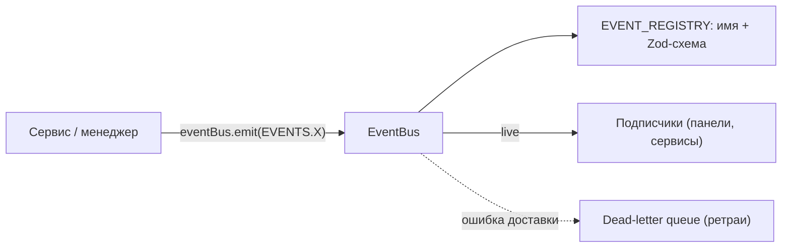

<!-- АВТОСГЕНЕРАЦИЯ: файл создан scripts/gen-wiki-docs.mjs из корпуса Wiki (src/components/WikiPanel). Не редактировать вручную. -->

# Каталог событий шины

> Раздел: **Разработчикам** · Статус: verified · Теги: dev, события, каталог, шина

Источники: `scripts/gen-wiki-events.mjs`, `src/kernel/events/event-registry.ts`

## Каталог событий шины

Сгенерировано автоматически (scripts/gen-wiki-events.mjs) из реестра-источника src/kernel/events/event-registry.ts: 546 событий в 70 разделах. EVENTS, EVENT_VALIDATORS и типы выводятся из реестра — новое событие добавляй только туда, и оно появится во всех производных экспортах.

Шина in-memory и lossy: порядок и доставка после перезагрузки не гарантированы. Менеджеры гидрируются из durable-хранилища (Dexie/KV), а событие используют как сигнал «обнови», а не как источник правды.

Внимание: 16 имён зарегистрированы более одного раза (алиасы/дубли):

- key:compromise:signal — 2 раза
- key:group:sync — 2 раза
- key:health:check — 2 раза
- key:health:check:all — 2 раза
- chat:cancel — 2 раза
- chat:response — 2 раза
- chat:model:select — 2 раза
- chat:target:start — 2 раза
- chat:stream:start — 2 раза
- chat:stream:chunk — 2 раза
- chat:stream:end — 2 раза
- chat:stream:error — 2 раза
- system:navigate — 2 раза
- system:notification — 2 раза
- system:decision — 2 раза
- system:reload — 2 раза

### Provider / Key Events (27)

| Ключ EVENTS | Имя события |
|---|---|
| KEYS_LOADED | key:loaded |
| KEY_ADDED | key:added |
| KEY_REMOVED | key:removed |
| KEY_UPDATED | key:updated |
| KEY_STATE_CHANGED | key:state:changed |
| KEY_COMPROMISED | key:compromised |
| COMPROMISE_SIGNAL | key:compromise:signal |
| KEY_COMPROMISE_SIGNAL | key:compromise:signal |
| GROUP_SYNC | key:group:sync |
| KEY_GROUP_SYNC | key:group:sync |
| KEY_HEALTH_CHECK_STARTED | key:health:check:started |
| KEY_HEALTH_CHECK_COMPLETED | key:health:check:completed |
| KEY_HEALTH_CHECK_FAILED | key:health:check:failed |
| KEY_LATENCY_BURST | key:latency:burst |
| KEY_QUOTA_EXCEEDED | key:quota:exceeded |
| QUOTA_BREACH | quota:breached |
| KEY_REPUTATION_THRESHOLD_CROSSED | key:reputation:threshold:crossed |
| CHECK_HEALTH | key:health:check |
| KEY_CHECK_HEALTH | key:health:check |
| CHECK_ALL_HEALTH | key:health:check:all |
| KEY_CHECK_ALL_HEALTH | key:health:check:all |
| KEY_PROBE_RESULT | key:probe:result |
| PROVIDER_STATE_CHANGED | provider:state:changed |
| PROVIDER_CIRCUIT_BREAKER_SYNCED | provider:circuit:breaker:synced |
| PROVIDER_RATE_LIMIT_SYNCED | provider:rate:limit:synced |
| PROVIDER_ERROR_SYNCED | provider:error:synced |
| KEY_ALERT_RESOLVED | key:alert:resolved |

### Session / Binding (1)

| Ключ EVENTS | Имя события |
|---|---|
| SESSION_BINDING_EXPIRED | session:binding:expired |

### Chat Events (18)

| Ключ EVENTS | Имя события |
|---|---|
| SEND_MESSAGE | chat:send |
| CANCEL_MESSAGE | chat:cancel |
| CHAT_CANCEL_MESSAGE | chat:cancel |
| MESSAGE_RESPONSE | chat:response |
| CHAT_MESSAGE_RESPONSE | chat:response |
| SELECT_MODEL | chat:model:select |
| CHAT_SELECT_MODEL | chat:model:select |
| START_CHAT_WITH_TARGET | chat:target:start |
| CHAT_START_WITH_TARGET | chat:target:start |
| STREAM_START | chat:stream:start |
| CHAT_STREAM_START | chat:stream:start |
| STREAM_CHUNK | chat:stream:chunk |
| CHAT_STREAM_CHUNK | chat:stream:chunk |
| STREAM_END | chat:stream:end |
| CHAT_STREAM_END | chat:stream:end |
| STREAM_ERROR | chat:stream:error |
| CHAT_STREAM_ERROR | chat:stream:error |
| CHAT_SUMMARY_CREATED | chat:summary:created |

### System Events (18)

| Ключ EVENTS | Имя события |
|---|---|
| NAVIGATE | system:navigate |
| SYSTEM_NAVIGATE | system:navigate |
| NOTIFICATION | system:notification |
| SYSTEM_NOTIFICATION | system:notification |
| DECISION | system:decision |
| SYSTEM_DECISION | system:decision |
| KERNEL_UPDATED | kernel:updated |
| KERNEL_HEARTBEAT | kernel:heartbeat |
| KERNEL_STATE_RESET | kernel:state:reset |
| RUNTIME_READY | system:runtime:ready |
| RUNTIME_FAILED | system:runtime:failed |
| CLEAR_DATA | system:data:clear |
| RELOAD | system:reload |
| SYSTEM_RELOAD | system:reload |
| KERNEL_LOAD_FAILED | kernel:load:failed |
| KERNEL_PERSIST_FAILED | kernel:persist:failed |
| SYSTEM_RUNTIME_METRICS | system:runtime:metrics |
| EVENTBUS_BACKPRESSURE | system:eventbus:backpressure |

### Provider Runtime (2)

| Ключ EVENTS | Имя события |
|---|---|
| PROVIDER_RUNTIME_STATE | provider:runtime:state |
| PROVIDER_RUNTIME_BUDGET | provider:runtime:budget |

### Debate Runtime Events (25)

| Ключ EVENTS | Имя события |
|---|---|
| DEBATE_SESSION_CREATED | debate:runtime:session:created |
| DEBATE_SESSION_STARTED | debate:runtime:session:started |
| DEBATE_SESSION_PAUSED | debate:runtime:session:paused |
| DEBATE_SESSION_RESUMED | debate:runtime:session:resumed |
| DEBATE_SESSION_CANCELLED | debate:runtime:session:cancelled |
| DEBATE_SESSION_COMPLETED | debate:runtime:session:completed |
| DEBATE_SESSION_FAILED | debate:runtime:session:failed |
| DEBATE_PHASE_CHANGED | debate:runtime:phase:changed |
| DEBATE_BUDGET_EXCEEDED | debate:runtime:budget:exceeded |
| DEBATE_ROUND_STARTED | debate:runtime:round:started |
| DEBATE_ROUND_ENDED | debate:runtime:round:ended |
| DEBATE_ROUND_EARLY_EXIT | debate:runtime:round:early:exit |
| DEBATE_AGENT_THINKING | debate:runtime:agent:thinking |
| DEBATE_AGENT_CHUNK | debate:runtime:agent:chunk |
| DEBATE_AGENT_RESPONDED | debate:runtime:agent:responded |
| DEBATE_AGENT_ERROR | debate:runtime:agent:error |
| DEBATE_BUDGET_UPDATED | debate:runtime:budget:updated |
| DEBATE_BUDGET_PRESSURE_CHANGED | debate:runtime:budget:pressure |
| DEBATE_CONSENSUS_REACHED | debate:runtime:consensus:reached |
| DEBATE_AGENT_TIMEOUT | debate:runtime:agent:timeout |
| DEBATE_AGENT_FALLBACK | debate:runtime:agent:fallback |
| DEBATE_MEMORY_CLAIM | debate:runtime:memory:claim |
| DEBATE_AGENT_PHASE_CHANGED | debate:runtime:agent:phase:changed |
| DEBATE_AGENT_SCORED | debate:runtime:agent:scored |
| DEBATE_TRANSITION_INVALID | debate:transition:invalid |

### Observability Events (8)

| Ключ EVENTS | Имя события |
|---|---|
| TIMELINE_EVENT_ADDED | observability:timeline:event:added |
| TIMELINE_CLEARED | observability:timeline:cleared |
| METRICS_SNAPSHOT | observability:metrics:snapshot |
| METRICS_ALERT | observability:metrics:alert |
| METRICS_ALERT_RESOLVED | observability:metrics:alert:resolved |
| TRACE_UPDATED | observability:trace:updated |
| SYSTEM_HEALTH_CHANGED | observability:health:changed |
| ERROR_BOUNDARY_CAUGHT | observability:error:boundary:caught |

### Cognitive Events (6)

| Ключ EVENTS | Имя события |
|---|---|
| COGNITIVE_TRACE_UPDATED | cognitive:trace:updated |
| COGNITIVE_STEP_ACTIVE | cognitive:step:active |
| COGNITIVE_STEP_COMPLETED | cognitive:step:completed |
| COGNITIVE_DECISION_MADE | cognitive:decision:made |
| REQUEST_INCOMING | request:incoming |
| REQUEST_COMPLETED | request:completed |

### Domain Events (51)

| Ключ EVENTS | Имя события |
|---|---|
| DEBATE_UPDATED | debate:updated |
| DEBATE_STARTED | debate:started |
| DEBATE_ARGUMENT | debate:argument |
| DEBATE_CONSENSUS | debate:consensus |
| DEBATE_ENDED | debate:ended |
| DEBATE_FACT_CHECKED | debate:fact:checked |
| DEBATE_VERDICT_GENERATED | debate:verdict:generated |
| DEBATE_SESSION_CONFLICT | debate:session:conflict |
| MEMORY_UPDATED | memory:updated |
| TOOLS_UPDATED | tools:updated |
| TOOL_EXECUTION_START | tool:execution:start |
| TOOL_EXECUTION_SUCCESS | tool:execution:success |
| TOOL_EXECUTION_ERROR | tool:execution:error |
| ROLES_UPDATED | roles:updated |
| ROLE_ASSIGNED | role:assigned |
| ROLE_UNASSIGNED | role:unassigned |
| MCP_UPDATED | mcp:updated |
| SETTINGS_UPDATED | settings:updated |
| SETTINGS_LATENCY_THRESHOLD | settings:latency:threshold |
| POLICY_VIOLATION | policy:violation |
| SKILLS_UPDATED | skills:updated |
| PRICING_UPDATED | pricing:updated |
| BUDGET_ALERT | budget:alert |
| KEYSTATE_UPDATED | keystate:updated |
| KEYSTATE_REMOVED | keystate:removed |
| SNAPSHOT_CAPTURED | snapshot:captured |
| SNAPSHOT_RESTORED | snapshot:restored |
| AGENT_CONFIG_UPDATED | agent:config:updated |
| AGENT_LIFECYCLE_CHANGE | agent:lifecycle:change |
| AGENT_HEALTH_CHANGE | agent:health:change |
| AGENT_RESTARTED | agent:restarted |
| CLAUDECODE_EXEC | claudecode:exec |
| AGENT_CREATED | agent:created |
| AGENT_EXECUTED | agent:executed |
| AGENT_RATE_LIMITED | agent:rate:limited |
| AGENT_BLACKBOARD_UPDATED | agent:blackboard:updated |
| AGENT_HANDOFF_INITIATED | agent:handoff:initiated |
| ROUTER_SIGNAL | router:signal |
| ADVISOR_SUGGESTION | advisor:suggestion |
| ADVISOR_SUGGESTION_EXECUTED | advisor:suggestion:executed |
| ADVISOR_SUGGESTION_DISMISSED | advisor:suggestion:dismissed |
| DIAGNOSTIC_COMPLETE | diagnostic:complete |
| SYSTEM_TOPOLOGY_MOUNTED | system:topology:mounted |
| SYSTEM_NODE_SPAWN | system:node:spawn |
| SYSTEM_NODE_REMOVED | system:node:removed |
| VIRTUAL_KEY_CREATED | virtual:key:created |
| VIRTUAL_KEY_RESOLVED | virtual:key:resolved |
| VIRTUAL_KEY_REVOKED | virtual:key:revoked |
| ELO_RATING_UPDATED | elo:rating:updated |
| CACHE_INVALIDATED | cache:invalidated |
| SESSION_DELETED | session:deleted |

### Persona Events (5)

| Ключ EVENTS | Имя события |
|---|---|
| PERSONA_CHANGED | persona:changed |
| PERSONA_TONE_CHANGED | persona:tone:changed |
| PERSONA_CREATED | persona:created |
| PERSONA_UPDATED | persona:updated |
| PERSONA_DELETED | persona:deleted |

### Achievement / Agent Delegation (4)

| Ключ EVENTS | Имя события |
|---|---|
| AGENT_WIZARD_CONFIG_GENERATED | agent:wizard:config-generated |
| AGENT_JOURNAL_ADDED | agent:journal:added |
| AGENT_JOURNAL_REMOVED | agent:journal:removed |
| AGENT_JOURNAL_CLEARED | agent:journal:cleared |

### Aquarium / Arch Review (1)

| Ключ EVENTS | Имя события |
|---|---|
| AQUARIUM_SCREENSHOT_CAPTURED | aquarium:screenshot:captured |

### Chat Lifecycle (5)

| Ключ EVENTS | Имя события |
|---|---|
| CHAT_FORKED | chat:forked |
| CHAT_REWOUND | chat:rewound |
| CHAT_BOOKMARK_ADDED | chat:bookmark:added |
| CHAT_BOOKMARK_REMOVED | chat:bookmark:removed |
| CHAT_BOOKMARK_CLEARED | chat:bookmark:cleared |

### Experiment / Hypothesis / Research (2)

| Ключ EVENTS | Имя события |
|---|---|
| HYPOTHESES_UPDATED | hypotheses:updated |
| RESEARCH_SESSION_UPDATED | research:session:updated |

### Key Rotation (1)

| Ключ EVENTS | Имя события |
|---|---|
| KEY_ROTATION_TRIGGERED | key:rotation:triggered |

### Intelligence / Local (1)

| Ключ EVENTS | Имя события |
|---|---|
| KEY_INTELLIGENCE_PIPELINE_ERROR | key:intelligence:pipeline:error |

### Roles (5)

| Ключ EVENTS | Имя события |
|---|---|
| ROLE_CREATED | role:created |
| ROLE_DELETED | role:deleted |
| ROLE_SANDBOX_TEST_COMPLETED | role:sandbox:test:completed |
| ROLE_SANDBOX_TEST_FAILED | role:sandbox:test:failed |
| ROLE_UPDATED | role:updated |

### Team Events (6)

| Ключ EVENTS | Имя события |
|---|---|
| TEAM_CREATED | team:created |
| TEAM_UPDATED | team:updated |
| TEAM_DELETED | team:deleted |
| TEAM_EXECUTION_STARTED | team:execution:started |
| TEAM_EXECUTION_COMPLETED | team:execution:completed |
| TEAM_EXECUTION_FAILED | team:execution:failed |

### Scheduler (6)

| Ключ EVENTS | Имя события |
|---|---|
| SCHEDULE_COMPLETED | schedule:completed |
| SCHEDULE_CREATED | schedule:created |
| SCHEDULE_DELETED | schedule:deleted |
| SCHEDULE_TRIGGERED | schedule:triggered |
| SCHEDULE_UPDATED | schedule:updated |
| SCHEDULER_HEARTBEAT | scheduler:heartbeat |

### Metrics (1)

| Ключ EVENTS | Имя события |
|---|---|
| KEY_STORE_GAUGES | metrics:key:store:gauges |

### WhatIf / Pressure (3)

| Ключ EVENTS | Имя события |
|---|---|
| WHATIF_SIMULATION_COMPLETED | whatif:simulation:completed |
| PRESSURE_MAP_UPDATED | pressure:map:updated |
| PRESSURE_ALERT_RAISED | pressure:alert:raised |

### Webhook / Secrets / Compromise (3)

| Ключ EVENTS | Имя события |
|---|---|
| WEBHOOK_DELIVERY_FAILED | webhook:delivery:failed |
| SECRETS_LOOKUP_FAILED | secrets:lookup:failed |
| COMPROMISE_SIGNAL_REJECTED | compromise:signal:rejected |

### Topology / Queue (2)

| Ключ EVENTS | Имя события |
|---|---|
| TOPOLOGY_EVALUATED | topology:evaluated |
| QUEUE_TASK_FAILED | queue:task:failed |

### Debate (extras) (1)

| Ключ EVENTS | Имя события |
|---|---|
| DEBATE_HUMAN_VOTE | debate:human:vote |

### Quality Impact (3)

| Ключ EVENTS | Имя события |
|---|---|
| DEBATE_QUALITY_TECHNIQUE_APPLIED | debate:quality:technique:applied |
| DEBATE_QUALITY_IMPACT_COMPUTED | debate:quality:impact:computed |
| DEBATE_QUALITY_EXPERIMENT_COMPLETED | debate:quality:experiment:completed |

### Crystal Vault (knowledge) (5)

| Ключ EVENTS | Имя события |
|---|---|
| CRYSTAL_PROPOSED | knowledge:crystal:proposed |
| CRYSTAL_FORMED | knowledge:crystal:formed |
| CRYSTAL_SUPERSEDED | knowledge:crystal:superseded |
| CRYSTAL_REFUTED | knowledge:crystal:refuted |
| CRYSTAL_CONTRADICTION_DETECTED | knowledge:crystal:contradiction:detected |

### Junction Engine (cross-domain synthesis) (3)

| Ключ EVENTS | Имя события |
|---|---|
| JUNCTION_DETECTED | knowledge:junction:detected |
| JUNCTION_VALIDATED | knowledge:junction:validated |
| JUNCTION_REJECTED | knowledge:junction:rejected |

### Synthesis Engine (multi-perspective consensus) (5)

| Ключ EVENTS | Имя события |
|---|---|
| SYNTHESIS_STARTED | synthesis:started |
| SYNTHESIS_COMPLETED | synthesis:completed |
| SYNTHESIS_REFINED | synthesis:refined |
| SYNTHESIS_EXPORTED_TO_CRYSTAL | synthesis:exported-to-crystal |
| SYNTHESIS_EXPORTED_TO_FORUM | synthesis:exported-to-forum |

### Knowledge Generator (autonomous research cycle) (5)

| Ключ EVENTS | Имя события |
|---|---|
| GENERATOR_STARTED | generator:started |
| GENERATOR_STAGE | generator:stage |
| GENERATOR_COMPLETED | generator:completed |
| GENERATOR_FAILED | generator:failed |
| GENERATOR_CANCELLED | generator:cancelled |

### Agent Forum (async persistent threads) (4)

| Ключ EVENTS | Имя события |
|---|---|
| FORUM_TOPIC_CREATED | forum:topic:created |
| FORUM_POST_ADDED | forum:post:added |
| FORUM_POST_VOTED | forum:post:voted |
| FORUM_TOPIC_ESCALATED_TO_DEBATE | forum:topic:escalated-to-debate |

### Invocation Engine (managed agent invocation; intent lifecycle only) (5)

| Ключ EVENTS | Имя события |
|---|---|
| INVOCATION_REQUESTED | invocation:requested |
| INVOCATION_ACCEPTED | invocation:accepted |
| INVOCATION_REJECTED | invocation:rejected |
| INVOCATION_EXECUTING | invocation:executing |
| INVOCATION_DONE | invocation:done |

### Conversation Core lifecycle (generic; independent of Debate/Forum/Chat) (7)

| Ключ EVENTS | Имя события |
|---|---|
| CONVERSATION_TURN_START | conversation:turn:start |
| CONVERSATION_TURN_COMPLETE | conversation:turn:complete |
| CONVERSATION_TURN_ERROR | conversation:turn:error |
| CONVERSATION_PAUSED | conversation:paused |
| CONVERSATION_RESUMED | conversation:resumed |
| CONVERSATION_ABORTED | conversation:aborted |
| CONVERSATION_COMPLETED | conversation:completed |

### Crew + Task + Process (Wave 1.1, CrewAI-style, local-first) (11)

| Ключ EVENTS | Имя события |
|---|---|
| CREW_CREATED | crew:created |
| CREW_STARTED | crew:started |
| CREW_COMPLETED | crew:completed |
| CREW_FAILED | crew:failed |
| CREW_ABORTED | crew:aborted |
| CREW_DELETED | crew:deleted |
| TASK_STARTED | task:started |
| TASK_COMPLETED | task:completed |
| TASK_FAILED | task:failed |
| TASK_HITL | task:hitl |
| FORGE_PROPOSED | forge:proposed |

### Council / advanced debate (Wave 2, additive over Debate Runtime) (10)

| Ключ EVENTS | Имя события |
|---|---|
| COUNCIL_CREATED | council:created |
| COUNCIL_PROPOSAL | council:proposal |
| COUNCIL_FACT | council:fact |
| COUNCIL_MESSAGE | council:message |
| COUNCIL_WHISPER | council:whisper |
| COUNCIL_PHASE | council:phase |
| COUNCIL_JUDGED | council:judged |
| COUNCIL_VOTE | council:vote |
| COUNCIL_COMPLETED | council:completed |
| COUNCIL_ABORTED | council:aborted |

### State Graph runtime (Wave 3, LangGraph-style, local-first) (12)

| Ключ EVENTS | Имя события |
|---|---|
| GRAPH_DEFINED | graph:defined |
| GRAPH_STARTED | graph:started |
| GRAPH_NODE | graph:node |
| GRAPH_CHECKPOINT | graph:checkpoint |
| GRAPH_REFLECTED | graph:reflected |
| GRAPH_HITL | graph:hitl |
| GRAPH_APPROVED | graph:approved |
| GRAPH_REJECTED | graph:rejected |
| GRAPH_COMPLETED | graph:completed |
| GRAPH_FAILED | graph:failed |
| GRAPH_ABORTED | graph:aborted |
| GRAPH_RESTORED | graph:restored |

### Persona & Context (Wave 4: Letta-style memory, persona, goals) (10)

| Ключ EVENTS | Имя события |
|---|---|
| MEMORY_REMEMBERED | memory:remembered |
| MEMORY_PROMOTED | memory:promoted |
| MEMORY_FORGOTTEN | memory:forgotten |
| MEMORY_LINKED | memory:linked |
| PERSONA_DISTILLED | persona:distilled |
| CONTEXT_CREATED | context:created |
| CONTEXT_SHARED | context:shared |
| GOAL_CREATED | goal:created |
| GOAL_PROGRESS | goal:progress |
| GOAL_COMPLETED | goal:completed |

### Ops / governance / mobile (Wave 5) (6)

| Ключ EVENTS | Имя события |
|---|---|
| OPS_AUDIT | ops:audit |
| OPS_HIERARCHY | ops:hierarchy |
| OPS_BUDGET | ops:budget |
| OPS_SANDBOX | ops:sandbox |
| OPS_MOBILE | ops:mobile |
| OPS_NOTIFY | ops:notify |

### Interop / federation / coordination (Phase A: Waves 6+7) (10)

| Ключ EVENTS | Имя события |
|---|---|
| INTEROP_AGENT | interop:agent |
| INTEROP_NEGOTIATED | interop:negotiated |
| INTEROP_ERROR | interop:error |
| GATEWAY_INGRESS | gateway:ingress |
| FED_PEER | fed:peer |
| HANDOFF_DISPATCHED | handoff:dispatched |
| HANDOFF_RETURNED | handoff:returned |
| MARKET_OPENED | market:opened |
| MARKET_AWARDED | market:awarded |
| CONTRACT_PROPOSED | contract:proposed |

### Meta & unified memory (Phase B: Waves 8+9) (8)

| Ключ EVENTS | Имя события |
|---|---|
| META_PROPOSED | meta:proposed |
| META_APPLIED | meta:applied |
| META_EVOLVED | meta:evolved |
| META_HEALTH | meta:health |
| COG_WRITTEN | cog:written |
| COG_GOVERNED | cog:governed |
| COG_COUNTERFACTUAL | cog:counterfactual |
| COG_COMPILED | cog:compiled |

### Trust & ecosystem (Phase C: Waves 10+11) (4)

| Ключ EVENTS | Имя события |
|---|---|
| TRUST_UPDATED | trust:updated |
| TRUST_POLICY | trust:policy |
| ECO_INSTALLED | eco:installed |
| ECO_SNAPSHOT | eco:snapshot |

### Frontier evals & exotic (Phase D: Waves 12+13) (5)

| Ключ EVENTS | Имя события |
|---|---|
| EVAL_RUN | eval:run |
| EVAL_COMPARED | eval:compared |
| EVAL_REDTEAM | eval:redteam |
| EVAL_ORG | eval:org |
| EVAL_INTENT | eval:intent |

### Parity E.2/E.3 (tools, knowledge, training) (5)

| Ключ EVENTS | Имя события |
|---|---|
| TOOL_EXECUTED | tool:executed |
| KNOWLEDGE_ADDED | knowledge:added |
| KNOWLEDGE_HYBRID_RETRIEVED | knowledge:hybrid:retrieved |
| TRAINING_RECORDED | training:recorded |
| CATALOG_UPDATED | catalog:updated |

### Rival parity (Phase F: 10 projects) (26)

| Ключ EVENTS | Имя события |
|---|---|
| LOOP_ITER | loop:iter |
| GROUPCHAT_CREATED | groupchat:created |
| GROUPCHAT_TURN | groupchat:turn |
| GUARDRAIL_HIT | guardrail:hit |
| GUARDRAIL_RULE_ADDED | guardrail:rule:added |
| GUARDRAIL_RULE_REMOVED | guardrail:rule:removed |
| INTERPRETER_EXEC | interpreter:exec |
| MINISWE_SOLVED | miniswe:solved |
| WHALE_CARGO_CHECK | whale:cargo:check |
| WHALE_PATCH_APPLIED | whale:patch:applied |
| CACHE_CONTROL_MARKED | cache:control:marked |
| CACHE_CONTROL_STATS | cache:control:stats |
| FILES_UPLOADED | files:uploaded |
| PROJECT_CREATED_RIVALS | project:created:rivals |
| PROJECT_FILE_ADDED | project:file:added |
| ROUTINE_DEFINED | routine:defined |
| ROUTINE_TRIGGERED | routine:triggered |
| AGENTVIEW_SESSIONS | agentview:sessions |
| AGENTVIEW_SKILL | agentview:skill |
| BLOCK_SET | block:set |
| SOP_PHASE | sop:phase |
| QUEUE_ENQUEUED | queue:enqueued |
| DYAD_DONE | dyad:done |
| PLANNER_PLAN_COMPLETED | planner:plan:completed |
| PLANNER_STEP | planner:step |
| PLANNER_FILTER_ADDED | planner:filter:added |

### Rival parity 2 (Phase G: 10 more projects) (9)

| Ключ EVENTS | Имя события |
|---|---|
| REACT_STEP | react:step |
| RAG_ANSWERED | rag:answered |
| RUNTIME_STARTED | runtime:started |
| RUNTIME_ACTION | runtime:action |
| SWE_EDIT | swe:edit |
| MODES_SWITCHED | modes:switched |
| SMEM_ADDED | smem:added |
| INTEGRATION_TRIGGER | integration:trigger |
| CHARACTER_IMPORTED | character:imported |

### Rival parity 3 (Phase H: third 10) (8)

| Ключ EVENTS | Имя события |
|---|---|
| REASON_THOUGHT | reason:thought |
| SESSION_DELTA | session:delta |
| DATASET_HIT | dataset:hit |
| DOCSTORE_FEEDBACK | docstore:feedback |
| TYPED_VALID | typed:valid |
| CODEPLAN_ROUND | codeplan:round |
| DIALOGUE_TURN | dialogue:turn |
| BOTROUTE_NODE | botroute:node |

### Rival parity 4 (Phase I: fourth 10) (9)

| Ключ EVENTS | Имя события |
|---|---|
| COPILOT_TOPIC | copilot:topic |
| BEDROCK_ACTION | bedrock:action |
| BEDROCK_GUARD | bedrock:guard |
| CX_ROUTE | cx:route |
| FORCE_RUN | force:run |
| KORE_INTERRUPT | kore:interrupt |
| YELLOW_SENT | yellow:sent |
| LINDY_HIRED | lindy:hired |
| SMOL_STEP | smol:step |

### Rival parity 5 (Phase J: fifth 10) (13)

| Ключ EVENTS | Имя события |
|---|---|
| APP_SCAFFOLD | app:scaffold |
| ONTO_CREATED | onto:created |
| WORK_PUSHED | work:pushed |
| COMPUTER_ACT | computer:act |
| COMPUTER_HANDOFF | computer:handoff |
| SEARCH_FANOUT | search:fanout |
| CODEEXEC_QUEUED | codeexec:queued |
| CODEEXEC_SANDBOX_DONE | codeexec:sandbox:done |
| BROWSER_HARNESS_ACT | browser:harness:act |
| MCP_HARNESS_RECONNECTED | mcp:harness:reconnected |
| MCP_HARNESS_PROXY | mcp:harness:proxy |
| EVAL_SCORER_REGISTERED | eval:scorer:registered |
| EVAL_JUDGE_DONE | eval:judge:done |

### Rival parity 6 (Phase K: sixth 10) (12)

| Ключ EVENTS | Имя события |
|---|---|
| N8N_RUN | n8n:run |
| MAKE_RUN | make:run |
| ZAP_FIRED | zap:fired |
| TEMPORAL_STEP | temporal:step |
| TEMPORAL_SIGNAL | temporal:signal |
| TEMPORAL_PAUSED | temporal:paused |
| ASSET_BUILT | asset:built |
| SENSOR_OK | sensor:ok |
| VOICE_STARTED | voice:started |
| VOICE_ENDED | voice:ended |
| SUPPORT_OPEN | support:open |
| SUPPORT_HANDOFF | support:handoff |

### Debate plus (Phase L: seventh 10, debate focus) (5)

| Ключ EVENTS | Имя события |
|---|---|
| FORMAT_START | format:start |
| FORMAT_DONE | format:done |
| DUNG_ATTACK | dung:attack |
| TOULMIN_CARD | toulmin:card |
| BRIER_RESOLVED | brier:resolved |

### Rival parity 8 (Phase M: forums/diagnostics/cognitive) (12)

| Ключ EVENTS | Имя события |
|---|---|
| FORUMPLUS_POLL | forumplus:poll |
| FORUMPLUS_SOLVED | forumplus:solved |
| DECISION_OUTCOME | decision:outcome |
| POLIS_CLUSTERED | polis:clustered |
| REFLEXION_TRIAL | reflexion:trial |
| REFLEXION_DONE | reflexion:done |
| TOT_LEVEL | tot:level |
| SELFCON_VOTE | selfcon:vote |
| SOAR_FIRED | soar:fired |
| SOAR_IMPASSE | soar:impasse |
| METER_ALERT | meter:alert |
| ERR_CAPTURED | err:captured |

### Rival parity 9 (Phase N: hype — OpenClaw/DSH/CN/Manus/Genspark) (8)

| Ключ EVENTS | Имя события |
|---|---|
| CLAW_SOUL | claw:soul |
| CLAW_CRON | claw:cron |
| DSH_PLUGIN | dsh:plugin |
| MANUS_VERIFY | manus:verify |
| MANUS_EXPORT | manus:export |
| GEN_FANOUT | gen:fanout |
| GEN_SHEETS | gen:sheets |
| GEN_LONGTASK | gen:longtask |

### Rival parity 10 (Phase P: Google + Chat Studio) (8)

| Ключ EVENTS | Имя события |
|---|---|
| A2ASPEC_CARD | a2aspec:card |
| A2ASPEC_TASK | a2aspec:task |
| CACHE_SAVED | cache:saved |
| NOTEBOOK_AUDIO | notebook:audio |
| LIVE_BARGE | live:barge |
| LIVE_TOOL | live:tool |
| DEEPRES_STEP | deepres:step |
| STUDIO_PACK | studio:pack |

### Rival parity 11 (Phase Q: viz + light sims, the last 9 to 100) (5)

| Ключ EVENTS | Имя события |
|---|---|
| NETLOGO_TICK | netlogo:tick |
| MESA_STEP | mesa:step |
| BONSAI_TRAINED | bonsai:trained |
| CHAINLIT_STEP | chainlit:step |
| MALMO_GOAL | malmo:goal |

### Rival parity 12 (Phase R: exotic/research) (4)

| Ключ EVENTS | Имя события |
|---|---|
| CONSTIT_CRITIQUE | constit:critique |
| CONSTIT_REVISE | constit:revise |
| VOYAGER_SKILL | voyager:skill |
| VOYAGER_STEP | voyager:step |

### Rival RU (Phase U: Russian school + market) (12)

| Ключ EVENTS | Имя события |
|---|---|
| METABOLIC_TICK | metabolic:tick |
| MAESTRO_ORCHESTRATE | maestro:orchestrate |
| LOCALTRIPLE_RUN | localtriple:run |
| RUSLAN_LEARN | ruslan:learn |
| EVOLAB_RUN | evolab:run |
| GIGASTUDIO_GEN | gigastudio:gen |
| AGENCYRU_CATALOG | agencyru:catalog |
| AGENCYRU_IMPORT | agencyru:import |
| ANALITIK_INTAKE | analitik:intake |
| CHEMIST_ASK | chemist:ask |
| HEISENBERG_BOARD | heisenberg:board |
| HEISENBERG_MOVE | heisenberg:move |

### Deploy bundle (Phase 57: G4) (4)

| Ключ EVENTS | Имя события |
|---|---|
| DEPLOY_BUNDLE_CREATED | deploy:bundle:created |
| SIM_WORLD_CREATED | sim:world:created |
| SIM_TICK | sim:tick |
| SIM_COMPLETED | sim:completed |

### Rival synth (Phase V: MIT/Sakana etc.) (45)

| Ключ EVENTS | Имя события |
|---|---|
| LATENT_SYNTH | latent:synth |
| AISCIENTIST_QUEUED | aiscientist:queued |
| AISCIENTIST_RUN | aiscientist:run |
| SPARKS_CYCLE | sparks:cycle |
| SCIAGENTS_HYPOTHESIZE | sciagents:hypothesize |
| EIGHTSTAGE_RUN | eightstage:run |
| COGNITAE_RUN | cognitae:run |
| COGTEAM_RUN | cogteam:run |
| SYN_SLEEP | syn:sleep |
| HELIX_GAPS | helix:gaps |
| IDEATOR_TEST | ideator:test |
| RCK_BIND | rck:bind |
| COGNEE_RECALL | cognee:recall |
| METAN_HIERARCHY | metan:hierarchy |
| CONCEPTS_COMPOSE | concepts:compose |
| SECONDBRAIN_RUN | secondbrain:run |
| STORM_RESEARCH | storm:research |
| BLACKBOARD_POST | blackboard:post |
| DOLORES_TRACE | dolores:trace |
| EPISTEME_SYNC | episteme:sync |
| METAKB_QUERY | metakb:query |
| RESEARCHOS_FOLDER | researchos:folder |
| DEEPRESEARCH2_RUN | deepresearch2:run |
| DARWIN_EVOLVE | darwin:evolve |
| QYVARIA_QUERY | qyvaria:query |
| PARLIAMENTARY_RUN | parliamentary:run |
| POLICY_ADVANTAGES | policy:advantages |
| SOCRATIC_DISCUSS | socratic:discuss |
| FISHBOWL_ROTATE | fishbowl:rotate |
| CONTINUE_CHAT | continue:chat |
| GOOSE_RECIPE | goose:recipe |
| GPTENGINEER_RUN | gptengineer:run |
| GOTPILOT_START | gptpilot:start |
| PI_DISPATCH | pi:dispatch |
| TABBY_COMPLETE | tabby:complete |
| VOID_SESSION | void:session |
| WARP_BLOCK | warp:block |
| ZED_OPEN | zed:open |
| CODEX_PROMPT | codex:prompt |
| GEMINICLI_CHAT | geminicli:chat |
| KILO_FANOUT | kilo:fanout |
| HELICONE_LOG | helicone:log |
| PORTKEY_ROUTE | portkey:route |
| LITELLM_PROXY | litellm:proxy |
| LANGFUSE_TRACE | langfuse:trace |

### Projects (roadmapp.md) (11)

| Ключ EVENTS | Имя события |
|---|---|
| PROJECT_CREATED | project:created |
| PROJECT_UPDATED | project:updated |
| PROJECT_DELETED | project:deleted |
| PROJECT_AGENT_ASSIGNED | project:agent:assigned |
| PROJECT_AGENT_REMOVED | project:agent:removed |
| PROJECT_TASK_CREATED | project:task:created |
| PROJECT_TASK_STATUS | project:task:status |
| PROJECT_RUN_STARTED | project:run:started |
| PROJECT_RUN_COMPLETED | project:run:completed |
| PROJECT_FILE_UPDATED | project:file:updated |
| PROJECT_FILE_DELETED | project:file:deleted |

### Project Workspace (roadmapp.md §P2) (4)

| Ключ EVENTS | Имя события |
|---|---|
| WORKSPACE_INITIALIZED | workspace:initialized |
| WORKSPACE_FILE_WRITTEN | workspace:file:written |
| WORKSPACE_FILE_DELETED | workspace:file:deleted |
| WORKSPACE_DIR_DELETED | workspace:dir:deleted |

### Agent Runtime (roadmapp.md §P3) (1)

| Ключ EVENTS | Имя события |
|---|---|
| RUNTIME_AGENT_EVENT | runtime:agent:event |

### Website Preview (roadmapp.md §P4) (2)

| Ключ EVENTS | Имя события |
|---|---|
| WEBSITE_PREVIEW_GENERATED | website:preview:generated |
| WEBSITE_PREVIEW_VALIDATED | website:preview:validated |

### QA / Browser Inspector (roadmapp.md §P5) (1)

| Ключ EVENTS | Имя события |
|---|---|
| QA_INSPECTION_COMPLETED | qa:inspection:completed |

### Multi-Agent Pipeline (roadmapp.md §P6) (4)

| Ключ EVENTS | Имя события |
|---|---|
| PIPELINE_CREATED | pipeline:created |
| PIPELINE_STAGE_COMPLETED | pipeline:stage:completed |
| PIPELINE_ADVANCED | pipeline:advanced |
| PIPELINE_COMPLETED | pipeline:completed |

### Python Runtime (roadmapp.md §P7) (3)

| Ключ EVENTS | Имя события |
|---|---|
| PYTHON_RUN_STARTED | python:run:started |
| PYTHON_RUN_COMPLETED | python:run:completed |
| PYTHON_REQUIREMENT_ADDED | python:requirement:added |

### Artifacts (roadmapp.md §P11) (5)

| Ключ EVENTS | Имя события |
|---|---|
| ARTIFACT_CREATED | artifact:created |
| ARTIFACT_BUILD_COMPLETED | artifact:build:completed |
| SNAPSHOT_CREATED | snapshot:created |
| PROJECT_EXPORTED | project:exported |
| PROJECT_IMPORTED | project:imported |

### Templates (roadmapp.md §P12) (1)

| Ключ EVENTS | Имя события |
|---|---|
| TEMPLATE_APPLIED | template:applied |

### Debate Integration (roadmapp.md §P13) (2)

| Ключ EVENTS | Имя события |
|---|---|
| PROJECT_DEBATE_STARTED | project:debate:started |
| PROJECT_DEBATE_VERDICT | project:debate:verdict |

### Advanced Autonomy (roadmapp.md §P14) (5)

| Ключ EVENTS | Имя события |
|---|---|
| AUTONOMY_GOAL_CREATED | autonomy:goal:created |
| AUTONOMY_PHASE_ADVANCED | autonomy:phase:advanced |
| AUTONOMY_TASK_COMPLETED | autonomy:task:completed |
| AUTONOMY_GOAL_COMPLETED | autonomy:goal:completed |
| AUTONOMY_GOAL_FAILED | autonomy:goal:failed |

### Project Observability (roadmapp.md §P8) (2)

| Ключ EVENTS | Имя события |
|---|---|
| PROJECT_ACTIVITY_LOGGED | project:activity:logged |
| PROJECT_ERROR_LOGGED | project:error:logged |

### Agent Channels (mIRC-like) (5)

| Ключ EVENTS | Имя события |
|---|---|
| CHANNEL_CREATED | channel:created |
| CHANNEL_MESSAGE | channel:message |
| CHANNEL_AGENT_JOINED | channel:agent:joined |
| CHANNEL_AGENT_LEFT | channel:agent:left |
| CHANNEL_ARCHIVED | channel:archived |

---

## Связанные материалы

- [Разработчикам: шина событий](./dev-events.md)
- [Разработчикам: сервисы и lazyService](./dev-services.md)
- [Разработчикам: обзор и слои](./dev-overview.md)

[← Все материалы](./README.md)
