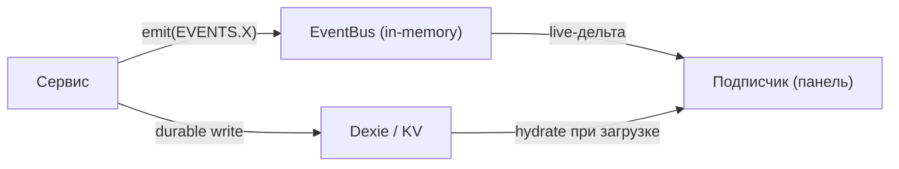

<!-- АВТОСГЕНЕРАЦИЯ: файл создан scripts/gen-wiki-docs.mjs из корпуса Wiki (src/components/WikiPanel). Не редактировать вручную. -->

# Разработчикам: шина событий

> Раздел: **Разработчикам** · Статус: verified · Теги: dev, события, шина

Источники: `src/kernel/events/event-bus.ts`, `src/kernel/events/event-names.ts`, `src/kernel/events/event-registry.ts`

## Где что

- `event-bus.ts` — реализация шины (on/emit/onSafe/subscribeAll/off) + DLQ (dead-letter с ретраями).
- `event-names.ts` — объект `EVENTS` с именами (единый словарь).
- `event-registry.ts` — реестр типов событий (метаданные/валидация).
- Доменные файлы: `chat-events`, `debate-runtime-events`, `provider-events`, `cognitive-events`, `workspace-events`, `system-events`, `observability-events`.

## Ключевое свойство: шина lossy

Шина in-memory и не гарантирует порядок и доставку при перезагрузке. Значит менеджеры и панели обязаны **гидрироваться из durable-хранилища (Dexie/KV)**, а не полагаться на то, что «событие придёт».

## Практика

- Доменные события добавляй в соответствующий `*-events.ts` и в `EVENTS`.
- `onSafe` — когда нельзя допустить исключение из хендлера в шину.
- Для порядко-зависимой логики не полагайся на последовательность эмитов — читай состояние из БД.

Полный перечень имён — в авто-каталоге [Каталог событий шины](./dev-event-catalog.md).

---

## Связанные материалы

- [Каталог событий шины](./dev-event-catalog.md)
- [Разработчикам: сервисы и lazyService](./dev-services.md)
- [Разработчикам: boot, DI и контейнер](./dev-boot.md)

[← Все материалы](./README.md)
