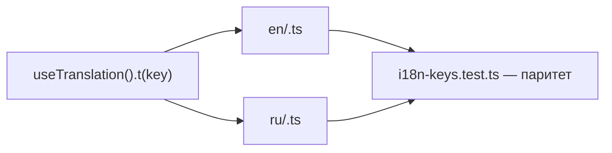

<!-- АВТОСГЕНЕРАЦИЯ: файл создан scripts/gen-wiki-docs.mjs из корпуса Wiki (src/components/WikiPanel). Не редактировать вручную. -->

# Каталог локализации

> Раздел: **Разработчикам** · Статус: verified · Теги: dev, i18n, локали, каталог

Источники: `scripts/gen-wiki-i18n.mjs`, `src/i18n/translations/`

## Локализация (i18n)

Словари разбиты по неймспейсам-файлам (src/i18n/translations/{en,ru}/<namespace>.ts), каждый — плоский Record<string,string>, склеиваются через spread в index.ts. Всего 19 неймспейсов, 3871 ключей (en) / 3871 (ru), паритет: совпадает. Паритет наборов ключей en↔ru проверяет тест src/i18n/i18n-keys.test.ts.

### Ключи по неймспейсам

| Неймспейс | Ключей (en) | Ключей (ru) |
|---|---|---|
| agents | 111 | 111 |
| analytics | 828 | 828 |
| budget | 104 | 104 |
| chat | 167 | 167 |
| common | 171 | 171 |
| dashboard | 186 | 186 |
| debate | 284 | 284 |
| dyad | 23 | 23 |
| errors | 9 | 9 |
| governance | 160 | 160 |
| groupChat | 44 | 44 |
| integrations | 276 | 276 |
| memory | 168 | 168 |
| nav | 355 | 355 |
| observability | 261 | 261 |
| providers | 241 | 241 |
| quality | 65 | 65 |
| settings | 194 | 194 |
| workspace | 224 | 224 |

### Префиксы ключей (en)

Верхний уровень ключа до первой точки — сгруппирован по неймспейсу.

**agents** — agents (55), roles (26), agent_journal (23), agent_wizard (4), roles_consortia (3)

**analytics** — director (115), fleet (85), analytics (68), synthesis (47), room (45), projects (40), generator (35), forum (35), lenses_crystal (34), lenses (30), ab_test (24), scheduler (20), prediction (17), channels (17), cost_analytics (16), keyUsage (16), decision_log (15), research_engine (14), autonomy (13), metrics (11), hypothesis_generator (10), python (10), artifacts (10), debateIntegration (10), eval (9), junctions (9), qa (9), pipeline (9), junction (9), memory (8), guardians (8), observability (6), safety (6), templates (6), preview (5), experimental (3), governance (2), provenance (2)

**budget** — pricing (34), budget (31), cost_opt (21), budgetAlerts (18)

**chat** — chat (102), prompts (28), chat_export (22), bookmarks (15)

**common** — common (57), onboarding (49), shortcuts (28), palette (19), sidebar (5), layout (4), info (4), sidepanel (2), experimental (2), quick_access (1)

**dashboard** — overview (97), dashboard (61), system_health (19), contrib (9)

**debate** — debate (212), debate_runtime (42), debate_analysis (14), topic_suggester (12), debate_live (2), arch_review (1), debate_system_research (1)

**dyad** — dyad (23)

**errors** — error_boundary (6), not_found (3)

**governance** — policy (91), sop (26), guardrails (25), security (12), governance (6)

**groupChat** — groupChat (44)

**integrations** — mcp (53), connectors (50), skills (49), tools (46), webhooks (45), cache (33)

**memory** — memory (66), knowledge (43), message_search (26), memory_palace (22), key_notes (11)

**nav** — nav (243), costs (18), approvals (17), portability (16), issues (15), adapters (14), companies (14), tasks (10), runs (8)

**observability** — health (75), traces (46), logs (36), router_trace (27), sre (24), docs_health (24), performance_profiler (16), state_inspector (13)

**providers** — provider (72), rotations (36), add_key (33), routing (30), groups (25), pool_status (22), provider_manager (15), provider_dashboard (8)

**quality** — quality_impact (51), quality (14)

**settings** — settings (194)

**workspace** — aquarium (40), tasks (37), pressure_map (30), builder (26), patterns (24), batch (22), workflows (16), playground (16), session_bindings (7), docs (6)

---

## Связанные материалы

- [Разработчикам: локализация (i18n)](./dev-i18n.md)
- [Разработчикам: компоненты и панели](./dev-components.md)
- [Разработчикам: обзор и слои](./dev-overview.md)

[← Все материалы](./README.md)
