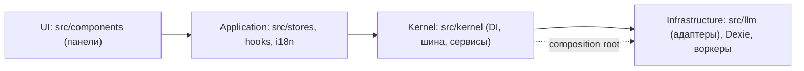

<!-- АВТОСГЕНЕРАЦИЯ: файл создан scripts/gen-wiki-docs.mjs из корпуса Wiki (src/components/WikiPanel). Не редактировать вручную. -->

# Разработчикам: обзор и слои

> Раздел: **Разработчикам** · Статус: verified · Теги: dev, архитектура, слои

Источники: `.dependency-cruiser.cjs`, `src/kernel/DEPENDENCY_MAP.md`

## Что это за код

Браузерное SPA: React + TypeScript + Vite, сборка в статику, данные — локально (IndexedDB/Dexie). Опционально рядом живут sidecar (browser/computer-use), sync-server и CORS-прокси, но ядро работает без сервера.

## Слои (жёстко enforced)

Направление зависимостей только в одну сторону: **UI → Application → Kernel → Infrastructure**. Правила проверяет dependency-cruiser на CI (`npm run check:deps`), 0 нарушений — гейт.

- Панель не имеет права импортировать адаптер или Dexie напрямую — только сервис или контракт.
- Composition root (bootstrap) — единственное исключение: там слои соединяются.

## Куда идти дальше

- Дерево каталогов: [Разработчикам: карта каталогов](./dev-layout.md).
- Как поднимается ядро: [Разработчикам: boot, DI и контейнер](./dev-boot.md).
- Сервисы и lazyService: [Разработчикам: сервисы и lazyService](./dev-services.md).
- События: [Разработчикам: шина событий](./dev-events.md). Панели: [Разработчикам: компоненты и панели](./dev-components.md). Ворота: [Разработчикам: ворота качества и CI](./dev-ci.md).
- Авто-каталоги (генерируются из кода): [Каталог компонентов OS](./dev-component-catalog.md) (компоненты и связи), [Каталог событий шины](./dev-event-catalog.md) (события шины), [Карта зависимостей ядра (DI)](./dev-service-map.md) (DI-граф ядра), [Контракты ядра](./dev-contracts.md) (интерфейсы ядра и их реализации), [Каталог сторов](./dev-store-catalog.md) (сторы), [Каталог локализации](./dev-i18n-catalog.md) (локали).
- Скрипты и команды: [Скрипты и CLI](./dev-scripts.md). Тестовая поверхность: [Каталог тестов](./dev-tests-catalog.md).
- Рецепты типовых задач: [Рецепты: типовые задачи](./dev-cookbook.md).
- Короткая версия для онбординга — [Разработчикам: структура и ворота](./for-developers.md).

---

## Связанные материалы

- [Разработчикам: структура и ворота](./for-developers.md)
- [Архитектура и связи](./architecture.md)
- [Разработчикам: карта каталогов](./dev-layout.md)
- [Разработчикам: boot, DI и контейнер](./dev-boot.md)

[← Все материалы](./README.md)
