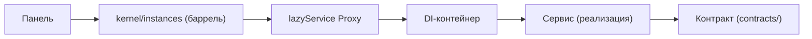

<!-- АВТОСГЕНЕРАЦИЯ: файл создан scripts/gen-wiki-docs.mjs из корпуса Wiki (src/components/WikiPanel). Не редактировать вручную. -->

# Разработчикам: сервисы и lazyService

> Раздел: **Разработчикам** · Статус: verified · Теги: dev, сервисы, DI, lazyService

Источники: `src/kernel/service-helper.ts`, `src/kernel/instances/`

## Баррели-фасады

Панели импортируют сервисы только из `src/kernel/instances`, собранного из:
- `services-core` / `services-extras` — сервисы;
- `events` — `eventBus`, `EVENTS`, тип `EventMap`;
- `core-references` / `extra-references` — ссылки на ресурсы;
- `infra` — инфраструктура (БД, security, logger).

## lazyService (src/kernel/service-helper.ts)

Это Proxy, который резолвит сервис из контейнера **при первом обращении к свойству**, кэширует инстанс и биндит методы.

- Пока сервис не зарегистрирован — обращение бросает `ServiceNotRegisteredError` (кроме `then`/`toJSON`/`symbol`).
- Есть негативный кэш на 1с — не спамит контейнер при отсутствии.
- `invalidateLazyServiceNotFound(name)` — сбросить негативный кэш после ручной регистрации.
- `clearResolvedServices()` — сброс на shutdown.

## Паттерн в компоненте

Панель пишет `import { keyService, eventBus, EVENTS } from '../../kernel/instances'` и вызывает методы. Исключение из резолва кидать не должна — оборачивай в try/catch и показывай баннер (см. [Разработчикам: конвенции кода](./dev-conventions.md)).

## Как добавить сервис

1. Контракт — в `src/kernel/contracts`.
2. Реализация — в `src/kernel/services/...`.
3. Регистрация — в фазе bootstrap.
4. Экспорт — из нужного барреля `instances/*`.

Полный граф «кто от кого зависит» — в [Карта зависимостей ядра (DI)](./dev-service-map.md) (из DEPENDENCY_MAP.md). Перечень контрактов и их реализаций — в [Контракты ядра](./dev-contracts.md).

---

## Связанные материалы

- [Карта зависимостей ядра (DI)](./dev-service-map.md)
- [Разработчикам: boot, DI и контейнер](./dev-boot.md)
- [Разработчикам: шина событий](./dev-events.md)
- [Разработчикам: компоненты и панели](./dev-components.md)

[← Все материалы](./README.md)
