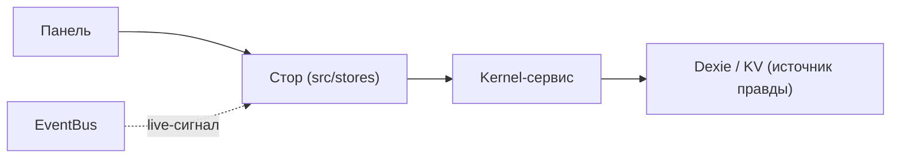

<!-- АВТОСГЕНЕРАЦИЯ: файл создан scripts/gen-wiki-docs.mjs из корпуса Wiki (src/components/WikiPanel). Не редактировать вручную. -->

# Каталог сторов

> Раздел: **Разработчикам** · Статус: verified · Теги: dev, сторы, состояние, каталог

Источники: `scripts/gen-wiki-stores.mjs`, `src/stores/`

## Сторы (состояние UI)

Состояние слоя Application: 28 файлов в src/stores, 20 хуков-сторов (Zustand-подобных), 77 экспортов. Стор держит UI-состояние; источник правды для durable-данных — сервис/БД, а стор — кэш для рендера.

| Файл | Хук/экспорт | Тип | Тип состояния |
|---|---|---|---|
| src/stores/activeDebateStore.ts | createDebateSessionStoreAdapter | function | — |
|  | useActiveDebateStore | hook |  |
| src/stores/channel-store.ts | ChannelStoreState | interface | ChannelStoreState |
|  | useChannelStore | hook |  |
|  | ensureSubscribed | function |  |
|  | destroy | function |  |
| src/stores/councilStore.ts | resetCouncilStoreSubscription | function | CouncilState |
|  | useCouncilStore | hook |  |
| src/stores/crewStore.ts | CrewRunStatus | type | CrewState |
|  | resetCrewStoreSubscription | function |  |
|  | useCrewStore | hook |  |
| src/stores/debateLiveStore.ts | createDebateLiveStoreAdapter | function | DebateLiveState |
|  | DebateAgentEvent | interface |  |
|  | DebateRoundEvent | interface |  |
|  | DebateLiveState | interface |  |
|  | useDebateLiveStore | hook |  |
| src/stores/directorController.ts | DirectorControls | interface | — |
|  | createDirectorControls | function |  |
| src/stores/directorStore.ts | DirectorStatus | type | DirectorStoreState |
|  | DirectorTurnLogEntry | interface |  |
|  | DirectorStoreState | interface |  |
|  | useDirectorStore | hook |  |
| src/stores/frontierStore.ts | resetFrontierStoreSubscription | function | FrontierState |
|  | useFrontierStore | hook |  |
| src/stores/graphStore.ts | resetGraphStoreSubscription | function | GraphState |
|  | useGraphStore | hook |  |
| src/stores/interopStore.ts | resetInteropStoreSubscription | function | InteropState |
|  | useInteropStore | hook |  |
| src/stores/invocationStore.ts | InvocationView | interface | InvocationStoreState |
|  | InvocationLogEntry | interface |  |
|  | ExecutionFeedEntry | interface |  |
|  | InvocationStoreState | interface |  |
|  | useInvocationStore | hook |  |
| src/stores/key-store-deps.ts | — | — | — |
| src/stores/key-store-init.ts | KeyStoreState | interface | — |
|  | ensureInitialized | function |  |
| src/stores/key-store-utils.ts | KeyMeta | interface | — |
|  | VALID_KEY_STATUSES | const |  |
|  | ImportedKeyInput | type |  |
|  | isStringArray | function |  |
|  | parseNotes | function |  |
|  | parseImportedKey | function |  |
|  | computeActiveKeys | function |  |
|  | computeActiveCount | function |  |
|  | computeErrorCount | function |  |
| src/stores/metaStore.ts | resetMetaStoreSubscription | function | MetaState |
|  | useMetaStore | hook |  |
| src/stores/opsStore.ts | resetOpsStoreSubscription | function | OpsState |
|  | useOpsStore | hook |  |
| src/stores/personaStore.ts | resetPersonaStoreSubscription | function | PersonaState |
|  | usePersonaStore | hook |  |
| src/stores/project-store.ts | ProjectView | interface | ProjectStoreState |
|  | ProjectStoreState | interface |  |
|  | useProjectStore | hook |  |
|  | ensureSubscribed | function |  |
|  | destroy | function |  |
| src/stores/register-debate-store-adapters.ts | registerDebateStoreAdapters | function | — |
| src/stores/rivalStore.ts | resetRivalStoreSubscription | function | RivalState |
|  | useRivalStore | hook |  |
| src/stores/topologyTraceStore.ts | TopologyStepEvent | interface | TopologyTraceState |
|  | TopologyTraceState | interface |  |
|  | useTopologyTraceStore | hook |  |
| src/stores/trustStore.ts | resetTrustStoreSubscription | function | TrustState |
|  | useTrustStore | hook |  |
| src/stores/uiPreferencesStore.ts | LayoutMode | type | UiPreferencesState |
|  | UiPreferencesState | interface |  |
|  | UiPreferencesActions | interface |  |
|  | useUiPreferences | hook |  |
| src/stores/useChatStore.ts | — | — | — |
| src/stores/useKeyIntelligence.ts | useKeyIntelligence | function | — |
| src/stores/useKeyStore.ts | KeyStoreActions | interface | Store |
|  | useKeyStore | hook |  |
|  | useKeyList | function |  |
|  | useCheckingIds | function |  |
|  | useKeySelector | function |  |
|  | refreshKeyStore | function |  |
| src/stores/useNotificationStore.ts | useNotificationStore | hook | NotificationState |
| src/stores/useSystemStatus.ts | SystemStatusWithStaleness | interface | — |
|  | useSystemStatus | function |  |

---

## Связанные материалы

- [Разработчикам: состояние (stores) и хуки](./dev-stores.md)
- [Разработчикам: сервисы и lazyService](./dev-services.md)
- [Контракты ядра](./dev-contracts.md)
- [Разработчикам: обзор и слои](./dev-overview.md)

[← Все материалы](./README.md)
