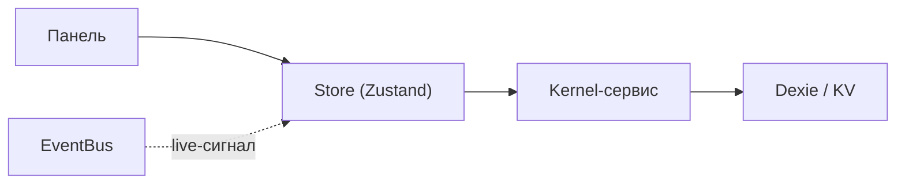

<!-- АВТОСГЕНЕРАЦИЯ: файл создан scripts/gen-wiki-docs.mjs из корпуса Wiki (src/components/WikiPanel). Не редактировать вручную. -->

# Разработчикам: состояние (stores) и хуки

> Раздел: **Разработчикам** · Статус: verified · Теги: dev, stores, состояние

Источники: `src/stores/`, `src/hooks/`

## Сторы

`src/stores/` — Zustand-подобные сторы на фичу: `useChatStore`, `useKeyStore`, `useNotificationStore`, `activeDebateStore`, `debateLiveStore`, `directorStore`, `personaStore`, `councilStore`, `crewStore`, `graphStore`, `rivalStore`, `opsStore` и др. Каждый сторы держат UI-состояние и (где нужно) синхронизируются с сервисами.

## Хуки

`src/hooks/` — общие хуки (поллинг, таймеры, видимость и т.п.). Пример комплексного: `usePolling` в `components/Common`.

## Правило

Прежде чем класть данные в стор — реши, обязаны ли они переживать reload. Если да — источник правды в сервисе/БД, а стор — кэш для рендера.

Полный список хуков, типов состояния и вспомогательных экспортов — в [Каталог сторов](./dev-store-catalog.md).

---

## Связанные материалы

- [Каталог сторов](./dev-store-catalog.md)
- [Разработчикам: компоненты и панели](./dev-components.md)
- [Разработчикам: сервисы и lazyService](./dev-services.md)

[← Все материалы](./README.md)
