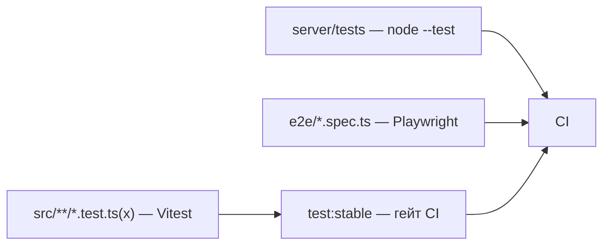

<!-- АВТОСГЕНЕРАЦИЯ: файл создан scripts/gen-wiki-docs.mjs из корпуса Wiki (src/components/WikiPanel). Не редактировать вручную. -->

# Каталог тестов

> Раздел: **Разработчикам** · Статус: verified · Теги: dev, тесты, каталог, CI

Источники: `scripts/gen-wiki-tests.mjs`, `package.json`

## Тесты

Тестовая поверхность: 486 unit/компонентных тестов в src, 8 server-тестов (node --test), 3 тестов скриптов, 17 e2e (Playwright) — всего 514. CI гоняет стабильный набор ([Разработчикам: ворота качества и CI](./dev-ci.md)), а не все сразу: полный vitest на общих раннерах не тянет.

### Unit/компонентные тесты по областям (src)

| Область | Тестов |
|---|---|
| src/kernel | 290 |
| src/components | 157 |
| src/llm | 20 |
| src/stores | 14 |
| src/hooks | 3 |
| src (корень) | 1 |
| src/i18n | 1 |

### Стабильный гейт CI — test:stable (34 путей)

| Путь из package.json |
|---|
| src/stores |
| src/hooks |
| src/kernel/events |
| src/kernel/workers |
| src/kernel/container.test.ts |
| src/kernel/security.test.ts |
| src/kernel/services/rivals/guardrail-service.test.ts |
| src/llm/http/llm-http-client.test.ts |
| src/llm/decorators/circuit-breaker.test.ts |
| src/llm/decorators/retry-decorator.test.ts |
| src/llm/decorators/rate-limit-decorator.test.ts |
| src/llm/decorators/fallback-decorator.test.ts |
| src/llm/decorators/priority-queue.test.ts |
| src/llm/decorators/semantic-router.test.ts |
| src/llm/decorators/canary-router.test.ts |
| src/llm/decorators/compress-route.test.ts |
| src/llm/decorators/logging-decorator.test.ts |
| src/llm/decorators/cost-manager.test.ts |
| src/llm/registry/adapter-factory.test.ts |
| src/kernel/services/provider-adapter-registry.test.ts |
| src/kernel/services/parity/tool-runner-service.test.ts |
| src/kernel/services/key-management/key-vault.test.ts |
| src/kernel/utils/network.test.ts |
| src/kernel/services/n8n-service.test.ts |
| src/kernel/services/telegram-service.test.ts |
| src/components/Common/gatewayApi.test.ts |
| src/kernel/services/tool-executor.test.ts |
| src/kernel/services/cross-tab-lock-service.test.ts |
| src/kernel/services/storage/dexie-storage.session.test.ts |
| src/components/ChatPanel/code-escape.test.ts |
| src/kernel/services/local-secret-store.test.ts |
| src/kernel/services/external-secrets-service.test.ts |
| src/kernel/services/debate-runtime/debate-preflight.test.t |
| src/llm/http/sse-parser.test.tss |

### Server-тесты (node --test)

| Файл |
|---|
| server/tests/autocycle.test.mjs |
| server/tests/browser-use-adapter.test.mjs |
| server/tests/computer-act-adapter.test.mjs |
| server/tests/decide-approval.test.mjs |
| server/tests/run-integrity.test.mjs |
| server/tests/wakeup-issue.test.mjs |
| server/tests/write-queue.test.mjs |
| server/tests/ws-auth.test.mjs |

### Тесты скриптов

| Файл |
|---|
| scripts/tests/net-guard.test.mjs |
| scripts/tests/sidecar-ctl.test.mjs |
| scripts/tests/smoke-stack.test.mjs |

### E2E (Playwright)

| Спека |
|---|
| e2e/basic-flow.spec.ts |
| e2e/data-chat.spec.ts |
| e2e/data-debate.spec.ts |
| e2e/data-dialogs.spec.ts |
| e2e/data-fleet.spec.ts |
| e2e/data-forum.spec.ts |
| e2e/data-health.spec.ts |
| e2e/data-keys.spec.ts |
| e2e/data-knowledge.spec.ts |
| e2e/data-organizer.spec.ts |
| e2e/data-projects.spec.ts |
| e2e/data-research.spec.ts |
| e2e/data-room.spec.ts |
| e2e/data-runtime.spec.ts |
| e2e/data-sync.spec.ts |
| e2e/routes-a-flow.spec.ts |
| e2e/routes-b-flow.spec.ts |

---

## Связанные материалы

- [Разработчикам: тесты](./dev-testing.md)
- [Разработчикам: ворота качества и CI](./dev-ci.md)
- [Скрипты и CLI](./dev-scripts.md)
- [Разработчикам: обзор и слои](./dev-overview.md)

[← Все материалы](./README.md)
