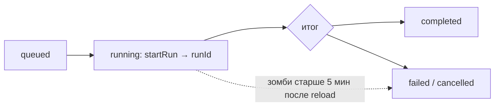

<!-- АВТОСГЕНЕРАЦИЯ: файл создан scripts/gen-wiki-docs.mjs из корпуса Wiki (src/components/WikiPanel). Не редактировать вручную. -->

# След исполнения: журнал, раны, зомби

> Раздел: **Знания и память** · Статус: verified · Теги: история, P1, P2, инструменты

Источники: `src/kernel/services/tool-executor.ts`, `src/kernel/services/agent-project-runtime.ts`, `docs/audits/agent-team-audit-memory-history-management.md`

## P1 — журнал инструментов

Все вызовы (ToolService, ToolRunner, computer-loop) пишутся в один KV-журнал: успех, ошибка, отказ (disabled, лимиты, governance, BLOCKED, approve). Связки runId/taskId/agentId там, где доступны. Один писатель (single-writer контракт), merge при загрузке, кап 200.

## P2 — цепочка рана

Метод startRun — первым (его id — единый runId), вызовы с именами в строке рана, детали — в журнале P1. Зомби (running старше 5 минут после reload) помечаются failed. Пустые toolCalls — честная пустота, не успех.

## Что НЕ покрыто

Browser-шлюз, MCP-делегаты, фабрика агентов — вне журнала (зафиксировано, не скрыто).

---

## Связанные материалы

- [Агенты: устройство и управление](./agents.md)
- [Панель: Задачи агентов](./panel-agent-tasks.md)
- [Диагностика и известные проблемы](./diagnostics.md)

[← Все материалы](./README.md)
