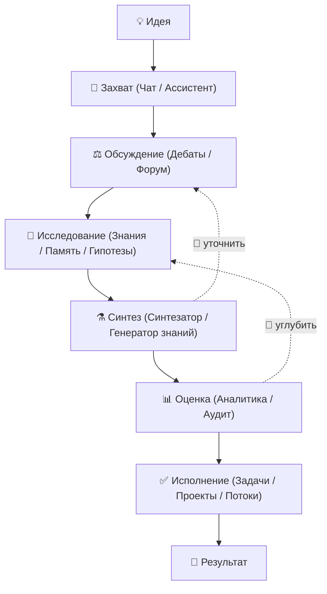

<!-- АВТОСГЕНЕРАЦИЯ: файл создан scripts/gen-wiki-docs.mjs из корпуса Wiki (src/components/WikiPanel). Не редактировать вручную. -->

# Путь идеи: от мысли до результата

> Раздел: **Руководство** · Статус: documented · Теги: руководство, сценарий, идея, изобретение

Источники: `src/components/DebatePanel/DebatePanel.tsx`, `src/components/SimulationPanel/SimulationPanel.tsx`, `src/components/KnowledgePanel/KnowledgePanel.tsx`, `src/kernel/services/debate-runtime/`, `src/kernel/services/memory/`, `src/kernel/services/rag/`

## Что это
      
В SuperAgents OS есть **150+ действий**, но главная сила — не количество кнопок, а возможность **провести одну идею через всю систему** и собрать цельный результат. Эта статья — дорожная карта «пути идеи»: от первой мысли до готового вывода, текста или плана.

---

## Этап 1. Захват идеи 💬

Первая мысль не должна потеряться. Запиши её так, как удобно.

| Где | Что даёт | Эмодзи |
|---|---|---|
| **Чат с ИИ** | Быстрый диалог: «разложи идею», «что тут важного?» | 💭 |
| **Ассистент** | Помощник, который ведёт диалог и подсказывает следующие шаги | 🧑‍💼 |
| **Память** | Идея сохраняется и всплывает потом, когда понадобится | 🧠 |

> 💡 **Совет:** сформулируй идею одним предложением и вопросом «что я хочу понять/сделать?». Так системе будет проще помочь.

---

## Этап 2. Обсуждение и прояснение ⚖️

Теперь дай идею «на суд» нескольким точкам зрения.

| Компонент | Что происходит |
|---|---|
| **Дебаты** | Команда агентов спорит: одни защищают, другие критикуют, судья выносит вердикт. Есть 13 стратегий (socratic, argument_tree, jury_trial и др.) — можно выбрать под задачу |
| **Форум агентов** | Открытое обсуждение: много агентов обмениваются мнениями без жёсткой структуры |
| **Граф аргументов** | Наглядно видно, кто что поддерживает, а кто опровергает — слабые места идеи видны сразу |

> 🎯 **Зачем:** дебаты помогают найти слабые места до того, как ты потратишь время на реализацию.

---

## Этап 3. Исследование 🔬

Собери факты, данные и связанные знания.

| Где | Что можно сделать |
|---|---|
| **База знаний (RAG)** | Загрузи источники (URL/текст) — система найдёт нужное по смыслу |
| **Генератор знаний** | Из источников и мыслей сделай готовый конспект или статью |
| **Исследование (гипотезы)** | Сгенерируй гипотезы и план проверки |
| **Память** | Вспомни похожие прошлые задачи и их решения |
| **Контрфактические сценарии** | «А что было бы, если…?» — проверь альтернативы |
| **What-If** | Что если сменить модель/параметры? |

---

## Этап 4. Синтез ⚗️

Собери разрозненные результаты в единое целое.

| Где | Что даёт |
|---|---|
| **Синтезатор** | Объединяет выводы обсуждений и исследований в связный текст |
| **Генератор знаний** | Превращает сырьё в готовые статьи/документы |

---

## Этап 5. Оценка 📊

Проверь, насколько результат хорош.

| Где | Что можно увидеть |
|---|---|
| **Аналитика** | Сколько запросов/токенов ушло, какая стоимость |
| **Аудит** | Кто и что делал — полная прозрачность |
| **Оценка/ELO** | Сравнение качества разных конфигураций |

---

## Этап 6. Исполнение ✅

Преврати вывод в действие.

| Где | Что сделать |
|---|---|
| **Агенты** | Отправь агентов выполнять конкретные задачи |
| **Задачи** | Многошаговый план с агентами |
| **Проекты** | Организуй всё по проектам |
| **Рабочие процессы** | Автоматический поток из шагов |
| **Построитель** | Собери когнитивный конвейер из готовых блоков |

---

## Этап 7. Эксперименты и глубже 🧪

Если идея сложная — можно моделировать и возвращаться во времени.

| Где | Что даёт |
|---|---|
| **Симуляция** | «Мир» с агентами — посмотри, как система поведёт себя |
| **Time Machine** | Откат и просмотр прошлых состояний |
| **Wiki Brain** | Документация о самой системе — принципы и руководства |

---

## Практический пример: «Вода из воздуха» 💧

Представим, что идея — прибор для получения воды из воздуха (как у твоего дяди).

1. **💬 Захват:** «Хочу устройство, которое собирает воду из воздуха. Как проверить, что это реально?»
2. **⚖️ Дебаты:** агенты спорят о технической сложности, стоимости, физике конденсации.
3. **🔬 Исследование:** загружаем статьи о конденсации, влажности, существующих устройствах.
4. **⚗️ Синтез:** получаем сводку «что известно и что нужно проверить».
5. **📊 Оценка:** видим, какие аргументы сильнее, где пробелы.
6. **✅ Исполнение:** ставим задачи на прототип, расчёт, поиск материалов.

---

## Главное 🧭

Система не «делает за тебя» — она **помогает мыслить шире и ничего не терять**. Проведи идею по этапам, и на выходе получишь: обоснованный вывод, план и готовый текст. А если что-то непонятно — начни с Чat и спроси: «какой следующий шаг?».

---

## Связанные материалы

- [Возможности ОС](./capabilities.md)
- [Дебаты: режимы и механика](./debates.md)
- [Агенты: устройство и управление](./agents.md)
- [Знания и память](./memory.md)
- [Провайдеры и маршрутизация](./providers.md)

[← Все материалы](./README.md)
