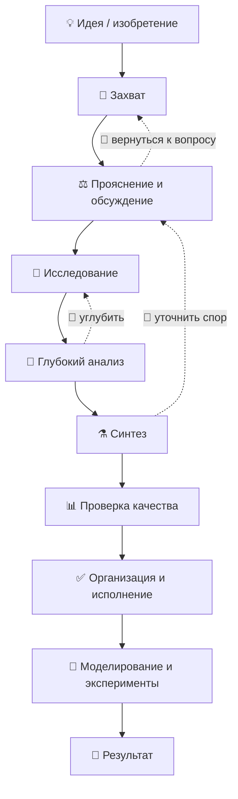

<!-- АВТОСГЕНЕРАЦИЯ: файл создан scripts/gen-wiki-docs.mjs из корпуса Wiki (src/components/WikiPanel). Не редактировать вручную. -->

# Путь идеи: от мысли до результата

> Раздел: **Руководство** · Статус: documented · Теги: руководство, сценарий, идея, изобретение

Источники: `src/components/DebatePanel/DebatePanel.tsx`, `src/components/SimulationPanel/SimulationPanel.tsx`, `src/components/KnowledgePanel/KnowledgePanel.tsx`, `src/kernel/services/debate-runtime/`, `src/kernel/services/memory/`, `src/kernel/services/rag/`

## Что это

SuperAgents OS — это не просто чат с ИИ. Это **150+ действий для работы с информацией**: обсуждения, исследования, памятные заметки, документы, задачи и многое другое. Эта статья — полная «дорожная карта»: как провести идею/изобретение через все этапы и получить настоящий результат.

---

## Этап 1. Захват идеи 💬

Зафиксируй мысль, пока она свежая.

| Компонент | Что даёт |
|---|---|
| **Чат** | Быстрый диалог: «разложи», «что здесь важного?» |
| **Ассистент** | Помощник, который ведёт диалог и подсказывает шаги |
| **Заметки / Файлы / Редактор** | Запиши идею, набросай черновик |
| **Голосовой ввод** | Наговори идею, не печатая |
| **Память** | Идея сохранится и всплывёт потом |

> 💡 **Совет:** сформулируй одним предложением + вопросом «что я хочу понять или сделать?».

---

## Этап 2. Прояснение и обсуждение ⚖️

Отдай идею «на суд» разным точкам зрения.

| Компонент | Что даёт |
|---|---|
| **Дебаты** | Команда агентов спорит: pro/con/neutral, судья выносит вердикт. 13 стратегий + топологии (roundtable, judge, tree-of-thought, red-blue…) |
| **Форум агентов** | Открытый обмен мнениями без жёсткой структуры |
| **Граф аргументов** | Визуально: кто что поддерживает / опровергает |
| **Темы** | Подборка тем для спора |
| **Стратегии** | Конструктор: собери свою стратегию дебата |
| **Комната / Групповой чат / Dyad** | Совещание нескольких агентов или парный диалог |
| **Директор** | Управление командой и ролями |
| **Экипажи / Совещания** | Классические «Crew»-команды и «Council»-судейство |

---

## Отдельно: какие бывают «разговоры» с агентами 💬

Их в системе много, и они разные. Вот как не запутаться и что выбрать для своей идеи.

| Тип | Где | Суть | Когда использовать |
|---|---|---|---|
| **Чат 1-на-1** | Чат | Ты и ассистент: вопрос → ответ. Самый простой | Начать, уточнить вопрос, «разложить» идею |
| **Ассистент** | Ассистент | Персональный помощник, ведёт диалог по системе | Путеводитель по всей системе |
| **Групповой чат** | Групповой чат | Несколько агентов в одном общем потоке | Когда нужно собрать разные мнения сразу |
| **Пара (Dyad)** | Dyad | Ровно два агента обсуждают | Спор «за/против» вдвоём |
| **Комната** | Комната | Агенты «живут» и общаются в пространстве | Симуляция общения, сцены |
| **Форум** | Форум | Открытое обсуждение многих агентов | Свободный мозговой штурм |
| **Дебаты** | Дебаты | Структурированный спор: роли + судья + раунды | Когда нужен взвешенный вердикт |
| **Совещание** | Совещание (Council) | Судьи и роли оценивают результаты | Оценка и «судейство» |
| **Экипаж** | Экипажи (Crew) | Команда агентов параллельно решает задачи | Выполнение нескольких частей сразу |
| **Директор** | Директор | Управляет командой, распределяет роли | Когда много ролей и целей |
| **Live-сцена** | Live Workspace | Полноэкранная живая визуализация | Наблюдать «вживую» за работой |

> 💡 **Как выбрать:** хочешь просто поговорить → **Чат**. Нужен спор до вердикта → **Дебаты**. Нужно много идей → **Форум**. Нужно выполнить много задач → **Экипаж**.

---

## Этап 3. Исследование 🔬

Собери факты, источники и знания.

| Компонент | Что даёт |
|---|---|
| **База знаний (RAG)** | Загрузи URL/текст — поиск по смыслу |
| **Движок исследования** | Глубокий поиск и сбор из источников |
| **Гипотезы** | Сгенерируй гипотезы и план проверки |
| **Генератор знаний** | Из источников → готовый конспект/статья |
| **Память** | Вспомни похожие прошлые задачи |
| **Дворец памяти** | Структурированное хранение заметок |
| **Линзы / Кристаллы / Junction** | Взгляд на данные под разными углами и связки |
| **Источники (Webhooks/Коннекторы)** | Подключение внешних данных |

---

## Этап 4. Глубокий анализ 🧠

Разбери идею по-настоящему: найди слабые места, противоречия, скрытые допущения.

| Компонент | Что даёт |
|---|---|
| **Анализ дебатов** | Метрики по аргументам и спикерам |
| **Minimax-планировщик** | Оценка ходов «как в шахматах» |
| **Прогноз результата** | Пытается предсказать, чем закончится |
| **Схожесть** | Находит дубликаты/близкие мысли |
| **Дрейф позиции** | Замечает, когда агент «поплыл» |
| **Контрфактика** | «А что было бы, если…?» |
| **Каузальный отладчик** | Причинно-следственные цепочки |
| **What-If** | Сценарии при смене параметров |
| **Провайдерное давление** | Нагрузка/лимиты |
| **Техники** | Сотни «микро-инструментов»: credibility, consistency, belief-mining, anchoring, steelman, shadow-opponent, expert-witness, stakeholder, bias-profiler, frame-tracker, stance-drift, insight-bus, entanglement, calibration, blind-eval, bayesian-judge, got-deliberation, concept-blender и др. |

---

## Этап 5. Синтез ⚗️

Собери всё в единый цельный вывод/документ.

| Компонент | Что даёт |
|---|---|
| **Синтезатор** | Объединяет выводы спорных мест и исследований |
| **Генератор знаний** | Превращает сырьё в статью/документ |
| **Рецензия архитектуры** | Проверка связности результата |
| **Отчёты исследования** | Готовый отчёт |
| **Аудит промптов** | Проверка качества формулировок |
| **Дистилляция модели** | «Сжать» знания в модель |

---

## Этап 6. Проверка качества 📊

Проверь, насколько результат хорош и надёжен.

| Компонент | Что даёт |
|---|---|
| **Аналитика** | Запросы, токены, стоимость |
| **Оценка / ELO** | Сравнение качества конфигураций |
| **A/B-тесты** | Сравнение двух вариантов |
| **Наборы для оценки** | Тестовые датасеты |
| **Качество** | Метрики качества ответов |
| **Аудит** | Кто и что делал — прозрачность |
| **Политики / Guardrails / Governance** | Правила и ограничения |
| **Утверждения** | Ручное одобрение опасных действий |

---

## Этап 7. Организация и исполнение ✅

Преврати вывод в план и действие.

| Компонент | Что даёт |
|---|---|
| **Агенты** | Отправь агентов на конкретные задачи |
| **Задачи** | Многошаговый план с агентами |
| **Проекты** | Организуй всё по проектам |
| **Рабочие процессы** | Автоматический поток из шагов |
| **Построитель** | Собери когнитивный конвейер |
| **Планировщик / Планирование** | Расписание и план |
| **Автономия** | Агент сам решает шаги |
| **Пакетная обработка** | Много задач разом |
| **Постановка (SOP)** | Стандартные процедуры |
| **Деплой / Интеграции** | Выпуск наружу |
| **Пул задач** | Очередь на запуск |

---

## Этап 8. Моделирование и эксперименты 🧪

Если идея сложная — моделируй и пробуй.

| Компонент | Что даёт |
|---|---|
| **Симуляция** | «Мир» с агентами — поведение системы |
| **Time Machine** | Откат и просмотр прошлых состояний |
| **Топологии** | Шаблоны графов для экспериментов |
| **Playground** | Быстрое сравнение моделей |
| **Эксперименты роутинга** | Тесты выбора моделей |
| **Стресс-тесты** | Нагрузить систему |
| **Wiki Brain** | Документация о самой системе |

---

## Каталог сценариев (примеры) 🗂️

| # | Сценарий | Этапы | Ключевые компоненты |
|---|---|---|---|
| 1 | Проверить бизнес-идею | 2→4→5 | Дебаты, граф аргументов, анализ, синтез |
| 2 | Собрать обзор темы | 3→5 | Исследование, генератор знаний, синтез |
| 3 | Подготовить статью | 3→5→6 | Знания, синтез, отчёт, аудит промптов |
| 4 | Взвесить «за/против» решения | 2→4 | Дебаты, steelman, credibility, consistency |
| 5 | Найти слабые места плана | 4 | vulnerability-targeting, minimax, counterfactual |
| 6 | Сгенерировать гипотезы | 3 | Движок исследования, hypothesis-gen |
| 7 | Сравнить два подхода | 6 | A/B-тесты, eval-datasets, ELO |
| 8 | Спланировать проект | 7 | Проекты, задачи, планировщик, workflows |
| 9 | Автоматизировать рутину | 7 | Агенты, autonomy, batch, run-queue |
| 10 | Понять, кто что делает | 6 | Аудит, аналитика, флот |
| 11 | Проверить безопасность идеи | 6 | Security, guardrails, approvals, governance |
| 12 | Смоделировать последствия | 8 | Симуляция, what-if, time-machine |
| 13 | Разобрать чужую статью | 3→4 | Знания, анализ, frame-tracker, stance-drift |
| 14 | Собрать досье | 2→3 | Форумы, граф аргументов, память |
| 15 | Расписать по шагам | 7 | Планировщик, задачи, директор |
| 16 | Проверить факты | 4 | credibility, adversarial-source, consistency |
| 17 | Найти скрытые допущения | 4 | belief-mining, logical-form, enthymeme |
| 18 | Усилить аргумент | 2→4 | steelman, expert-witness, persona-mixer |
| 19 | Понять аудиторию | 4 | stakeholder, audience, persuasiveness |
| 20 | Сравнить модели | 6→8 | Playground, ELO, routing-experiments |
| 21 | Оценить стоимость | 6 | Аналитика, cost-analytics, pricing |
| 22 | Собрать «как это работает» | 3 | Исследование, граф аргументов, knowledge |
| 23 | Написать реферат | 3→5 | Знания, генератор знаний, синтез |
| 24 | Придумать новое применение | 2→3→4 | Дебаты, исследование, concept-blender |
| 25 | Свести разрозненные данные | 3→5 | Junction, кристаллы, синтез |
| 26 | Проверить согласованность | 4 | consistency, drift-detector, frame-tracker |
| 27 | Спланировать дебат | 2→8 | Топологии, стратегии, симуляция |
| 28 | Оценить риски | 4→6 | vulnerability, stakeholder, guardrails, approvals |
| 29 | Собрать команду | 2→7 | Агенты, роли, экипажи, директор |
| 30 | Разобрать «почему это работает» | 3→4 | Исследование, causal-debugger, logical-form |
| 31 | Свести итог заседания | 5 | Синтезатор, форум, отчёт |
| 32 | Подготовить презентацию | 5 | Синтез, генератор знаний |
| 33 | Вспомнить прошлый опыт | 3 | Память, дворец памяти |
| 34 | Сравнить разные точки зрения | 2→4 | Дебаты, audience, steelman |
| 35 | Проверить вывод | 6 | ELO, качество, аудит |
| 36 | Собрать обучающий материал | 3→5→7 | Знания, генератор, задачи |
| 37 | Автоматически следить за темой | 7→3 | Агенты, знания, память |
| 38 | Прогнать сценарий «что если» | 4→8 | Counterfactual, what-if, симуляция |
| 39 | Упаковать проект для публикации | 7→6 | Деплой, интеграции, аудит |
| 40 | Собрать полное исследование | 3→4→5→6 | весь путь целиком |

---

## Быстрый словарик: что где находится 🗺️

Чтобы не искать вслепую — вот простая карта самых полезных инструментов по этапам.

| Инструмент | Простыми словами | Где помогает |
|---|---|---|
| **Чат** | Поговорить с ИИ один-на-один | Везде |
| **Ассистент** | Помощник, который ведёт тебя по системе | Старт |
| **Движок исследования** | Ищет и собирает информацию из источников | Исследование |
| **База знаний (RAG)** | Твой архив знаний; ищет по смыслу | Исследование |
| **Память** | «Блокнот» системы: помнит важное | Везде |
| **Дворец памяти** | Удобная структура твоих заметок | Исследование |
| **Гипотезы** | Предлагает, что проверить | Исследование |
| **Генератор знаний** | Из сырья делает статью/конспект | Синтез |
| **Синтезатор** | Собирает разрозненное в единый вывод | Синтез |
| **Дебаты** | Спор агентов до вердикта | Прояснение |
| **Форум** | Открытое обсуждение | Прояснение |
| **Граф аргументов** | Схема «кто что поддерживает» | Прояснение/анализ |
| **Техники** | ~60 «микро-инструментов» анализа | Анализ |
| **Оценка/ELO** | Сравнивает качество вариантов | Проверка |
| **A/B-тесты** | Ставит эксперимент «два варианта» | Проверка |
| **Качество** | Метрики качества ответов | Проверка |
| **Политики/Guardrails** | Правила поведения и ограничения | Безопасность |
| **Аудит** | Журнал «кто что делал» | Прозрачность |
| **Задачи** | План шагов с агентами | Исполнение |
| **Проекты** | Папки-организаторы работы | Исполнение |
| **Рабочие процессы** | Автоматические цепочки шагов | Исполнение |
| **Построитель** | Конструктор когнитивных конвейеров | Исполнение |
| **Планировщик** | Расписание задач | Исполнение |
| **Автономия** | Агент сам решает, что делать | Исполнение |
| **Симуляция** | «Мир» для проверки поведения | Эксперименты |
| **What-If** | «А что если изменить…» | Эксперименты |
| **Time Machine** | Откат во времени | Везде |
| **Wiki Brain** | Документация о самой системе | Справка |

---

## Практический пример: «Вода из воздуха» 💧

1. **💬 Захват:** «Хочу прибор, который собирает воду из воздуха. Как проверить реальность?»
2. **⚖️ Прояснение:** дебаты по физике конденсации, стоимости, сложности.
3. **🔬 Исследование:** статьи о влажности, существующих устройствах, материалах.
4. **🧠 Анализ:** слабые места (энергозатратность), противоречия в данных.
5. **⚗️ Синтез:** сводка «что известно / что проверить».
6. **📊 Проверка:** оценка источников, аудит.
7. **✅ Исполнение:** задачи на прототип, расчёт, бюджет.
8. **🧪 Эксперимент:** симуляция и what-if по сценариям погоды.

---

## Главное 🧭

Система **не «делает за тебя»** — она становится твоим «вторым мозгом»: помогает мыслить шире, ничего не терять и доводить идею до результата. Проводи идею по этапам — на выходе: обоснованный вывод, план и готовый документ.

> 🌟 **Помни:** любая великая идея начиналась с простого вопроса. У тебя уже есть инструмент, который усилить твоё мышление. Не бойся пробовать — каждый шаг делает тебя и систему лучше.

**Как двигаться дальше:**
- Непонятно с чего начать → открой **Чат** и спроси: «Каков следующий шаг для моей идеи?».
- Хочешь наглядно — открой **Рабочий стол** на главной: там папки-разделы, и в каждой уже лежат нужные инструменты.
- Просто любопытно → листай **Wiki** и читай про любой компонент.

**Ты уже создал нечто большое. Теперь научимся использовать это на полную.** 🚀

---

## Связанные материалы

- [Возможности ОС](./capabilities.md)
- [Дебаты: режимы и механика](./debates.md)
- [Агенты: устройство и управление](./agents.md)
- [Знания и память](./memory.md)
- [Провайдеры и маршрутизация](./providers.md)

[← Все материалы](./README.md)
