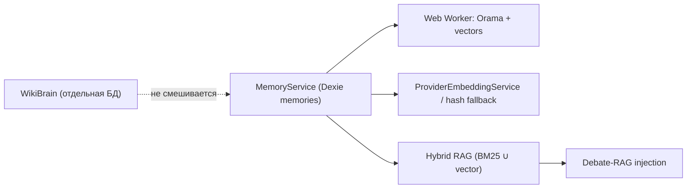

<!-- АВТОСГЕНЕРАЦИЯ: файл создан scripts/gen-wiki-docs.mjs из корпуса Wiki (src/components/WikiPanel). Не редактировать вручную. -->

# Знания и память

> Раздел: **Знания и память** · Статус: verified · Теги: память, RAG, персоны

Источники: `src/kernel/services/memory-engine.ts`, `src/kernel/services/memory-orchestrator.ts`, `src/kernel/services/rag/hybrid-retrieval-service.ts`, `docs/audits/agent-team-audit-memory-history-management.md`

## Слои

- **Единый движок памяти** — `MemoryService`: все записи в одной Dexie-таблице `memories`; 7 «магазинов» (working/episodic/semantic/procedural/emotional/social/spatial) — метки типа, не раздельные хранилища.
- **Поиск** — семантический (векторный, Web Worker/Orama) + полнотекстовый (keyword); `recall` с Ebbinghaus-recency-реранком.
- **Эмбеддинги** — провайдерские (`/embeddings`, опционально) с офлайн-хэш-фолбэком; пространства hash/provider не смешиваются.
- **RAG** — две линии: гибридный BM25+vector (RRF k=60) и линейный `KnowledgeService` (token-overlap).
- **Дебатный RAG** — инъекция релевантной памяти прошлых дебатов в промпт (`[RECALLED CONTEXT]`); чанки аргументов персистентны.
- **WikiBrain** — отдельная БД (`aios-wiki-brain`) и собственный embedder; вне общего векторного пространства памяти.

## Честно о дублировании

Один текст лежит в нескольких местах с разной обрезкой (Dexie + repo-кэш + MemoryCache + воркер) — единого источника правды нет. Полный список рисков — в аудите `docs/audits/memory-audit.md`.

История разработки этой области — [Зона 4: память и знания](./zone-4.md).

---

## Связанные материалы

- [Компонент: память и знания](./comp-memory.md)
- [След исполнения: журнал, раны, зомби](./execution-trail.md)
- [Дебаты: режимы и механика](./debates.md)
- [Архитектура и связи](./architecture.md)
- [Память: что есть и чего нет (аудит)](./memory-audit.md)

---

## Связи с кодом (авто)

Цепочка «панель → маршрут → компонент → тесты» собрана из реестра маршрутов.

- Панель `memory` → маршрут `/memory`
  - Компонент: `src/components/MemoryPanel/MemoryPanel`
  - Тесты: `src/components/MemoryPanel/MemoryPanel.test.tsx`

См. также: [Каталог панелей](./panels-catalog.md) · [Каталог компонентов OS](./dev-component-catalog.md).

[← Все материалы](./README.md)
