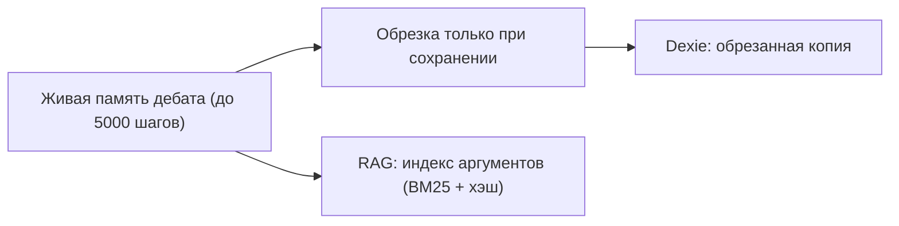

<!-- АВТОСГЕНЕРАЦИЯ: файл создан scripts/gen-wiki-docs.mjs из корпуса Wiki (src/components/WikiPanel). Не редактировать вручную. -->

# Знания и память

> Раздел: **Знания и память** · Статус: verified · Теги: память, RAG, персоны

Источники: `src/kernel/services/debate-runtime/debate-memory.ts`, `docs/audits/agent-team-audit-memory-history-management.md`

## Слои

- **Живая память дебата** — шаги/клеймы/цепочки; synthesis-шаг завершает цепочку (иначе persona-память мертва).
- **Обрезка только на сохранении** — live-память полная (лимит 5000 шагов), в Dexie едет обрезанная копия.
- **RAG дебатов** — аргументы раунда индексируются и ищутся (BM25+хэш), чанки персистентны.
- **Глобальные стеки** — memories, persona-профили, кристаллы, кросс-дебатный индекс: персистентны, но в дебатный промпт wired только RAG и persona-блок.

## Честно о дублировании

Один текст лежит в нескольких местах с разной обрезкой — единого источника правды нет, это известное следствие архитектуры, а не баг одного сервиса.

История разработки этой области — [Зона 4: память и знания](./zone-4.md).

---

## Связанные материалы

- [След исполнения: журнал, раны, зомби](./execution-trail.md)
- [Дебаты: режимы и механика](./debates.md)
- [Архитектура и связи](./architecture.md)
- [Память: что есть и чего нет (аудит)](./memory-audit.md)

---

## Связи с кодом (авто)

Цепочка «панель → маршрут → компонент → тесты» собрана из реестра маршрутов.

- Панель `memory` → маршрут `/memory`
  - Компонент: `src/components/MemoryPanel/MemoryPanel`
  - Тесты: `src/components/MemoryPanel/MemoryPanel.test.tsx`

См. также: [Каталог панелей](./panels-catalog.md) · [Каталог компонентов OS](./dev-component-catalog.md).

[← Все материалы](./README.md)
