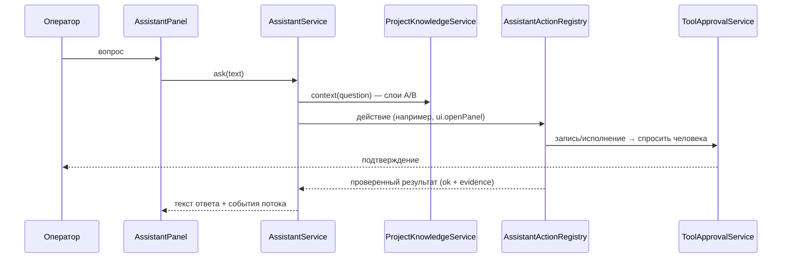

<!-- АВТОСГЕНЕРАЦИЯ: файл создан scripts/gen-wiki-docs.mjs из корпуса Wiki (src/components/WikiPanel). Не редактировать вручную. -->

# Панель: Помощник проекта

> Раздел: **Панели** · Статус: verified · Теги: панель, ассистент, голос, инструменты, память

Источники: `src/components/Assistant/AssistantPanel.tsx`, `src/components/Assistant/assistant-wiring.ts`, `src/components/Assistant/use-speech.ts`, `src/kernel/services/assistant/assistant-service.ts`, `src/kernel/services/assistant/assistant-actions.ts`, `src/kernel/services/assistant/assistant-agent.ts`, `src/kernel/services/agent-service.ts`, `src/kernel/services/assistant/project-knowledge-service.ts`, `src/kernel/services/assistant/assistant-navigation-service.ts`, `src/kernel/services/assistant/assistant-diary-service.ts`, `src/kernel/services/assistant/assistant-exam-service.ts`, `src/kernel/services/assistant/assistant-diagnosis-service.ts`, `src/kernel/services/capability-trust/capability-trust-service.ts`

## Что это

Панель «Помощник» — это текстовый (и голосовой) доступ к самой системе. Ассистент
не рассказывает о проекте по памяти: он спрашивает у кода, что панель из себя
представляет, где она живёт, какие тесты её закрывают, и только потом отвечает.

## Четыре слоя знания

Ответ собирается из четырёх слоёв, и каждый слой отвечает за своё:

1. **A — документация.** Статьи вики (`ProjectKnowledgeService` + BM25). Это
   намерение системы: «что задумано».
2. **B — структура.** Панель → роут → компонент → тесты. Берётся из
   сгенерированных `wiki-panel-map` и `wiki-connections`. Это факт: «что
   реализовано».
3. **C — эпизодическая память.** Что было решено раньше (`memoryOrchestrator.recall`).
4. **D — оперативное состояние.** Живое состояние: id ассистента, сессия,
   список доступных действий.

Если документация и код расходятся, ассистент обязан доверять коду и сказать об
этом вслух.

## Действия

Действия объявлены декларативно (`assistant-actions.ts`), сгруппированы и
имеют класс разрешения:

- **research** — `system.find`, `system.describe`, `system.capabilities`,
  `system.exam`, `system.diagnose`, `memory.search`, `diary.recent`;
- **navigation** — `ui.openPanel` (роут открывает интерфейс и подтверждает переход);
- **work** — `agents.list`, `agents.spawn`, `agents.setState`, `agents.update`
  (только имя и роль, встроенных агентов не трогает), `tools.list`,
  `memory.remember`, `diary.write`, а также UI-действия `keys.*`, `mcp.list`,
  `scheduler.create`, `skills.list`;
- **coordination** — `debate.start`, `scheduler.list`, `tasks.list` (доска задач
  с исполнителями и статусами) и `tasks.create` (делегирование задачи агенту).

Каждое действие возвращает проверяемый результат: `ok`, краткое описание и
**evidence** — что именно было зафиксировано. Ассистент не имеет права сказать
«открыл», если интерфейс не подтвердил переход.

Навигация — двусторонний канал, как и подтверждение опасных действий:
`AssistantNavigationService.open()` кладёт запрос в очередь и публикует событие
`assistant:navigation`, панель переходит по роуту и вызывает `confirm(id)`.
Пятнадцать секунд без подтверждения — это честный `FAILED`, а не «наверное,
открылось». Тот же путь проверен end-to-end: в e2e-тесте модель просит
`ui.openPanel`, стримовый tool-call доходит до реестра, браузер оказывается на
`/agents`.

## Экзамен и дневник

Ассистент не имеет права утверждать, что возможность работает, пока это не
проверено (`assistant-exam-service.ts`):

- **verified** — возможность исполнена, результат наблюдаем: утверждать можно;
- **discovered** — реализация есть, но в этой сессии не запускалась: описывать
  можно, утверждать — нет;
- **declared** — о возможности знает только документация: утверждать нельзя.

Читаемые возможности экзаменует запуском, пишущие — только через права
человека. Дневник (`assistant-diary-service.ts`) хранит опыт в журнале агентов
и зеркалит его в долговременную память, поэтому прошлый опыт всплывает в
контексте следующего вопроса.

## Маршрутизация проблемы

Симптом сам не говорит, где поломка: «панель не открывается» может быть
роутом (B), ключом (D) или устаревшей статьёй (A). `system.diagnose`
(`assistant-diagnosis-service.ts`) определяет слой и даёт проверки, которые
нужно выполнить в этом слое, с запасными слоями на случай, если первый
окажется чистым.

## Права

Ассистент работает в режиме **guarded**: чтение (`tool:read`) идёт свободно,
запись (`tool:write`) и исполнение (`tool:exec`, `tool:net`, `tool:mcp`)
требуют подтверждения через `ToolApprovalService` — тот же канал, что и у
обычных агентов. Если интерфейс не подключён, запрос отклоняется сразу
(fail closed), а не висит.

## Ассистент как агент топологии

Ассистент — не отдельное окно рядом с системой, а её агент: узел с
зарезервированным id `assistant` (`assistant-agent.ts`). Узел засевается при
каждой загрузке топологии, поэтому переживает и перезапуск, и восстановление
снимка; удалить его нельзя, авто-клонирование и пул участников дебатов его
пропускают. В админке он отмечен как `built-in`.

Свой профиль ассистент знает фактами: блок `[SELF]` в контексте и действие
`system.self` отдают id узла, статус и режим прав. Тот же профиль показан в
шапке панели строкой `агент assistant · ready · guarded` — если узел на паузе
или потерял права, это видно до первого вопроса. Режим `guarded` записан
явно при первом ходе — движок прав больше не считает ассистента «не
настроенным». Реестр возможностей содержит запись `agent:assistant`.

Пауза в админке останавливает действия, но не ответы: приостановленный
ассистент объясняет, что он на паузе, вместо того чтобы ходить по системе.
Каждый ход пишется в статистику агента (`cognitive:step:completed`), поэтому
карточка в админке показывает реальные вызовы, а не нули.

Текущее состояние системы ассистент читает, а не воображает:
`topology.summary` (узлы, агенты, паузы, рёбра), `metrics.summary` (запросы,
токены, стоимость, задержка, успех), `traces.summary` (выполненные, упавшие,
идущие) и `approvals.pending` (что ждёт подтверждения человека). Все четыре —
`tool:read` и возвращают числа как evidence. Конфигурацию он тоже читает, а не
пересказывает: `roles.list` (роли по категориям, built-in/custom),
`settings.get` (режим, SLA, модель по умолчанию — без ключей и токенов) и
`audit.recent` (последние записи журнала + целостность цепочки). Пишущих
навыков ровно четыре, и все четыре работают через подтверждение человека: `settings.update`
(режим, SLA, язык или переключатель из белого списка), `agents.update` (только
имя и роль, встроенных агентов не трогает), `scheduler.create` (повторяющаяся
задача: имя, промпт, частота или cron, по умолчанию — на самом ассистенте) и
`tasks.create` (задача на доске с исполнителем, приоритетом и типом; агент
проверяется на существование).
Каждый из них читает значение обратно после записи; ключи, токены и прочее
ассистент не трогает. Задача, назначенная на самого ассистента, выполняется не
через общий сценарий беседы, а через его собственный мозг — с его знаниями,
действиями и правом подтверждения, — и каждый запуск (успешный или нет)
попадает в дневник как `action` с тегом `schedule`.

## Голос

Голос — браузерный, не зависит от провайдера модели: `SpeechRecognition` для
ввода и `speechSynthesis` для озвучки (`use-speech.ts`). Если Web Speech
недоступен, панель остаётся текстовой. Голос выбирается под язык ответа
(`pickVoice`: точное совпадение → язык без региона → голос по умолчанию),
длинный ответ режется на предложения (`chunkForSpeech`), иначе браузер
обрывает озвучку. Речь прерывается разговором пользователя и новым вопросом;
включённая озвучка запоминается в `localStorage`.

## Границы слоёв

Ядро не импортирует `src/components`. Корпус статей передаётся в ядро через
`setCorpusProvider`, UI-действия — через `attachUiActions`, а канал
навигации — через `AssistantNavigationService`: ядро просит, интерфейс
подтверждает.

---

## Связанные материалы

- [Панель: Чат](./panel-chat.md)
- [Панель: Наблюдаемость (логи, трейсы, здоровье)](./panel-observability.md)
- [Знания и память](./memory.md)

---

## Связи с кодом (авто)

Цепочка «панель → маршрут → компонент → тесты» собрана из реестра маршрутов.

- Панель `assistant` → маршрут `/assistant`
  - Компонент: `src/components/Assistant/AssistantPanel`
  - Тесты: `src/components/Assistant/AssistantPanel.test.tsx`

См. также: [Каталог панелей](./panels-catalog.md) · [Каталог компонентов OS](./dev-component-catalog.md).

[← Все материалы](./README.md)
