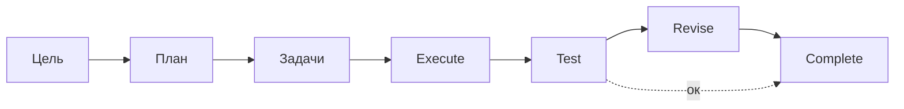

<!-- АВТОСГЕНЕРАЦИЯ: файл создан scripts/gen-wiki-docs.mjs из корпуса Wiki (src/components/WikiPanel). Не редактировать вручную. -->

# Панель: Автономия

> Раздел: **Панели** · Статус: verified · Теги: панель, автономия, планирование, инструкция

Источники: `src/i18n/translations/en/analytics.ts`, `src/components/AutonomyPanel/AutonomyPanel.tsx`

## Назначение

Автономный цикл: цель → план → задачи → исполнение → проверка → доработка → завершение. Ключи `autonomy.*`.

## Шаги

Цель (goal), план, задачи (tasks), назначение исполнителей, execute, test, revise, complete. Показываются прогресс, статус и запуск. Есть сид-демо.

## Где менять

Компонент: `AutonomyPanel`. Задачи — [Панель: Задачи и пайплайны](./panel-tasks.md), агенты — [Агенты: устройство и управление](./agents.md).

---

## Связанные материалы

- [Агенты: устройство и управление](./agents.md)
- [Панель: Задачи и пайплайны](./panel-tasks.md)
- [Каталог компонентов OS](./dev-component-catalog.md)

[← Все материалы](./README.md)
