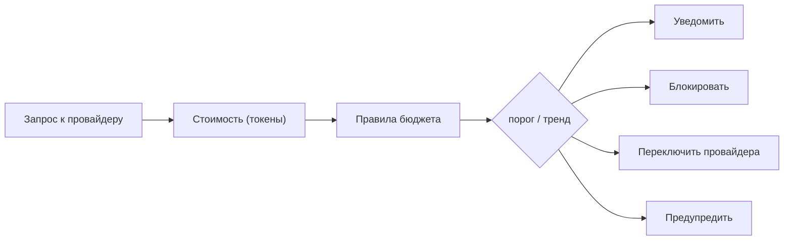

<!-- АВТОСГЕНЕРАЦИЯ: файл создан scripts/gen-wiki-docs.mjs из корпуса Wiki (src/components/WikiPanel). Не редактировать вручную. -->

# Панель: Бюджет и затраты

> Раздел: **Панели** · Статус: verified · Теги: панель, бюджет, затраты, pricing, инструкция

Источники: `src/i18n/translations/en/budget.ts`, `src/components/BudgetPanel/`

## Назначение

Бюджеты, цены, оптимизация затрат и алерты. Строки — ключи `budget.*`, `pricing.*`, `cost_opt.*`, `budgetAlerts.*`.

## Бюджеты

Общий, дневной, недельный и месячный лимиты, баланс, потрачено/остаток, автопополнение, отдельные бюджеты по провайдерам и история. Есть секции: глобальная, агентов, провайдеров, алертов.

## Цены (pricing)

Таблица цен, синхронизация с OpenRouter, активные оверрайды стоимости входа/выхода для модели и их правка. Показывает трату за месяц, среднее в день, остаток, прогноз до конца месяца и выход за бюджет.

## Оптимизация затрат

Потенциальная экономия, рекомендации (можно скрыть), разбивка по провайдерам и моделям: запросы, средняя стоимость, средняя латентность, надёжность. Если данных нет — так и написано.

## Алерты бюджета

Правила с именем и порогом; условия (выше/ниже порога, около лимита, тренд вверх/вниз) и действия (уведомить, блокировать, переключить провайдера, предупредить). Есть история срабатываний и очистка.

## Где менять

Компоненты: `BudgetPanel` и его секции (`PlatformBudgetSection` и др.). Провайдеры и ключи — [Панель: Провайдеры и ключи](./panel-providers.md), роутер — в настройках [Панель: Настройки](./panel-settings.md).

---

## Связанные материалы

- [Провайдеры и маршрутизация](./providers.md)
- [Диагностика и известные проблемы](./diagnostics.md)
- [Панель: Настройки](./panel-settings.md)
- [Каталог компонентов OS](./dev-component-catalog.md)

[← Все материалы](./README.md)
