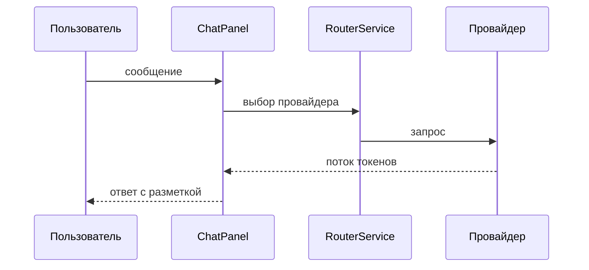

<!-- АВТОСГЕНЕРАЦИЯ: файл создан scripts/gen-wiki-docs.mjs из корпуса Wiki (src/components/WikiPanel). Не редактировать вручную. -->

# Панель: Чат

> Раздел: **Панели** · Статус: verified · Теги: панель, чат, инструкция

Источники: `src/components/ChatPanel/ChatPanel.tsx`, `src/components/ChatPanel/MarkdownRenderer.tsx`

## Назначение

Основной диалог с моделями: стриминг ответов, режимы исполнения (single, broadcast, race), сравнение провайдеров side-by-side.

## Ответы с разметкой

- Ссылки кликабельны, включая голые URL; картинки по https открываются, битые сворачиваются в подпись.
- Блоки кода с подсветкой, кнопкой копирования и запуском (python/js/ts).
- Таблицы и mermaid-схемы рисуются прямо в ответе.

## Связи

Провайдер и ключи — из [Провайдеры и маршрутизация](./providers.md); история — в сессиях Dexie (последние 200 записей, дальше обрезка); память подмешивается в промпт.

---

## Связанные материалы

- [Провайдеры и маршрутизация](./providers.md)
- [Панель: Провайдеры и ключи](./panel-providers.md)
- [Знания и память](./memory.md)
- [Зона 1: панели провайдеров и чата](./zone-1.md)

[← Все материалы](./README.md)
