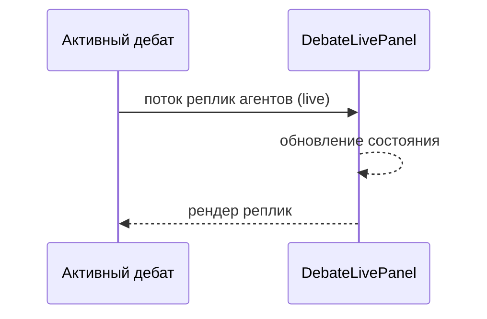

<!-- АВТОСГЕНЕРАЦИЯ: файл создан scripts/gen-wiki-docs.mjs из корпуса Wiki (src/components/WikiPanel). Не редактировать вручную. -->

# Панель: Живые дебаты

> Раздел: **Панели** · Статус: verified · Теги: панель, дебаты, live, инструкция

Источники: `src/i18n/translations/en/debate.ts`, `src/components/DebateLive/DebateLivePanel`

## Назначение

Просмотр активных дебатов в реальном времени. Ключи `debate_live.*`.

## Состояния

Если активных дебатов нет — честное «нет активных» (`empty` / `no_active`), без заглушек.

## Где менять

Компонент: `DebateLivePanel`. Обзор дебатов — [Дебаты: режимы и механика](./debates.md).

---

## Связанные материалы

- [Дебаты: режимы и механика](./debates.md)
- [Панели: История дебатов и повтор](./panel-debate-history.md)
- [Панель: Анализ дебатов](./panel-debate-analysis.md)

[← Все материалы](./README.md)
