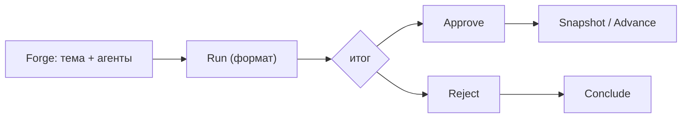

<!-- АВТОСГЕНЕРАЦИЯ: файл создан scripts/gen-wiki-docs.mjs из корпуса Wiki (src/components/WikiPanel). Не редактировать вручную. -->

# Панель: Флот (Fleet Console)

> Раздел: **Панели** · Статус: verified · Теги: панель, флот, fleet, агенты, инструкция

Источники: `src/i18n/translations/en/analytics.ts`, `src/components/FleetPanel/FleetPanel.tsx`, `src/components/FleetPanels/`

## Назначение

Управление парком агентов и сценариев: вкладки, запуски и форматы. Ключи `fleet.*`.

## Вкладки

crews, councils, graphs, persona, ops, interop, meta, trust, frontier, rivals.

## Работа

Кузница (forge) с созданием и запуском, прогон (run), продвижение (advance), завершение (conclude), approve / reject, установка, снапшоты и отметка прочитанного. Есть уведомления, peers и handoffs, предложения, пакеты и бандлы.

## Форматы и прогоны

Форматы дебатов: oxford, lincoln-douglas, popper, deliberative, munk, adversarial. Прогоны: dyad, chat, react, rag, codeagent, assistant, scaffold, askcode, deck, ticket, n8n, sim, mesa, gym, mission, poll, tot, reflexion. Плюс извлечение утверждений, циклы (loops) и очередь (queue), бенчмарк и heartbeat.

## Где менять

Компоненты: `FleetPanel`, `FleetPanels/*`, `CouncilPanel`. Персоны — [Панели: Персоны агентов](./panel-persona.md), агенты — [Агенты: устройство и управление](./agents.md).

---

## Связанные материалы

- [Агенты: устройство и управление](./agents.md)
- [Инструменты анализа дебатов](./panel-debate-toolkit.md)
- [Панели: Персоны агентов](./panel-persona.md)

[← Все материалы](./README.md)
