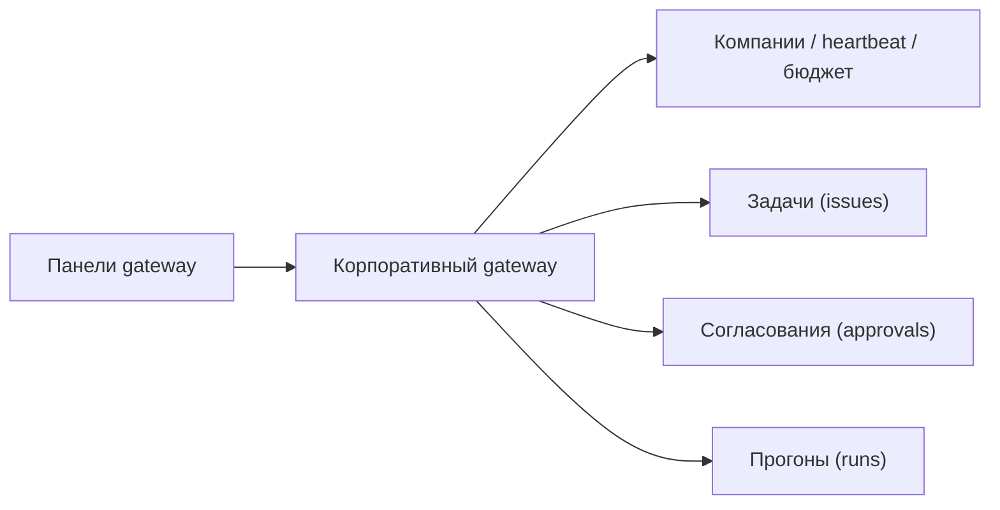

<!-- АВТОСГЕНЕРАЦИЯ: файл создан scripts/gen-wiki-docs.mjs из корпуса Wiki (src/components/WikiPanel). Не редактировать вручную. -->

# Панели: Компании и корпоративный gateway

> Раздел: **Панели** · Статус: verified · Теги: панель, gateway, компании, задачи, согласования, инструкция

Источники: `src/i18n/translations/en/nav.ts`, `src/components/IssuesPanel/`, `src/components/ApprovalsPanel/`, `src/components/ExportImportPanel/`, `src/components/AdaptersPanel.tsx`

## Назначение

Группа панелей, работающих через корпоративный gateway: компании, задачи, согласования, переносимость, адаптеры и прогоны. Ключи `issues.*`, `approvals.*`, `portability.*`, `adapters.*`, `companies.*`, `runs.*` (в неймспейсе nav).

Общий шаблон подключения у всех: URL, секрет и кнопка «подключить», плюс выбор компании.

## Компании

Обзор гейтвея: агенты, heartbeat, бюджет (или безлимит), локальный фолбэк, состояния загрузки и ошибок. Если гейтвея нет — честное сообщение.

## Задачи (issues)

Статусы, фильтры по компании / агенту / статусу, вход в задачу (checkout), перемещение по статусам, цитаты и отметка «взято в работу».

## Согласования (approvals)

Очередь pending / approved / rejected с комментариями; отправить, одобрить, отклонить.

## Переносимость

Экспорт и импорт, переименование, режимы пропуск / перезапись и отчёт по пропущенным и импортированным.

## Адаптеры

Конфиг в JSON, входные данные и execute, включение / выключение; при плохом JSON — понятная ошибка.

## Прогоны (runs)

Список прогонов с фильтрами и честным пустым состоянием.

## Где менять

Компоненты: `IssuesPanel`, `ApprovalsPanel`, `ExportImportPanel`, `Adapters`, `CompaniesPanel`, `RunsPanel`. Управление доступом — [Панель: Governance и безопасность](./panel-governance.md).

---

## Связанные материалы

- [Панель: Governance и безопасность](./panel-governance.md)
- [Агенты: устройство и управление](./agents.md)
- [Панель: Наблюдаемость (логи, трейсы, здоровье)](./panel-observability.md)
- [Зона 16: company gateway](./zone-16.md)

---

## Связи с кодом (авто)

Цепочка «панель → маршрут → компонент → тесты» собрана из реестра маршрутов.

- Панель `companies` → маршрут `/companies`
  - Компонент: `src/components/CompaniesPanel`
  - Тесты: `src/components/CompaniesPanel.test.tsx`
- Панель `issues` → маршрут `/issues`
  - Компонент: `src/components/IssuesPanel`
  - Тесты: — (рядом с компонентом не найдены)
- Панель `runs` → маршрут `/runs`
  - Компонент: `src/components/RunsPanel`
  - Тесты: `src/components/RunsPanel.test.tsx`
- Панель `adapters` → маршрут `/adapters`
  - Компонент: `src/components/AdaptersPanel`
  - Тесты: — (рядом с компонентом не найдены)
- Панель `portability` → маршрут `/portability`
  - Компонент: `src/components/PortabilityPanel`
  - Тесты: — (рядом с компонентом не найдены)
- Панель `approvals` → маршрут `/approvals`
  - Компонент: `src/components/ApprovalsPanel`
  - Тесты: — (рядом с компонентом не найдены)

См. также: [Каталог панелей](./panels-catalog.md) · [Каталог компонентов OS](./dev-component-catalog.md).

[← Все материалы](./README.md)
