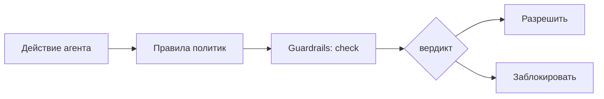

<!-- АВТОСГЕНЕРАЦИЯ: файл создан scripts/gen-wiki-docs.mjs из корпуса Wiki (src/components/WikiPanel). Не редактировать вручную. -->

# Панель: Governance и безопасность

> Раздел: **Панели** · Статус: needs-check · Теги: панель, governance, политики, guardrails, инструкция

Источники: `src/components/GovernancePanel/GovernancePanel.tsx`, `src/components/PolicyPanel/PolicyPanel.tsx`, `src/components/GuardrailsPanel/GuardrailsPanel.tsx`, `src/components/SopPanel/SopPanel.tsx`, `src/components/PromptSecurityPanel.tsx`

## Назначение

Контур управления и безопасности ОС: роли, правила политик, guardrails, SOP-процедуры и проверка промптов. Все панели этой группы используют неймспейс `governance.*`.

## Роли (Governance)

Назначение ролей: вводится `user_id`, выбирается роль, кнопка «назначить». Список назначенных и доступных ролей; при пустоте — честное «ролей нет».

> **Статус:** панель `GovernancePanel` — минимальная RBAC-реализация (observer/approver/director/auditor). Audit trail, HITL-очередь и policy-binding реализуются соседними панелями группы (Policy / Guardrails / SOP), а не самой этой панелью.

## Политики (Policy + редактор)

Правила доступа: создать/редактировать/удалить, включить/выключить, статистика по правилам, импорт и экспорт политик целиком. Редактор правила (`policy-editor`) — форма конкретной политики (условия и действия).

## Guardrails

Правила безопасности: у каждого — тип (kind), паттерны, проверка `check` с вердиктом; tripwire отмечает срабатывание. Добавление правила по имени + паттерну, проверка на пробном вводе, удаление.

## SOP (стандартные процедуры)

Определения процедур (definitions), запуски (runs), фазы (phases) и статус; запуск по цели (goal), лог выполнения. Есть сид-демо для быстрого старта.

## Промпт-безопасность (Prompt Security)

Скан промпта: оценка (score), порог блокировки (block_score), активные правила, история сканов. Включается/выключается.

## Опасные действия

Удаление и сброс правил/политик, очистка списка — подтверждаются диалогом.

## Где менять

Компоненты: `GovernancePanel`, `PolicyPanel`, `PolicyEditorPanel`, `GuardrailsPanel`, `SopPanel`, `PromptSecurityPanel`. Строки — неймспейс `governance.*` (en/ru паритет). Связи — в [Каталог компонентов OS](./dev-component-catalog.md).

---

## Связанные материалы

- [Агенты: устройство и управление](./agents.md)
- [Диагностика и известные проблемы](./diagnostics.md)
- [Провайдеры и маршрутизация](./providers.md)
- [Каталог компонентов OS](./dev-component-catalog.md)
- [Зона 6: governance и политики](./zone-6.md)

---

## Связи с кодом (авто)

Цепочка «панель → маршрут → компонент → тесты» собрана из реестра маршрутов.

- Панель `sop` → маршрут `/sop`
  - Компонент: `src/components/SopPanel/SopPanel`
  - Тесты: `src/components/SopPanel/SopPanel.test.tsx`
- Панель `policies` → маршрут `/policies`
  - Компонент: `src/components/PolicyPanel/PolicyPanel`
  - Тесты: `src/components/PolicyPanel/PolicyPanel.test.tsx`
- Панель `policy-editor` → маршрут `/policy-editor`
  - Компонент: `src/components/PolicyEditorPanel`
  - Тесты: — (рядом с компонентом не найдены)
- Панель `governance` → маршрут `/governance`
  - Компонент: `src/components/GovernancePanel/GovernancePanel`
  - Тесты: `src/components/GovernancePanel/GovernancePanel.test.tsx`
- Панель `guardrails` → маршрут `/guardrails`
  - Компонент: `src/components/GuardrailsPanel/GuardrailsPanel`
  - Тесты: `src/components/GuardrailsPanel/GuardrailsPanel.test.tsx`
- Панель `security` → маршрут `/security`
  - Компонент: `src/components/PromptSecurityPanel`
  - Тесты: — (рядом с компонентом не найдены)

См. также: [Каталог панелей](./panels-catalog.md) · [Каталог компонентов OS](./dev-component-catalog.md).

[← Все материалы](./README.md)
