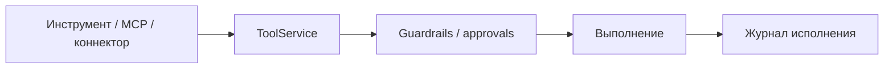

<!-- АВТОСГЕНЕРАЦИЯ: файл создан scripts/gen-wiki-docs.mjs из корпуса Wiki (src/components/WikiPanel). Не редактировать вручную. -->

# Панели: Интеграции (MCP, коннекторы, навыки, инструменты, вебхуки)

> Раздел: **Панели** · Статус: verified · Теги: панель, интеграции, mcp, коннекторы, навыки, инструменты, вебхуки, инструкция

Источники: `src/i18n/translations/en/integrations.ts`, `src/components/MCPPanel/MCPPanel.tsx`, `src/components/ConnectorsPanel/ConnectorsPanel.tsx`, `src/components/SkillsPanel/SkillsPanel.tsx`, `src/components/ToolsPanel/ToolsPanel.tsx`

## Назначение

Внешние и внутренние подключения ОС: MCP-серверы, коннекторы, навыки, инструменты, вебхуки и кэш. Строки — неймспейс `integrations.*` (секции mcp, connectors, skills, tools, webhooks, cache).

## MCP

Серверы MCP: список со статусом (connected/connecting/disconnected/error), добавление по имени и URL, проверка соединения и переподключение всех. Показываются инструменты и ресурсы сервера; если их нет — честное «нет».

## Коннекторы

Карточки подключений с типом и категорией: подключить/отключить, синхронизация сейчас, конфиг провайдера, deploy и отзыв. Есть симулированный режим и подтверждения удаления.

## Навыки (skills)

Список навыков: создать/редактировать/удалить, включить/выключить (active/inactive), импорт и экспорт. Есть хаб популярных навыков с установкой и разделением «установленные» / «доступные».

## Инструменты (tools)

Каталог инструментов с фильтром и поиском; карточка инструмента с вкладками sandbox, schema и security (секреты, сетевой доступ). Регистрация нового инструмента, экспорт/импорт, быстрый тест с выводом.

## Вебхуки

Добавление вебхука (URL, события, секрет), включение/пауза, ping и тестовая отправка с результатом, история последних срабатываний, удаление.

## Кэш

Настройки кэша: hit_rate, ключи, размер, TTL, максимальное число записей, персистентность и кэш по провайдеру, история инвалидаций, очистка. Есть отдельная панель Google-кэша.

## Где менять

Компоненты: `MCPPanel`, `ConnectorsPanel`, `SkillsPanel`, `ToolsPanel`, `WebhooksPanel`, `CachePanel`. Связи — в [Каталог компонентов OS](./dev-component-catalog.md).

---

## Связанные материалы

- [Провайдеры и маршрутизация](./providers.md)
- [Панель: Governance и безопасность](./panel-governance.md)
- [Каталог компонентов OS](./dev-component-catalog.md)
- [Зона 7: инструменты и MCP](./zone-7.md)

---

## Связи с кодом (авто)

Цепочка «панель → маршрут → компонент → тесты» собрана из реестра маршрутов.

- Панель `skills` → маршрут `/skills`
  - Компонент: `src/components/SkillsPanel/SkillsPanel`
  - Тесты: `src/components/SkillsPanel/SkillsPanel.test.tsx`
- Панель `google-cache` → маршрут `/google-cache`
  - Компонент: `src/components/GoogleCachePanel`
  - Тесты: — (рядом с компонентом не найдены)
- Панель `tools` → маршрут `/tools`
  - Компонент: `src/components/ToolsPanel/ToolsPanel`
  - Тесты: `src/components/ToolsPanel/ToolsPanel.test.tsx`
- Панель `connectors` → маршрут `/connectors`
  - Компонент: `src/components/ConnectorsPanel/ConnectorsPanel`
  - Тесты: `src/components/ConnectorsPanel/ConnectorsPanel.test.tsx`
- Панель `mcp` → маршрут `/mcp`
  - Компонент: `src/components/MCPPanel/MCPPanel`
  - Тесты: `src/components/MCPPanel/MCPPanel.test.tsx`
- Панель `cache` → маршрут `/cache`
  - Компонент: `src/components/CachePanel`
  - Тесты: — (рядом с компонентом не найдены)
- Панель `webhooks` → маршрут `/webhooks`
  - Компонент: `src/components/WebhooksPanel`
  - Тесты: — (рядом с компонентом не найдены)

См. также: [Каталог панелей](./panels-catalog.md) · [Каталог компонентов OS](./dev-component-catalog.md).

[← Все материалы](./README.md)
