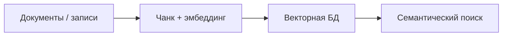

<!-- АВТОСГЕНЕРАЦИЯ: файл создан scripts/gen-wiki-docs.mjs из корпуса Wiki (src/components/WikiPanel). Не редактировать вручную. -->

# Панель: База знаний (RAG)

> Раздел: **Панели** · Статус: verified · Теги: панель, знания, RAG, поиск, инструкция

Источники: `src/components/KnowledgePanel/KnowledgePanel.tsx`, `src/i18n/translations/en/memory.ts`

## Назначение

База знаний для RAG: документы и записи, их индексация, семантический поиск и граф связей. Строки — ключи `knowledge.*` (лежат в неймспейсе memory).

## Записи и документы

Добавление знания, список записей со счётчиком, источник и важность у каждой; правка и удаление прямо из списка (инлайн-редактирование с сохранением/отменой).

## Индексация

Настройки разбивки: модель эмбеддингов, размер чанка, перекрытие (overlap) и векторная БД. Во время индексации показывается прогресс.

## Поиск

Семантический поиск с плейсхолдером и фильтром (все/по источнику). Пустые состояния честные: «нет записей» и «нет совпадений» различаются.

## Данные

Импорт и экспорт базы, синхронизация, анализ, очистка данных (с подтверждением). Ошибки удаления/обновления показываются, а не глотаются.

## Граф связей

Если у знания нет рёбер — выводится «связей нет», а не пустая панель.

## Где менять

Компонент: `src/components/KnowledgePanel/KnowledgePanel.tsx`. Обзор области памяти и RAG — [Знания и память](./memory.md).

---

## Связанные материалы

- [Знания и память](./memory.md)
- [Панель: Governance и безопасность](./panel-governance.md)
- [Каталог компонентов OS](./dev-component-catalog.md)
- [Зона 4: память и знания](./zone-4.md)

[← Все материалы](./README.md)
