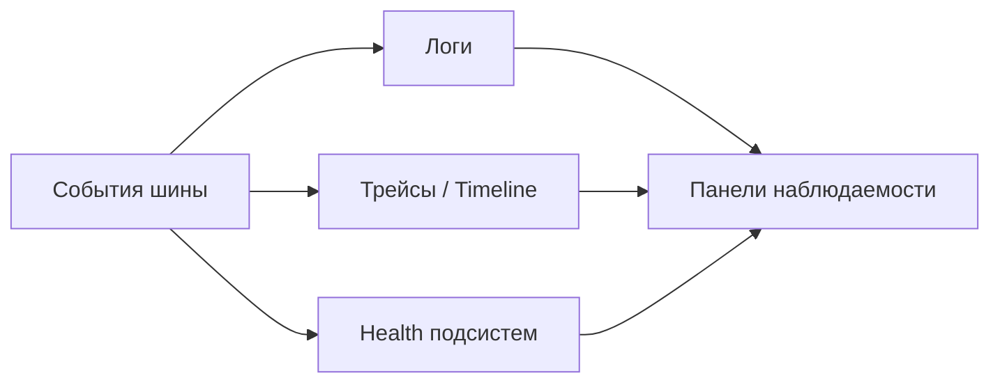

<!-- АВТОСГЕНЕРАЦИЯ: файл создан scripts/gen-wiki-docs.mjs из корпуса Wiki (src/components/WikiPanel). Не редактировать вручную. -->

# Панель: Наблюдаемость (логи, трейсы, здоровье)

> Раздел: **Панели** · Статус: verified · Теги: панель, логи, трейсы, health, инструкция

Источники: `src/i18n/translations/en/observability.ts`, `src/components/LogsPanel/LogsPanel.tsx`, `src/components/RouterTraceView/RouterTraceView.tsx`, `src/components/TracesPanel/TracesPanel.tsx`

## Назначение

Контур наблюдаемости: логи, трейсы, здоровье, трейс роутера, инспектор состояния, профилировщик и здоровье документации. Строки — ключи `logs.*`, `traces.*`, `health.*`, `router_trace.*`, `docs_health.*`, `performance_profiler.*`, `state_inspector.*` (в неймспейсе observability).

## Логи

Консоль логов с уровнями и фильтрами — первое место, куда смотреть при сбое.

## Трейсы

Список трейсов: спаны, длительности, ошибки. Версия `router-trace` показывает выбор провайдера и ключа, причины отказа и fallback.

## Здоровье

Здоровье подсистем и SLA: статусы, предупреждения, время обновления. Health-метрики питают и дашборд обзора.

## Инспектор состояния

Снимок состояния ядра/сторов для отладки (что реально лежит в памяти и БД).

## Профилировщик производительности

Замеры времени рендера и сервисов — где тормозит.

## Здоровье документации

Проверка документации и ссылок: что устарело или битое.

## Где менять

Компоненты: `LogsPanel`, `TracesPanel`, `RouterTraceView`, `HealthPanel`, `StateInspectorPanel`. Системная диагностика — [Диагностика и известные проблемы](./diagnostics.md), SRE-контур — [Панель: SRE-агент](./panel-sre.md).

---

## Связанные материалы

- [Диагностика и известные проблемы](./diagnostics.md)
- [Панель: SRE-агент](./panel-sre.md)
- [Каталог компонентов OS](./dev-component-catalog.md)
- [Зона 5: система и мониторинг](./zone-5.md)

[← Все материалы](./README.md)
