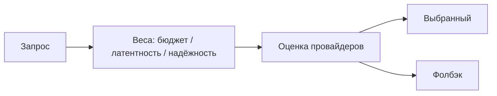

<!-- АВТОСГЕНЕРАЦИЯ: файл создан scripts/gen-wiki-docs.mjs из корпуса Wiki (src/components/WikiPanel). Не редактировать вручную. -->

# Панели: Умная маршрутизация

> Раздел: **Панели** · Статус: verified · Теги: панель, маршрутизация, routing, веса, инструкция

Источники: `src/i18n/translations/en/providers.ts`, `src/components/RoutingIntelligence/RoutingIntelligence`

## Назначение

Маршрутизация запросов к провайдерам с настраиваемыми весами. Ключи `routing.*`.

## Веса

Вес бюджета, латентности и надёжности; пользовательский вес, пресеты весов и эффективные веса. Сохранение, сброс, импорт и экспорт конфигурации.

## Вкладки

Дополнительно (advanced), дерево решений (decision_tree) и история. Кнопка объяснения (explain) показывает, почему выбран маршрут.

## Детали решения

Таблица провайдеров: стоимость, надёжность, оценка, TPS, TTFT; плюс выбранный и фолбэк, оценка стоимости.

## Где менять

Компоненты: `RoutingIntelligence` и `SmartRoutingPanel`. Провайдеры и ключи — [Панель: Провайдеры и ключи](./panel-providers.md).

---

## Связанные материалы

- [Панель: Провайдеры и ключи](./panel-providers.md)
- [Панель: Настройки](./panel-settings.md)
- [Панель: Бюджет и затраты](./panel-budget.md)
- [Зона 8: роутер и маршрутизация](./zone-8.md)

[← Все материалы](./README.md)
