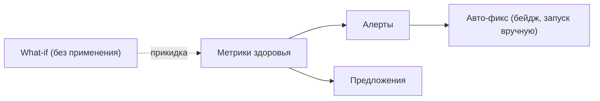

<!-- АВТОСГЕНЕРАЦИЯ: файл создан scripts/gen-wiki-docs.mjs из корпуса Wiki (src/components/WikiPanel). Не редактировать вручную. -->

# Панель: SRE-агент

> Раздел: **Панели** · Статус: verified · Теги: панель, SRE, метрики, алерты, инструкция

Источники: `src/components/SREAgentPanel/SREAgentPanel.tsx`, `src/i18n/translations/en/observability.ts`

## Назначение

SRE-контур: алерты, метрики здоровья, предложения по авто-исправлению и прогон сценариев «что если». Строки — ключи `sre.*` (лежат в неймспейсе observability).

## Алерты

Список алертов с бейджем. Авто-фикс помечается бейджем; его можно исполнить вручную. Пустое состояние — честное «алертов нет».

## Метрики и кэш

Метрики здоровья и режим кэша, который экономит задержку и стоимость (индикаторы экономии латентности и денег).

## Предложения (suggestions)

Список улучшений; если пусто — так и написано, без выдуманных советов.

## What-if

Прогон сценариев «что если» без применения — прикидка эффекта заранее.

## Где менять

Компонент: `src/components/SREAgentPanel/SREAgentPanel.tsx`. Системная диагностика — [Диагностика и известные проблемы](./diagnostics.md).

---

## Связанные материалы

- [Диагностика и известные проблемы](./diagnostics.md)
- [След исполнения: журнал, раны, зомби](./execution-trail.md)
- [Каталог компонентов OS](./dev-component-catalog.md)
- [Зона 18: SRE и пулы](./zone-18.md)

[← Все материалы](./README.md)
