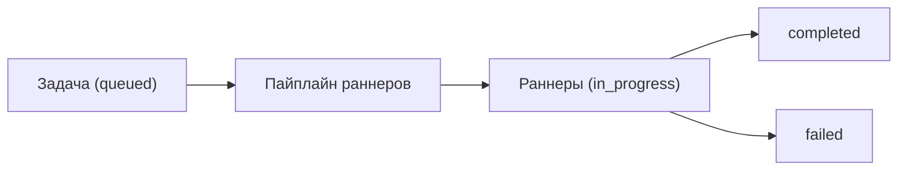

<!-- АВТОСГЕНЕРАЦИЯ: файл создан scripts/gen-wiki-docs.mjs из корпуса Wiki (src/components/WikiPanel). Не редактировать вручную. -->

# Панель: Задачи и пайплайны

> Раздел: **Панели** · Статус: verified · Теги: панель, задачи, пайплайны, инструкция

Источники: `src/i18n/translations/en/workspace.ts`, `src/components/TasksPanel/TasksPanel.tsx`

## Назначение

Задачи и их выполнение через пайплайны раннеров. Строки — ключи `tasks.*`.

## Задачи

Создание задачи (название, описание, приоритет, срок), редактирование и удаление. Статусы: queued, in_progress, completed, failed. Кнопка очистки завершённых.

## Пайплайны

Строка активных задач: активный пайплайн, активные раннеры, статусы и исключения. Есть сид-демо для быстрого старта.

## Фильтры и состояния

Поиск, фильтр по статусу, честные пустые состояния («нет задач» / «нет совпадений»). Ошибки загрузки и обновления показываются.

## Где менять

Компонент: `TasksPanel`. Журнал исполнения — [След исполнения: журнал, раны, зомби](./execution-trail.md).

---

## Связанные материалы

- [След исполнения: журнал, раны, зомби](./execution-trail.md)
- [Панель: Задачи агентов](./panel-agent-tasks.md)
- [Каталог компонентов OS](./dev-component-catalog.md)
- [Зона 3: агенты и задачи](./zone-3.md)

---

## Связи с кодом (авто)

Цепочка «панель → маршрут → компонент → тесты» собрана из реестра маршрутов.

- Панель `tasks` → маршрут `/tasks`
  - Компонент: `src/components/TasksPanel/TasksPanel`
  - Тесты: `src/components/TasksPanel/TasksPanel.test.tsx`

См. также: [Каталог панелей](./panels-catalog.md) · [Каталог компонентов OS](./dev-component-catalog.md).

[← Все материалы](./README.md)
