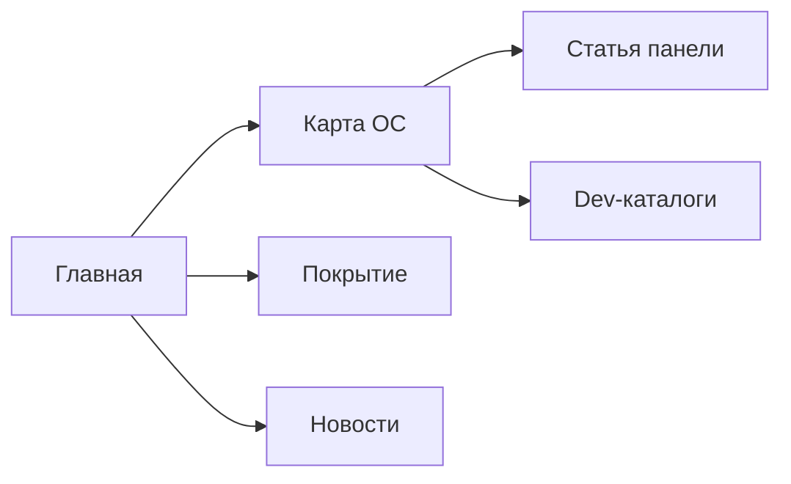

<!-- АВТОСГЕНЕРАЦИЯ: файл создан scripts/gen-wiki-docs.mjs из корпуса Wiki (src/components/WikiPanel). Не редактировать вручную. -->

# Панель: Wiki

> Раздел: **Панели** · Статус: verified · Теги: панель, wiki, документация, инструкция

Источники: `src/components/WikiPanel/WikiPanel.tsx`, `src/components/WikiPanel/wiki-articles.ts`

## Назначение

Сама эта документация. Wiki — портал о системе в системе: материалы, карта панелей, покрытие и раздел для разработчиков.

## Разделы

Слева — секции (руководство, панели, агенты, дебаты, память, провайдеры, диагностика, история, архитектура, заметки, разработчикам). Сверху — поиск и крошки. Есть «Карта ОС», которая ведёт от панели к связанной статье, и «Покрытие», которое показывает, где материал есть, а где заглушка.

## Для разработчиков

8 авто-каталогов (компоненты, события, сервисы-DI, контракты, сторы, локали, скрипты, тесты) и набор руководств. Подробнее — [Разработчикам: структура и ворота](./for-developers.md).

## Где менять

Компонент: `src/components/WikiPanel/WikiPanel.tsx`; статьи — в `wiki-*.ts`. См. [Разработчикам: обзор и слои](./dev-overview.md).

---

## Связанные материалы

- [Разработчикам: структура и ворота](./for-developers.md)
- [Разработчикам: обзор и слои](./dev-overview.md)
- [Каталог компонентов OS](./dev-component-catalog.md)

---

## Связи с кодом (авто)

Цепочка «панель → маршрут → компонент → тесты» собрана из реестра маршрутов.

- Панель `wiki` → маршрут `/wiki`
  - Компонент: `src/components/WikiPanel/WikiPanel`
  - Тесты: `src/components/WikiPanel/WikiPanel.test.tsx`

См. также: [Каталог панелей](./panels-catalog.md) · [Каталог компонентов OS](./dev-component-catalog.md).

[← Все материалы](./README.md)
