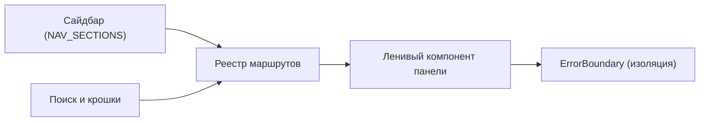

<!-- АВТОСГЕНЕРАЦИЯ: файл создан scripts/gen-wiki-docs.mjs из корпуса Wiki (src/components/WikiPanel). Не редактировать вручную. -->

# Как пользоваться панелями

> Раздел: **Руководство** · Статус: verified · Теги: инструкция, навигация

Источники: `src/route-registry-core.ts`, `src/route-registry-content.ts`, `src/routes.tsx`

## Навигация

Слева — сайдбар с секциями, сверху — поиск и крошки. Каждый пункт меню — это запись в реестре маршрутов: один id открывает один ленивый компонент панели.

## Типовой сценарий

1. Открой [Панель: Провайдеры и ключи](./panel-providers.md) и добавь ключ.
2. Проверь [Панель: Чат](./panel-chat.md) — отправь сообщение.
3. Задачи агентам — через [Панель: Задачи агентов](./panel-agent-tasks.md).
4. Спорные вопросы — в [Дебаты: режимы и механика](./debates.md).

## Если панель не открывается

Панель обёрнута в ErrorBoundary: ошибка внутри гасит только её, остальная ОС жива. Экспериментальные пункты помечены бейджем Beta.

---

## Связанные материалы

- [Панель: Чат](./panel-chat.md)
- [Панель: Провайдеры и ключи](./panel-providers.md)
- [Панель: Задачи агентов](./panel-agent-tasks.md)

[← Все материалы](./README.md)
