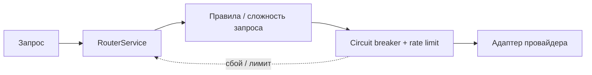

<!-- АВТОСГЕНЕРАЦИЯ: файл создан scripts/gen-wiki-docs.mjs из корпуса Wiki (src/components/WikiPanel). Не редактировать вручную. -->

# Провайдеры и маршрутизация

> Раздел: **Провайдеры** · Статус: verified · Теги: модели, ключи, роутер

Источники: `src/kernel/services/provider-router.ts`, `src/llm/anthropic/anthropic-adapter.ts`

## Как устроено

RouterService — единая точка выбора провайдера: семантические правила, сложность запроса, fallback-цепочки, circuit breaker и rate limit поверх каждого адаптера. Подключены Gemini, OpenRouter, Groq, NVIDIA, OpenAI-совместимые, Anthropic (SSE + vision, computer-use контур).

## Ключи и бюджеты

Ключи — в локальном хранилище, использование пишется на ключ (статистика). Бюджеты режут траты; unbounded-провайдеры по умолчанию разрешены с предупреждением — следи за этим.

История разработки этой области — [Зона 1: панели провайдеров и чата](./zone-1.md) и [Зона 8: роутер и маршрутизация](./zone-8.md).

---

## Связанные материалы

- [Панель: Провайдеры и ключи](./panel-providers.md)
- [Панель: Чат](./panel-chat.md)
- [Диагностика и известные проблемы](./diagnostics.md)

[← Все материалы](./README.md)
