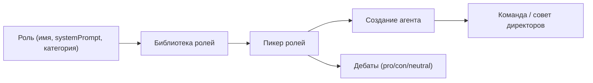

<!-- АВТОСГЕНЕРАЦИЯ: файл создан scripts/gen-wiki-docs.mjs из корпуса Wiki (src/components/WikiPanel). Не редактировать вручную. -->

# Роли агентов: как настраивать и использовать

> Раздел: **Агенты** · Статус: documented · Теги: роли, агенты, персона, команды, дебаты

Источники: `docs/wiki/comp-agents-roles-skills.md`, `src/kernel/services/role-team-service.ts`, `src/kernel/services/unified-role-service.ts`, `src/kernel/contracts/debate-types.ts`

## Зачем роли

В SuperAgents OS агент — это не просто промпт. Агент собирается из **роли**: имени, описания, системного промпта, категории, температуры и набора инструментов. Роль задаёт «кто ты», а модель и ключ — «чем ты думаешь». Это превращает одного и того же LLM в разных специалистов: химика, юриста, ревизора или аналитика.

## Из чего состоит роль

| Поле | Что делает | Откуда |
| --- | --- | --- |
| `name` | Отображаемое имя роли | Ролевая библиотека |
| `description` | Короткое «для чего» | Пикер ролей |
| `systemPrompt` | Системный промпт (RU/EN) | Семя роли |
| `category` | Группировка (аналитика, генерация…) | Фильтры |
| температура | Степень креативности | Карточка роли |
| ключ/модель | Фиксированный провайдер | T1 ротация |

## Как создать роль

1. Открой панель «Роли» → «Новая роль».
2. Заполни имя, описание и systemPrompt (можно на русском).
3. Выбери категорию и температуру.
4. Сохрани — роль появится в библиотеке и пикере.
5. Используй её при создании агента, команды или в дебатах.

## Примеры ролей

### Совет учёных (RU)

Хороший способ проверить систему — собрать «совет учёных», где каждая роль — отдельный специалист:

- **Химик** — оценивает реакции и материалы, методы синтеза.
- **Математик** — проверяет расчёты, выкладки, логику формул.
- **Историк** — ищет прецеденты и датировки, отличает факт от интерпретации.
- **Экономист** — считает стоимость, окупаемость, риски бюджета.

Каждая роль — отдельное семя с `systemPrompt` на русском. Они устанавливаются в один клик и сразу доступны для команд и дебатов.

### Дебаты: pro / con / neutral

Роль задаёт позицию в дебатах. В `DebateRole` есть **pro**, **con** и **neutral**:

- Pro-роль аргументирует «за».
- Con — «против».
- Neutral — беспристрастный анализ обеих сторон.

В авто-дебатах участники формируются из активных ключей, каждой роли даётся позиция, а модели разных семейств автоматически разводятся, чтобы не было эхо-камеры.

### Совет директоров

Команда из четырёх ролей может работать как «совет директоров»:

- **Генеральный директор** — стратегия и приоритеты.
- **Финансовый директор** — бюджет и окупаемость.
- **Технический директор** — реализуемость.
- **Риск-менеджер** — угрозы.

Каждый отвечает за свою перспективу, а результат синтезируется.

## Где это в коде

- `src/kernel/services/role-team-service.ts` — подбор провайдера и ключа для роли (`pickProviderAndKey`).
- `src/kernel/services/unified-role-service.ts` — единый сервис ролей.
- `src/kernel/contracts/debate-types.ts` — `DebateRole`: pro/con/neutral.
- [Компонент: агенты, роли и навыки](./comp-agents-roles-skills.md) — компонент «агенты, роли, навыки».

## Практические советы

- Пиши системные промпты на том языке, на котором должна говорить роль.
- Для «учёного совета» давай каждой роли узкую специализацию — дебаты получаются содержательнее.
- Привязывай важные роли к фиксированным ключам/моделям, если нужно постоянство.
- Не перегружай роль инструментами — давай только те, что реально нужны.

## Схема потока

---

## Связанные материалы

- [Агенты: устройство и управление](./agents.md)
- [Панель: Конструктор агентов](./panel-builder.md)
- [Панель: Роли и консорциумы](./panel-roles.md)
- [Дебаты: режимы и механика](./debates.md)

[← Все материалы](./README.md)
