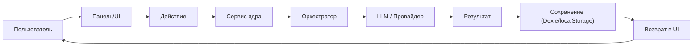

<!-- АВТОСГЕНЕРАЦИЯ: файл создан scripts/gen-wiki-docs.mjs из корпуса Wiki (src/components/WikiPanel). Не редактировать вручную. -->

# Карта сценариев: проверенные пути выполнения

> Раздел: **Руководство** · Статус: documented · Теги: руководство, аудит, сценарии, проверка

Источники: `src/kernel/services/debate-runtime/debate-sync-manager.ts`, `src/kernel/services/debate-runtime/debate-engine.ts`, `src/kernel/services/debate-runtime/debate-conclusion-engine.ts`, `src/stores/chat/chat-send-message.ts`, `src/components/SimulationPanel/SimulationPanel.tsx`

## Что это

«Карта сценариев» — это **проверенная карта** того, как реальные пользовательские задачи проходят через SuperAgents OS. В отличие от статьи «Путь идеи», здесь описаны **фактические цепочки выполнения с опорой на код и статусы проверки**: что реально работает, что работает с ограничениями, а что не проверено.

## Метки проверки

| Метка | Значение |
|---|---|
| **[V]** | Реализация подтверждена чтением кода |
| **[T]** | Есть тест, результат известен |
| **[R]** | Сценарий фактически выполнен |
| **[SA]** | Статический анализ (проблема/особенность в коде) |
| **[H]** | Гипотеза, требует проверки |
| **[NV]** | Не проверено в текущих условиях |

> ⚠️ Аудит **не полон**: проверены ключевые пути, остальные — в разделе «Открытые вопросы». Не называй непроверенную часть «зелёной».

---

## Общая карта

---

## Каталог сценариев

| # | Сценарий | Статус | Краткая цепочка |
|---|---|---|---|
| 1 | Дебаты: идея → вердикт | [V] | UI → startDebate → preflight → resolveStrategyConfig → createSession → startSession → pipeline → verdict → saveVerdict |
| 2 | Чат → ответ с контекстом из памяти | [V] | Chat → ragOnChat → memoryService.searchAdvanced → [RECALLED CONTEXT] → LLM → ответ |
| 3 | Симуляция: создать мир с агентами | [V] | SimulationPanel → worldStateService.create → engine → tick |
| 4 | Дебаты: восстановление после reload | [SA] | engine._restoreOrphanedSessions + restoreSession (см. аудит) |
| 5 | Агент: создать и выполнить задачу | [SA] | AgentFactory.create → resolve → execute |
| 6 | RAG: загрузить источник и найти | [NV] | требует ручной проверки |
| 7 | Wiki-Brain интеграция | [NV] | нет подтверждённой связки |

---

## Подробные цепочки

### 1. Дебаты (идея → вердикт) [V]

Пользователь → **DebatePanel** → `debateService.startDebate(topic, participants, strategy)`
→ **DebateSyncManager.startDebate**:
- preflight (≥2 участника, ≥1 ключ, debate-провайдер);
- `resolveStrategyConfig` (strategy → топология + quality);
- `_initEngineSession` → `DebateEngine.createSession`.

Затем **DebateEngine.startSession** (distributed-lock → `buildPipeline().run()`):
- pipeline: preflight → setupExecutor → roundLoop → consensusAndFinalize;
- вердикт: `validateAndSaveVerdict` → `store.saveVerdict` (Dexie `debateVerdicts`).

Возврат в UI через события `DEBATE_UPDATED`, `DEBATE_VERDICT_GENERATED`.

**Граница автоматизации:** всё от клика до вердикта автоматизировано; выбор стратегии и участников — ручной.

### 2. Чат с контекстом из памяти [V]

Пользователь → **Chat** → **chat-send-message**:
- если `CONFIG.featureFlags.memory.ragOnChat` — `memoryService.searchAdvanced` (scoped по сессии, при <2 — глобальный поиск);
- формируется `[RECALLED CONTEXT]`-префикс;
- при `autoStore` — сообщение сохраняется в память.

**Ограничение:** контекст из памяти — только текст; нет гарантий релевантности без оценки качества.

### 3. Симуляция [V]

**SimulationPanel** → `worldStateService.create({name, rooms, agentIds})` → **SimulationEngineService.step/run** → мир + tick.

**Ограничение:** если агенты не созданы — работает `StubActPort` (демо, без ИИ). Выбор агентов — через пикер (добавлен).

---

## Карта передачи данных

| Переход | Что передаётся | Кто пишет | Кто читает | Источник истины | Статус |
|---|---|---|---|---|---|
| UI → SyncManager | topic, participants, strategy | UI | SyncManager | — | [V] |
| SyncManager → Engine | topology, config | SyncManager | Engine | — | [V] |
| Engine → Pipeline | события раунда | Orchestrator | Pipeline | — | [V] |
| Pipeline → Verdict | claims | Pipeline | ConclusionEngine | — | [V] |
| Verdict → Dexie | verdict record | saveVerdict | — | debateVerdicts | [V] |
| Chat → Memory | текст | chat-send-message | memoryService | memories | [V] |
| Simulation → World | agentIds | SimulationPanel | worldStateService | sim:world:* | [V] |

---

## Диагностика разрывов

| Симптом | Где искать | Как проверить | Возможная причина | Следующий шаг |
|---|---|---|---|---|
| Дебат «завис» | pipeline-builder | логи событий | ошибка провайдера | см. лог / retry |
| Нет вердикта | conclusion-engine | `debateVerdicts` | LLM-verdict не прошёл | fallback heuristic |
| Чат не подтянул память | chat-send-message | флаг `ragOnChat` | флаг выключен | включить |
| Пустая симуляция | SimulationPanel | show | нет агентов | Demo seed |

---

## Известные ограничения

- **[NV]** Аудит не полон; метки проставлены только по проверенным цепочкам.
- **[SA]** Восстановление сессий и выполнение агента требуют более глубокой проверки (см. аудиты `docs/audits/*`).
- **[SA]** Wiki-Brain / Junction / Forum-интеграции не подтверждены как единый поток.

---

## Маршруты (инструкции)

1. **Проверить идею:** Дебаты → стратегия → вердикт.
2. **Собрать справку:** Чат (с флагом памяти) → «найди по источнику».
3. **Смоделировать:** Симуляция → создать мир → tick.

---

## Дата и границы аудита

- Дата проверки: 2026-10.
- Исследованы: дебаты (sync-manager/engine/conclusion), чат→память, симуляция.
- Запущены: чтение кода; **полные тесты не запускались** (ограничения окружения).
- Остались непроверенными: RAG-загрузка, Wiki-Brain, восстановление всех типов сессий.

---

## Связанные материалы

- [Путь идеи: от мысли до результата](./idea-path.md)
- [Возможности ОС](./capabilities.md)
- [Дебаты: режимы и механика](./debates.md)
- [Знания и память](./memory.md)
- [Агенты: устройство и управление](./agents.md)

[← Все материалы](./README.md)
